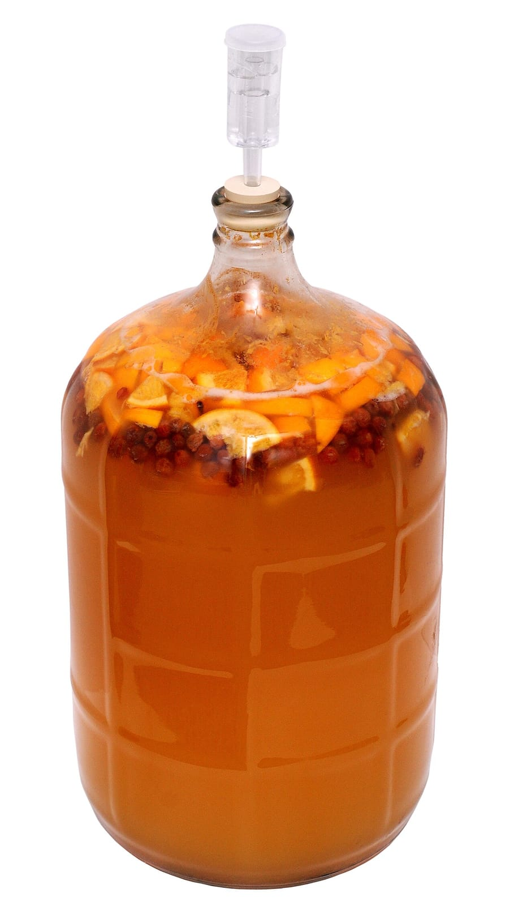
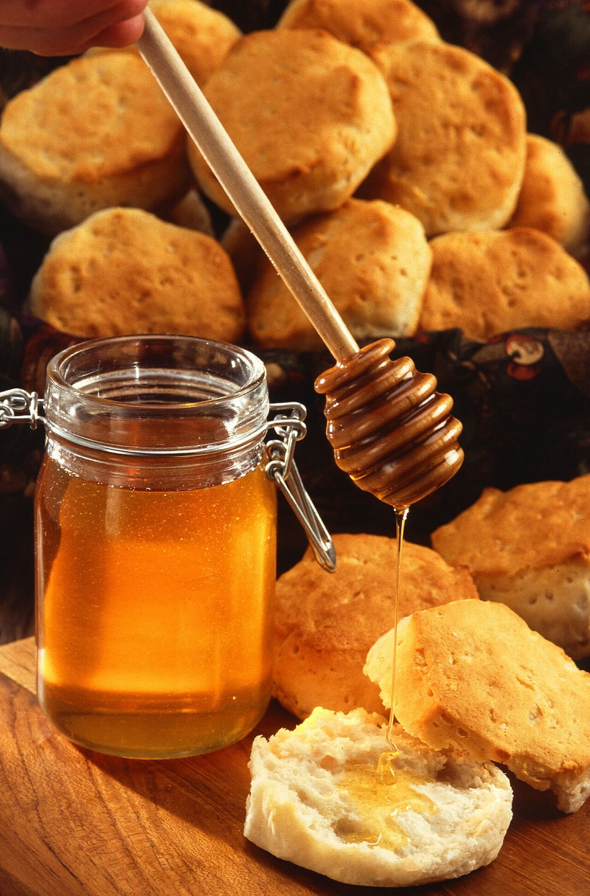

# 蜂蜜酒

蜂蜜酒（mead，也称蜜酒）是以[蜂蜜](ref:honey)和水为糖源、经酵母[发酵](ref:fermentation)得到的酒精饮料。它的原料只有蜂蜜、水与酵母时称为传统蜂蜜酒；加入水果、香料、果汁或焦化蜂蜜后，会形成一整个风格家族。蜂蜜酒不属于啤酒，也不完全等同于[葡萄酒](ref:wine)，但它和[苹果酒](ref:cider)一样，属于以农产品发酵而来的佐餐或休闲酒。

图：蜂蜜酒。图片：Evan-Amos，CC0，via Wikimedia Commons（[原图页面](https://commons.wikimedia.org/wiki/File:Honey-Fruit-Mead-Brewing.jpg)）。

## 定义边界：什么算蜂蜜酒

蜂蜜酒的核心是“蜂蜜提供主要可发酵糖”。传统蜂蜜酒只用水与蜂蜜；加入蜂蜜以外的糖源（果汁、麦芽、葡萄汁）仍然可以叫蜂蜜酒，但通常会有更具体的子名称。酒精度通常落在 3% 至 18% 之间，具体取决于蜂蜜用量与发酵程度。

不算蜂蜜酒的产品包括：以白酒、伏特加或其他中性酒精为基酒、只添加蜂蜜调味的“蜂蜜利口酒”；以麦芽为主、蜂蜜为辅的蜂蜜啤酒；以及只含蜂蜜风味糖浆的无酒精饮料。它们的原料结构与发酵逻辑不同，酒标上的类别词也不同。

## 蜂蜜的组成与发酵难点

蜂蜜大约含 80% 糖（以果糖与葡萄糖为主）、约 17% 至 18% 的水，以及少量有机酸、矿物质与芳香物质。它的糖浓度极高，直接发酵会因渗透压抑制酵母；因此必须先加水稀释到适合发酵的糖度。稀释比例同时决定潜在酒精度与酒体。

蜂蜜的第二个难点是氮源不足。葡萄汁含有较多可同化氮，蜂蜜几乎没有，酵母在发酵中后期容易因缺氮而停滞或产生硫味。生产者通常分次添加酵母营养盐，并控制温度，避免发酵过热产生溶剂味。蜂蜜的酸度也偏低，成品若不加酸或不用果汁补充，容易显得平淡。

## 配方与糖度估算

一个常用的起点是每 4 升醪液使用约 1 千克蜂蜜。蜂蜜的糖度约为 80%，即约 800 克糖；换算到 4 升，糖浓度约为每升 200 克，潜在酒精度约为 12%。这个比例不是法规，而是便于计算的基准，实际配方会按目标酒精度、甜度与蜂蜜种类调整。

蜂蜜种类会直接改变香气：洋槐蜂蜜清淡花香，椴树蜂蜜浓郁，荞麦蜂蜜带麦芽与树脂感，百花蜂蜜则更复杂。深色蜂蜜通常矿物质与风味更重，发酵后可能留下明显的焦糖或香料感；浅色蜂蜜更适合突出果香与花香的风格。

## 酵母与发酵管理

酵母菌株的选择决定发酵速度、酒精耐受度与香气走向。葡萄酒酵母适合干型、清爽的风格；香槟酵母耐高酒精度；某些专用蜂蜜酒酵母则强调酯类与花香。发酵温度通常控制在 15 至 25 摄氏度之间，温度过高会损失细腻香气。

营养管理是蜂蜜酒成败的关键。分次添加营养盐、在发酵前充分充氧、避免一次性加入过多糖，都能降低停滞风险。发酵结束后，生产者可以选择澄清、过滤、冷稳定或陈年；是否进行二次发酵、是否加糖、是否使用橡木桶，都会改变最终风格。

## 风格家族

传统蜂蜜酒只用水与蜂蜜；加入水果的 melomel 可以是莓果、核果或柑橘；加入香料的 metheglin 常用肉桂、姜、丁香；加入苹果汁的 cyser 接近苹果酒与蜂蜜酒的交叉；加入葡萄汁的 pyment 则与葡萄酒共享果香与酸度；把蜂蜜先焦化再发酵的 bochet，会带来焦糖、太妃糖与轻微苦味。

加入麦芽的 braggot 处在蜂蜜酒与[啤酒](ref:beer)之间，麦芽提供谷物与苦味，蜂蜜提供糖与花香。它提醒我们：风格名称描述的是配方结构，不是单一原料。不同地区对这些词的使用并不统一，酒标上的酒精度与残糖比名称更可靠。

## 强度与甜度

按强度，蜂蜜酒常被分为低酒精的 hydromel、标准强度的 mead 与较高酒精的 sack。hydromel 通常低于 7%，标准型多在 7% 至 14%，sack 可以超过 14%。这些是行业惯用区间，不是统一法规。

甜度由[残糖](ref:residual-sugar)决定：发酵彻底的是干型，提前终止发酵或后加蜂蜜的是甜型。甜型蜂蜜酒需要足够的[酸度](ref:acidity)与苦味支撑，否则容易显得腻。干型蜂蜜酒则更考验蜂蜜本身的香气与发酵的干净度。

## 法规与分类

在中国，GB/T 17204-2021《饮料酒术语和分类》为饮料酒提供术语与分类框架，以蜂蜜为原料的发酵酒可据此归入发酵酒大类；具体标签与酒精度要求还要看产品执行标准与食品安全法规。在美国，蜂蜜酒通常按葡萄酒类别申报与管理，而不是按啤酒类别。

这意味着同一瓶蜂蜜酒在不同市场可能适用不同的标签、税率与酒精度上限。进口产品的中文背标应给出真实类别、原料与酒精度，而不是只写“蜂蜜酒”三个字。关于[酒精度](ref:abv)的标注方式，可另见术语条目。

## 陈年与氧化

蜂蜜酒可以像葡萄酒一样陈年，但并非所有风格都适合。高酒精度、残糖适中、酸度足够的蜂蜜酒在瓶中会发展出蜂蜜、干果与香料气息；低酒精度、低酸度的产品则容易氧化出纸板味。使用橡木桶会带来香草与单宁，但也可能压过细腻的花香。

陈年过程中，蜂蜜的挥发性花香会逐渐减弱，取而代之的是更深的蜜蜡、茶与干果调。生产者有时会保留一部分新鲜批次用于调配，以维持品牌风格的一致性。

## 常见误解与争议

第一，认为蜂蜜酒一定是甜的。第二，认为蜂蜜酒是“蜂蜜兑酒精”。第三，把蜂蜜利口酒当作蜂蜜酒。第四，认为蜂蜜酒越陈越好。第五，把 braggot 当作纯蜂蜜酒。第六，认为所有蜂蜜都适合发酵，实际上高矿物质或强风味的蜂蜜需要更谨慎的配方。

争议主要集中在两个方面：一是“蜂蜜酒”是否应限定为 100% 蜂蜜糖源，二是工业化产品与传统手工产品的标签透明度。前者影响法规分类，后者影响消费者预期。

## 怎么喝

干型蜂蜜酒适合冷藏后饮用，可搭配奶酪、烤禽与香料菜；甜型适合甜点或少量纯饮。冬季加热并加入香料的 mulled mead 是常见喝法，但加热会挥发香气，不宜反复加热。蜂蜜酒也可以作为调酒配料，但它的甜度与蜂蜜香气很容易压过其他材料。

饮用温度通常低于室温、高于冰镇：过冷会封闭花香，过热会突出酒精。开瓶后应冷藏并尽快饮用，尤其是低酒精度、低酸度的产品。

对照阅读：[葡萄酒](ref:wine)、[酒精度（ABV）](ref:abv)。

## 相关图像

图：蜂蜜。图片：Scott Bauer, USDA ARS，Public domain，via Wikimedia Commons（[原图页面](https://commons.wikimedia.org/wiki/File:Runny_hunny.jpg)）。关联图像：蜂蜜酒。
