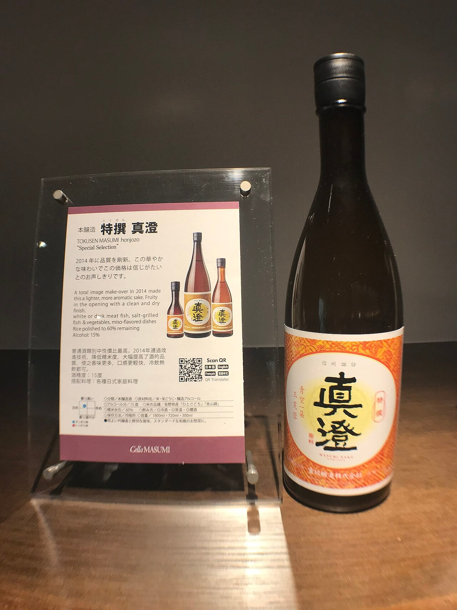
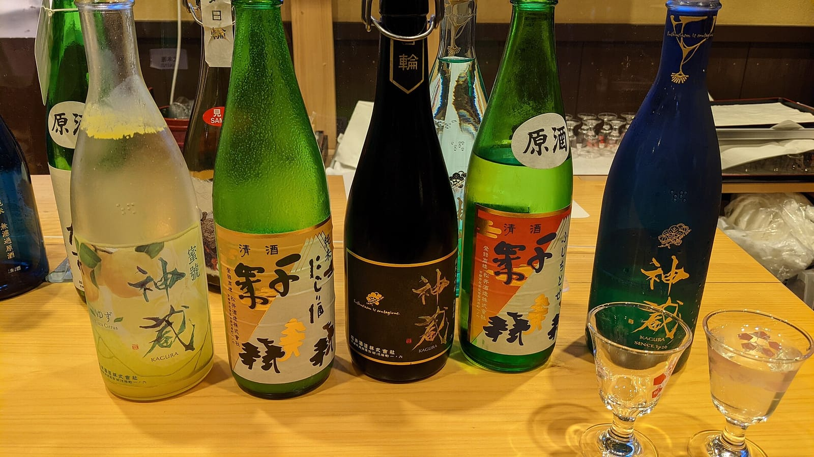

# 本酿造

本酿造是[清酒](ref:sake)八个特定名称之一，常被一句“加了酒精”草草概括。这句话只说对了一半：它确实允许添加酿造酒精，但添加量有法定上限，精米步合与麹米比例也有门槛。把这三个条件放在一起看，本酿造才是一个完整的类别，而不是“纯米酒的兑水版”。

图：本酿造“特撰 真澄”的酒瓶与店内说明牌；这款酒的精米步合为 60%，酒精度 15 度。图片：At1973，CC BY-SA 4.0，via [原图页面](https://commons.wikimedia.org/wiki/File:TOKUSEN_Masumi_honjozo_%22Special_Selection%22.jpg)。

> **先给结论**
> **一句话：** 这页判断本酿造的风味位置，以及怎么选、怎么喝。
>
> - **适合谁：** 正在比较本酿造与其他风格、准备购买或点单的人。
> - **不适合谁：** 只想要“哪个最好”的排名、不接受口味差异的人。
> - **先看这两点：**
>   - 精米步合是白米重量对玄米重量的比例，不是“去掉多少”的比例。
>   - 本酿造适合冷饮，也适合温饮。

## 本酿造在清酒分类中的位置

日本清酒的特定名称按原料与工艺分成八类：吟酿、大吟酿、纯米、纯米吟酿、纯米大吟酿、特别纯米、本酿造、特别本酿造。前五类以“是否添加酿造酒精”和“精米步合”交叉划分，后三类则是在基本类别上再加“特别”条件。本酿造处在“允许添加酒精、但不追求吟酿级精米”的位置。

这个位置决定了它的市场角色。吟酿类追求低温慢发酵带来的花果香，成本高；纯米酒强调米与水的完整表达，风味更饱满；本酿造则用少量酒精把酒体收紧，做出干净、利落、适合日常配餐的风格。三者是并列的风格路线，不是从低到高的阶梯。

## 法定三件套：精米步合、麹米、酒精

第一件是[精米步合](ref:polishing-ratio)。本酿造的上限为 70%，意思是把玄米外层磨去至少 30%，留下不超过 70% 的白米。数字越小，磨得越深，成本越高。大吟酿的上限是 50%，吟酿与纯米吟酿是 60%，本酿造与纯米酒的旧规曾同为 70%，但纯米酒的 70% 要求在 2004 年修订时被取消，本酿造仍保留 70% 上限。

第二件是麹米比例。特定名称清酒要求麹米占白米重量的 15% 以上。麹米是已经长满麹菌、能够把淀粉糖化的白米；比例过低，糖化动力不足，发酵容易失衡。这条规则对本酿造同样适用，常被忽略。

第三件是酿造酒精上限。本酿造允许添加酿造酒精，但添加量不得超过白米重量的 10%。酿造酒精是从淀粉质或含糖质原料发酵、蒸馏得到的高纯度酒精，不是工业酒精，也不是任意酒类。标签上的“酿造酒精”四个字，对应的是一条有明确数字的法规边界。

## 精米步合怎么读

精米步合是白米重量对玄米重量的比例，不是“去掉多少”的比例。写 70%，意思是留下 70%、磨去 30%；写 60%，意思是留下 60%、磨去 40%。米粒外层富含蛋白质、脂肪与灰分，磨得越深，杂味来源越少，但米本身的鲜味也会减少，因此精米步合不是越低越好，而是要与酒的目标匹配。

本酿造的 70% 上限意味着它比吟酿类保留更多外层成分。蛋白质与脂肪多，发酵时更容易产生杂味，对制曲、蒸米、温度与卫生管理的要求反而更高。用“精米步合高所以工艺粗糙”来判断本酿造，是把原料标准当成了工艺水平。

## 酿造酒精到底改变了什么

国税厅的说明把添加适量的酿造酒精描述为：香气更高、口感更“清爽”。原因不只是稀释。少量酒精会改变香气物质在酒液与气相之间的分配，让部分酯类更容易被闻到；同时它让酒体更薄、更干，辛口感更清晰。酒精还会抑制清酒中乳酸菌（火落菌）的增殖，对稳定性有帮助。

这些作用有边界。添加量超过 10%，产品就不能再标为本酿造；添加的是酿造酒精，不是水、糖或香精。把“加酒精”直接等同于“掺假”，混淆了工艺许可与违法添加。另一头，把本酿造说成“更高级的纯米酒”也不对：它只是选择了不同的酒体目标。

## 与纯米酒的分岔

[纯米酒](ref:junmai)只使用米、米麹与水，不添加酿造酒精。原料表更短，风味通常更饱满，旨味与甜感更明显。本酿造允许少量酒精，精米步合上限为 70%，风格更容易做得清爽、干口、利落。两者的差别在原料表与工艺路线，不在等级。

价格带可能重叠，同一酒厂也可能同时生产两者。比较时先看类别，再看精米步合、酒精度、酒母与是否生酒。只凭“纯米”两个字判断质量，会漏掉一半信息。纯米酒内部同样有普通纯米、特别纯米、纯米吟酿、纯米大吟酿的分层，本酿造内部也有普通与特别之分。

## 特别本酿造与标签上的“特别”

特别本酿造在本酿造的基础上再收紧：精米步合上限为 60%，或者采用符合规定的特别制造方法，并在标签上作出说明。它不是“本酿造的升级版”，而是另一组法定条件。看到“特別本醸造”时，应同时找精米步合数字或工艺说明；只有类别名、没有对应信息，标签就不完整。

其他常见标签词也各有含义。“原酒”指装瓶前不加水调整酒精度；“生酒”指制成后完全不加热；“生貯蔵酒”指不经加热贮存、出货前加热一次；“樽酒”指在木桶中贮存并带有木香。这些词描述的是处理方式，不改变本酿造的类别条件，但会显著改变风味与保存要求。

## 风味谱系与代表产品

本酿造的香气以米香、蒸米香与轻快酯香为主，入口干净，酸度与酒精感较平衡，收口偏利落。它不是一个味道，而是一条从轻快到饱满的谱系：普通本酿造多做日常酒，特别本酿造更干净、更精致，生本酿造保留清新与微气泡感，樽酒本酿造带木香与干爽感，酒母与酒米的选择又会带来苹果、梨或米糕般的差异。

产地传统上，兵库县滩区与京都伏见是清酒酿造的两大核心，前者水质偏硬，发酵有力，常做出辛口、骨架清晰的酒；后者水质偏软，风格更柔和。两地的本酿造都常见于日常餐桌，但具体产品仍取决于酒厂选择。代表产品不必是某个品牌，而应理解为“以日常配餐为目标、精米步合 70% 上下、添加少量酿造酒精”的这一类酒。

## 温度、器皿与配餐

本酿造适合冷饮，也适合温饮。冷饮（约 10–15°C）突出干净与辛口；温饮（约 40–45°C）让米香与旨味展开，但温度过高会放大酒精与酸感。器皿上，小杯或猪口便于控制温度；想观察香气时，可用郁金香形杯，但不要倒满。

配餐方面，本酿造的清爽感适合刺身、寿司、清蒸海鲜、豆腐与鸡肉料理。它的酸度与酒精感能切开油脂，又不会像重酒体清酒那样压住食材。开瓶后冷藏，尽量在数周内喝完；生酒与低酒精度产品更需要低温与避光。

## 常见误解

第一，把本酿造当成劣质酒。酒精添加是制度允许的工艺，有明确上限。第二，把“添加酒精”理解为工业酒精。酿造酒精是食品用途的高纯度酒精。第三，认为纯米酒一定优于本酿造。两者是不同类别，风格目标不同。第四，忽视精米步合。70% 与 60% 对应不同的原料与成本。第五，只看“本醸造”三个字，不看酒精度、酒母与是否生酒。第六，把“特别本酿造”当成营销词。它有对应的精米步合或工艺条件。

## 延伸阅读

- [清酒](ref:sake)：清酒的类别体系与酿造框架。
- [纯米酒](ref:junmai)：不添加酿造酒精的对照类别。
- [精米步合](ref:polishing-ratio)：70% 与 60% 上限的含义。
- [制曲](ref:qu-making)：米曲在清酒糖化中的作用。
- [酒精度](ref:abv)：比较不同清酒强度的基础指标。
- [日本](ref:japan)：清酒的产区与国家背景。

**关键事实。**

| 项目 | 内容 |
| --- | --- |
| 一句话定位 | 日本清酒的特定名称类别之一，精米步合上限 70%、麹米使用比例不低于 15%，并允许添加不超过白米重量 10% 的酿造酒精；口感通常比纯米酒更清爽利落，但本酿造不是质量等级 |
| 上位风格 | 清酒 |
| 香气家族 | 清爽米香 |

## 相关图像

图：纯米酒相关实景照片。图片：Nisiguti，CC BY-SA 4.0，via Wikimedia Commons（[原图页面](https://commons.wikimedia.org/wiki/File:Matsui_Sake_Brewery%27s_Sake_20211122.jpg)）。关联图像：本酿造。
