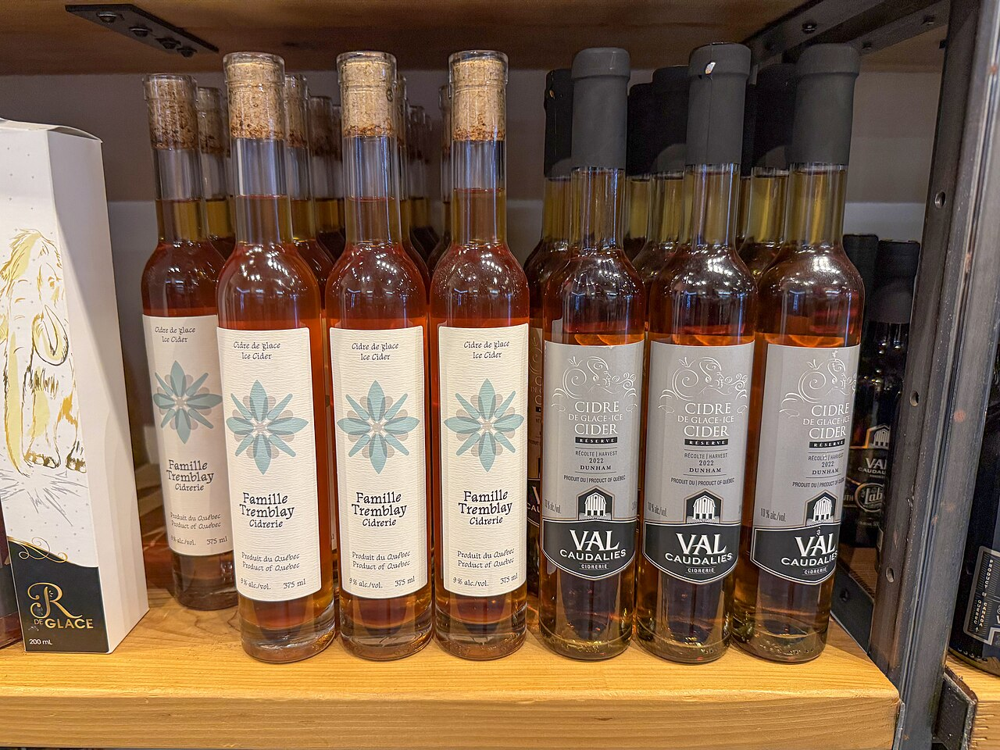
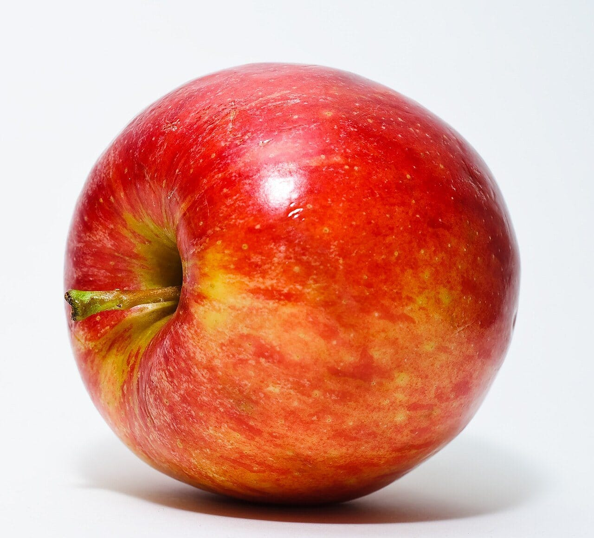

# 冰苹果酒

加拿大魁北克起源的甜型苹果酒，用自然冷冻或冷冻浓缩的苹果汁发酵，酒精度与甜度都高；带苹果、焦糖、蜂蜜与酸度。

冰苹果酒的核心是冷冻浓缩：在魁北克，苹果汁在自然低温中结冰，糖与酸被浓缩，再发酵成高甜度、较高酒精度的苹果酒；它不是苹果汁加酒精，也不是冰酒。这一风格在 1990 年代魁北克酒庄手中成型，依靠冬季低温与长时间发酵，产量受天气影响很大。加拿大其他省份与美国佛蒙特、纽约州也有生产，常用 ice cider 或 apple ice wine 命名，欧盟分类并不统一，购买时要看产酒国标签、产地与残糖说明。魁北克 IGP 产品会有相应标识，Neige 与 Domaine L’Orpailleur 是最常见的出口品牌，Domaine de la Pomanière 等酒庄也生产，但甜度与品种差异很大。饮用温度 6–8°C，用小号甜酒杯倒 60–80 mL；不要加冰，融化会稀释酸度。开瓶后冷藏，两三周内喝完，出现气泡可能意味着残余发酵。与冰酒相比，它的酸度更高、蜂蜜与杏脯感更弱，苹果与焦糖才是主线；这也是它适合配奶酪与苹果甜点的原因。

图：Ice Cider：Quebec Ice Cider（Wikimedia Commons）。图片：Hayden Soloviev，CC BY 4.0，via Wikimedia Commons（[原图页面](https://commons.wikimedia.org/wiki/File:Quebec_Ice_Cider.jpg)）。

## 定义与边界

冰苹果酒（ice cider / cidre de glace）是加拿大魁北克发展出的甜型苹果酒：用冬季自然冷冻的苹果或冷冻浓缩的苹果汁发酵，酒精度通常 7–13% vol，残糖高、酸度也高，风味带苹果、焦糖、蜂蜜与杏干。

它与冰酒（ice wine）不是同一类：冰酒用葡萄，冰苹果酒用苹果；它与普通苹果酒的区别在浓缩方式与残糖，不靠后期加糖。魁北克的“Cidre de glace”受 IGP 规范约束，其他省份与美国佛蒙特也有同名产品，但法规与甜度标准不完全一致。

## 历史与命名

魁北克冬季漫长、苹果成熟期短，1980 年代当地苹果酒生产者借鉴冰酒的冷冻浓缩思路，把苹果留在树上或采收后冷冻，让水分结冰、糖分与酸度浓缩，再慢慢发酵。

1990 年代以后，冰苹果酒成为魁北克苹果酒的名片；IGP 规范对原料、冷冻方式、发酵与残糖作出规定。名称里的“ice”指冷冻浓缩，不是加冰饮用；它也不等于“苹果冰酒”这类营销叫法。

## 原料与工艺

原料以酸度高的烹饪苹果与 cider 苹果为主，常见品种包括 McIntosh、Spartan、Cortland 与 Golden Russet；单一品种或混酿都会影响香气。苹果采收后冷藏或留在树上，待气温降到零下，果实中的水分结冰，压榨时得到浓缩汁。

浓缩汁的糖度可达 30–40 °Brix，发酵启动慢，酵母需要耐高糖与低温；发酵在 10–15°C 进行数周至数月，结束时保留大量残糖，再用冷降或过滤停止发酵。部分酒厂会在橡木桶中短期陈年，增加香草与坚果气息。

魁北克 IGP 要求使用自然冷冻或冷冻浓缩的苹果汁，并对残糖、酒精度与产地作出规定；其他地区可能用冷冻浓缩汁或反渗透浓缩，工艺不同，标签也会不同。

冷冻浓缩有两种路径：自然冷冻把苹果留在树上或放在户外，压榨时只取浓缩汁；人工冷冻把榨好的苹果汁冷冻，再分离冰晶。前者受天气影响大，后者更稳定，但 IGP 对“自然冷冻”有明确偏好。

## 风格与味觉

酒液金黄到琥珀，黏度略高；香气以熟苹果、焦糖、蜂蜜、杏干与柑橘皮为主，入口甜而不腻，酸度把甜度托住，收口带苹果皮与香料。酒精度 7–13% vol，残糖从半甜到甜型。

与冰酒比，它的酸度更高、酒体更轻，苹果香气更直接；与普通苹果酒比，它的甜度与浓度高得多，不适合当解渴饮料。判断典型性，先看是否用冷冻浓缩、残糖与酸度的平衡，再看有没有人工加糖或香精。

魁北克冰苹果酒的残糖常在 130–250 g/L，酸度 6–10 g/L，酒精度 7–13%；甜度与酸度的平衡比单纯高糖更重要。美国佛蒙特的版本有时更干、更偏苹果皮与香料。

## 代表产区与品牌

魁北克是核心产区，Neige 与 Domaine L’Orpailleur 是最常见的出口品牌；Domaine de la Pomanière 等酒庄也做冰苹果酒，但不同酒庄的甜度与品种差异很大。

加拿大其他省份与美国佛蒙特、纽约州也有生产，常用“ice cider”或“apple ice wine”命名；欧盟对这类甜苹果酒的分类并不统一，购买时看产酒国标签与残糖说明。

## 怎么喝与配餐

饮用温度 6–8°C，用小号甜酒杯或郁金香杯，倒 60–80 mL；温度过低会压住焦糖与蜂蜜香气，过高则让酒精感突出。配餐适合蓝纹奶酪、鹅肝、苹果塔、焦糖布丁与坚果；也可以替代甜酒配辛香菜肴。

开瓶后冷藏，2–3 周内喝完；高残糖与低酒精度让它比普通葡萄酒更耐放，但氧化后会出现苹果酱与木质味。不要加冰块，融化会稀释酸度与结构。

冰苹果酒适合在 6–8°C 饮用，不要加冰；融化会稀释酸度与结构。

## 选购、储存与误区

先看是否标注“Cidre de glace / Ice cider”、产地与残糖；魁北克 IGP 产品会有相应标识。价格高可能来自自然冷冻与低产量，不代表甜度更高；选择时看酸度与酒精度，而不只看“越甜越好”。

常见误读：把它当成苹果汁加酒精；把它与冰酒混为一谈；以为所有冰苹果酒都来自魁北克。它的核心是冷冻浓缩与发酵，不是加糖或加冰。

冰苹果酒的年份差异明显：冷冬浓缩更高、酸度更尖；暖冬果实更熟、焦糖味更重。开瓶后若出现气泡，说明残余发酵，需冷藏并尽快喝完。

## 延伸阅读与另见

- [苹果酒](ref:cider)：苹果发酵酒的基础。
- [苹果](ref:apple)：品种与酸度。
- [发酵](ref:fermentation)：糖转化为酒精。
- [加拿大](ref:canada)：魁北克产区背景。
- [甜酒](ref:dessert-wine)：甜型酒的分类与残糖。

对照阅读：[苹果酒](ref:cider)、[苹果](ref:apple)、[发酵](ref:fermentation)。

**关键事实。**

| 项目 | 内容 |
| --- | --- |
| 一句话定位 | 加拿大魁北克起源的甜型苹果酒，用自然冷冻或冷冻浓缩的苹果汁发酵，酒精度与甜度都高；带苹果、焦糖、蜂蜜与酸度 |
| 上位风格 | 苹果酒 |

**来源与边界。** 本页关于「冰苹果酒」的关键事实，主要由以下来源交叉核对：Ecocert（魁北克冰苹果酒 IGP 的天然冷冻浓缩、原料与生产区域要求）、European Union（欧盟葡萄酒类别、地理标志与标签规则）、Wine Institute（美国葡萄酒与甜酒分类背景）等 4 条来源。价格、批次与状态会变，涉及这些字段时以页面所列来源的最新版本为准。正文为项目自写，来源只作核验，不复制原文。

## 相关图像

图：一个鲜食红苹果。酿酒用苹果通常更小、更酸或更涩，与鲜食苹果的育种目标不同。图片：Abhijit Tembhekar，CC BY 2.0，via Wikimedia Commons（[原图页面](https://commons.wikimedia.org/wiki/File:Red_Apple.jpg)）。关联图像：冰苹果酒。
