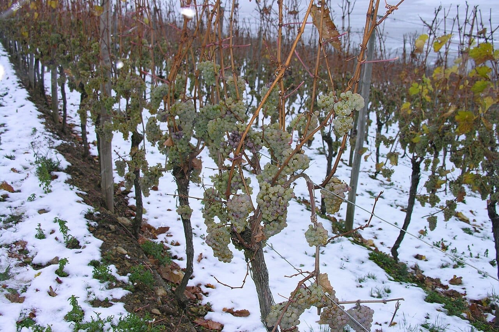
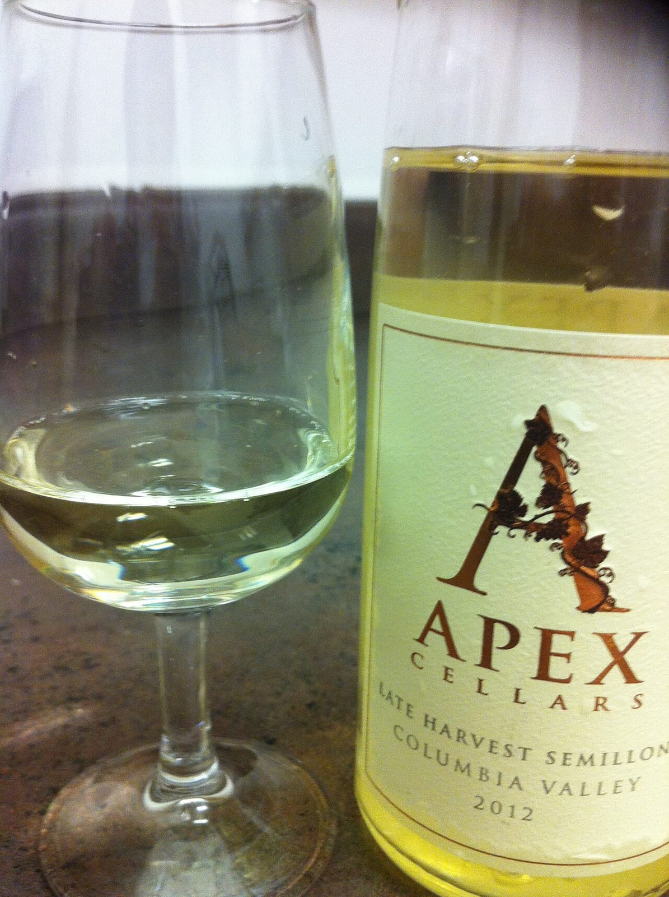

# 冰酒

冰酒（ice wine，德语 Eiswein）是一种在藤上自然结冰的葡萄酿成的甜型[葡萄酒](ref:wine)，属于[甜酒](ref:dessert-wine)的一类。葡萄留在枝头直到冬季气温降到冰点以下，采收后在冻结状态下压榨，果肉中的水分以冰晶形式留在压榨机里，流出的只是少量高度浓缩的汁液。它的甜不来自加糖，也不来自贵腐菌，而来自物理性的脱水与冻结。理解冰酒，要同时理解温度、时间与风险。

图：冰酒。图片：Mya，CC BY 2.0，via Wikimedia Commons（[原图页面](https://commons.wikimedia.org/wiki/File:Frozen_grapes_in_Luxembourg.jpg)）。

## 在藤上完成的浓缩

普通甜酒靠贵腐菌、晾晒或中断发酵取得糖分，冰酒靠的是冬天。葡萄在秋季正常成熟后不被采下，继续挂在藤上，水分缓慢蒸发，糖、酸与风味物质同步浓缩。等到气温足够低，果实内部结冰，采收与压榨必须在同一低温窗口完成，否则冰晶融化，浓缩效果消失。

这个过程与[晚收](ref:late-harvest)有交集，但目的不同：晚收追求成熟度，冰酒追求冻结后的固液分离。也正因为要等到冬天，冰酒的产量与年份高度不稳定。

## -7°C 与 -8°C：两条法规线

[德国](ref:germany)是冰酒的传统产地，法规要求采收与压榨时气温不高于 -7°C，实际生产中常在 -10°C 到 -12°C 之间进行。加拿大安大略的 VQA 体系要求 -8°C 及以下，并由认证体系监督采收。两个数字相差一度，背后是不同国家的农业管理与标签体系，而不是风格高低。

欧盟层面，冰酒属于特殊采收葡萄酒的一类，标签使用受地理标志与产品规范约束。符合规定的酒才能使用 Eiswein、Icewine 等名称；用人工冷冻或采收后冷冻葡萄酿造的酒，不能冒用这些名称。

## 压榨那一夜

冰酒的压榨通常在深夜到清晨进行，因为这是一天中气温最低的时段。葡萄从藤上采下后直接进压榨机，不能解冻，也不能久放。压榨压力比普通白葡萄酒更慢、更轻，目的是让冰晶留在里面，只让浓缩汁流出。出汁率极低，通常只有普通压榨的一小部分，这也是冰酒昂贵的原因。压榨车间的温度同样关键，通常要保持低温，避免汁液在槽内回温。

压榨后的汁液糖度极高，发酵缓慢，酵母在高压渗透环境下工作困难，发酵可能持续数月。成品通常保留大量[残糖](ref:residual-sugar)，酒精度不高，酸度明亮。

## Riesling、Vidal 与其他品种

德国最常用[雷司令](ref:riesling)，因为它晚熟、酸度高、皮厚，能在藤上挂到冬天而不易腐烂。雷司令冰酒通常更轻盈，带柑橘、青苹果与矿物感，酸度像刀锋。加拿大安大略常用 Vidal，这是一个抗寒的杂交品种，皮厚、香气浓，酿出的冰酒更饱满，带杏、菠萝与蜂蜜。

其他品种也有使用，例如德国的 Silvaner、Ortega，奥地利的 Grüner Veltliner 与 Scheurebe，加拿大的 Riesling 与 Cabernet Franc。品种决定香气方向，但冰酒的核心结构仍是高糖与高酸的对抗。树龄与产量也会影响浓缩程度：老藤根系深、果实小，单位产量低，汁液往往更集中。

## 一场与天气的赌博

冰酒的生产是一场赌博。葡萄要在藤上多挂两三个月，期间可能遇到雨水、冰雹、鸟害、霉菌与腐烂；如果冬天不够冷，整批葡萄可能报废。德国官方资料给出的经验是，最终装瓶的冰酒平均只占原采收量的 5%–10%，其余或被剪除，或毁于天气。葡萄在藤上停留越久，糖分越高，但酸度也会下降，酒庄必须在浓缩与新鲜之间取舍。

1830 年，德国莱茵黑森的 Dromersheim 有记录显示酒农在 2 月发现冻结葡萄可以压出极甜的汁液，这被视作冰酒较早的文字记载之一。此后冰酒在德国与奥地利逐渐制度化，20 世纪后期又在加拿大发展成规模化产业。

## 糖与酸的拉锯

冰酒的香气通常集中在蜂蜜、杏、菠萝、柑橘皮与白色花朵，口感黏稠，但收口应当干净。糖度极高时，酸度是唯一的解药；酸不足的冰酒会像糖浆，喝两口就腻。判断一款冰酒，可以看它在口中是否"流动"：好的冰酒浓郁却不笨重，回味带柑橘或矿物，而不是单纯的甜。

温度也影响平衡。温度太低，香气封闭、甜味被压住；温度太高，酒精与糖感膨胀。6–8°C 是比较稳妥的区间，香气与甜度都能保持。

## 怎么喝，配什么

冰酒适合用小号郁金香杯，倒少量，慢慢升温。它可以直接作为餐后酒，也可以搭配水果塔、杏仁饼干、蓝纹奶酪或鹅肝。与巧克力搭配要谨慎，因为巧克力太甜会压住酒；如果要用，选黑巧克力且甜度较低的甜点。饮用时不要加冰，冰会稀释香气，也让温度过低。

开瓶后冷藏可保存数天到一周，但香气会逐渐衰退。冰酒不适合长期存放于普通酒架，应避光、恒温。本页关于冰酒的内容涉及酒精饮料；过量饮酒有害健康，未成年人不应饮酒。

## 标签上的文字游戏

第一，"Icewine" 在加拿大是一个受监管的连写词，分开写成 "Ice Wine" 可能只是风格描述。第二，德国 Eiswein 与加拿大 Icewine 的法规不同，不能简单互换。第三，标着"冰酒风味"的酒可能只是加甜的白葡萄酒。第四，冰酒不是越甜越好，酸度才是它的骨架。第五，冰酒不是贵腐酒，两者可以都甜，但成因完全不同。

对照阅读：[甜酒](ref:dessert-wine)、[德国](ref:germany)。

**关键事实。**

| 项目 | 内容 |
| --- | --- |
| 一句话定位 | 让葡萄在藤上自然结冰、在冻结状态下压榨的甜酒；德国 Eiswein 与加拿大 Icewine 的采收温度规则不同，Riesling 与 Vidal 是常见品种，产量极低而糖酸高度浓缩 |
| 上位风格 | 葡萄酒 |
| 香气家族 | 蜂蜜/热带水果/柑橘 |

**来源与边界。** 本页关于「冰酒」的关键事实，主要由以下来源交叉核对：Deutsches Weininstitut (DWI)（德国冰酒的采收温度、历史与产量比例）、VQA Ontario（安大略 VQA 的产地认证与冰酒生产框架）、European Union（欧盟葡萄酒类别、地理标志与标签规则）等 4 条来源。价格、批次与状态会变，涉及这些字段时以页面所列来源的最新版本为准。正文为项目自写，来源只作核验，不复制原文。

**并读。** 把「冰酒」与「甜酒」、「雷司令」、「德国」放在一起读时，先确认它们是同一层级还是上下游关系：先确认定义与工艺，再比较原料、产区与代表品牌。本页负责给出酒类风格的基本坐标，对照条目补上具体案例与差异；读完再回到本页，才能分清哪些差别属于酒类风格本身，哪些只是产地、批次或品牌选择。

## 相关图像

图：晚收（late harvest）。图片：Agne27，CC BY-SA 3.0，via Wikimedia Commons（[原图页面](https://commons.wikimedia.org/wiki/File:Late_harvest_Semillon.jpg)）。关联图像：冰酒。
