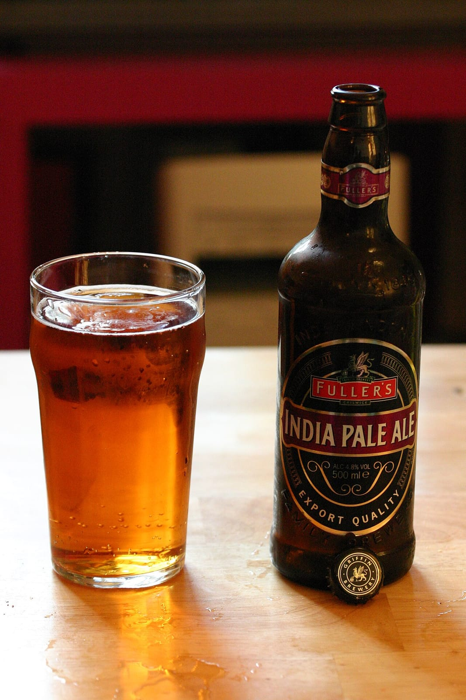

# 印度淡色艾尔

印度淡色艾尔（India pale ale，简称 IPA）是一类以酒花香气与苦味为突出特征的上面发酵啤酒。它诞生于英国向印度出口啤酒的贸易背景，19 世纪在伯顿等地形成稳定形态，20 世纪后期又被美国精酿重新定义，衍生出美式 IPA、双倍 IPA 与浑浊 IPA 等分支。理解 IPA 的关键，是把苦度看作可调参数，而不是质量等级。

图：印度淡色艾尔。图片：Wikimedia Commons contributor，CC BY-SA 3.0，via Wikimedia Commons（[原图页面](https://commons.wikimedia.org/wiki/File:Fuller%27s_India_pale_ale.jpg)）。

## 定义与标准

IPA 不是单一风格，而是一个家族。风格指南通常把它拆为英式 IPA、美式 IPA、双倍 IPA、浑浊 IPA 等条目，各自给出强度、苦度与色度区间。共同点是酒花表达优先于麦芽甜味，发酵为上层发酵，收口偏干。它属于[英式艾尔](ref:english-ale)传统向外延伸后形成的一支，同时与今天的[啤酒](ref:beer)风格体系并行。

以英式 IPA 为例，常见酒精度约 5.0–7.5%，苦度约 40–60 IBU；美式 IPA 的酒精度与苦度区间相近或略高，但香气更偏柑橘与松脂。这些区间是描述工具，用来判断一款酒是否在目标风格内成立，而不是给酒排队打分。

## 产地与风格/历史

18 世纪后期，伦敦的 Hodgson 酒厂向印度供货，随后[英国](ref:united-kingdom)多家酒厂加入这一贸易。19 世纪，伯顿（Burton upon Trent）凭借富含硫酸盐的水质成为重要出口中心，当地啤酒的酒花苦味显得更干、更锐利。出口啤酒普遍提高酒花用量与酒精度，以便在长途海运中保持稳定。

传统叙述常把它简化为“为了防腐而加重酒花”，近年的啤酒史研究提醒，这一解释并不完整：贸易结构、驻印消费者的支付能力，以及当时英国啤酒本已偏高的酒花用量，都是形成 IPA 的因素。把 IPA 说成在印度发明，更是明显的误传。

20 世纪，英国 IPA 一度被淡色艾尔与苦啤覆盖，苦味趋于克制。1970 年代后期，[美国](ref:usa)的[精酿啤酒](ref:craft-beer)运动重新解释这一名称，用本地高α酸酒花做出香气更张扬的版本，IPA 由此成为精酿中最具辨识度的风格之一。

## 原料与工艺

[大麦](ref:barley)以淡色艾尔麦芽为主，提供足够的可发酵糖与干净的麦芽骨架。少量特种麦芽可以增加饼干或焦糖气息，但不应压过酒花。酒花品种决定香气方向：英式 Goldings、Fuggles 偏草本、泥土与花香；美式 Cascade、Citra、Mosaic 偏柑橘、松脂与热带水果。

干投是在发酵后期或后发酵阶段加入酒花，主要提取香气而非苦味。煮沸早期添加酒花则贡献苦味，晚期与回旋沉淀阶段添加更多贡献风味与香气。水质也会改变表达：硫酸盐放大苦味，氯化物让口感更圆润。浑浊 IPA 常加入小麦或燕麦，增加蛋白质与多糖，并刻意保留悬浮物。

[发酵](ref:fermentation)使用酿酒酵母，温度控制在酯香可控的区间。温度偏高会带来明显的果香，甚至溶剂感；温度偏低则更干净，让酒花更突出。发酵完成后的氧化控制同样关键，因为酒花香气是最先流失的部分。

## 风味特征

IPA 的第一印象应是香气，而不是苦味数字。英式 IPA 常见草本、泥土、花香与乾爽的麦芽骨架；美式 IPA 常见柑橘、葡萄柚、松脂与热带水果；浑浊 IPA 香气更浓、口感更圆润，苦味往往相对柔和。

苦味的质量比强度更重要。好的苦味应该干净、有麦芽支撑，并在收口时留下回甘，而不是尖锐或持久的涩感。[苦度](ref:ibu)测量的是异构化α酸浓度，不能完整代表感知苦味：麦芽甜度、碳酸化、温度与酒体都会改变感受。同样标注 60 IBU 的两款酒，喝起来可能差别很大。

## 品鉴与饮用

IPA 强调新鲜，适饮温度约 6–10°C。温度过低会压住香气，过高会让酒精感突出。杯型应有利于聚拢香气，郁金香杯或专用的 IPA 杯都合适。倒酒时保留泡沫层，可以减缓香气逸出。

储存应避光、阴凉，未经过滤与杀菌的产品通常需要冷藏。开瓶后应尽快喝完，因为二氧化碳逸出与氧化会迅速改变风味。佐餐时，较高的苦度能切开油脂，适合烤肉、油炸食物与浓郁奶酪；搭配清淡菜肴时则应选苦味较柔和的版本。

## 常见误区

第一，认为 IPA 诞生于印度。它是在英国为出口印度市场而发展起来的。
第二，认为越苦越好。苦味需要麦芽与香气的支撑，单纯提高 IBU 只会让酒失衡。
第三，把 IBU 当作质量评分。它是分析指标，不是好喝程度的度量。
第四，把浑浊 IPA 当成工艺失误。它的浑浊来自蛋白质、多糖与酒花多酚的相互作用，是设计的一部分。
第五，认为 IPA 必须高酒精度。低酒精度的 session IPA 同样属于这一家族。

对照阅读：[啤酒](ref:beer)、[英国](ref:united-kingdom)。

## 延伸阅读

- [啤酒](ref:beer)：啤酒的整体分类与工艺框架。
- [英式艾尔](ref:english-ale)：IPA 所源自的英国上层发酵传统。
- [英国](ref:united-kingdom)：出口贸易与伯顿酿造的历史背景。
- [美国](ref:usa)：现代美式 IPA 与精酿运动的发生地。
- [精酿啤酒](ref:craft-beer)：IPA 在当代被重新定义的市场语境。
- [苦度](ref:ibu)：IBU 的含义、测量方式与局限。
- [大麦](ref:barley)：麦芽骨架与酒花平衡的基础。
- [发酵](ref:fermentation)：上层发酵温度对香气的影响。

**关键事实。**

| 项目 | 内容 |
| --- | --- |
| 一句话定位 | 以酒花香气与苦味为突出特征的上面发酵啤酒，源于英国向印度出口的贸易背景，现代已分化出英式、美式与浑浊等分支，苦度是可调参数而非质量等级 |
| 上位风格 | 啤酒 |
| 香气家族 | 酒花 |

**来源与边界。** 本页关于「印度淡色艾尔」的关键事实，主要由以下来源交叉核对：Beer Judge Certification Program（英式、美式与浑浊 IPA 的强度、苦度与香气描述边界）、Brewers Association（美国精酿行业对 IPA 及其变体的公开表述；未复制其文案）、Campaign for Real Ale（英国啤酒传统与英式 IPA 的历史语境）等 4 条来源。价格、批次与状态会变，涉及这些字段时以页面所列来源的最新版本为准。正文为项目自写，来源只作核验，不复制原文。

**并读。** 把「印度淡色艾尔」与「啤酒」、「英式艾尔」、「英国」放在一起读时，先确认它们是同一层级还是上下游关系：先确认定义与工艺，再比较原料、产区与代表品牌。本页负责给出酒类风格的基本坐标，对照条目补上具体案例与差异；读完再回到本页，才能分清哪些差别属于酒类风格本身，哪些只是产地、批次或品牌选择。

**适用边界。** 对「印度淡色艾尔」而言，法定定义、原料比例与地域风格会随法规和行业分类更新；品牌案例不等于整个风格。

## 相关图像

图：英国类别配图。图片：Decatur Wine & Spirits，CC BY-SA 3.0，via Wikimedia Commons（[原图页面](https://commons.wikimedia.org/wiki/File:DecaturGins.jpg)）。关联图像：印度淡色艾尔。
