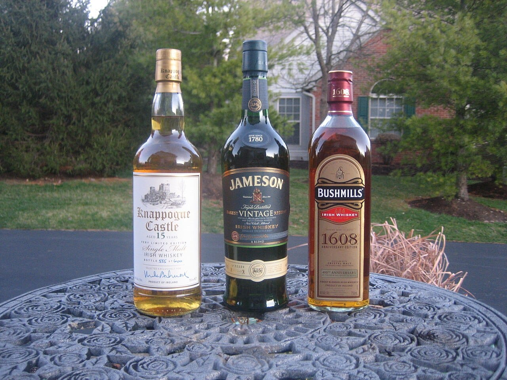

# 爱尔兰威士忌

爱尔兰威士忌是爱尔兰岛最古老的蒸馏酒传统之一。它受欧盟地理标志保护，名字里的“whiskey”多一个 e，与苏格兰、日本的“whisky”形成拼写上的分野。它的法定框架不复杂：谷物原料、发酵蒸馏、木桶陈年至少三年、装瓶不低于 40% vol、蒸馏低于 94.8% vol。真正让爱尔兰威士忌与众不同的，是单一壶式与三次蒸馏这两条工艺传统。

图：爱尔兰威士忌。图片：Hammersbach，CC BY-SA 3.0，via Wikimedia Commons（[原图页面](https://commons.wikimedia.org/wiki/File:GoodIrishWhiskeys.jpg)）。

> **先给结论**
> **一句话：** 这页判断爱尔兰威士忌的风味位置，以及怎么选、怎么喝。
>
> - **适合谁：** 正在比较爱尔兰威士忌与其他风格、准备购买或点单的人。
> - **不适合谁：** 只想要“哪个最好”的排名、不接受口味差异的人。
> - **先看这两点：**
>   - 纯饮适合判断谷物、果香、香料与桶味的比例。
>   - 按欧盟烈酒法规与爱尔兰威士忌的技术文件，爱尔兰威士忌必须在爱尔兰岛（包括爱尔兰共和国与北爱尔兰）蒸馏与陈年。

## 定义与法规

按欧盟烈酒法规与爱尔兰威士忌的技术文件，爱尔兰威士忌必须在爱尔兰岛（包括爱尔兰共和国与北爱尔兰）蒸馏与陈年。原料为谷物，经发酵、蒸馏后进入木桶，陈年不少于三年；蒸馏得到的酒液酒精度必须低于 94.8% vol，装瓶酒精度不得低于 40% vol。除水与焦糖色外，不允许添加其他物质。

“爱尔兰威士忌”是受保护的地理标志名称。它不是“在爱尔兰装瓶的威士忌”的同义词：蒸馏与陈年都必须在爱尔兰岛完成，才能使用这个名称。法规同时规定类别名称的使用条件，单一麦芽、单一壶式、单一谷物与调和各有自己的原料与蒸馏要求。

## 拼写：为什么是 whiskey

爱尔兰威士忌的官方名称写作 whiskey，苏格兰与日本通常写作 whisky。这个差别不是法律强制的结果，而是行业与地理标志长期形成的书写惯例；美国威士忌同样使用 whiskey。读酒标时，拼写可以作为判断来源的线索，但不能反过来推导风格：一瓶标 whiskey 的酒未必来自爱尔兰，最终仍要看产地与类别。

在中文语境里，“爱尔兰威士忌”是通用译名，也有“爱尔兰威士奇”等音译写法。正式文本与酒标引用应以英文原名为准，避免把拼写差异误当成质量差异。

## 历史：从修道院到现代酒厂

爱尔兰的蒸馏传统可以追溯到中世纪的修道院，盖尔语“uisce beatha”意为“生命之水”，后来演变为 whiskey。19 世纪，都柏林与科克一带出现大型蒸馏厂，爱尔兰威士忌一度是英语世界的重要烈酒。都柏林式壶式威士忌以发芽与未发芽大麦的混合醪液为特色，酒体厚、香料感强。

19 世纪末到 20 世纪，爱尔兰威士忌经历长期收缩。第一次世界大战、爱尔兰独立后的贸易摩擦、美国禁酒令、以及苏格兰调和威士忌的竞争，都削弱了它的出口市场。20 世纪后期，少数酒厂维持生产，随后新酒厂陆续出现，单一壶式与高年份产品重新受到关注。今天爱尔兰威士忌的产区分布比历史高峰期更分散，但都柏林、科克与北爱尔兰的布什米尔斯仍是传统坐标。

## 原料与工艺：三次蒸馏的传统

原料以[大麦](ref:barley)为主，也可使用玉米、小麦等谷物。大麦先发芽，部分酒厂保留未发芽大麦以增加谷物与香料感；糖化后加入酵母发酵，再进入[蒸馏](ref:distillation)。壶式蒸馏器是爱尔兰传统的主力，柱式蒸馏器则用于谷物威士忌。

三次蒸馏是爱尔兰威士忌最常被提到的工艺特征。多一次蒸馏意味着酒液与铜的接触更多，硫化物被移除得更彻底，成品更轻盈、干净、柔顺。但三次蒸馏不是法定要求：不少酒厂采用两次蒸馏，保留更多谷物油脂与厚度。把“爱尔兰威士忌”一律等同于三次蒸馏，是把传统当成强制规则。

## 分类：四个法定类别

单一麦芽爱尔兰威士忌：100% 发芽大麦，单一酒厂，壶式蒸馏。单一壶式爱尔兰威士忌：同一酒厂壶式蒸馏，醪液中发芽大麦不少于 30%、未发芽大麦不少于 30%，其他谷物不超过 5%。单一谷物爱尔兰威士忌：单一酒厂，以柱式蒸馏器处理谷物，通常以玉米或小麦为主。调和爱尔兰威士忌：把上述两类或更多类别的威士忌调配。

四个类别不是质量阶梯。调和威士忌占据市场多数，追求稳定与平衡；单一壶式强调未发芽大麦带来的谷物与香料；单一麦芽突出麦芽与酒厂个性；单一谷物则常作为调和骨架，也能单独装瓶，展现柱式蒸馏的干净风格。

## 感官风格

爱尔兰威士忌通常以柔顺、圆润、易饮著称。香气常见青苹果、梨、柑橘、香草、蜂蜜与谷物甜感；口感从轻盈的谷物威士忌到厚实的壶式威士忌都有。三次蒸馏的产品更干净、更细腻；两次蒸馏的产品更有油脂感与香料感。单一壶式的未发芽大麦会带来类似青苹果、丁香、肉豆蔻与烤面包的复合气息。

泥煤不是爱尔兰威士忌的普遍特征。多数产品不使用泥煤烘干麦芽，因此烟熏感很轻或没有；少数酒厂刻意生产泥煤版本，作为风格对照。把“爱尔兰威士忌”与“无泥煤”完全画等号，会忽略这些例外；反过来，把泥煤当成爱尔兰传统，也不符合多数产品的事实。

## 产区与传统坐标

爱尔兰威士忌没有像苏格兰那样的法定子产区。地理标志覆盖整个爱尔兰岛，酒标上的地名更多是酒厂所在地与传统描述，而不是法律等级。都柏林是历史上的壶式威士忌中心；科克郡的米德尔顿一带集中了大型酒厂；北爱尔兰的布什米尔斯以麦芽威士忌闻名；劳斯郡的库利则推动了近代单一麦芽与泥煤产品的发展。

这些坐标描述的是产业地理，不是风味保证。同一座酒厂可以用不同原料、蒸馏次数与桶型生产多条产品线；同一地区的新酒厂也可能采用完全不同的技术路线。关于[爱尔兰](ref:ireland)的饮食与酒类背景，可参见产区条目。

## 代表产品

常见例子包括 Jameson、Bushmills、Tullamore D.E.W.、Powers、Redbreast、Green Spot、Kilbeggan 与 Connemara。它们分别覆盖调和、单一麦芽、单一壶式与泥煤风格；具体酒款的类别、桶型与酒龄以酒标为准。本页不评价具体品牌或批次的高低。

选购时先读类别词，再看是否单一酒厂、原料结构与蒸馏方式，最后看酒龄、桶型与酒精度。调和威士忌适合日常饮用与调酒；单一壶式适合感受谷物与香料；单一麦芽适合比较酒厂风格；高酒精度版本需要少量加水打开。

## 陈年与橡木桶

陈年必须在木桶中完成，至少三年，参见[橡木桶陈年](ref:oak-ageing)。爱尔兰威士忌常用曾装过波本、雪莉或其他酒类的橡木桶；桶的先前内容、烘烤程度与使用次数会带来香草、椰子、干果、巧克力与香料。部分产品使用新桶或风味桶，以增加甜度与层次。

酒龄标注的是瓶中所有威士忌中最年轻的一款。一瓶标 12 年的调和威士忌可以含有更老的酒，但不得含有不足 12 年的酒。陈年时间长不等于质量高：原酒结构不足时，过长的陈年会让木味与苦味压过谷物香。

## 品鉴与饮用

纯饮适合判断谷物、果香、香料与桶味的比例。加少量水可以降低酒精刺激、打开香气，但过量水会稀释酒体；加冰适合高酒精度产品，低温会压住细腻香气。爱尔兰威士忌也是热饮与鸡尾酒的常见基酒：爱尔兰咖啡把威士忌、咖啡、糖与奶油组合在一起，热托迪则以热水、糖与香料调制。

品鉴时先闻静止香气，再小口含住，注意甜度、酒体、谷物感与收口，最后看回味长度。本页关于爱尔兰威士忌的内容涉及酒精饮料；过量饮酒有害健康，未成年人不应饮酒。

## 常见误区

第一，认为爱尔兰威士忌必须三次蒸馏。三次蒸馏是传统，不是法定要求，两次蒸馏同样合法。

第二，把 whiskey 拼写当成爱尔兰独有。美国威士忌也使用 whiskey，拼写只能作为线索。

第三，认为爱尔兰威士忌等于单一麦芽。调和威士忌占据市场多数，单一壶式也是爱尔兰独有类别。

第四，认为所有爱尔兰威士忌都没有泥煤。多数产品无泥煤，但存在刻意生产的泥煤版本。

第五，把“单一壶式”当成“单一麦芽”。单一壶式使用发芽与未发芽大麦的混合醪液，原料结构不同。

第六，把酒龄当成质量保证。陈年受桶型、仓储与气候影响，原酒结构同样关键。

## 延伸阅读

- [威士忌](ref:whisky)：威士忌的总体分类与工艺。
- [蒸馏](ref:distillation)：壶式蒸馏、柱式蒸馏与三次蒸馏的差异。
- [橡木桶陈年](ref:oak-ageing)：桶型与时间对风味的影响。
- [大麦](ref:barley)：爱尔兰威士忌的主要谷物原料。
- [爱尔兰](ref:ireland)：爱尔兰的饮食与酒类背景。
