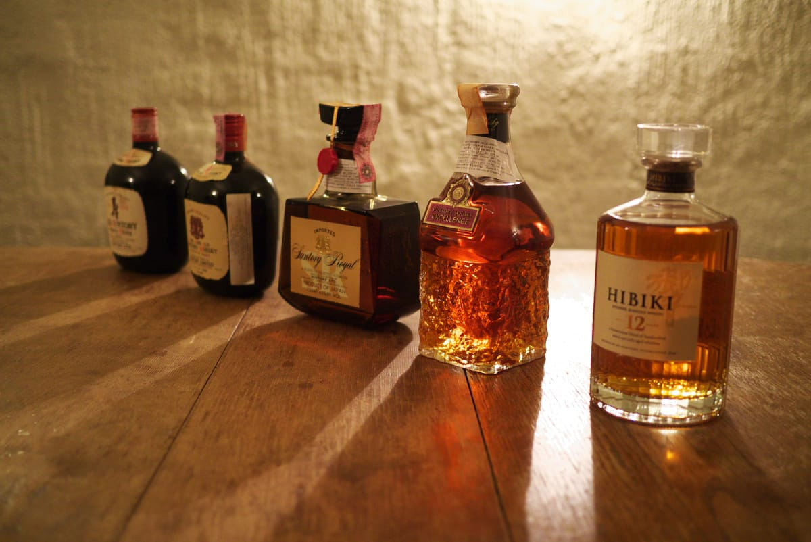

# 日本威士忌

日本威士忌的历史不足百年，却在国际市场上形成了清晰的辨识度。它早期以苏格兰为模板，随后发展出自己的蒸馏器组合、酵母管理与水楢桶语言。更重要的是，2021 年生效的行业标识规则，把“日本威士忌”从一个容易被滥用的产地印象，变成了一套可以逐条核对的条件。

图：日本威士忌。图片：Mikael Leppä，CC BY 2.0，via Wikimedia Commons（[原图页面](https://commons.wikimedia.org/wiki/File:Vintage_Suntory_Tasting.jpg)）。

> **先给结论**
> **一句话：** 这页判断日本威士忌的风味位置，以及怎么选、怎么喝。
>
> - **适合谁：** 正在比较日本威士忌与其他风格、准备购买或点单的人。
> - **不适合谁：** 只想要“哪个最好”的排名、不接受口味差异的人。
> - **先看这两点：**
>   - 纯饮时用郁金香形杯，先闻花果与麦芽，再找泥煤、水楢与桶味。
>   - 2021 年 2 月，日本洋酒酒造组合发布《日本威士忌标识自主规则》，同年 4 月 1 日实施，并设置到 2024 年 3 月 31 日的过渡期。

## 定义与法规

2021 年 2 月，日本洋酒酒造组合发布《日本威士忌标识自主规则》，同年 4 月 1 日实施，并设置到 2024 年 3 月 31 日的过渡期。规则要求标为“Japanese Whisky / Japan Whisky”的产品必须满足：原料以发芽谷物、谷物或马铃薯为基础；糖化、发酵与蒸馏在日本完成；蒸馏酒精度低于 95% vol；在日本境内的木桶中陈年至少三年，木桶容量不超过 700 升；在日本装瓶，装瓶酒精度不低于 40% vol；允许使用普通焦糖色调整颜色。

这套规则属于行业协会的自主标准，不是国会立法，但它通过成员企业的共同遵守与市场监督产生约束力。日本国税厅负责酒类标示的总体监管，行业标准则在同一框架内细化“日本威士忌”这一名称的使用条件。与[苏格兰威士忌](ref:scotch-whisky)的法定法规相比，日本的路径更接近“行业自律加行政监管”的组合。

## 历史脉络

日本威士忌的起点通常追溯到 1923 年。三得利在京都府与大阪府交界处的山崎建立麦芽威士忌蒸馏所，竹鹤政孝在其中扮演关键角色。竹鹤曾赴苏格兰学习酿造，回国后把壶式蒸馏、酵母与陈年观念带入日本。1934 年，他在北海道余市创立 Nikka 的蒸馏所，形成“山崎—余市”双中心的早期格局。

战后日本威士忌进入大众消费时代，调和型产品成为主流。2000 年代以后，日本单一麦芽在国际评鉴中受到关注，2010 年代需求快速增长，部分年份产品甚至出现供应紧张。市场热度也带来一个问题：一些标着日本地名或日式包装的产品，实际混入了海外蒸馏的威士忌。2021 年的标识规则正是对这一现象的制度回应。

## 原料与工艺

主要原料是[大麦](ref:barley)，其中相当一部分是进口的泥煤烘干麦芽，另有本地或进口的未发芽谷物用于谷物威士忌。水在日本威士忌中被视为风格要素，山崎、白州、余市与宫城峡各自使用不同水源，硬度与矿物质组成会影响发酵与蒸馏后的口感。

糖化、发酵之后进入[蒸馏](ref:distillation)。日本酒厂常同时保有多座形状不同的壶式蒸馏器，有的带莱恩臂，有的使用直火加热，有的以蒸汽加热；不同蒸馏器的回流比不同，得到的原酒从轻盈花果到厚重油脂都有。酒厂再通过酵母种类、发酵时间与切酒点微调风格。这种“同厂多风格”的原酒库，是日本调和威士忌能够做出层次的技术基础。

## 分级与标签

在自主规则之下，常见的类别包括单一麦芽日本威士忌、单一谷物日本威士忌与调和日本威士忌。单一麦芽要求原酒来自同一家蒸馏厂，且全部在日本蒸馏、陈年与装瓶；单一谷物同理；调和则把麦芽与谷物原酒混合。所有构成“日本威士忌”的原酒都必须满足产地与陈年条件，不能以进口散装威士忌充数后再贴日本标签。

年份标注遵循最低酒龄原则。标 12 年的产品中，最年轻的原酒不得低于 12 年，但可以含有更老的酒。日本威士忌没有苏格兰那样的法定产区等级，也没有“单一麦芽高于调和”的官方排序；类别描述的是构成方式，不是质量排名。

## 感官风格

日本威士忌常被描述为干净、细腻、平衡：苹果、梨、柑橘与白花香气，配合蜂蜜、麦芽糖与轻柔的泥煤烟熏。余市等北海道酒厂因气候寒冷、陈年较慢，常带更明显的油脂感与烟熏；山崎与白州则偏向花果、香料与清透的木质调。

水楢桶是日本威士忌最具辨识度的元素之一。水楢是日本橡木，纹理致密、孔隙大，制桶与陈年难度高，容易渗漏，但能带来檀香、沉香、椰子与香料气息。水楢桶并非越多越好：比例过高时木质调会压过果香，因此多数产品把它作为调配中的一部分，而不是全部。

## 产区

日本没有类似苏格兰的法定产区划分，“日本威士忌”是一个全国性名称。实际生产形成几个集群：山崎位于大阪府岛本町，白州位于山梨县北杜市，余市位于北海道余市町，宫城峡位于宫城县仙台市。此外，秩父、厚岸、静冈等地也有规模较小的蒸馏所。

这些地点之间气候差异明显。北海道冬季漫长寒冷，熟成速度慢，酒体往往更紧致；本州中部的山崎与白州夏季湿热，木桶提取更快，香气更外放。由于没有法定分区，酒标上的地名更多指向蒸馏所所在地，而不是一套受保护的风味等级。

## 代表产品

山崎系列以单一麦芽为主，常见花果、香料与水楢气息；白州风格更清爽，带青草、柑橘与轻烟；余市以直火蒸馏与厚重酒体著称；宫城峡则偏向柔和、甜润与果香。响是调和威士忌的代表，强调多酒厂原酒的平衡。秩父等新兴酒厂以小型批次和单桶装瓶获得关注。

这些产品覆盖单一麦芽、单一谷物与调和三条路线，也展示了日本威士忌“酒厂内部多风格”的特点。它们之间不是简单的等级关系，而是原料、蒸馏器与陈年策略的不同组合。

## 品鉴与饮用

纯饮时用郁金香形杯，先闻花果与麦芽，再找泥煤、水楢与桶味。加少量水可以打开香气，也会改变酒体厚度。日本常见的饮用方式还包括水割（加冰与水稀释）与 Highball（加苏打水），前者降低酒精刺激、突出甜感，后者适合佐餐与夏季饮用。

温度对香气影响很大。冰镇会压住细腻的花香，适合风味较重的版本；室温更适合判断结构与层次。无论哪种喝法，都应适量；本页关于日本威士忌的内容涉及酒精饮料；过量饮酒有害健康，未成年人不应饮酒。

## 常见误区

第一，认为所有标着日本品牌的威士忌都在日本蒸馏。2021 年规则生效后，标为日本威士忌的产品必须全部在日本完成关键工序，过渡期结束后旧库存不能再使用该名称。第二，把行业自主标准当成法律。它由行业协会制定，依靠成员遵守与市场监管，而非国会立法。第三，认为年份越长越好。陈年受气候、桶型与仓库位置影响，原酒结构不足时长时间陈年只会放大木味。第四，认为水楢桶比例越高越高级。水楢带来独特香气，也容易失衡。第五，认为日本有法定产区体系。日本没有苏格兰式的法定分区，地名主要指向蒸馏所所在地。第六，把“Japanese whisky”和“Japanese whiskey”的拼写差异当成法律区别。两种拼写在规则中都被覆盖。

## 延伸阅读

- [苏格兰威士忌](ref:scotch-whisky)：日本威士忌早期最重要的技术与制度参照。
- [蒸馏](ref:distillation)：不同壶式蒸馏器与切酒如何塑造原酒。
- [橡木桶陈年](ref:oak-ageing)：波本桶、雪莉桶与水楢桶的差异。
- [大麦](ref:barley)：日本威士忌的主要谷物原料。
- [日本](ref:japan)：日本威士忌的地理与产业背景。

**关键事实。**

| 项目 | 内容 |
| --- | --- |
| 一句话定位 | 在日本完成糖化、发酵、蒸馏、陈年与装瓶的威士忌；2021 年起日本洋酒酒造组合以自主标识规则界定“日本威士忌”，要求原料、三年木桶陈年与 40% vol 装瓶等条件 |
| 上位风格 | 威士忌 |
| 香气家族 | 谷物/果香/烟熏 |

## 相关图像

图：苏格兰威士忌。图片：Sansvase，CC BY-SA 3.0，via Wikimedia Commons（[原图页面](https://commons.wikimedia.org/wiki/File:Bowmore_whisky_12_years.JPG)）。关联图像：日本威士忌。
