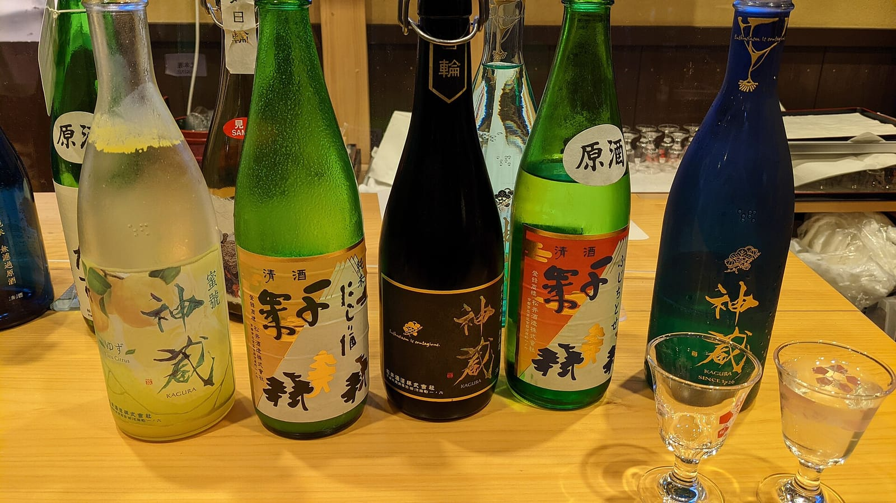
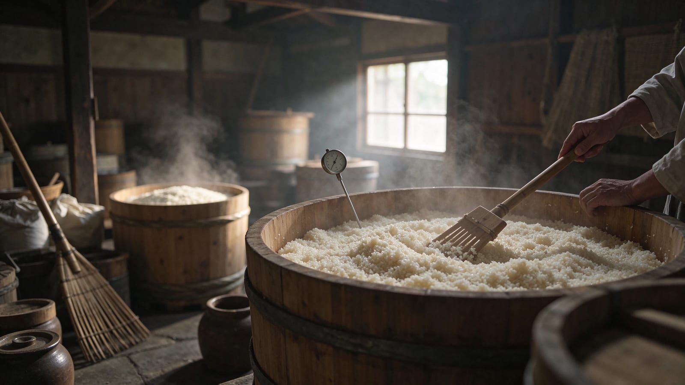

# 纯米酒

纯米酒是[清酒](ref:sake)的一个类别，只以米、米曲和水酿成，不添加酿造酒精。它的子类别纯米吟酿与纯米大吟酿，分别对应更低的精米步合与更低温的长期发酵。理解纯米酒，关键是分清“原料限定”与“精米步合限定”这两层规则。

图：纯米酒相关实景照片。图片：Nisiguti，CC BY-SA 4.0，via Wikimedia Commons（[原图页面](https://commons.wikimedia.org/wiki/File:Matsui_Sake_Brewery%27s_Sake_20211122.jpg)）。

## 定义与法定条件

纯米酒的原料限定为米、米曲和水。酿造过程中不添加酿造酒精，也不添加糖类、酸味料或着色料。日本清酒的特定名称标示制度把纯米酒作为独立类别，标签上的“純米”二字对应这套原料条件，而不是口感描述。

需要注意，纯米酒本身没有统一的精米步合上限。只有在叠加“吟酿”“大吟酿”等条件时，才会出现 60% 或 50% 的数字。把纯米酒一律理解为高精米产品，是常见的误读。

## 精米步合与子类别

[精米步合](ref:polishing-ratio)是剩余米粒的比例。纯米吟酿的精米步合上限为 60%，纯米大吟酿为 50%。这两个子类别同时要求纯米的原料条件与吟酿式低温长期发酵。

精米把米粒外层的蛋白质与脂肪磨去，减少杂味来源，也让曲菌更容易深入米心。精米步合越低，成本与碎米率通常越高，香气更干净，但米本身的旨味也可能被削弱。因此低步合是风格选择，不是质量评分。

## 风味与口感

纯米酒通常比添加酒精的类别更饱满，米香、旨味与酸度更明显。纯米吟酿在保留米味的同时带苹果、梨、香蕉般的酯香；纯米大吟酿的香气更集中、口感更细。不同酒米、水质与酒母会带来差异，不能用一个模板概括。

温度对纯米酒影响很大。冷饮突出清爽与香气，温饮（约 40 至 55°C）会把米香与旨味放大，也会让酒精感更明显。吟酿类通常更适合低温，纯米酒与山废系则常被推荐温饮。

## 酿造要点

清酒的酿造流程是精米、洗米、浸渍、蒸米、[制曲](ref:qu-making)、造酒母、三段仕込み、发酵、压榨、澄清、火入与储藏。纯米酒没有添加酒精来调整酒体，因此酒母管理、蒸米状态与发酵温度更直接地决定最终风味。

酒母可以选择速酿、[生酛或山废](ref:kimoto-yamahai)。速酿稳定、周期短；生酛与山废依靠天然乳酸菌，周期长、风味更复杂。纯米酒与这些酒母的组合，会形成从清爽到浓厚的不同表达。

## 吟酿香与精米的关系

吟酿香通常被描述为苹果、梨、香蕉一类果香，主要来自乙酸异戊酯、己酸乙酯等酯类。它需要低温长期发酵、合适的酵母与较低的发酵温度，也需要较低的[精米步合](ref:polishing-ratio)来减少杂味干扰。

两者的关系是“条件”而不是“因果”。精米步合低，香气潜力更大，但如果发酵温度偏高或酵母不合适，香气仍然出不来。反过来，精米步合不够低的产品也可以有干净、清新的香气。把低步合等同于吟酿香，会忽略工艺的作用。

## 标签与选购

纯米酒的标签通常同时出现“純米”“純米吟醸”“純米大吟醸”与精米步合数字。选购时先看类别词，再看精米步合、酒米品种、日本酒度与是否生酒。类别词是法定概念，精米步合是条件之一，二者不能互相替代。

同一品牌可能同时生产纯米酒、本酿造与吟酿类产品。比较时应把类别、精米步合、酒精度与价格带放在一起，而不是只凭“纯米”二字判断高低。

## 常见误区

第一，把纯米酒当成“更高等级”。它是原料类别，不是质量排名。
第二，认为纯米酒一定精米步合很低。纯米酒本身没有统一上限，低步合来自吟酿或大吟酿条件。
第三，把纯米与吟酿对立。纯米吟酿是两者的交集，既无添加酒精，也采用吟酿工艺。
第四，认为纯米酒都要温饮。温度取决于酒款，吟酿类通常更适合冷饮。
第五，把吟酿香归因于精米步合。香气来自酵母、温度与工艺的组合，精米只是前提之一。

纯米酒只用水、米与米曲酿成，不添加酿造酒精，这是它与本酿造的核心差别；纯米吟酿、纯米大吟酿还要满足更低的精米步合上限。精米步合说明米被磨去多少，不代表甜度或等级；纯米也不等于一定浓稠，风味仍取决于酵母、温度与酒母管理。纯米酒与本酿造的差别在是否添加酿造酒精，而纯米吟酿、纯米大吟酿的差别在精米步合与酿造温度；这些标签回答的是类别，不是甜度。读瓶标时还要看日本酒度、酸度与是否生酒。

对照阅读：[清酒](ref:sake)、[制曲](ref:qu-making)。

## 延伸阅读

- [清酒](ref:sake)：清酒的类别体系与酿造框架。
- [精米步合](ref:polishing-ratio)：精米程度与特定名称酒的关系。
- [制曲](ref:qu-making)：米曲在清酒糖化中的作用。
- [大米](ref:rice)：酒米与食用米的差别。
- [生酛与山废](ref:kimoto-yamahai)：纯米酒常见的酒母路线。
- [日本](ref:japan)：清酒的产区与国家背景。

**关键事实。**

| 项目 | 内容 |
| --- | --- |
| 一句话定位 | 只用米、米曲和水酿成、不添加酿造酒精的清酒类别；纯米吟酿与纯米大吟酿还分别受 60% 与 50% 精米步合上限约束 |
| 上位风格 | 清酒 |
| 香气家族 | 米香 |

**来源与边界。** 本页关于「纯米酒」的关键事实，主要由以下来源交叉核对：Japan Sake and Shochu Makers Association（清酒分类与标示）、National Tax Agency of Japan（特定名称酒的原料、精米步合与标示要求）、Oxford University Press（提供关于纯米酒、吟酿香与清酒酿造的条目；由原条目末尾参考资料迁移，未逐条复核访问日期）。价格、批次与状态会变，涉及这些字段时以页面所列来源的最新版本为准。正文为项目自写，来源只作核验，不复制原文。

**并读。** 把「纯米酒」与「清酒」、「精米步合（polishing ratio）」、「制曲」放在一起读时，先确认它们是同一层级还是上下游关系：先确认定义与工艺，再比较原料、产区与代表品牌。本页负责给出酒类风格的基本坐标，对照条目补上具体案例与差异；读完再回到本页，才能分清哪些差别属于酒类风格本身，哪些只是产地、批次或品牌选择。

**适用边界。** 对「纯米酒」而言，法定定义、原料比例与地域风格会随法规和行业分类更新；品牌案例不等于整个风格。

**更新提示。** 「纯米酒」最近核对于 2026-11-05；价格、状态与公开信息会变，引用前以本页来源的最新版本为准。

## 相关图像

图：生酛与山废酒母的编辑插图：木桶中的米麹与蒸汽、竹耙翻拌；画面为 AI 辅助绘制，不是酒厂实拍。。图片：Hejiu 编辑团队，使用豆包 Seedream 5.5 AI 辅助生成；项目自制，不是现场照片（[项目说明](https://hejiu.org/about/)）。关联图像：纯米酒。
