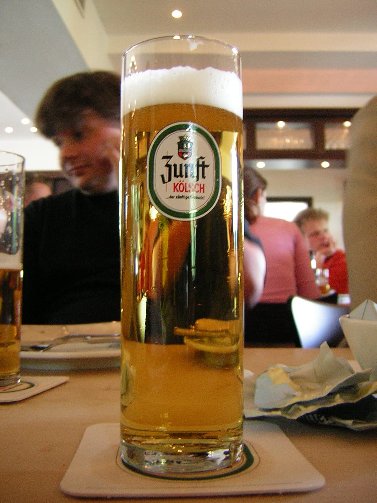
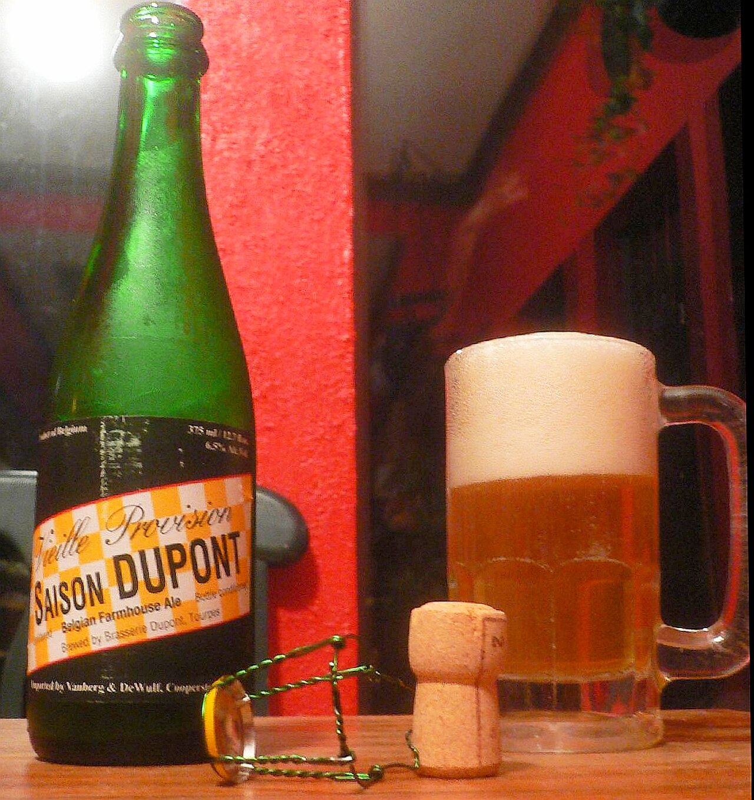

# 科隆啤酒

科隆啤酒（Kölsch）是德国科隆的一种淡色、上层发酵、经低温贮酒与过滤的啤酒，酒体轻盈、收口干爽，带细腻果香与清晰酒花苦味。它在工艺上属于艾尔，在感官上却接近拉格，这种上发酵与冷处理的组合是理解它的关键。名称受地理标志保护，并非所有淡色艾尔都能叫 Kölsch。

图：科隆啤酒。图片：User:Trexer，CC BY-SA 3.0，via Wikimedia Commons（[原图页面](https://commons.wikimedia.org/wiki/File:Zunft-K%C3%B6lsch_Glas.JPG)）。

## 一种语言，也是一种啤酒

科隆人爱说“Kölsch 是唯一能喝的语言”。这句话既是地方自豪感，也点出名称的特殊性：它既是方言的名称，也是啤酒的名称。科隆的酿造传统可追溯到中世纪，城市里的酿酒作坊曾沿莱茵河供应周边地区；19 世纪下层发酵技术传入后，当地酒厂反而更明确地保留上层发酵，以此与皮尔森式拉格区分。

在[啤酒](ref:beer)的分类里，科隆啤酒常被放进淡色上层发酵一支，但它不是英式淡色艾尔。英国艾尔强调麦芽与酒花的平衡、常温侍酒与桶装二次发酵；科隆啤酒则追求干净、明亮与低温下的稳定，目标更接近拉格的易饮性。理解这一点，才不会把它的果香当成缺陷。

## 1986 年那条界线

1986 年 3 月 6 日，科隆及周边地区的酒厂签署了《科隆啤酒公约》（Kölsch Konvention），共 16 条。公约规定：Kölsch 必须上层发酵、浅色、过滤，并有明显的酒花特征；只能在科隆市及其近郊酿造，此前已在产区外使用该名称的酒厂可获豁免。这份自愿协议后来成为欧盟地理标志保护的基础，Kölsch 目前受“受保护地理标志”（g.g.A.）保护。

地理范围常被误传为“只要能看到科隆大教堂就能酿”。实际边界由公约与欧盟登记文件界定，而不是视线。名称保护的意义不只是产地，更是工艺与感官的最低共识：浅色、过滤、上发酵、酒花清晰。把范围理解得过于宽泛，会让这个名称失去区分力。

## 上发酵，却像拉格一样冷

原料通常是浅色大麦麦芽，部分酒厂加入少量[小麦](ref:wheat)以改善泡沫与口感；酒花多用德国贵族品种，如 Hallertau 或 Tettnang，强调草本与辛香而不是热带水果。糖化以单温度或阶梯升温为主，追求干净的麦芽甜，不刻意制造焦糖。

[发酵](ref:fermentation)使用艾尔[酵母](ref:yeast)，主发酵温度约 15–20°C，产生少量梨、苹果般的酯香；随后转入接近 0–4°C 的贮酒阶段，持续数周。冷贮让酵母沉降、双乙酰降低、口感变干，也让酒液在过滤后保持稳定。这套流程与拉格的冷相似，但酵母与主发酵温度不同，风味因此保留了轻微果味。

发酵结束后的过滤也值得说明。科隆啤酒追求明亮的外观，过滤会去掉大部分酵母与部分香气前体，因此酒厂必须在香气强度与稳定性之间取舍。未过滤的版本在精酿圈被称为“自然浑浊”，但那不属于公约定义的 Kölsch，讨论时应把两者分开。

## 淡金、干爽、带一点果香

典型酒液呈淡稻草色至浅金色，清澈透亮，泡沫细白。香气以谷物、淡面包为底，叠加梨、苹果、白花的轻酯香与草本酒花；硫化物味在低浓度下可以接受，双乙酰应很低。入口轻到中等酒体，碳酸化中高，苦味清晰但不粗糙，收口干爽，余味偏酒花而不是麦芽甜。

参数只能作参考：酒精度常见约 4.4%–5.2%，[苦度](ref:ibu)约 18–30 IBU，[原麦汁浓度](ref:original-gravity)约 11–12.5 °P。不同酒厂会为本地口味调整，出口版本有时更强或更苦。若出现明显香蕉、丁香，说明发酵温度偏高或酵母不同；若苦味全无、口感发甜，则已经偏离风格。

## 科隆酒馆里的 0.2 升

传统侍酒使用细直的 0.2 升 Stange 杯，服务生（Köbes）把杯子放在托盘上巡回续杯，不主动询问，直到客人用手盖住杯口。小杯的意义在于让酒保持低温与新鲜，也让交谈节奏不被大杯打断。适饮温度约 6–8°C，酒杯最好预先冲洗干净，残留油脂会破坏泡沫。

配餐是莱茵地区的家常逻辑：Himmel un Ääd（苹果、土豆泥与血肠）、Halver Hahn（黑麦面包夹奶酪）、酸味炖牛肉都与它的干爽与轻苦相合。它不适合搭配重奶油或极甜的菜，苦味不足以切开油脂。新鲜度同样重要，科隆啤酒的香气衰减很快，尽量选择本地生产、周转快的瓶装或桶装。

科隆的啤酒服务还有一套默契：服务生不会等你点单，而是看到杯空就换新杯；客人若不想再喝，把杯口盖住即可。这套做法提高了周转，也要求酒厂把酒做得足够轻、足够新鲜。离开科隆后，同样的酒往往以瓶装出现，风味会比酒馆里的桶装版本更收敛，这是运输与储存的代价，不是配方突然改变。

## 与皮尔森、赛松、小麦啤的距离

与[皮尔森](ref:pilsner)相比，科隆啤酒是上层发酵，果香更明显，苦味通常更柔和，酒体也更圆。与[小麦啤](ref:wheat-beer)相比，它清澈、过滤、没有香蕉与丁香，酵母香克制。与[赛松](ref:saison)相比，它的酒精度更低、胡椒与农舍气息更少，整体更接近城市日常饮用。与美式淡色艾尔相比，它的酒花用量与香气强度都低得多。

这些差异说明：风格边界由酵母、温度、过滤与侍酒方式共同决定，而不是单看颜色。把所有淡色啤酒都叫 Kölsch，既不准确，也削弱了地理标志的意义。[德国](ref:germany)其他地区的淡色啤酒可以借鉴这套工艺，却不能使用这个名称。

对照阅读：[啤酒](ref:beer)、[小麦啤酒](ref:wheat-beer)。

**关键事实。**

| 项目 | 内容 |
| --- | --- |
| 一句话定位 | 德国科隆的淡色上层发酵啤酒，经低温贮酒与过滤，以干净果香、柔和苦味和 0.2 升 Stange 杯侍酒为标志，名称受地理标志保护 |
| 上位风格 | 啤酒 |
| 香气家族 | 麦芽与酒花 |

**来源与边界。** 本页关于「科隆啤酒」的关键事实，主要由以下来源交叉核对：Beer Judge Certification Program（科隆啤酒的强度、苦度、色度与发酵描述）、Privatbrauerei Gaffel（1986 年公约、地理范围、上发酵与过滤要求及 Stange 侍酒传统）、Deutscher Brauer-Bund e.V.（德国啤酒种类与地方风格保护的公开表述）等 4 条来源。价格、批次与状态会变，涉及这些字段时以页面所列来源的最新版本为准。正文为项目自写，来源只作核验，不复制原文。

**并读。** 把「科隆啤酒」与「啤酒」、「皮尔森啤酒」、「小麦啤酒」放在一起读时，先确认它们是同一层级还是上下游关系：先确认定义与工艺，再比较原料、产区与代表品牌。本页负责给出酒类风格的基本坐标，对照条目补上具体案例与差异；读完再回到本页，才能分清哪些差别属于酒类风格本身，哪些只是产地、批次或品牌选择。

## 相关图像

图：赛松。图片：Jmcstrav，Public domain，via Wikimedia Commons（[原图页面](https://commons.wikimedia.org/wiki/File:Saison_Dupont.jpg)）。关联图像：科隆啤酒。
