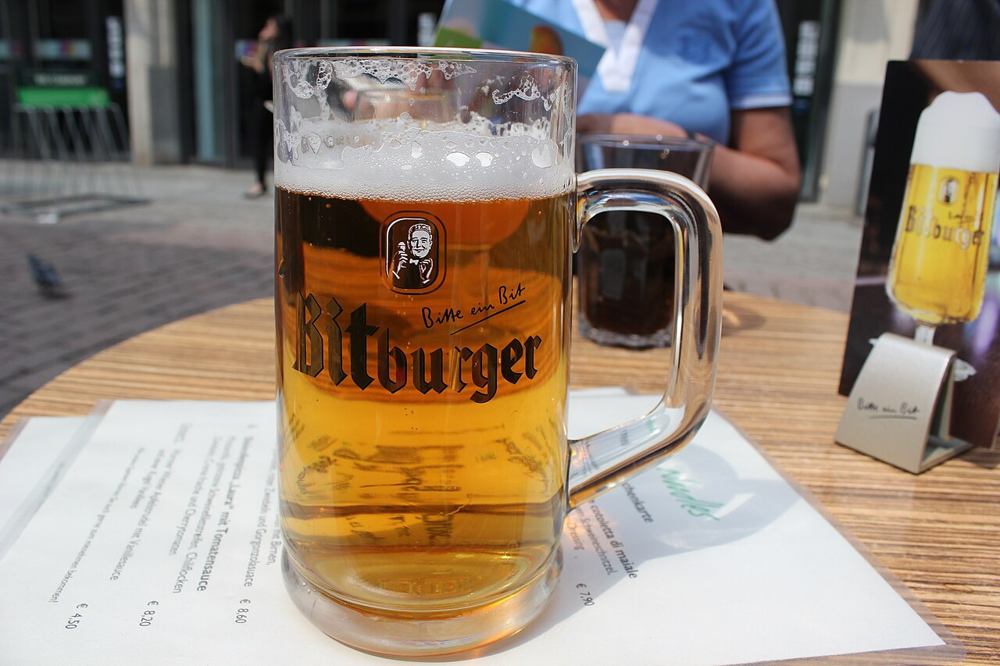
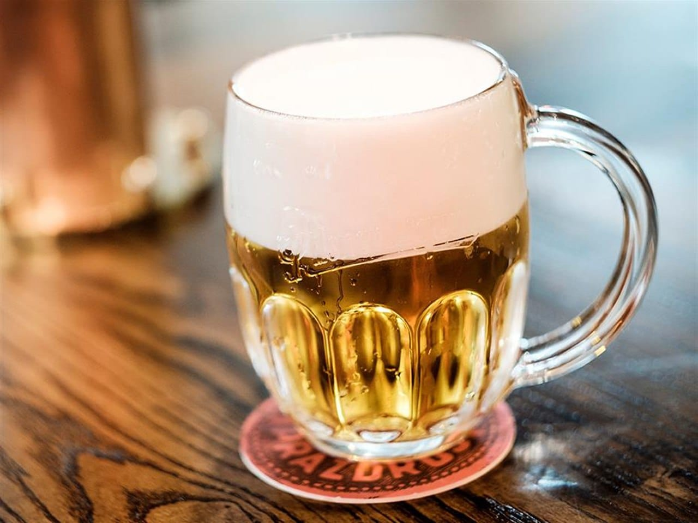

# 拉格啤酒

拉格（lager）是以低温下层发酵酵母酿成、并在接近冰点的温度下长时间贮酒的一类啤酒的统称。它与上层发酵的艾尔构成啤酒最基本的两条技术路线。在[啤酒](ref:beer)的风格体系里，拉格是工艺家族而不是单一风格：淡色拉格、深色拉格与[皮尔森](ref:pilsner)都在其中，而皮尔森只是最有代表性的一支。理解这一点，才能把“拉格”与“皮尔森”两个词放回各自的位置。

图：拉格啤酒。图片：Lars Curfs ( Grashoofd )，CC BY-SA 3.0 nl，via Wikimedia Commons（[原图页面](https://commons.wikimedia.org/wiki/File:Bitburger_Glass.JPG)）。

## 定义与标准

拉格的技术核心是酵母与温度。下层发酵酵母 Saccharomyces pastorianus 是酿酒酵母与野生酵母的杂交种，能在 7–12°C 下正常工作，耐冷、沉降性好，产生的酯香与高级醇较少。主发酵结束后，酒液还要在接近 0°C 的环境中贮放数周，这一过程即 lagering，名称来自德语 lagern（储藏）。

风格指南通常把拉格拆成淡色拉格、深色拉格、皮尔森与博克等条目。淡色拉格酒精度常见 4.0–5.5%，苦度约 20–40 IBU；深色拉格常见 4.5–6.0%。这些数字描述典型区间，不是评分表。日常语境中，lager 也常被当作“工业淡味啤酒”的代称，那是市场用法，不是技术定义。

## 历史与产地

中世纪以来，中欧酿酒者就有把啤酒存放在冬季窖池或冰洞中的做法，低温让酒液稳定、杂味减少，但产量受季节限制。19 世纪，巴伐利亚的酿酒师改良了酵母与发酵控制，使下层发酵逐渐成为可复制的工艺。1842 年，比尔森诞生了淡色下层发酵啤酒，即后来的[皮尔森](ref:pilsner)。

1870 年代，卡尔·冯·林德（Carl von Linde）的机械制冷技术进入酒厂，全年稳定的低温发酵成为可能，拉格由此走向大规模生产。20 世纪，拉格在美洲与亚洲进一步工业化，成为全球产量最大的啤酒类型；与此同时，家族式酒厂仍保留着小批量、未过滤的版本。

## 原料与工艺

[水](ref:water)的矿物组成直接影响酒花苦味的呈现与麦芽香气。[大麦](ref:barley)麦芽提供酶与可发酵糖，部分市场为降低成本、追求清淡风味，会加入大米或玉米等辅料。酒花提供苦味与香气，用量与品种决定风格走向。

糖化可采用煮出法或单温度浸出法。麦汁煮沸、加酒花、澄清并冷却后接种下层酵母。[发酵](ref:fermentation)温度通常 7–12°C，持续一到两周；随后转入贮酒罐，在接近 0°C 的条件下存放数周至数月。低温让酵母沉降、双乙酰被还原、碳酸自然饱和，酒液变得干净、稳定。

包装前，多数商业拉格会过滤或进行巴氏杀菌以延长货架期；[精酿啤酒](ref:craft-beer)中的拉格则常保留酵母与未过滤状态，风味更完整，但保质期更短。

## 风味特征

拉格的共同点是干净、酯香低、发酵带来的杂味少。淡色拉格以面包、饼干般的麦芽香为底，酒花给出草本、花香或轻微柑橘；深色拉格带焦糖、坚果、可可与烘烤面包；皮尔森则以萨兹酒花的辛香与细腻苦味见长。低温发酵并不意味着没有风味，发酵度、碳酸与酒体仍然塑造口感。

常见缺陷有双乙酰带来的黄油味、DMS 带来的煮玉米味、氧化造成的纸板味，以及透明瓶在日光下产生的“日光臭”。这些属于工艺或储运问题，与拉格本身的风格无关。

## 品鉴与饮用

淡色拉格与皮尔森适饮温度约 4–8°C，深色拉格可稍高至 8–10°C。温度过低会压住香气，过高则显得松散。细长杯或高脚杯有助于聚拢泡沫与香气。拉格对新鲜度敏感，酒花香与细腻的麦芽香会随氧化和光照衰减，购买时留意生产日期比看包装更有用。

佐餐时，淡色拉格适合油炸食物、沙拉与海鲜，深色拉格适合烤肉、炖菜与硬质奶酪。保存应避光、阴凉，避免反复升温。

## 常见误区

第一，把拉格等同于寡淡的工业啤酒。发酵方式不等于风味强度，精酿拉格可以很有个性。
第二，把皮尔森当成所有拉格。皮尔森是拉格的一支，且依赖特定的水质、酒花与传统。
第三，把深色拉格当作世涛。二者的发酵方式与配方结构不同。
第四，认为拉格不能算精酿。当代精酿酒厂广泛生产拉格。
第五，认为颜色越浅越没味道。风味取决于原料、发酵与新鲜度，而不是色度。

拉格是一类低温下层发酵、并在接近冰点长期贮酒的啤酒工艺家族，不是“所有淡色啤酒”的同义词。皮尔森、深色拉格、黑拉格都是其分支；低温贮酒让酵母回收双乙酰、悬浮物沉降，带来干净口感。看到“拉格”应先想到工艺，再谈具体风格。

对照阅读：[啤酒](ref:beer)、[水](ref:water)。

## 延伸阅读

- [啤酒](ref:beer)：拉格与艾尔的两条技术路线。
- [皮尔森](ref:pilsner)：拉格中最具代表性的淡色风格。
- [水](ref:water)：水质对酒花与麦芽表达的影响。
- [大麦](ref:barley)：麦芽与可发酵糖的来源。
- [发酵](ref:fermentation)：下层发酵与低温贮酒的作用。
- [原麦汁浓度](ref:original-gravity)：判断啤酒强度的另一项指标。
- [精酿啤酒](ref:craft-beer)：当代小批量拉格的背景。

**关键事实。**

| 项目 | 内容 |
| --- | --- |
| 一句话定位 | 以低温下层发酵酵母酿成、并在接近冰点的温度下长时间贮酒的一类啤酒的统称；淡色拉格、深色拉格与皮尔森都是其分支，拉格是工艺家族，皮尔森是具体风格 |
| 上位风格 | 啤酒 |
| 香气家族 | 麦芽与酒花 |

**来源与边界。** 本页关于「拉格啤酒」的关键事实，主要由以下来源交叉核对：Beer Judge Certification Program（淡色拉格、深色拉格与皮尔森的强度、苦度与色度区间）、Brewers Association（精酿行业对拉格与风格命名的公开表述；未复制其文案）、Deutscher Brauer-Bund（德国下层发酵与窖藏传统的公开表述）等 4 条来源。价格、批次与状态会变，涉及这些字段时以页面所列来源的最新版本为准。正文为项目自写，来源只作核验，不复制原文。

**并读。** 把「拉格啤酒」与「啤酒」、「皮尔森啤酒」、「水」放在一起读时，先确认它们是同一层级还是上下游关系：先确认定义与工艺，再比较原料、产区与代表品牌。本页负责给出酒类风格的基本坐标，对照条目补上具体案例与差异；读完再回到本页，才能分清哪些差别属于酒类风格本身，哪些只是产地、批次或品牌选择。

**适用边界。** 对「拉格啤酒」而言，法定定义、原料比例与地域风格会随法规和行业分类更新；品牌案例不等于整个风格。

## 相关图像

图：皮尔森啤酒。图片：Steven Walling，CC BY-SA 4.0，via Wikimedia Commons（[原图页面](https://commons.wikimedia.org/wiki/File:Pilsner_urquell_mug.jpg)）。关联图像：拉格啤酒。
