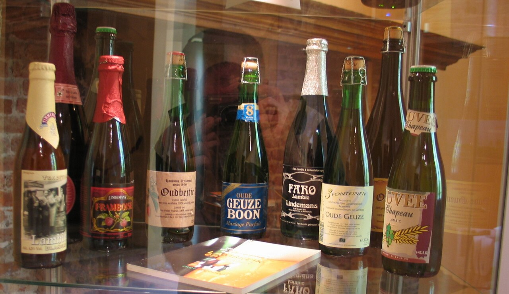

# 兰比克

兰比克（lambic，荷兰语 lambiek）是比利时布鲁塞尔周边帕约滕兰（Pajottenland）与森讷河谷（Senne/Zenne）一带的传统啤酒，依靠空气中的野生酵母与细菌进行自发发酵，而不是接种商业酵母。它酸、干、带野生菌气息，常以陈年兰比克与年轻兰比克混合装瓶，形成 gueuze；加入水果则成为 kriek、framboise 等版本。

图：兰比克。图片：Paul Hermans at Dutch Wikipedia，CC BY-SA 3.0，via Wikimedia Commons（[原图页面](https://commons.wikimedia.org/wiki/File:Bieren_uit_de_streek_rond_brussel.jpg)）。

## 定义与标准

兰比克没有一张统一的参数表。酒精度常见 5.0–6.5%，gueuze 常见 5.0–8.0%，水果兰比克常见 5.0–7.0%。颜色从淡金到琥珀，通常浑浊；苦度很低，通常不超过 10 IBU。风格指南把兰比克、gueuze 与水果兰比克分别列出，但它们的共同基础是同一套自发发酵与长期陈放工艺。

名称之间存在包含关系。gueuze 是用不同年份兰比克调配并二次发酵的产品，不是独立于兰比克的另一种发酵方式；kriek 与 framboise 则是在兰比克基础上加樱桃或覆盆子。把 gueuze 当作“兰比克的品牌名”，会忽略其调配与瓶内发酵的技术核心。

## 历史与产地

兰比克的酿造传统集中在布鲁塞尔以西与以南的帕约滕兰，森讷河（Zenne）一带的水源与空气微生物环境被视为风格形成的重要条件。这一带在 18 至 19 世纪已有成熟的兰比克与 gueuze 生产，20 世纪后期产量大幅收缩，之后在酒厂与爱好者推动下逐步恢复。

在欧盟层面，Oude Geuze、Oude Kriek 等传统名称自 1997 年起获得保证传统特色（TSG）保护；兰比克整体是否属于受保护地理标志，应以欧盟官方登记为准，不宜笼统宣称。今日的兰比克仍以[比利时](ref:belgium)的小型酒厂为主要生产者，产量有限。

## 原料与工艺

[大麦](ref:barley)麦芽构成基础，[小麦](ref:wheat)常以未发芽形式占配方的 30–40%，为酒体与微生物提供养分。酒花使用陈年酒花：长时间存放后α-酸下降，抗菌作用保留而苦味很弱，因此兰比克的苦度很低。

糖化采用浑浊糖化（turbid mash），保留糊精与未糖化淀粉，为后续的细菌与酵母提供缓慢的食物来源。麦汁在开放式冷却槽（coolship）中过夜冷却，接受环境中的酵母与细菌，随后进入橡木桶进行长达一到三年的[陈放](ref:oak-ageing)。[发酵](ref:fermentation)并非单一菌种完成：酿酒酵母、 Brettanomyces 与乳酸菌、片球菌等依次作用，形成复杂的酸味与香气。

gueuze 的调配是关键工艺：年轻兰比克提供可发酵糖，老年兰比克提供酸度、香气与结构，混合后装瓶进行二次发酵，产生细密气泡。水果版本在陈放阶段加入整果或果浆，糖分被微生物继续消耗，风味与酸度随之变化。

## 风味特征

兰比克呈淡金至琥珀色，通常浑浊。香气以酸、柑橘、青苹果、干草、谷仓与马毯气息为主，可能带橡木、蜂蜜与香料；入口干爽，酸度明显，苦味很低，收口干净。gueuze 因二次发酵而有气泡，酸度与香气层次更集中；水果版本则叠加樱桃、覆盆子的果香与酸感。

优质兰比克的酸应当明亮而不刺鼻，野生菌气息复杂但不腐败。醋味过重、纸板味或明显的溶剂感，通常指向氧化、卫生或桶管理问题，而不是风格本身。

## 品鉴与饮用

兰比克与 gueuze 适饮温度约 8–12°C。郁金香杯或收口杯有助于聚集香气；gueuze 倒酒宜缓慢，避免搅动沉淀。佐餐适合硬质奶酪、海鲜、禽肉与酸味明显的菜肴，也可作为餐前开胃酒。

瓶装兰比克应直立、避光、阴凉保存，减少氧气进入。高酸与低酒精度使其开瓶后不宜久放；陈年 gueuze 的风味会继续变化，但并非所有版本都适合长期存放，购买时可留意酒厂建议。

## 常见误区

第一，把兰比克等同于普通酸啤。自发发酵、特定产地与长期橡木桶陈放是其核心。
第二，认为酸味就是坏酒。兰比克的酸来自受控的微生物作用。
第三，认为所有兰比克都加水果。水果版本只是其中一类。
第四，认为兰比克越陈越好。酸度、桶味与气泡需要平衡，过度氧化会破坏风味。
第五，认为任何地方都能轻易复制兰比克。其风味与产地环境、酒花处理和桶房微生物密切相关。

兰比克的发酵不靠单一培养酵母，而是依赖帕约滕兰与森讷河谷环境中的野生酵母和细菌；浑浊糖化、陈年酒花与橡木桶长期陈放构成它的酸、苦与复杂度。新老酒液混合装瓶得到 gueuze，水果版本则在同一基酒上二次发酵，不能把酸味简单当成“坏了”。

对照阅读：[啤酒](ref:beer)、[小麦](ref:wheat)。

## 延伸阅读

- [啤酒](ref:beer)：兰比克在啤酒风格体系中的位置。
- [比利时](ref:belgium)：帕约滕兰与森讷河谷的产地背景。
- [小麦](ref:wheat)：未发芽小麦在兰比克配方中的作用。
- [大麦](ref:barley)：兰比克基础麦芽的来源。
- [发酵](ref:fermentation)：野生酵母与细菌参与的复合发酵。
- [橡木桶陈放](ref:oak-ageing)：长期桶陈对酸度与香气的影响。
- [精酿啤酒](ref:craft-beer)：当代兰比克复兴与欧美酸啤潮流的背景。

**关键事实。**

| 项目 | 内容 |
| --- | --- |
| 一句话定位 | 比利时帕约滕兰与森讷河谷一带依靠野生酵母和细菌自发发酵的传统啤酒；使用浑浊糖化、陈年酒花与橡木桶长期陈放，常以新老酒液混合装瓶成 gueuze，并有樱桃、覆盆子等水果版本 |
| 上位风格 | 啤酒 |
| 香气家族 | 酸香与野生酵母 |

**来源与边界。** 本页关于「兰比克」的关键事实，主要由以下来源交叉核对：Brasserie Cantillon（兰比克的原料、自然冷却、橡木桶陈放与 gueuze 调配等公开工艺信息）、Beer Judge Certification Program（兰比克、gueuze 与水果兰比克的强度、苦度与风味边界）、Oxford University Press（提供关于帕约滕兰、浑浊糖化、陈年酒花与兰比克调配的条目）等 4 条来源。价格、批次与状态会变，涉及这些字段时以页面所列来源的最新版本为准。正文为项目自写，来源只作核验，不复制原文。

**并读。** 把「兰比克」与「啤酒」、「比利时」、「小麦」放在一起读时，先确认它们是同一层级还是上下游关系：先确认定义与工艺，再比较原料、产区与代表品牌。本页负责给出酒类风格的基本坐标，对照条目补上具体案例与差异；读完再回到本页，才能分清哪些差别属于酒类风格本身，哪些只是产地、批次或品牌选择。

**适用边界。** 对「兰比克」而言，法定定义、原料比例与地域风格会随法规和行业分类更新；品牌案例不等于整个风格。

**更新提示。** 「兰比克」最近核对于 2026-11-21；价格、状态与公开信息会变，引用前以本页来源的最新版本为准。

## 相关图像

图：比利时类别配图。图片：Falk2，CC BY-SA 4.0，via Wikimedia Commons（[原图页面](https://commons.wikimedia.org/wiki/File:J33_542_Walplein,_%C2%BBDe_halve_Maan%C2%AB.jpg)）。关联图像：兰比克。
