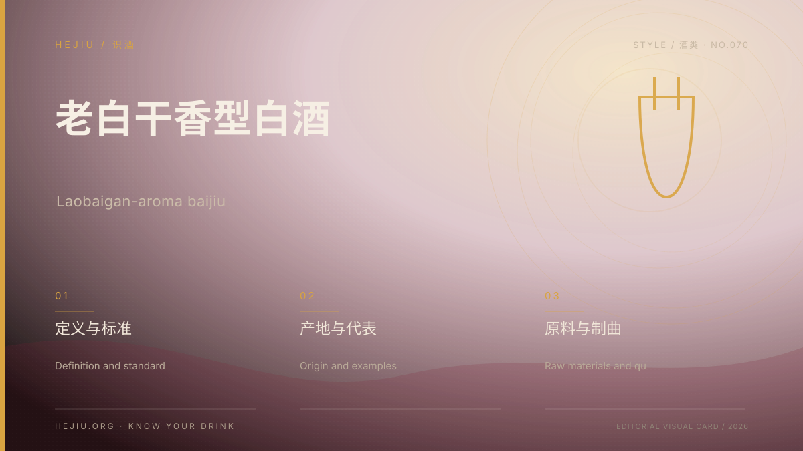

# 老白干香型白酒

老白干香型白酒是[白酒](ref:baijiu)香型分类中的一种，以河北衡水一带的衡水老白干为代表。国家标准 GB/T 10781.10-2024《白酒质量要求 第10部分：老白干香型白酒》于 2024-11-28 发布、2025-12-01 实施，全部代替此前的 GB/T 20825-2007。它以[高粱](ref:sorghum)为主料，常用小麦踩制的清茬曲作糖化发酵剂，并以地缸发酵与清蒸清烧为常见工艺表述。

图：老白干香型白酒 双语视觉卡（项目自绘 SVG）。不是实拍。

## 定义与标准

在白酒香型谱系里，老白干香型与浓香、酱香、清香、米香等并列。术语层面的框架见 GB/T 15109-2021《白酒工业术语》，产品层面的要求则以 GB/T 10781.10-2024 为依据。新旧标准交替期间，市场上仍可能出现标注 GB/T 20825-2007 的产品，执行标准号应以瓶标与实际生产日期为准。

香型是分类，不是质量等级。写着“老白干香型”只说明它属于这一类风格，不说明它比其它香型更纯、更传统或更高级。

## 产地与代表

老白干香型的主要产地是河北衡水。代表产品为衡水老白干，常见产品包括[衡水老白干古法20](ref:laobaigan-gufa)等高度酒款。企业资料把产区叙事与当地水质、气候和长期形成的作坊传统联系在一起。

产地名称不是质量保证。同一香型下，不同企业在原料配比、曲种、发酵容器与贮存方式上差异明显，成品可以从偏清爽到偏醇厚。把“衡水”当成固定风味，会忽略具体产品的分层。

## 原料与制曲

原料以[高粱](ref:sorghum)为主，小麦用于制曲，稻壳常经清蒸后作填充料。填充料的作用是让酒醅在固态发酵与蒸馏时保持疏松、透气，清蒸则是为了减少辅料带来的杂味。

制曲参见[制曲](ref:qu-making)的一般原理。清茬曲强调低温、清蒸与洁净的培菌环境，目标是得到糖化发酵能力稳定、杂味较少的曲。曲的质量决定发酵启动与香气前体的基础，不是“越老越香”。

## 工艺特征

老白干香型的常见工艺表述是地缸发酵与清蒸清烧：酒醅在埋入地下的陶缸中发酵，蒸馏时把粮与酒分开处理，以减少粮香被蒸煮过程掩盖。企业不同工坊也会采用老五甑、清蒸清烧三排净等具体路线，细节属于企业技术范围。

地缸与[泥窖](ref:fermentation-pit)不是一回事。地缸是缸体容器，强调隔离与温控；泥窖是窖池，强调窖泥微生物的长期培养。把两者混为一谈，会误判风味来源。发酵与蒸馏的基本原理可参见[发酵](ref:fermentation)与[蒸馏](ref:distillation)。

## 风味特征

行业与企业的常见描述是“芳香秀雅、醇厚丰柔、甘冽爽净”。与[清香型白酒](ref:light-aroma)相比，老白干香型通常酒体更醇厚、粮香更明显；与[浓香型白酒](ref:strong-aroma)相比，它又少了明显的窖香与己酸乙酯主导感。

这些描述是风格坐标，不是评分。温度、杯型、醒酒时间与个人阈值都会改变感知；同一款酒在不同状态下也会呈现不同层次。

## 品鉴与饮用

品鉴时先闻静止香气，判断粮香、曲香与酯香的比例，再加少量水观察香气是否展开。入口注意甜、酸、苦的平衡与酒体厚度，咽下后看回味是否干净。高度产品宜小杯慢饮，不宜大口急饮。

配餐可选风味浓郁、油脂适中的菜肴。开瓶后应避光、密封、阴凉保存，低度产品尽快喝完。本页关于老白干香型白酒的内容涉及酒精饮料；过量饮酒有害健康，未成年人不应饮酒。

## 常见误区

第一，把老白干香型等同于清香型。两者都用清蒸清烧与地缸发酵，但原料、曲种与风味目标不同。
第二，把“老白干”只当成品牌名。它既是香型名称，也是这类酒的俗称。
第三，把地缸发酵当成泥窖发酵。容器与微生物来源不同，风味路径也不同。
第四，把香型当成质量等级。香型只是分类，不能替代对具体产品的判断。
第五，把企业宣传中的“不上头”“低杂醇油”当成已证实的科学结论。这类表述需要独立检测与证据支持。

老白干香型以河北衡水一带为代表，地缸发酵、清蒸清烧是常见工艺表述，风格干净、醇厚而不失力度。它和清香型、浓香型都不是同一个香型类别；新标准替代旧标准属于规则更新，不等于旧产品自动升级，读标签时应看执行标准与生产日期。地缸发酵让酒醅不直接接触窖泥，清蒸清烧则强调原料与酒醅分开蒸煮；这些工艺选择塑造了老白干的干净与力度。新标准替代旧标准是规则更新，产品是否升级仍要看原料、工艺与检验结果。

对照阅读：[白酒](ref:baijiu)、[浓香型白酒](ref:strong-aroma)。

## 延伸阅读

- [白酒](ref:baijiu)：老白干香型白酒在白酒分类与工艺框架中的位置。
- [清香型白酒](ref:light-aroma)与[浓香型白酒](ref:strong-aroma)：与老白干香型最常被对比的两类。
- [高粱](ref:sorghum)与[小麦](ref:wheat)：老白干香型的基础原料。
- [制曲](ref:qu-making)：清茬曲与糖化发酵剂的作用。
- [发酵](ref:fermentation)与[蒸馏](ref:distillation)：地缸发酵与清蒸清烧的工艺位置。
- [衡水老白干古法20](ref:laobaigan-gufa)：老白干香型的具体产品实例。

**关键事实。**

| 项目 | 内容 |
| --- | --- |
| 一句话定位 | 以河北衡水一带为代表的白酒香型；GB/T 10781.10-2024《白酒质量要求 第10部分：老白干香型白酒》自 2025-12-01 实施并全部代替 GB/T 20825-2007，地缸发酵与清蒸清烧是其常见工艺表述 |
| 上位风格 | 白酒 |
| 香气家族 | 老白干香 |

**来源与边界。** 本页关于「老白干香型白酒」的关键事实，主要由以下来源交叉核对：国家市场监督管理总局、国家标准化管理委员会（标准号、发布日期、实施日期与代替关系；未复制标准正文；旧标准号、实施日期与废止日期；未复制标准正文）、衡水老白干（清蒸清烧三排净、地缸发酵与人工装甑等工艺公开表述）、衡水老白干酿酒集团（高粱、清茬曲、稻壳填充料与地缸发酵等公开表述）等 7 条来源。价格、批次与状态会变，涉及这些字段时以页面所列来源的最新版本为准。正文为项目自写，来源只作核验，不复制原文。

**并读。** 把「老白干香型白酒」与「白酒」、「清香型白酒」、「浓香型白酒」放在一起读时，先确认它们是同一层级还是上下游关系：先确认定义与工艺，再比较原料、产区与代表品牌。本页负责给出酒类风格的基本坐标，对照条目补上具体案例与差异；读完再回到本页，才能分清哪些差别属于酒类风格本身，哪些只是产地、批次或品牌选择。
