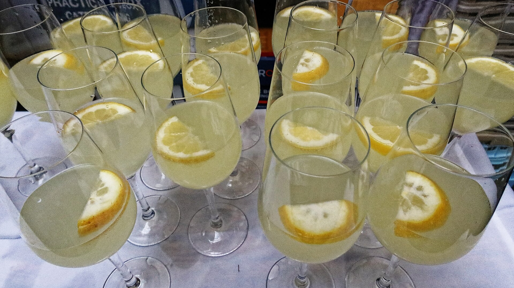

# 柠檬酒

柠檬酒（limoncello）是[意大利](ref:italy)南部的柠檬皮利口酒：把新鲜柠檬的黄色外皮浸入中性烈酒，让精油与香气溶出，再与糖浆混合，得到亮黄色、甜而油润的餐后酒。它不靠果汁取味，也不经过发酵，因此喝起来不像柠檬水，更接近“被糖托住的柠檬皮”。在索伦托、阿马尔菲与卡普里，它常被保存在冷冻室里，用小杯一口一口地喝。

图：柠檬酒相关实景照片。图片：Burkhard Mücke，CC BY-SA 4.0，via Wikimedia Commons（[原图页面](https://commons.wikimedia.org/wiki/File:Limoncello_Spritz_mit_Prosecco.jpg)）。

## 南意大利的柠檬皮

定义柠檬酒只需要三件东西：柠檬皮、酒精、糖。柠檬皮必须只取黄色外层，避免白色海绵层带来苦味；酒精通常是中性谷物酒精或葡萄酒精；糖则以糖浆形式加入，决定甜度与黏稠度。传统家庭配方会把整瓶酒放在阴凉处浸泡数周，再过滤、加糖、装瓶，整个过程不需要复杂设备。

它的地理身份与柠檬产地绑定，而不是与某一条法定配方绑定。索伦托半岛与阿马尔菲海岸盛产香气浓郁的椭圆柠檬，卡普里则把柠檬酒做成旅游名片。正因如此，柠檬酒既有家庭手作的粗粝版本，也有酒厂生产的稳定版本，风格跨度比许多法定酒种更大。

## 法律上的“利口酒”，风味上的“柠檬”

在欧盟法规里，柠檬酒属于[利口酒](ref:liqueur)：最低酒精度 15% vol，含糖量至少 100 克/升。法规没有为“limoncello”规定统一配方，也没有给它本身一个欧盟地理标志；受保护的是“Limone di Sorrento”和“Limone Costa d'Amalfi”等柠檬产地名称。也就是说，酒标可以写索伦托柠檬，但并不意味着整瓶酒都受原产地法约束。

市售柠檬酒的酒精度多在 25% 到 32% 之间，糖分常在 200 到 350 克/升。酒精度太低，柠檬香气会显得水；太高，酒精会压过果皮。糖分则决定它是“甜酒”还是“糖浆”。一些生产商会加入少量柠檬汁或酸度调节剂，让口感更接近鲜果；传统派则认为这会破坏精油的纯净感。

## 从家庭厨房到瓶装

柠檬酒的现代流行常被追溯到 20 世纪初的索伦托与卡普里家庭，但类似的柠檬皮浸酒在地中海地区更早就有。20 世纪 80 年代以后，意大利旅游业把这种家常酒推向餐馆与纪念品商店，随后商业化生产迅速扩张。今天，它既是家庭餐桌上的自制酒，也是机场免税店里最常见的意大利伴手礼之一。

商业化带来两种路线：一种强调手工、小批量、只用本地柠檬；另一种强调稳定、低价、全年供应。前者颜色更自然、香气更有果皮油感，后者可能更甜、更像糖果。两条路线都合法，区别在原料与工艺的取舍。

## 只用皮，不用汁

制作时先把柠檬洗净、擦干，只削下黄色表皮，尽量不带白色部分。果皮进入 90% 以上的中性酒精中浸泡，时间从十天到一个月不等；温度越低，浸泡越慢，香气越干净。浸提完成后过滤掉果皮，再用矿泉水与糖煮成的糖浆稀释到目标酒精度。多数做法不再[蒸馏](ref:distillation)，以保留果皮中较轻的香气；少数生产商会轻蒸馏，让酒体更清澈。

关键在“浸提”而不是“煮沸”。高温会破坏柠檬皮中细致的萜烯香气，也会把苦味一并带出。糖浆要冷却后再混合，避免香气被热气冲散。混合后通常静置一到两周，让酒精、糖与水融合，再过滤装瓶。颜色来自果皮本身，真正传统的柠檬酒不需要额外着色。

## 冷、甜、亮的感官

倒入小杯时，柠檬酒通常呈不透明的亮黄色，有时带一点绿色反光。闻香是新鲜柠檬皮、柠檬花、糖果与轻微树脂感；入口先甜，随后是酒精的温热与果皮油脂的厚度，酸度不高，尾段常有一丝苦。好的版本在甜与苦之间有一条清晰的线，不会只剩糖水感。

温度是它的一半。冷冻后酒液会变得更黏、更稠，香气也被收住，入口时甜味先到、酒精后到；室温下香气更开放，但甜感更重，酒精也更刺。评价时看三点：颜色是否像真实果皮、香气是否有精油感、甜度是否盖住柠檬的苦与酸。

## 索伦托、阿马尔菲与卡普里

索伦托半岛以“Ovale di Sorrento”椭圆柠檬闻名，果皮厚、精油多，适合长时间浸提；阿马尔菲海岸的柠檬更小、更香，常被用于家庭配方；卡普里则把柠檬酒与海岛旅游绑定，形成更甜、更易饮的风格。三地都视柠檬酒为地方骄傲，但配方与甜度并没有统一标准。

品牌层面，Pallini 与 Luxardo 提供稳定、易买的商业版本，Villa Massa 强调索伦托渊源，DICAPRI 则以索伦托 IGP 柠檬与传统配方为卖点。手工作坊的产品常在本地市场出售，标签上会写明柠檬品种、浸泡时间与糖分。购买时，产地与原料比“意大利国旗”更有信息量。

## 冰镇之后怎么喝

最经典的喝法是把整瓶酒放进冷冻室，取出后倒入同样冰过的小酒杯，一口喝完。低温会让酒体更稠、甜味更集中，也能压住酒精的刺感。它适合餐后、搭配柠檬甜点、杏仁饼干或新鲜莓果；也可以加苏打水与冰块，做成更轻松的长饮。

在调酒里，柠檬酒可以替代部分柠檬汁与糖浆，但因为它已经含糖，配方中的[残糖](ref:residual-sugar)要相应减少。与汤力水、普罗塞克或冰茶混合都很常见；淋在冰淇淋上则是意大利家庭的简单吃法。注意它不适合高温加热，香气会迅速散失。

## 与柠檬甜酒、柠檬汁的区别

“Limoncino”在利古里亚与托斯卡纳常被当作柠檬酒的同义词，但有些地区用它指酒精度更低、更甜的家庭版本。“Crema di limone”则是加入乳制品的奶油柠檬酒，口感更厚，保存期更短。柠檬汁没有酒精，不能替代柠檬酒；柠檬味伏特加或利口酒则可能用香精调配，缺少果皮浸提的油润感。

它也不是柠檬果酒。果酒靠发酵产生酒精，柠檬酒靠外加烈酒提取香气；前者酸度更高、酒精度更低，后者更甜、更稳定。把两者混为一谈，容易在配方的酸糖平衡上出错。

## 选购与保存

购买时看配料顺序：柠檬皮、酒精、糖、水越靠前越接近传统做法；若配料表很长、出现多种香精与色素，风味通常更糖果化。颜色过于荧光、清澈得像柠檬汽水，未必是优点。开瓶后放回冷冻室可以延长寿命，但每次取用后要拧紧瓶盖，避免吸收冰箱异味。

自制时注意两点：果皮必须无蜡、无农药残留；糖浆与酒精混合后要充分静置再过滤，否则瓶底会出现絮状物。高糖高酒精让柠檬酒相对耐放，但香气会随时间变平，建议在一年内喝完。

补充阅读：[修道院啤酒](ref:c-extra-1)。

相关条目：[利口酒](ref:liqueur)、[意大利](ref:italy)、[蒸馏](ref:distillation)。
