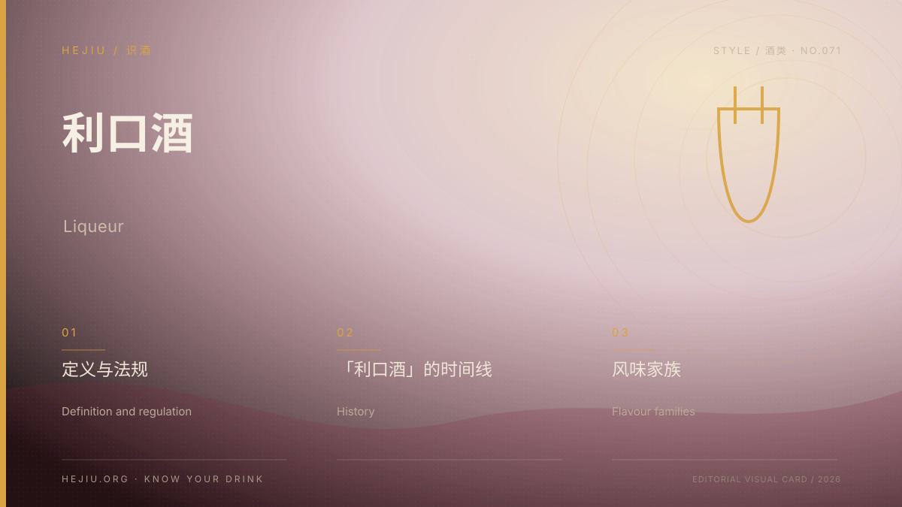

# 利口酒

利口酒（liqueur）是以烈酒为基底，加入糖与水果、草本、坚果、奶油等风味原料制成的甜味酒。它的结构可以概括为“基酒 + 风味提取 + 甜化”，三个环节的差别决定了成品是清澈的柑橘甜酒、浓稠的奶油酒，还是苦甜交织的草本酒。

图：利口酒 双语视觉卡（项目自绘 SVG）。不是实拍。

## 定义与法规

欧盟法规把利口酒定义为最低酒精度 15% vol、含糖量至少 100 克/升（以转化糖计）的甜味酒。部分以苦味、酸味或特定原料为主的子类别允许偏离这一糖分下限；而“crème de”一类名称要求更高的糖分，例如 crème de cassis 的法规最低含糖量为 250 克/升。各国标准可能更细，标签上的类别词、酒精度与糖分声明是判断依据。

利口酒与苦味酒（bitters）不是同一类别。苦味酒通常糖分很低、单次用量以 dash 计，主要作为调味料；利口酒则以饮用为目的，糖分与风味浓度都更高。这条边界在配方中很重要：把苦味酒当作甜味剂使用，成品会明显偏苦、偏干。

## 「利口酒」的时间线
利口酒的前身是欧洲中世纪的药用糖浆与“cordial”。修道院与药房把草药浸泡在酒精中，加糖保存，用于消化与日常保健。17 至 18 世纪，这类配方进入宫廷与商业生产，逐渐从药房走向餐桌。19 世纪，蒸馏、过滤与糖化技术稳定下来，查特酒、柑曼怡、君度等品牌形成了今天仍然清晰可辨的风味谱系。

20 世纪，利口酒分成两条路线：一条是餐后纯饮的浓郁型，另一条是调酒用的高浓度风味原料。后者在鸡尾酒复兴中变得更重要，因为少量用量就能提供明确的柑橘、咖啡、杏仁或草本方向。

## 风味家族

- **水果类**：柑橘、樱桃、桃子、黑加仑、覆盆子等，通常以浸提或蒸馏获取香气，甜度较高，常用于甜型鸡尾酒。
- **草本与苦味类**：查特、金巴利、阿佩罗等，风味从甜苦到复杂草本，既可纯饮也可作为结构型配料。
- **坚果类**：杏仁、榛子、核桃，常见杏仁香精感，适合餐后与甜点。
- **奶油类**：加入乳制品与乳化剂，口感浓稠，需注意保存与过敏原标识。
- **咖啡类**：咖啡豆浸提或调配，是白俄罗斯、浓缩咖啡马天尼等配方的核心甜味与苦味来源。
- **花香与蜂蜜类**：接骨木花、紫罗兰、蜂蜜，香气轻，适合清爽型饮用。

家族划分只是方便检索，实际产品常跨类，例如柑橘与草本并用、咖啡与奶油并用。

## 生产工艺

常见工艺有四条路径：浸泡（maceration）、渗滤（percolation）、蒸馏（distillation）与直接调配（compounding）。浸泡把原料放入酒液，让香气与色素溶出；渗滤让酒液缓慢穿过原料层，提取更均匀；蒸馏把浸泡液或蒸汽通过原料，得到更清澈、更集中的香气；直接调配则把香精、糖浆与基酒混合，成本低但融合度不同。

[蒸馏](ref:distillation)之后通常需要调整酒精度、加糖或糖浆、过滤与静置。静置让香气与糖分融合，减少尖锐感。奶油类还要经过均质，让乳脂稳定悬浮。生产者的核心任务是让基酒、风味与甜度三者不互相掩盖。

## 糖分、酒精度与保存

利口酒的酒精度跨度很大：清淡型可能在 15% vol 左右，浓郁型可到 40% vol 以上。糖分同样跨度大，从每升一百多克到数百克。高糖、低酒精的产品开瓶后更稳定；奶油类含乳制品，开瓶后应冷藏并尽快饮用。所有利口酒都应避免高温与直射光，防止香气与颜色劣化。

购买时值得检查三项：类别词是否明确、糖分与酒精度是否标注、是否含乳制品或坚果等过敏原。高糖不代表低质量，但会改变饮用方式与配方比例。

## 「利口酒」的闻与喝
品鉴利口酒的关键是温度与份量。小杯、少量、室温或轻微冷藏即可；过冷会压住香气，过热会放大酒精。先闻香气方向，再判断甜度与酒精是否平衡，最后看余味是否干净。

不同家族的评价重点不同：水果类看香气是否像真实果实而非糖果；草本类看苦味是否有层次、甜味是否遮住植物细节；奶油类看乳脂与酒体是否融合、是否有油腻感；咖啡类看烘焙度与苦甜比。与[白兰地](ref:brandy)这类纯饮烈酒相比，利口酒的判断标准更偏向“风味浓度与甜度的平衡”。

## 「利口酒」的饮用与搭配
利口酒可以纯饮、加冰、兑苏打水或牛奶，也常作为鸡尾酒的甜味与香气来源。由于已经含糖，配方中通常要减少或省略糖浆；用利口酒替代糖浆时，酸度往往需要同步调整。经典的[内格罗尼](ref:negroni)用金巴利提供苦味与甜味，正是利口酒承担结构角色的例子。

餐后饮用适合搭配黑巧克力、坚果、干酪与甜点；奶油类适合咖啡与巧克力，水果类适合挞类与莓果。餐前则更适合低糖、苦味或气泡型产品。高糖利口酒与高甜点心同食容易腻，份量应更小。

## 「利口酒」容易被读错的地方
第一，把利口酒等同于“低度酒”。它的酒精度可以很高，关键是糖分与饮用份量。
第二，认为越甜越低级。甜度是类别设计的一部分，问题在于是否平衡。
第三，把苦味酒与利口酒混用。苦味酒糖少、用量小，替换会改变配方结构。
第四，忽视奶油类的保存条件。含乳制品的产品开瓶后冷藏是基本要求。
第五，把英式“cordial”与美式“liqueur”当成同义词。英式英语中 cordial 常指浓缩果汁糖浆，语境不同，含义也不同。

对照阅读：[蒸馏](ref:distillation)、[内格罗尼](ref:negroni)。

**来源与边界。** 本页关于「利口酒」的关键事实，主要由以下来源交叉核对：European Union（利口酒的最低糖分、酒精度与类别要求）、International Bartenders Association（利口酒在经典鸡尾酒分类与配方中的角色）、Oxford University Press（提供关于利口酒历史、风味家族与调酒应用的条目）等 4 条来源。价格、批次与状态会变，涉及这些字段时以页面所列来源的最新版本为准。正文为项目自写，来源只作核验，不复制原文。

## 参考资料
- [蒸馏](ref:distillation)：风味提取与酒体清澈度的关键步骤。
- [白兰地](ref:brandy)：常作为利口酒基酒的葡萄蒸馏酒。
- [内格罗尼](ref:negroni)：利口酒在经典配方中承担结构角色的例子。
