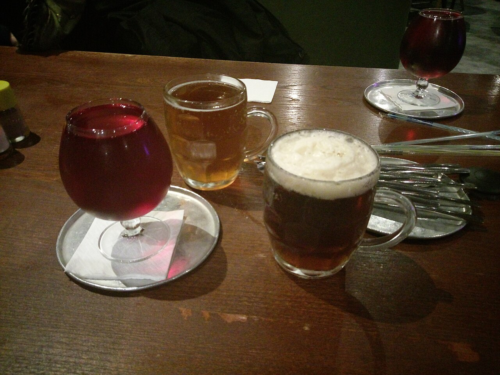

# 无醇/低醇啤酒

无醇/低醇啤酒是把酒精限制在很低水平，或在酿好之后再去除酒精的啤酒大类。法律阈值按国家各不相同，工艺上分成"控制发酵"与"事后脱醇"两条路线；风味从清淡谷物、甜麦芽到接近普通拉格都有，酒体常偏薄，残甜与酒花苦度的平衡是关键。

图：Low-alcohol / Non-alcoholic Beer：Low-alcohol beer, Iran（Wikimedia Commons）。图片：Freshman404，CC BY-SA 4.0，via Wikimedia Commons（[原图页面](https://commons.wikimedia.org/wiki/File:Low-alcohol_beer,_Iran.jpg)）。

## 定义与边界

美国 TTB 的标签规则把界限划得很具体：麦芽饮料标注"non-alcoholic"时，必须在紧邻位置以清晰印刷写明"contains less than 0.5% alcohol by volume"；"low alcohol"或"reduced alcohol"只能用于酒精度低于 2.5% 的产品；"alcohol free"则要求完全不含酒精。这是标签用语规则，不等于各国税法对酒精饮料的起点一致。

英格兰的官方指引把无醇饮品分成三档：alcohol-free 不超过 0.05% ABV，dealcoholized 在 0.05% 到 0.5% 之间，low alcohol 不超过 1.2% ABV。欧盟不少国家把"alcohol-free"的界限定在 0.5% ABV；学界建议的 NoLo 分级还包括 0.0% vol、无醇、低醇 0.5–1.2% vol 以及酒精含量比同类产品降低至少 30% 的减醇款。

税制门槛也随之不同：美国、德国、芬兰、荷兰对啤酒从超过 0.5% ABV 起计税，英国则从超过 1.2% ABV 起。需要分清的是，英语里的 light beer 多指减碳水、减热量的低度啤酒，和本页讨论的无醇、低醇类别不是同一条线。[啤酒](ref:beer)的基础原料与普通啤酒一致，差别在酒精水平和处理工艺。

## 历史与命名

20 世纪工业啤酒扩张期间，脱醇啤酒的尝试已经出现，但早期产品普遍麦汁味重、口感稀薄，更接近带气泡的甜味麦芽饮料。真正推动这一品类快速发展的是 2010 年代以后的健康、健身与适度饮酒趋势，无醇啤酒成为增长最快的饮品方向之一。

当代工艺无醇啤酒的代表是美国 Athletic Brewing：公司 2017 年由 Bill Shufelt 与酿酒师 John Walker 创立，2018 年在康涅狄格州 Stratford 开出第一座专门酿造无醇啤酒的工厂。他们的路线不是把普通啤酒事后脱醇，而是让麦汁完整发酵，但把终点控制在 0.5% ABV 以下；旗舰款 Run Wild IPA 用五种西北酒花提供柑橘与松针味。

名称上，NA beer、alcohol-free beer、low-alcohol beer、dealcoholized beer 各自对应不同阈值，买酒时先看标签上的实际酒精度，而不是只看"无醇"两个字。历史叙事常把品类兴起归于某一家公司，但真正的形成是原料、设备、税收规则与消费习惯共同作用的结果。

## 原料与工艺

基础原料仍是麦芽[大麦](ref:barley)、水、[酒花](ref:hop)和酵母，[发酵](ref:fermentation)路线的选择决定了成品骨架。第一条路线是控制发酵：通过低温发酵、提前中断或使用特殊酵母，让糖分转化不充分；做法简单、沿用普通设备，但成品容易残留麦汁甜感，酒体偏薄，带明显麦汁味。

第二条路线是事后脱醇，把酿好的啤酒送入专门设备去除酒精。真空蒸馏在减压下把沸点降到约 30–35 °C，酒精先蒸发出来，麦芽与酒花香气大部分保留，酒精度可以精确压到 0.05% 以下，适合麦芽型拉格和深色啤酒。反渗透让啤酒在高压下穿过半透膜，水和酒精透出、大分子风味物留在浓缩液里，酒花香气保留较好；但从经济性看，低于约 0.45% ABV 已不合算，膜处理后还需要重新充入二氧化碳。

旋转锥柱（spinning cone column）是高端脱醇标准：设备分两段工作，先回收约占体积 3%、酒精度约 60% 的芳香馏分，再对主体液体脱醇，最后把香气回掺。另有一条无发酵路线，直接用麦芽提取物、酒花油和水调配，做到 0.0% ABV。脱醇过程会带走一部分挥发性香气，酒厂常用干投酒花、调整麦芽配方和香气回掺来补偿。

## 风格与味觉

风味谱系从清淡谷物、甜麦芽一直延伸到接近普通拉格或艾尔。酒体普遍比全醇啤酒薄，残糖甜感与酒花苦度之间的平衡决定成品是否顺口；常见缺陷包括生麦汁味、稀薄水感、金属味和纸板样氧化味，多来自发酵不足、脱醇过热或储存氧化。

按酒精度分档，市面产品有 0.0%、低于 0.05%、低于 0.5%、不超过 1.2% 等几档，碳酸化水平也因工艺不同而有高低。工艺差异直接反映在杯里：脱醇拉格偏麦芽甜，反渗透和锥柱处理的版本能保留更多酒花香，停发酵版本则偏甜、偏薄。

味觉判断可以分开甜、苦、香气、酒体与气泡几个维度；一个维度突出不等于整体更好，平衡与收口干净通常比单一强度更难得。同一品牌的不同工艺线之间，差别往往比品牌名气更值得比较。

## 代表产区与品牌

德国是无醇啤酒的老牌产区，Bitburger 0.0 与长期专注无醇的 Clausthaler 是常见名字；荷兰有 Heineken 0.0，日本有 Asahi Dry Zero，美国则以 Athletic Brewing 为当代标杆。Athletic 的 Run Wild IPA 酒精度低于 0.5%，在美国无醇工艺啤酒市场占有过半份额，产品覆盖 IPA、金色艾尔、深色与酸啤等风格。

大厂的 0.0 系列走大众零售渠道，定价平稳；工艺小厂则围绕 IPA、小麦、世涛等具体风格做无醇版本，设备与投料成本会反映在定价上。品牌只能作为入口，同一类别下原料等级、脱醇工艺和新鲜度差异很大，先看标签参数再比较产品更稳妥。

## 怎么喝与配餐

无醇/低醇啤酒适合冰镇到 4–7 °C 左右饮用，普通啤酒杯即可；纯饮解渴，也能配餐。它天然适配午餐、驾车、运动前后、值班等不便饮酒的场景，和菜肴搭配时不必像全醇啤酒那样迁就酒精感。

配餐多选咸香、烤物与油炸小吃：炸鸡、烤香肠、椒盐坚果、薯片和汉堡都能接上啤酒的麦芽甜与气泡；清淡的无醇拉格也可配海鲜、轻食。酒精度低意味着口腔里的酒精暖意弱，温度太低会把果香和麦芽味一起关掉，倒酒前留意冰藏时间即可。

## 选购、储存与误区

读标签先找实际酒精度：是 0.0%、低于 0.05% 还是低于 0.5%，配料表与生产日期也要看。无醇啤酒货架期比全醇啤酒短，新鲜度直接影响风味；储存避光、避高温，开瓶后尽快喝完，不要久放。

几个常见误区需要避开：标注无醇不等于完全没有酒精，低于 0.5% 的产品仍含微量；颜色深浅和甜度高低都不代表品质；"手工""传统""小批量"是营销说法，不是法律术语。还要注意，低度 light beer 强调减热量，和本类别的脱醇路线不是一回事。

## 延伸阅读与另见

- 相关条目：[beer](ref:beer)、[fermentation](ref:fermentation)、[distillation](ref:distillation)、[barley](ref:barley)、[hop](ref:hop)。
- 想建立品类边界，可以先喝一支脱醇拉格和一支工艺无醇 IPA，对比麦芽甜、酒花苦与酒体厚度的差别，再尝试一支停发酵或无发酵调配版本。
