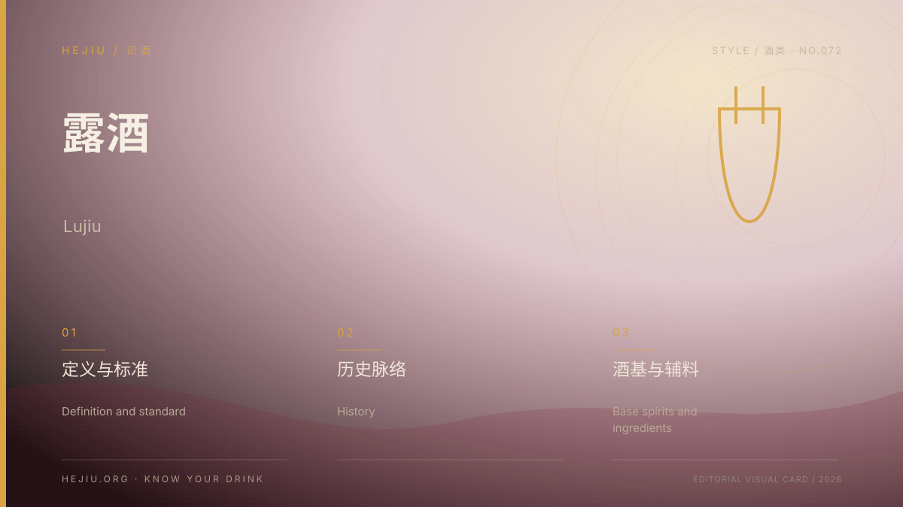

# 露酒

露酒是中国配制酒中的重要分支。按 GB/T 27588-2011《露酒》的定义，它以蒸馏酒、发酵酒或食用酒精为酒基，加入可食用或药食两用的辅料，经调配、混合或再加工制成，并且已经改变了原酒基的风格。它属于饮料酒，不属于药品。

图：露酒 双语视觉卡（项目自绘 SVG）。不是实拍。

## 定义与标准

标准把露酒归入配制酒范畴，并对酒基、辅料、感官与理化指标提出要求。露酒的“露”字与传统工艺有关：早期做法把香料或草本浸入酒中，取浸出液，再按配方调配。

露酒是分类名称，不是质量等级，也不是功效承诺。标签上的酒基、配料、酒精度与类型，是判断产品的直接信息；没有标注为露酒的产品，即使含草本，也不一定属于这一类别。

## 历史脉络

露酒的传统与药食同源观念、香料使用和节令饮用相关。古代文献中已有以酒浸泡草本或香料的记载；明清以后，配方化与商品化程度提高，出现了一批有地方特色的露酒。

20 世纪，露酒的生产被纳入食品工业体系，配方与标准逐步规范。改革开放后，低度化与风味多样化推动了新产品开发；与此同时，消费者对“草本”“养生”的关注，也让露酒的市场定位更复杂。

“露”字与明清花露蒸馏有关。花露是含香植物经水蒸气蒸馏得到的芳香液，少量兑入酒基即可增香，和直接把药材泡在酒里是两种不同的提取思路。清代宫廷与民间都有玫瑰露、桂花露一类的产品，后来才逐步演变为配方化的商品露酒。

## 酒基与辅料

酒基可以是[白酒](ref:baijiu)等蒸馏酒，也可以是黄酒、葡萄酒等发酵酒，或食用酒精。不同酒基带来不同的酒体与香气基础：蒸馏酒基干净、酒精度高，发酵酒基风味更复杂。

辅料包括草本、果实、花、香料、糖等，其中不少属于药食两用物质。辅料的作用是提供香气、风味或颜色，不是治疗作用。配方与用量属于企业技术范围，公开资料通常只描述方向。

## 工艺

露酒的常见工艺有浸泡、调配与再蒸馏。浸泡型把辅料浸入酒基，经过一段时间提取香气与风味，再过滤、澄清；调配型把酒基与糖液、果汁、香料提取物等按比例混合；再蒸馏型把浸泡液蒸馏，取香气更纯净的馏分。

[调配](ref:blending)决定最终风格：不同酒基、不同提取液与糖液的比例，会影响甜度、香气强度与收口。温度、时间与过滤方式影响提取效率与稳定性，也是产品质量控制的关键环节。

用食用酒精作酒基时，酒精本身还要符合食品安全国家标准对食用酒精的要求（GB 31640）；用白酒或黄酒作基酒，则要同时满足相应产品标准。标签上的“酒基”“配料”“酒精度”“执行标准”是判断类别的关键，不能只凭“含草本”推断。

## 风味与类型

露酒的风味跨度很大：草本型带植物、根茎与轻微苦味；果香型突出果实的酸甜；香料型常见肉桂、丁香、柑橘皮等气息。酒基的风格通常被部分掩盖，但仍影响酒体厚度与回味。

按配方与风味，市场上常见的类型包括草本露酒、果味露酒与花香露酒。竹叶青是草本露酒的代表性产品之一。类型描述的是风味来源，不是等级；同一类型内部差异仍然明显。

## 品鉴与饮用

品鉴时先闻香气，判断主要风味来源，再入口看酒基与辅料是否融合、甜酸是否平衡、收口是否干净。草本型可常温或加冰，果味型适合冷藏，加冰会降低香气强度但提升清爽感。

露酒常用于餐前、佐餐或调制鸡尾酒。高糖产品适合少量饮用，高酒精度产品应控制饮用量。饮用强度以标签上的[酒精度](ref:abv)为准，不以甜度或颜色推断。本页关于露酒的内容涉及酒精饮料；过量饮酒有害健康，未成年人不应饮酒。

## 常见误区

第一，把露酒当成药酒。药酒属于药品管理范畴，露酒是饮料酒。
第二，认为露酒有保健功效。标签与宣传中的功效说法不应轻信。
第三，把含草本的酒都叫露酒。类别以标签与标准为准，不是凭配料推测。
第四，认为甜度高就是低度。甜度与酒精度互不决定。
第五，把露酒当成低端产品。分类与价格、质量没有直接关系。

露酒以蒸馏酒、发酵酒或食用酒精为酒基，加入可食用或药食两用辅料，经调配或再加工制成；它属于配制酒，不是药酒，也不是简单浸泡酒。酒基、辅料、糖分与工艺决定风格，标签上的“露酒”说明类别，不说明功效，更不能替代药品。

对照阅读：[配制酒](ref:compounded)、[调配](ref:blending)。

## 延伸阅读

- [配制酒](ref:compounded)：露酒所属的上位类别。
- [白酒](ref:baijiu)：最常见的蒸馏酒基。
- [调配](ref:blending)：配方组合与风味平衡的核心动作。
- [酒精度](ref:abv)：理解标签标注的基础概念。

**关键事实。**

| 项目 | 内容 |
| --- | --- |
| 一句话定位 | 以蒸馏酒、发酵酒或食用酒精为酒基，加入可食用或药食两用辅料，经调配或再加工制成的饮料酒；GB/T 27588-2011 对其作出规定，露酒不是药酒 |
| 上位风格 | 配制酒 |

**来源与边界。** 本页关于「露酒」的关键事实，主要由以下来源交叉核对：国家质量监督检验检疫总局、国家标准化管理委员会（可在国家标准全文公开系统按标准号检索原文）、国家市场监督管理总局、国家标准化管理委员会（可在国家标准全文公开系统按标准号检索原文；GB/T 27588-2011的适用范围、术语与分类口径）、Oxford University Press（提供关于加味酒传统的条目；由原条目末尾参考资料迁移，未逐条复核访问日期）。价格、批次与状态会变，涉及这些字段时以页面所列来源的最新版本为准。正文为项目自写，来源只作核验，不复制原文。

**并读。** 把「露酒」与「配制酒」、「白酒」、「调配」放在一起读时，先确认它们是同一层级还是上下游关系：先确认定义与工艺，再比较原料、产区与代表品牌。本页负责给出酒类风格的基本坐标，对照条目补上具体案例与差异；读完再回到本页，才能分清哪些差别属于酒类风格本身，哪些只是产地、批次或品牌选择。

## 相关图像

图：葡萄酒调配实验的编辑插图：不同基酒在烧杯中对比，移液管用于小样调配；画面为 AI 辅助绘制，不是实验室实拍。图片：Hejiu 编辑团队，使用豆包 Seedream 5.5 AI 辅助生成；项目自制，不是现场照片（[项目说明](https://hejiu.org/about/)）。关联图像：露酒。
