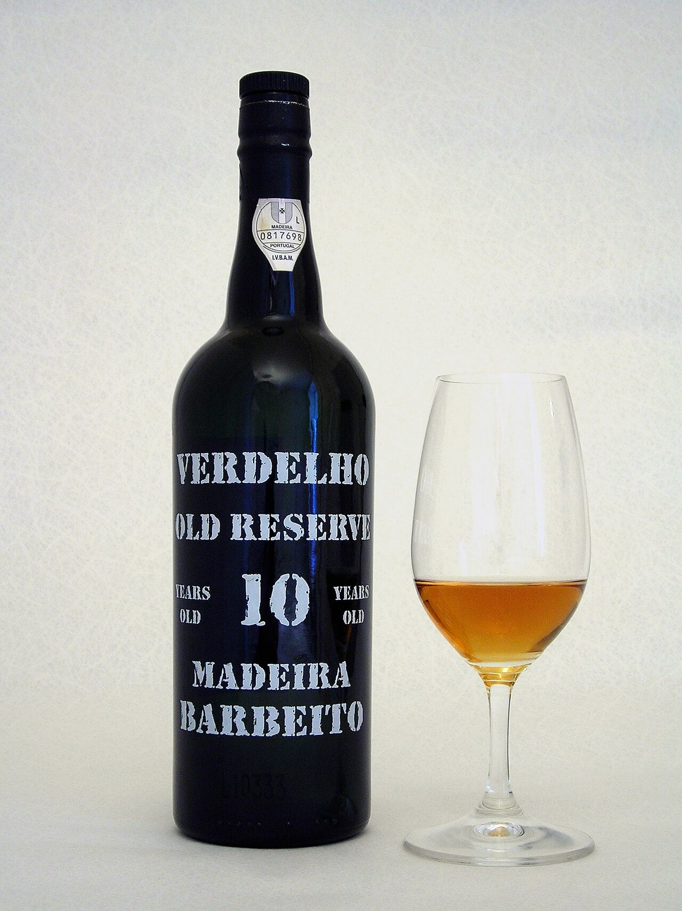

# 马德拉

马德拉（Madeira）是葡萄牙马德拉岛的[加强葡萄酒](ref:fortified-wine)，也是少数把“被热坏”变成风格的酒。它在发酵中途加入葡萄蒸馏酒，再用两种方式陈年：一种是在加热罐中主动升温，另一种是放在酒窖阁楼里，让大西洋气候缓慢烘烤。结果是高酸、深色、带坚果与焦糖气息，并且开瓶后能存活数周甚至数月。理解马德拉，关键不是记住甜度等级，而是理解热量与氧气如何被制度化。

图：一瓶 Barbeito Verdelho 10 年马德拉与一杯琥珀色酒液。图片：Origenes.Adamantius，CC BY-SA 4.0，via [原图页面](https://commons.wikimedia.org/wiki/File:Madeira_Barbeito_Verdelho_Old_Reserva_-_Bottle_Glass.jpg)。

## 一座岛，一种被热塑造的酒

[马德拉](ref:madeira)位于大西洋，距葡萄牙本土约一千公里，地形陡峭，葡萄园沿山坡修成窄梯田，机械几乎无法进入。岛屿的火山土与海洋性气候让葡萄成熟较慢，酸度得以保留。这一份高酸，是马德拉能够承受长期加热与氧化的基础；没有酸，同样的工艺只会得到平淡的甜酒。

岛上的地块极其零碎，许多农户只拥有不到一公顷的土地，葡萄与其他作物混种。这种结构让机械化难以实现，也意味着采收与挑选必须依靠人工。产量不高，但正是这种低产与高酸，让马德拉在经历加热之后仍然保有骨架。

## estufagem：主动加热

[加强](ref:fortification)之后，普通商业马德拉会进入 estufagem。酒液在不锈钢罐中通过热水盘管加热到约 45–50°C，保持至少 90 天，再静置至少 90 天。这个过程模拟了历史上长途海运船舱里的高温，让酒液快速获得熟成香气与琥珀色。法规对上市时间也有要求，酒液不能在采收后的第二个年份之前出售。用 Tinta Negra 酿造的入门级马德拉多走这条路。

## canteiro：阁楼里的慢时间

品质更高的酒走 canteiro。酒桶被放在酒窖的横梁上，不主动加热，只依靠阁楼里被阳光与海洋气候调节的温暖空气，缓慢陈年至少两年。时间更长、温度更温和，氧化更细腻，酸度保留得更好，香气从焦糖与咖啡转向干果、香料与雪松。canteiro 的成本高、周期长，因此常出现在年份酒与高端混酿中。

## 四个品种名与一个被低估的品种

马德拉的传统品种名同时也是甜度坐标。Sercial 最干，酸度锐利，带柑橘与杏仁；Verdelho 半干，带烟熏与蜂蜜；Boal（Bual）半甜，带葡萄干与焦糖；Malvasia（Malmsey）最甜，带太妃糖、咖啡与黑巧克力。这四个名字在酒标上通常代替了品种说明，看到它们就能大致判断甜度。

另一个名字是 Tinta Negra。它曾长期被视为低端品种，如今是岛上种植面积最大的红葡萄，既能酿干型也能酿甜型，是许多商业马德拉的骨架。品种与甜度并不一一对应：同一品种可以通过中断发酵的时机，做出不同甜度的酒。

四个传统品种名也不等于“越甜越高级”。Sercial 的干型在配餐上最难，却最能体现岛屿的高酸；Malmsey 的浓郁容易被误认为糖浆，真正好的版本仍有清晰的酸线。判断马德拉，甜度只是入口的第一层，酸度与回味才是它的结构。

## 氧化在这里是风格

[氧化](ref:oxidation)在多数葡萄酒里是缺陷，在马德拉却是核心。加热与长期桶陈让酒液与氧气持续接触，颜色从金黄走到琥珀、红木，香气从新鲜水果转向核桃、焦糖、咖啡与香料。与[雪莉](ref:sherry)的生物陈酿不同，马德拉没有酒花保护；与[波特](ref:port)的短期氧化不同，马德拉的氧化是数年甚至数十年的累积。它因此常被形容为“已经氧化完的酒”，开瓶后反而稳定。

## 从航线到酒窖的历史

马德拉的葡萄种植可追溯到 1418 年岛屿被葡萄牙航海者发现之后。16 至 17 世纪，马德拉作为大西洋航线的补给港，酒液在热带航程中反复受热，意外形成了今天风格的前身。18 世纪，英国与北美市场带动出口，酒庄开始有意识地用加热房模拟这一过程。19 世纪，白粉病与根瘤蚜几乎摧毁葡萄园，随后的大规模重种改变了品种结构，Tinta Negra 的比例上升。20 世纪以后，旅游与酒窖参观成为岛屿经济的一部分，传统工艺也被重新重视。

## 甜度、年份与标签

常见的马德拉标注 5、10、15、20、30、40 或 50 年，指的是酒液在桶中的平均陈年时间，而不是单一年份。Colheita 表示单一采收年份，通常至少陈年五年；Frasqueira 指单一品种、单一年份、在桶中至少陈年二十年，是马德拉中最严格的一类。2013 年之后，欧盟标签规则对年份与品种的表述更严格，购买时应看清是平均年龄还是单一年份。同一款酒若同时标有品种与年龄，通常说明它来自单一品种的长期陈酿。

## 开瓶之后

马德拉适合 14–16°C 饮用，年份较老的酒可以再高一点。郁金香杯或小号白葡萄酒杯即可，不需要醒酒。它是少数开瓶后还能放数月的葡萄酒，但并不意味着可以暴晒或高温存放；塞回软木塞、放在阴凉处即可，不必冷藏到过低温度。配餐上，Sercial 适合杏仁、橄榄与清汤；Verdelho 适合烟熏鱼类与火腿；Boal 适合坚果甜点与焦糖布丁；Malmsey 适合黑巧克力、蓝纹奶酪与咖啡甜点。本页关于马德拉的内容涉及酒精饮料；过量饮酒有害健康，未成年人不应饮酒。

对照阅读：[加强葡萄酒](ref:fortified-wine)、[氧化（oxidation）](ref:oxidation)。

**关键事实。**

| 项目 | 内容 |
| --- | --- |
| 一句话定位 | 葡萄牙马德拉岛的加强葡萄酒，以加热陈酿（estufagem）或自然阁楼陈酿（canteiro）塑造独特的氧化风味；从 Sercial 的极干到 Malmsey 的浓郁，酸度贯穿始终 |
| 上位风格 | 加强葡萄酒 |
| 香气家族 | 氧化/坚果/焦糖 |

**来源与边界。** 本页关于「马德拉」的关键事实，主要由以下来源交叉核对：Instituto da Vinha e do Vinho（马德拉 DOP 的范围、品种、加强与 estufagem/canteiro 陈酿方式）、European Union（加强葡萄酒、地理标志与标签框架）、International Organisation of Vine and Wine (OIV)（利口酒型葡萄酒与加强工艺的定义）等 4 条来源。价格、批次与状态会变，涉及这些字段时以页面所列来源的最新版本为准。正文为项目自写，来源只作核验，不复制原文。

**并读。** 把「马德拉」与「加强葡萄酒」、「马德拉」、「氧化（oxidation）」放在一起读时，先确认它们是同一层级还是上下游关系：先确认定义与工艺，再比较原料、产区与代表品牌。本页负责给出酒类风格的基本坐标，对照条目补上具体案例与差异；读完再回到本页，才能分清哪些差别属于酒类风格本身，哪些只是产地、批次或品牌选择。

## 相关图像

图：Quinta das Vinhas ^ Cottages, Estreito da Calheta, Madeira, Portugal, 27 June 2011 - Top vineyards - panoramio (1)。图片：anagh，CC BY-SA 3.0，via Wikimedia Commons（[原图页面](https://commons.wikimedia.org/w/index.php?curid=53715566)）。关联图像：马德拉。
