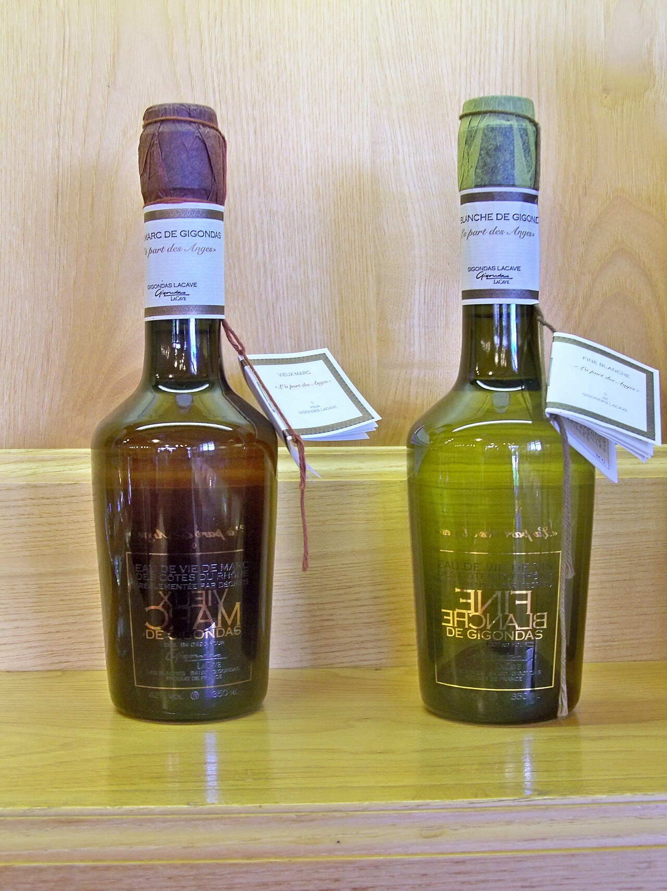

# 马克酒

法国对葡萄果渣蒸馏酒的称呼，勃艮第与香槟最著名；与意大利 grappa 同类，但法规、原料与陈年习惯不同，风格更质朴。

马克酒是法国对葡萄果渣蒸馏酒的称呼，原料是压榨后的葡萄皮、籽与残汁，勃艮第与香槟最著名；它与意大利 grappa 同类，但法规、原料习惯与陈年方式不同，不能直接互换名称。勃艮第 marc 多用黑皮诺与霞多丽的果渣，香槟 marc 则来自香槟区的黑皮诺、莫尼耶与霞多丽，产区名必须与原料来源对应。marc 的年份通常指葡萄采收年份，不是蒸馏年份，购买时要问清原料与蒸馏时间；透明不代表未陈年，陈年 marc 也可能颜色很浅。勃艮第的 Domaine de la Romanée-Conti 与 Château de Chamirey 都生产 Marc de Bourgogne，香槟区的 Marc de Champagne 常由酒商与合作社生产，Ruinart 等品牌也有出品。饮用温度 18–20°C，用小号郁金香杯倒 30–40 mL，先闻果皮与花香；可加一滴水，但不要加冰。开瓶后塞紧避光，一两年内喝完。在勃艮第，marc 常与 fine 一起出现：前者是果渣蒸馏，后者更接近以葡萄酒或果渣为基酒的白兰地，标签与税率都不同。

图：Marc：Marc et fine blanche de Gigondas（Wikimedia Commons）。图片：Véronique PAGNIER，Public domain，via Wikimedia Commons（[原图页面](https://commons.wikimedia.org/wiki/File:Marc_et_fine_blanche_de_Gigondas.jpg)）。

## 定义与边界

马克酒（marc）是法国对葡萄压榨后果渣蒸馏酒的称呼：把皮、籽、梗与残留果肉一起发酵，再用壶式蒸馏器蒸馏，得到 40–45% vol 的烈酒。勃艮第的 Marc de Bourgogne 与香槟的 Marc de Champagne 最著名。

它与意大利 grappa 同类，但法规、原料与陈年习惯不同：法国 marc 常标注产区与年份，部分产区有 AOC/AOP；grappa 在意大利有更细的原料与蒸馏规范。marc 不是葡萄酒，也不是白兰地；它是“果渣酒”，原料来自压榨后的固体部分。

## 历史与命名

葡萄压榨后的果渣过去是酒农的副产品，直接丢弃可惜，于是加水或利用残余糖分发酵，再蒸馏成高度酒。勃艮第与香槟的修道院、酒农在 19 世纪把这种做法商业化，marc 逐渐成为产区日常的餐后酒。

“marc”在法语里就是“果渣”的意思；Marc de Bourgogne 指勃艮第果渣酒，Marc de Champagne 指香槟区果渣酒。名称受产区法规约束，不是所有法国果渣酒都能用这两个名字。

在勃艮第，marc 过去是酒农冬季的暖身酒；在香槟，果渣酒常由酒商与合作社蒸馏，部分产品会标注“Marc de Champagne”而不是年份。20 世纪，欧盟烈酒法规把果渣酒纳入类别，要求原料来自葡萄、不得加糖或香料。

## 原料与工艺

果渣在压榨后仍含糖与酵母，酒农会把它装入密封罐或槽中厌氧发酵数周，避免醋酸菌把酒精转成醋。发酵完成后尽快蒸馏，否则果渣容易变质；传统用壶式蒸馏器分批蒸馏，掐头去尾，只取中段。

蒸馏得到的原酒无色、酒精度高，通常加水降到 40–45% vol；部分产品在橡木桶中陈年 2–10 年，颜色转为琥珀，风味增加香草、干果与香料。陈年 marc 更圆润，未陈年版更直接、更葡萄。

原料的葡萄品种、果渣新鲜度与蒸馏切割决定风格：黑皮诺果渣带来红色果皮与花香，霞多丽果渣更偏柑橘与坚果；果渣放置过久会产生醋酸与霉味，酒厂通常要求当天或次日蒸馏。

果渣的含水量影响发酵：太干的果渣需要加水，太湿的果渣容易醋酸化；酒厂通常把新鲜果渣直接入罐，避免氧化。蒸馏器的形状与加热方式也会改变果皮香气的保留程度，壶式蒸馏更香、柱式蒸馏更中性。

## 风格与味觉

未陈年 marc 无色透明，香气带葡萄皮、花香、青草与轻微苦味，入口酒精感强、质地紧；陈年版本呈琥珀，香气增加香草、干果、皮革与香料，口感更圆。

与 grappa 比，法国 marc 通常更质朴、果皮感更重，陈年版比例更高；与白兰地比，它没有葡萄酒二次蒸馏的柔顺，骨架更粗。判断典型性，先看原料是否为葡萄果渣、是否壶式蒸馏与是否标注产区。

陈年 marc 的桶型多为旧橡木桶，避免新桶的香草与烘烤盖住果皮；陈年 5 年以上的版本会出现干果、皮革与蘑菇气息，酒精度也会因挥发略降。

## 代表产区与品牌

勃艮第的 Domaine de la Romanée-Conti 与 Château de Chamirey 都生产 Marc de Bourgogne；香槟区的 Marc de Champagne 常由酒商与合作社生产，Ruinart 等品牌也有出品。

marc 的产量小、产区分散，代表性更多来自酒庄与年份，而不是全国性品牌。找酒时看“Marc de Bourgogne / Marc de Champagne”与年份，避免把普通果渣酒当成产区酒。

## 怎么喝与配餐

温度 18–20°C，用小号郁金香杯或烈酒杯，倒 30–40 mL；先闻果皮与花香，再小口含住，让酒精在舌面展开。配餐适合黑巧克力、坚果、干果与餐后咖啡；陈年版可以配雪茄与硬质奶酪。

它也可以加一滴水打开香气，但不要加冰，低温会压住果皮与花香。开瓶后塞紧、避光，1–2 年内喝完；高酒精度让它在开瓶后仍能保存较久，但香气会逐渐衰退。

## 选购、储存与误区

先看产区名与年份，再看酒精度与是否陈年；透明不代表未陈年，陈年 marc 也可能颜色很浅。价格高可能来自老酒或名庄，不代表风格更典型；果渣酒的价值在原料新鲜度与蒸馏，而不是包装。

常见误读：把 marc 当成 grappa；把果渣酒当成“劣质白兰地”；以为所有 marc 都必须陈年。它可以是无色的、强烈的、葡萄皮味很重的，也可以是琥珀色、圆润的。

marc 的年份通常指葡萄采收年份，不是蒸馏年份；购买时问清原料与蒸馏时间，比只看年份更有用。

## 延伸阅读与另见

- [格拉帕](ref:grappa)：意大利果渣酒的对照。
- [白兰地](ref:brandy)：葡萄酒蒸馏酒的类别。
- [葡萄渣（pomace）](ref:pomace)：marc 的原料。
- [蒸馏](ref:distillation)：壶式蒸馏与切割。
- [法国](ref:france)：产区与法规背景。

对照阅读：[格拉帕](ref:grappa)、[葡萄渣（pomace）](ref:pomace)、[白兰地](ref:brandy)。

**关键事实。**

| 项目 | 内容 |
| --- | --- |
| 一句话定位 | 法国对葡萄果渣蒸馏酒的称呼，勃艮第与香槟最著名；与意大利 grappa 同类，但法规、原料与陈年习惯不同，风格更质朴 |
| 上位风格 | 格拉帕 |

**来源与边界。** 本页关于「马克酒」的关键事实，主要由以下来源交叉核对：European Union（烈酒类别、定义与标签规则）、US TTB（美国威士忌、朗姆与烈酒分类）、Consorzio Nazionale Grappa（Grappa 与葡萄渣蒸馏的原料、蒸馏和陈酿要求）等 4 条来源。价格、批次与状态会变，涉及这些字段时以页面所列来源的最新版本为准。正文为项目自写，来源只作核验，不复制原文。
