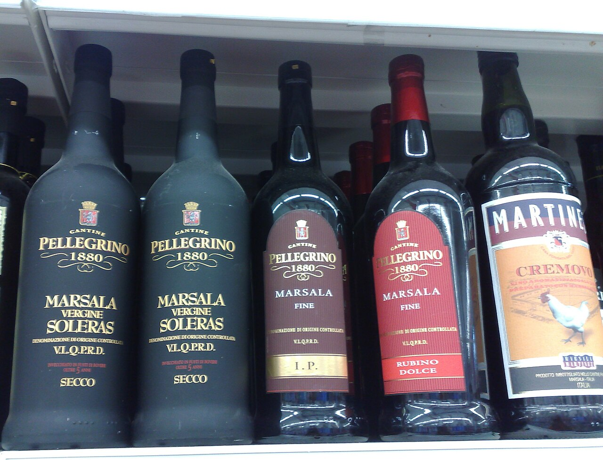
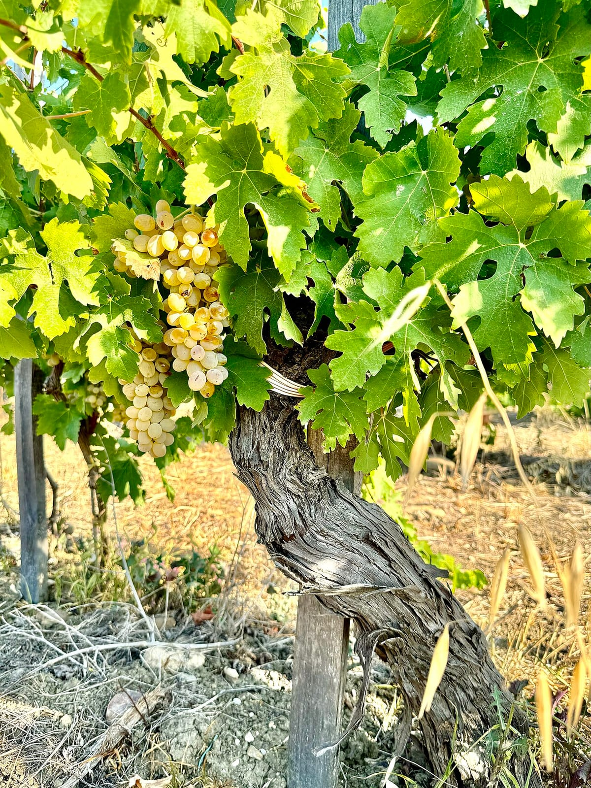

# 马沙拉

意大利西西里马沙拉地区的加强葡萄酒，以白葡萄为基酒，加入酒精或熟酒、经氧化陈年；从干型到甜型、从琥珀到宝石红都有。

马沙拉是西西里马沙拉地区的加强葡萄酒，以白葡萄为基酒，加入酒精或熟酒并经过氧化陈年；它从干型到甜型、从琥珀到宝石红都有，不能简单当成“甜料酒”。这一风格在 18 世纪末由英国商人推动成型，后来形成 Fine、Superiore、Superiore Riserva 与 Vergine 等等级；Vergine 不添加熟酒，更干、更复杂，Soleras 体系则通过多年份调配追求稳定。看标签要先区分类型：Fine 适合烹饪，Superiore 与 Superiore Riserva 适合纯饮；再看甜度、酒精度与陈年。Florio、Pellegrino、Curatolo Arini 是最常见的商业品牌，Marco De Bartoli 的 Vergine 与 Superiore 以传统氧化风格著称。纯饮温度 12–14°C，用小号甜酒杯倒 60 mL，配干果、杏仁饼干、蓝纹奶酪与焦糖甜点；烹饪时不要用加盐的劣质 cooking wine。开瓶后冷藏，一两个月内喝完。它也是 zabaglione、煎小牛肉与蘑菇酱的常用酒；但烹饪与纯饮应分开买，加盐的 cooking wine 不适合直接喝。甜度标识从 secco 到 dolce，酒精强化与氧化时间共同决定它适合纯饮还是入菜。

图：Marsala：Marsala（Wikimedia Commons）。图片：Dedda71，CC BY-SA 3.0，via Wikimedia Commons（[原图页面](https://commons.wikimedia.org/wiki/File:Marsala.jpg)）。

## 定义与边界

马沙拉（Marsala）是意大利西西里岛西端的加强葡萄酒：以白葡萄为基酒，加入酒精或“vino cotto”（浓缩熟酒）终止发酵、稳定酒质，再经氧化式陈年。颜色从琥珀到深棕，也有宝石红版本；甜度从干型（secco）到甜型（dolce），酒精度通常 17–20% vol。

它受意大利 DOC 规范约束：只有马沙拉产区、按法定原料与工艺生产并陈年的酒才能标注“Marsala”。类型包括 Fine、Superiore、Superiore Riserva、Vergine 与 Soleras；Vergine 不添加熟酒、甜度更干，Soleras 用类似索莱拉的连续取酒系统。

## 历史与命名

18 世纪，英国商人 John Woodhouse 发现西西里马沙拉的酒质适合长距离海运，于是用加强酒的方式稳定酒液，把它出口到英国与美国。1770 年代，马沙拉开始以加强酒形式进入国际市场。

19 世纪，Florio 与 Pellegrino 等家族酒庄把马沙拉做成品牌；1860 年加里波第登陆西西里后，马沙拉又成为意大利统一的象征之一。20 世纪，DOC 规范把类型、陈年与甜度固定下来；今天它既是餐后酒，也是西西里烹饪的重要原料。

## 原料与工艺

基酒多用 Catarratto、Grillo、Inzolia 等白葡萄，部分宝石红版本加入 Nero d’Avola 等红葡萄。采收后正常发酵，在酒精尚未完全转化时加入酒精或 vino cotto 终止发酵，保留残糖；vino cotto 是把葡萄汁煮浓的甜液，能增加焦糖、干果与浓度。

陈年采用氧化式木桶：酒液在橡木桶中与空气缓慢接触，颜色转深，香气从柑橘与花香转向干果、焦糖、香草、烟草与坚果。Fine 至少陈年 1 年，Superiore 至少 2 年，Superiore Riserva 至少 4 年；Vergine 与 Soleras 的陈年更长。

Soleras 系统把不同年份的酒液按层级混合，取酒时从最老的一层取出，再用次老一层补充，保持风格连续；perpetuo 系统类似，强调“永续”而不是单一年份。

Marsala 的甜度由停止发酵的时点决定：secco 几乎发酵到干，semisecco 保留中等残糖，dolce 在高糖时加入酒精。vino cotto 的用量影响颜色与焦糖味，Vergine 则完全不加甜液。

## 风格与味觉

颜色从浅琥珀到深棕，宝石红版本来自红葡萄短暂浸渍；香气带干果、焦糖、香草、烟草、橙皮与坚果，入口甜度从干到甜，酒精度高但口感圆润，收口带苦味与盐感。

Vergine 更干、更偏氧化坚果与香料，适合纯饮；Fine 更甜、更便宜，常用于烹饪；Superiore Riserva 在两者之间，陈年带来更复杂的干果与香草。判断典型性，先看类型、甜度与陈年，再看是否标注 DOC。

Fine 的酒龄至少 1 年，颜色较浅、甜度较高，适合烹饪；Superiore 至少 2 年，香气更复杂；Superiore Riserva 至少 4 年，常带干果与烟草；Soleras 通过连续取酒获得更深的颜色与坚果味。Vergine 不添加 vino cotto，风格更干、更接近氧化葡萄酒。

Superiore 与 Fine 的差别不仅在陈年，也在甜度与香气复杂度；烹饪与纯饮应选不同类型。

## 代表产区与品牌

Florio、Pellegrino、Curatolo Arini 是最常见的商业品牌；Marco De Bartoli 的 Vergine 与 Marsala Superiore 以传统氧化风格著称，被侍酒师视为产区标杆。

马沙拉产区集中在西西里西端的马沙拉、Petrosino 与部分周边市镇；酒庄规模从大型合作社到小型家族酒庄都有。找酒时看类型与陈年，而不是只看品牌；烹饪用 Fine 与纯饮用 Superiore 的价值不同。

## 怎么喝与配餐

纯饮温度 12–14°C，用小号甜酒杯或郁金香杯，倒 60 mL；Vergine 可以稍 warm，让坚果与香料展开。配餐适合干果、杏仁饼干、蓝纹奶酪、焦糖甜点与雪茄；甜型也可以配水果塔与巧克力。

烹饪时，马沙拉常用于 zabaglione、煎小牛肉与蘑菇酱；不要用“ cooking wine”替代，加盐与氧化的劣质酒会破坏酱汁。开瓶后冷藏，1–2 个月内喝完；高酒精度让它比普通葡萄酒耐放，但氧化会逐渐盖过果香。

马沙拉也可以用来做鸡尾酒，例如 Marsala Martini；甜型版本可替代甜酒配水果。Vergine 纯饮时可以先醒 15 分钟，让坚果与香料展开。开瓶后若出现醋味，说明氧化过度，不适合继续纯饮。

## 选购、储存与误区

先看类型与陈年：Fine 适合烹饪，Superiore 与 Superiore Riserva 适合纯饮，Vergine 更干、更复杂；再看甜度与酒精度。价格高可能来自陈年或名庄，不代表更适合烹饪；反之，便宜的 Fine 也可能有稳定品质。

常见误读：把马沙拉当成“甜料酒”；把宝石红当成红葡萄酒；以为所有马沙拉都甜。它的类型与甜度跨度很大，Vergine 可以很干，Soleras 可以很复杂。

## 延伸阅读与另见

- [加强葡萄酒](ref:fortified-wine)：加酒精稳定的葡萄酒类别。
- [葡萄酒](ref:wine)：葡萄酒的基本分类。
- [西西里](ref:sicily)：马沙拉产区背景。
- [索莱拉](ref:solera)：连续取酒的陈年系统。
- [橡木桶陈酿](ref:oak)：氧化式陈年与桶型。

对照阅读：[加强葡萄酒](ref:fortified-wine)、[西西里](ref:sicily)、[索莱拉](ref:solera)。

**关键事实。**

| 项目 | 内容 |
| --- | --- |
| 一句话定位 | 意大利西西里马沙拉地区的加强葡萄酒，以白葡萄为基酒，加入酒精或熟酒、经氧化陈年；从干型到甜型、从琥珀到宝石红都有 |
| 上位风格 | 加强葡萄酒 |

**来源与边界。** 本页关于「马沙拉」的关键事实，主要由以下来源交叉核对：OIV（葡萄酒、加强酒与特种葡萄酒定义）、European Union（欧盟葡萄酒类别、地理标志与标签规则）、Wine Institute（美国葡萄酒与甜酒分类背景）等 4 条来源。价格、批次与状态会变，涉及这些字段时以页面所列来源的最新版本为准。正文为项目自写，来源只作核验，不复制原文。

## 相关图像

图：Sicily：Old Inzolia vine in vineyard Dietro le Case, Menfi, Sicily（Wikimedia Commons）。图片：Marilena.CantineBarbera，CC BY 4.0，via Wikimedia Commons（[原图页面](https://commons.wikimedia.org/wiki/File:Old_Inzolia_vine_in_vineyard_Dietro_le_Case,_Menfi,_Sicily.jpg)）。关联图像：马沙拉。
