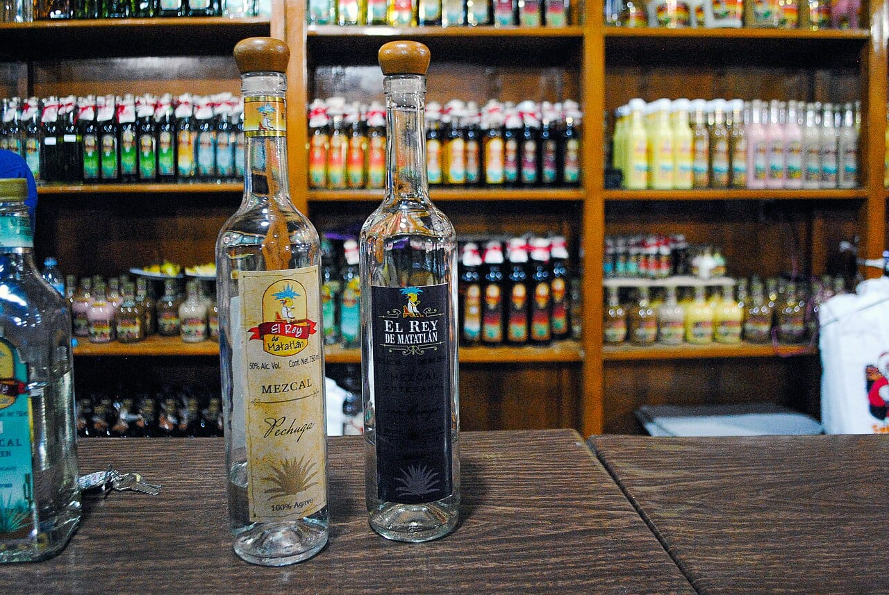
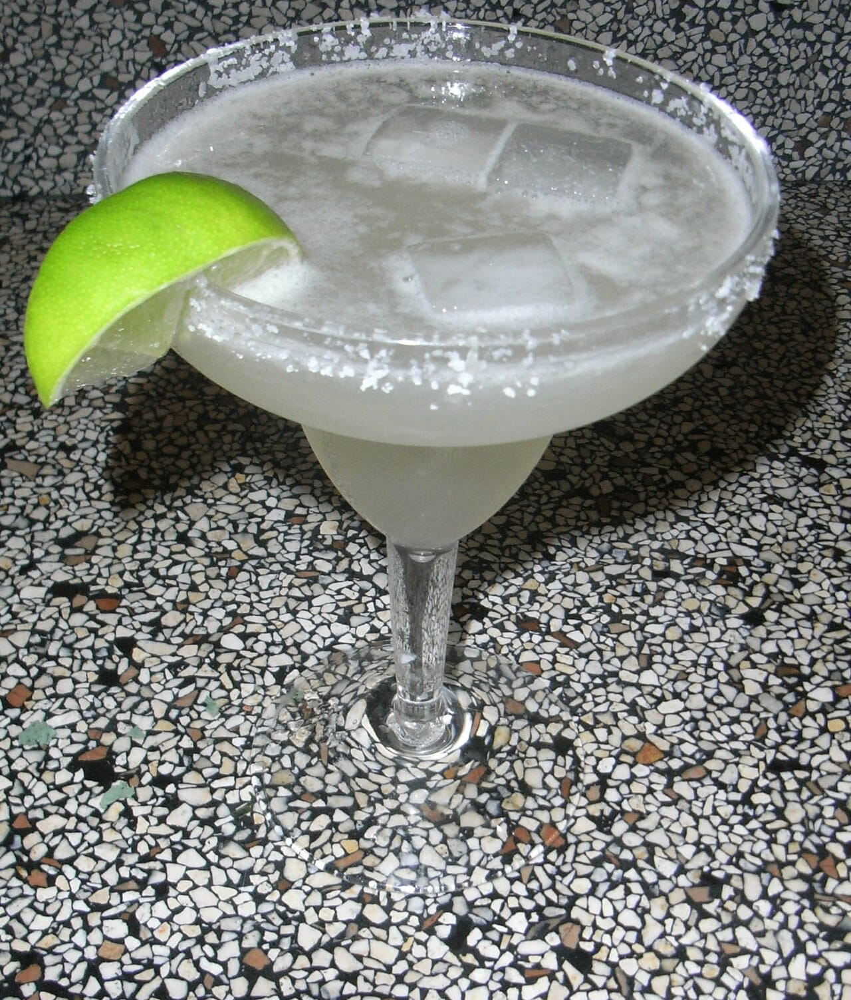

# 梅斯卡尔

梅斯卡尔（mezcal）是墨西哥以[龙舌兰](ref:agave)为原料的蒸馏酒。它最鲜明的感官特征是地下坑烤带来的烟熏，但烟熏强弱、植物气息与甜感会因产区、龙舌兰品种、发酵容器与蒸馏设备而大幅变化。它和[龙舌兰酒](ref:tequila)共享龙舌兰原料与蒸馏传统，却是原料范围、法定产区与工艺要求都不同的独立类别。

图：梅斯卡尔。图片：ProtoplasmaKid，CC BY-SA 4.0，via Wikimedia Commons（[原图页面](https://commons.wikimedia.org/wiki/File:Mezcal_bottles_.jpg)）。

## 定义边界：什么算梅斯卡尔

按墨西哥官方标准 NOM-070-SCFI-2016，梅斯卡尔必须以龙舌兰为原料，经蒸煮（传统上为坑烤）、发酵与蒸馏制成，并在法定产区内完成关键工序。它的名称受原产地名称保护，由梅斯卡尔监管委员会（CRM）负责认证与监督。

不算梅斯卡尔的产品包括：以蓝色韦伯龙舌兰为唯一原料、在哈利斯科等特定产区生产的龙舌兰酒；以索托尔（sotol）或赖西利亚（raicilla）等其他植物或地区传统制成的烈酒；以及只添加龙舌兰风味、以中性酒精为基酒的调配酒。它们可能都以“龙舌兰”为卖点，但法定类别不同。

## 法定产区与龙舌兰品种

梅斯卡尔的法定产区覆盖多个州，瓦哈卡是最具代表性的产区，格雷罗、杜兰戈、圣路易斯波托西、萨卡特卡斯、瓜纳华托、塔毛利帕斯与米却肯也有各自传统。不同产区的气候、海拔、土壤与蒸馏者习惯，构成了风格差异的第一层。

埃斯帕丁（espadín）是最常见、产量最大的栽培品种，风味相对干净、甜感明显；托巴拉（tobalá）、特佩斯特（tepeztate）与西拉（sierra）等野生或半野生品种则带来更强烈的植物、矿物、青椒与香料感。野生龙舌兰成熟慢、产量低，是精品梅斯卡尔价格高企的重要原因，也带来过度采收的生态争议。

## 采收与坑烤

龙舌兰成熟往往需要多年。采收者（jimador）去除叶片，取出茎心（piña），再将其运到坑烤场。传统做法是挖一个土坑，铺上石块、点燃木柴，把龙舌兰心堆入后覆盖纤维与泥土，焖烤数日。这个过程中，复杂果聚糖被水解为可发酵糖，同时产生烟熏、焦糖与烤植物风味。

坑烤是梅斯卡尔与龙舌兰酒最重要的工艺分岔之一。龙舌兰酒多使用高压蒸煮器或砖窑，风味更干净、更少烟熏；梅斯卡尔保留土坑与木柴，烟熏成为风格的一部分。但烟熏不是唯一标准，过度烟熏同样会掩盖品种与产区的细节。

## 碾碎、发酵与蒸馏

坑烤后的龙舌兰心需要碾碎。传统使用石轮（tahona）或木槌，现代也有机械粉碎。碾碎后的纤维与汁液加水进入发酵容器，常见的是木桶（tinas），也有陶罐或石槽。发酵多依赖野生酵母，时间从数天到两周不等，温度与容器微生物组成会带来酸度、酯类与 funk 感。

发酵完成后进入[蒸馏](ref:distillation)。许多生产者使用铜制[壶式蒸馏器](ref:pot-still)进行两次蒸馏，也有人使用陶制或木制设备。陶制蒸馏器会带来更明显的矿物与泥土感，铜器则更干净、更强调植物香气。设备差异不是细节，而是风格变量。

## 类别与陈年等级

按标准，梅斯卡尔按陈年时间分为三类。Joven 指未经陈年或未达到 Reposado 时长的产品，风味最直接；Reposado 要求在木质容器中陈年 2 至 12 个月；Añejo 要求超过 12 个月。陈年会让烟熏退后，增加香草、焦糖、干果与木质调。

陈年等级是法定区间，不是精确年份。同一等级内的实际陈年时间可能差别很大，桶型与桶龄也会改变风格。并非所有梅斯卡尔都适合陈年：烟熏与植物感强烈的原酒，长时间入桶后可能失去辨识度。

## 风格谱系：产区与特殊做法

瓦哈卡梅斯卡尔通常平衡、植物感清晰，埃斯帕丁的甜感与烟熏结合得较柔和；格雷罗的版本可能更直接、更矿物；杜兰戈与圣路易斯波托西的产品则因品种与气候呈现不同走向。产区之间的差异，往往比同一产区内的品牌差异更大。

特殊做法中，Pechuga 是在最后一次蒸馏时加入鸡胸肉、水果与香料，传统上用于庆典，风味更复杂、更圆润；de olla 指用陶制蒸馏器蒸馏，矿物感更突出。这些做法属于传统变体，不是所有梅斯卡尔都具备的特征。

## 关键参数

NOM-070-SCFI-2016 规定的酒精度区间为 35% 至 55% ABV，市售产品通常落在 40% 至 48% 之间。酒精度越高，香气越集中，但酒精刺激也越强；加水可以打开植物与矿物气息，但会改变口感结构。

陈年参数如上：Reposado 为 2 至 12 个月，Añejo 超过 12 个月。坑烤时间通常为数日，发酵时间从数天到两周，蒸馏多为两次。具体参数因生产者而异，酒标上的品种、产区与批次比笼统的“手工”更有信息量。

## 与龙舌兰酒的区别

龙舌兰酒限定蓝色韦伯龙舌兰与特定产区，主要产区是哈利斯科；梅斯卡尔允许更多龙舌兰品种与更广的法定产区。龙舌兰酒多用蒸煮器，梅斯卡尔强调坑烤；龙舌兰酒的陈年等级与梅斯卡尔相近，但两者的法规文本与认证机构不同。

两者都是龙舌兰蒸馏酒，但不能仅凭“都是龙舌兰酒”混用名称。把梅斯卡尔当作“烟熏版龙舌兰酒”是一种有用的入门比喻，却会忽略品种、产区与工艺的实质差异。关于龙舌兰酒的法定框架，可参见[龙舌兰酒](ref:tequila)条目。

## 常见误解与争议

第一，认为梅斯卡尔必须很烟熏。第二，认为带虫（con gusano）是质量标志；虫体是部分地方传统与商业卖点，不是 NOM-070 认证产品的类别要求。第三，认为所有梅斯卡尔都是“100% 龙舌兰”，实际标签与类别需按标准核对。第四，把“手工”当成质量保证。第五，忽视野生龙舌兰的生态压力。

争议主要集中在三处：野生品种的可持续采收、工业化生产与传统工艺的边界，以及“梅斯卡尔”名称在原产地保护之外的通用化使用。这些问题影响产业，也影响消费者对价格的判断。

## 怎么喝

梅斯卡尔适合小口慢饮。纯饮时让酒液在口中停留，感受烟熏、植物、矿物与甜感的层次；加一两滴水有助于释放香气。它也可以用于调酒，例如以梅斯卡尔替换龙舌兰调制[玛格丽特](ref:margarita)，会带来更明显的烟熏层次；与柑橘、苦味利口酒和烟熏盐搭配也很常见。

搭配食物时，烟熏感适合烤肉、摩尔酱与辛辣菜肴；高酸度与矿物感可以平衡油脂。本页关于梅斯卡尔的内容涉及酒精饮料；过量饮酒有害健康，未成年人不应饮酒。

对照阅读：[龙舌兰酒](ref:tequila)、[玛格丽特](ref:margarita)。

## 相关图像

图：玛格丽特。图片：Akke Monasso，CC BY-SA 3.0，via Wikimedia Commons（[原图页面](https://commons.wikimedia.org/wiki/File:MargaritaReal.jpg)）。关联图像：梅斯卡尔。
