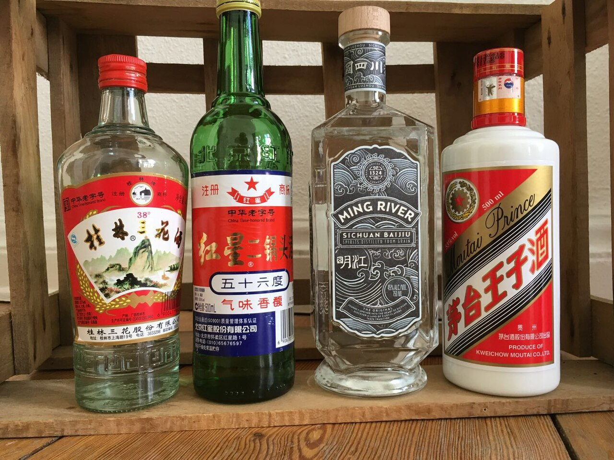

# 兼香型白酒

兼香型白酒是兼具浓香与酱香特征的白酒香型，常被称为浓酱兼香型。它不是把两种酒简单混在一起，而是在制曲、发酵与勾调上同时容纳两条工艺路线，形成复合香气。现行标准为 GB/T 23547-2009《浓酱兼香型白酒》。

图：兼香型白酒。图片：Xiaomage de，CC BY-SA 4.0，via Wikimedia Commons（[原图页面](https://commons.wikimedia.org/wiki/File:Vertreter_der_vier_Baijiu_Kategorien.jpg)）。

## 定义与标准

标准把兼香型描述为具有浓香与酱香复合香气的白酒，并对原料、工艺、感官与理化指标提出要求。兼香型是香型分类，不是质量等级；同一香型内部仍有偏浓、偏酱与平衡型的不同取向。

“兼”不等于“折中”。兼香型的难点在于让两种香气共存而不互相掩盖：浓香的窖香与绵甜、酱香的烘焙与醇厚，需要在酒体中找到比例。比例失衡时，成品会显得杂乱，而不是更复杂。

## 产地与代表

兼香型白酒的代表产品包括湖北松滋的白云边与安徽淮北的口子窖。不同企业的工艺路线不同：有的以酱香工艺为基础再融入浓香元素，有的以浓香工艺为基础再引入高温堆积与高温曲，还有的通过不同基酒勾调形成兼香。

产地名称不是质量保证。企业的原料、曲种、发酵容器与勾调比例差异明显，成品可以从偏浓到偏酱。把“兼香”当成一个固定风味，会忽略企业内部的产品分层。

## 原料与制曲

兼香型以[高粱](ref:sorghum)为主料，制曲常同时使用高温大曲与中温大曲，或在不同轮次使用不同曲种。高温曲带来酱香类的烘焙与曲香，中温曲保留浓香类的酯香与粮香，二者的比例直接影响风格走向。

参见[制曲](ref:qu-making)的一般原理。曲种组合不是越多越好：不同曲的微生物群落与酶系需要匹配，否则发酵过程容易出现酸度失衡或香气冲突。原料与曲的匹配，是兼香型的第一道门槛。

## 工艺

兼香型的工艺常见两条思路。第一条是工艺融合：在同一生产体系中同时采用高温堆积、高温发酵与泥窖续糟配料，让浓香与酱香元素在同一酒醅中生成。第二条是基酒组合：分别生产浓香与酱香基酒，再按比例勾调。

无论哪条路线，都涉及[发酵](ref:fermentation)温度、容器与轮次管理。泥窖提供窖香与己酸菌环境，参见[窖池](ref:pit)；高温堆积与高温曲则带来酱香类的香气前体。[蒸馏](ref:distillation)时的切割与分级贮存，决定最终能否形成清晰的复合香气。

## 风味特征

兼香型的香气通常同时出现窖香、粮香、烘焙香与轻微酱香，入口绵甜或醇厚，酒体中等偏厚，回味较长。偏浓的版本更突出窖香与绵甜，偏酱的版本更突出烘焙与醇厚，平衡型则追求两者的衔接。

复合香气不等于香气堆叠。优质兼香型应有清晰的层次与收口，香气之间不打架。香气越复杂，越需要干净的酒基与稳定的发酵；否则复合会变成杂乱，这是兼香型最常见的失败点。

## 品鉴与饮用

品鉴时先闻静止香气，判断窖香与烘焙香的比例，再轻摇闻香，观察是否有冲突或断层。入口注意甜、酸、苦的平衡与酒体厚度，咽下后看回味是否连贯。温度过高会放大酒精与烘焙香，过低会压住层次。

兼香型适合搭配风味较重的中式菜肴，如卤味、烧烤与红烧类。高度产品宜小杯慢饮，低度产品开瓶后应避光冷藏并尽快喝完。饮用强度以标签为准，不以香型推断。

## 常见误区

第一，认为兼香就是把浓香酒与酱香酒混在一起。工艺融合与基酒组合是两条不同路线。
第二，把兼香当成更高级的香型。香型只是分类，不是等级。
第三，认为香气越复杂越好。层次与收口比堆叠更重要。
第四，把偏浓或偏酱当成缺陷。它们是风格取向，不是质量问题。
第五，忽视企业的产品分层。同一品牌的兼香产品可能差异很大。

兼香型不是把浓香和酱香随意混在一起，而是在制曲、发酵与蒸馏中形成兼具两类特征的稳定风格，白云边、口子窖是常见代表。标准给出的是工艺与风味边界；它和“兼香”市场用语、勾调比例不是一回事，香型名称也不构成质量等级。兼香型的边界由标准、曲种、发酵容器与勾调共同构成，不同厂家的“兼香”比例并不一样；白云边与口子窖的风格差异就是例子。香型名称可以帮助分类，但不能替代对具体产品的判断。

对照阅读：[白酒](ref:baijiu)、[制曲](ref:qu-making)。

## 延伸阅读

- [白酒](ref:baijiu)：兼香型白酒在白酒分类与工艺框架中的位置。
- [高粱](ref:sorghum)：兼香型白酒的主要原料。
- [制曲](ref:qu-making)：高温曲与中温曲的组合逻辑。
- [发酵](ref:fermentation)：温度、容器与轮次对复合香气的影响。
- [蒸馏](ref:distillation)：切割与分级贮存对层次的作用。
- [窖池](ref:pit)：泥窖与窖香的关系。

**关键事实。**

| 项目 | 内容 |
| --- | --- |
| 一句话定位 | 兼具浓香与酱香特征的白酒香型，以白云边、口子窖等为代表；现行标准为 GB/T 23547-2009《浓酱兼香型白酒》，香型不是质量等级 |
| 上位风格 | 白酒 |
| 香气家族 | 兼香 |

**来源与边界。** 本页关于「兼香型白酒」的关键事实，主要由以下来源交叉核对：国家质量监督检验检疫总局、国家标准化管理委员会（可在国家标准全文公开系统按标准号检索原文）、国家市场监督管理总局、国家标准化管理委员会（可在国家标准全文公开系统按标准号检索原文；GB/T 23547-2009的适用范围、术语与分类口径）、Oxford University Press（提供关于中国白酒与香型的条目；由原条目末尾参考资料迁移，未逐条复核访问日期）。价格、批次与状态会变，涉及这些字段时以页面所列来源的最新版本为准。正文为项目自写，来源只作核验，不复制原文。

**并读。** 把「兼香型白酒」与「白酒」、「高粱」、「制曲」放在一起读时，先确认它们是同一层级还是上下游关系：先确认定义与工艺，再比较原料、产区与代表品牌。本页负责给出酒类风格的基本坐标，对照条目补上具体案例与差异；读完再回到本页，才能分清哪些差别属于酒类风格本身，哪些只是产地、批次或品牌选择。

**适用边界。** 对「兼香型白酒」而言，法定定义、原料比例与地域风格会随法规和行业分类更新；品牌案例不等于整个风格。

## 相关图像

图：制曲。图片：Uranassbandit，CC BY-SA 3.0，via Wikimedia Commons（[原图页面](https://commons.wikimedia.org/wiki/File:Hongqu_3.jpg)）。关联图像：兼香型白酒。
