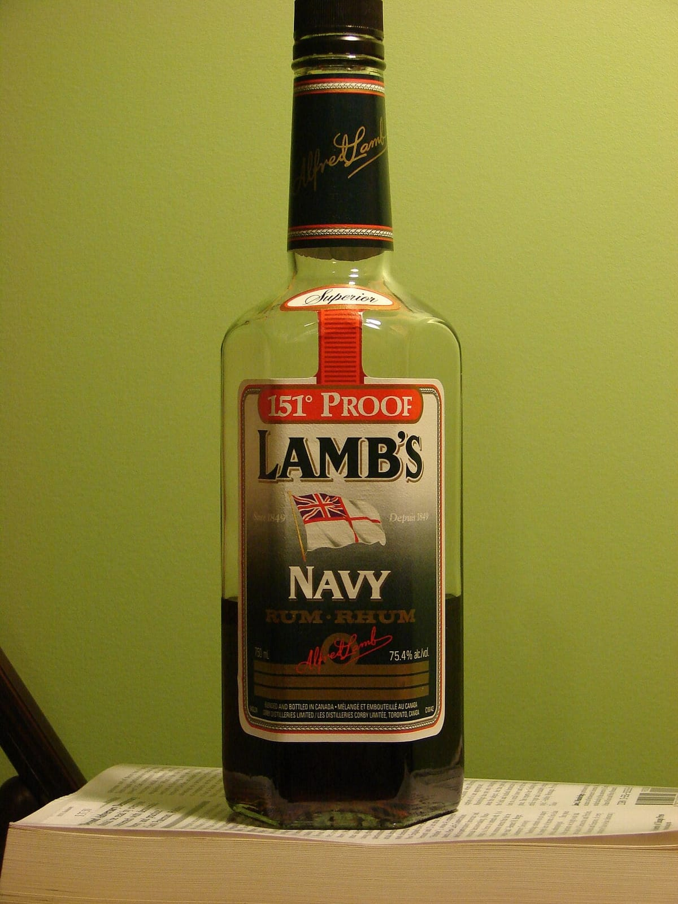

# 海军朗姆

海军朗姆是对英国皇家海军历史配给朗姆的俗称，现代市场上则指一类高酒精度、深色、厚重的加勒比调和朗姆，带焦糖、香料与干果气息；多数现代品牌由多个加勒比产地的陈酿朗姆调配而成。

图：一瓶 Lamb’s Navy Rum 151 Proof，标签标着 Navy Rum 与 75.4% vol。图片：Spikenard，Public domain，via [原图页面](https://commons.wikimedia.org/wiki/File:Lamb's_Navy_151.jpg)。

## 定义与边界

海军朗姆（navy rum）最初不是一个酿造风格名称，而是英国皇家海军每日配给的那份朗姆。船员口粮中的朗姆由海军补给部门统一采购、调配并发放，后来这套酒的色、香、强度被市场沿用，成为一类深色、浓烈、以多产地调和为特征的朗姆(ref:rum)商品。它属于朗姆大家族，原料仍是甘蔗糖蜜，经发酵与蒸馏(ref:distillation)取得基酒，再橡木陈化(ref:oak)与调配。

作为市场标签，“navy rum”并不是受法律保护的法定产区：它不规定单一产地、单一蒸馏方式或固定配方，不同品牌可以选用牙买加、圭亚那、巴巴多斯、特立尼达等产地的基酒，强度也从 40% 到接近配给原度不等。读标签时要区分“历史配给传统”与“现代品牌自称的海军风格”，前者是一段海军制度史，后者是商业产品定位。

## 历史与命名

在改用朗姆之前，英国海军每天给船员发一加仑啤酒作为口粮；长途航行中啤酒容易变质，占用货舱空间。1655 年英国占领牙买加之后，海军补给开始以朗姆替代啤酒，这套配给延续了三个多世纪。船上负责供应事务的军官称为 Purser，船员口语称 “Pusser”，配给朗姆因此也被叫作 Pusser's rum；每日一份的配额称为 the tot。

配给制度在 1850 年到 1970 年间趋于固定：正午前后 “Up Spirits” 时段发放，资深军士可以领纯饮份，普通年轻船员则兑两份水调成格罗格（grog）饮用。不愿饮酒的船员在船上登记为 “T”（temperance），每天领取三便士替代；不满 20 岁的船员标记为 “UA”，不领配给。1970 年 7 月 31 日，海军第一海务大臣 Michael Le Fanu 爵士下令终止每日朗姆配给，这一天被称为 Black Tot Day，此后海军不再发放朗姆。

## 原料与工艺

现代海军朗姆以加勒比甘蔗糖蜜为原料，基酒来自多个产地：牙买加多为壶式蒸馏、酯香突出，圭亚那 Demerara 风格酒体厚重，巴巴多斯与特立尼达提供清爽与木质骨架。调和师把不同产地、不同陈酿年份的基酒按配方搭配，再补入少量焦糖调色，使成品颜色深褐、口感厚重。橡木桶陈化带来香草、可可与干果层次，糖蜜发酵残留的果香与蒸馏带来的酒精强度共同构成酒的骨架。

配给原度的测定有一段前史：在 1816 年 Sykes 比重计普及之前，船上事务官把朗姆兑水后加入少量火药，用聚光镜点燃；火药能够引燃，说明酒度够高，这份酒才可以发放。这套火药测试对应的强度，后来用比重计量出为 109° proof，约合 54.5% ABV。现代高烈度海军朗姆常以这个“火药强度”为目标，而普通商业款多降到 40% 上下。

## 风格与味觉

典型海军朗姆呈深棕或红木色，香气以糖蜜、焦糖、烤糖、香草、可可、肉桂与轻微姜味为主，入口厚重甜润，随后是香料、干果与木质收尾，酒精感明显但通常被陈酿与调配柔化。牙买加基酒贡献热带果香与酯类，圭亚那基酒增加酒体与糖浆感，木桶陈化提供平滑度；不同品牌的配比不同，有的偏香料木质，有的偏糖蜜甜厚。

强度是区分产品的重要坐标：火药强度款约 54.5%，历史配给记录为 95.5° proof、约 54.6% ABV；现代普通海军朗姆多为 40%。高烈度款酒精温热感更强，适合纯饮或短饮；低度款更适合兑调。酒精度(ref:proof)与糖蜜甜度、橡木陈酿时间一起决定风格是浓烈硬朗还是柔和圆润，仅凭颜色深浅不能判断烈度。

## 代表产区与品牌

与海军配给关系最直接的现代品牌是 Pusser's：1979 年，Charles Tobias 在获得海军部许可后复原了海军最后使用的配给配方，创立 Pusser's British West Indies。其 Gunpowder Proof 产品按原海军强度装瓶，酒精度 54.5%，基酒以圭亚那等地陈年朗姆为主体，长期以“复原配给朗姆”为卖点。

另一个常见品牌是 Lamb's Navy Rum：1849 年，伦敦商人 Alfred Lamb 调和了来自巴巴多斯、牙买加、特立尼达与圭亚那的 18 款朗姆，创立该品牌，现行产品酒精度 40%。需要注意的是，Lamb's 历史上并不是海军官方供应商，它只是在品牌叙事中借用海军风格；1970 年配给终止后，品牌还使用过 “Join the Lamb's Navy” 的广告口号。市场上其余海军朗姆多为多产地调和的商业产品，品牌之间的产地构成与强度差异很大。

## 怎么喝与配餐

传统喝法分纯饮与兑调两种：资深者纯饮一小份，年轻船员的格罗格则兑水稀释，历史上还会加柠檬汁改善口感。现代饮用中，高烈度款可在室温下纯饮或加少量水释放香气；兑可乐、姜汁汽水做高杯长饮是常见的酒吧做法，也可以调进朗姆鸡尾酒中替代普通黑朗姆。

配餐偏重口味：烟熏或烤制的肉类、熏肠、腌肉与坚果能承接糖蜜与香料；黑巧克力、咖啡甜点与朗姆的焦糖、可可气息呼应。高度朗姆不适合搭配清淡海鲜或爽口沙拉，酒精与甜感会压过食材；辣味菜式会放大酒精刺激，应选择甜度与酒体更平衡的产品。

## 选购、储存与误区

选购时先看标签上的产地构成、酒精度与陈酿说明：标明牙买加、圭亚那等多产地调和的产品，骨架更接近传统海军朗姆；只写深色朗姆而不标产地与强度的产品，风格参考意义有限。把“海军”字样当成官方认证是常见误解——现代品牌使用这个名称属于商业定位，不等于曾为海军供货。

储存上，高酒精度朗姆性质稳定，避光、避高温、避开震动即可长期存放，不需要卧瓶；开瓶后酒精缓慢挥发，风味在数月内尚可保持，长期存放的开瓶瓶宜尽快喝完。海军朗姆残糖通常不高，不像甜利口酒那样依赖糖分保鲜，但若经过焦糖调色与调配，长期受热仍会让香气变闷。

## 延伸阅读与另见

认识海军朗姆，可以先从一款 40% 左右的多产地调和款入手了解糖蜜与骨架，再比较一款火药强度的复原配给款；两相对照，配给历史、产地调和与强度差别会比较清楚。

- 相关条目：[rum](ref:rum)、[distillation](ref:distillation)、[oak-ageing](ref:oak)、[liqueur](ref:liqueur)、[proof-and-abv](ref:proof)。
