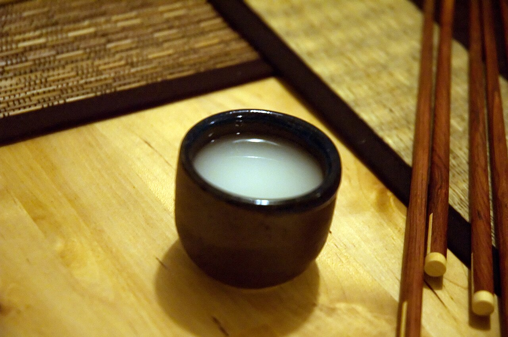

# 浊酒

日本清酒中的“粗滤”类型，保留米曲与酒糟，酒液浑浊、带甜味与乳脂感；需冷藏、饮用前摇匀，开瓶后尽快喝完。

浊酒是日本清酒里的“粗滤”类型，保留米曲与酒糟，酒液浑浊、带甜味与乳脂感；它不是“没过滤好的次品”，甜度与质地来自固形物与发酵，而不是过滤失误。浊酒在清酒分类中属于按过滤方式划分的一支，常与“にごり”“しぼり”“生”等标签同时出现；瓶内二次发酵版本会带轻微气泡，开瓶时要小心。看标签要先确认是否生酒、是否瓶内二次发酵，再看精米步合与酒精度；生酒必须冷藏，常温货架上的浊酒通常经过巴氏杀菌。菊水“ふなくち”是经典代表，甜度高、质地厚；獭祭的浊酒系列以吟酿风味与清爽甜感著称，新潟、山形、京都与广岛各有不同风格。饮用温度 8–12°C，饮用前轻轻摇匀，让沉淀重新分布，但不要剧烈摇晃；配唐扬鸡、天妇罗、麻婆豆腐与奶油奶酪。开瓶后冷藏，三到五天内喝完。沉淀会随温度变化，冷藏后更明显；摇匀后不要马上开瓶，等气泡稳定再倒。

图：Nigori Sake：Nigori sake（Wikimedia Commons）。图片：Luigi Anzivino，CC BY-SA 2.0，via Wikimedia Commons（[原图页面](https://commons.wikimedia.org/wiki/File:Nigori_sake.jpg)）。

## 定义与边界

浊酒（にごり酒 / nigori）是日本清酒的一种过滤类型：发酵完成后只做粗滤，保留部分米曲、酵母与酒糟，因此酒液呈乳白或浑浊，静置后会分层。它不是“未完成的清酒”，而是刻意保留固形物的成品。

它与澄明清酒（clear sake）的区别在过滤程度，不在原料或发酵；与“生酒”（nama）的区别在是否巴氏杀菌，浊酒可以是生酒，也可以是经过加热的。标签上的“にごり”“nigori”“ cloudy”都指同一类，但程度从轻微浑浊到浓稠米糊都有。

## 历史与命名

在清酒传统里，粗滤与无滤版本一直存在；早期农家酒与冬季酿造的“しぼり”常保留米渣，口感甜、质地厚。现代浊酒在 20 世纪后期被商品化，成为清酒品类中容易辨认的一支。

“にごり”字面是“浑浊”，不是贬义；它描述的是酒液状态。日本酒税法与清酒标签规则没有把浊酒单列为等级，酒厂可以在纯米酒、本酿造或吟酿的基础上做粗滤，因此同一瓶浊酒也可能同时标注“纯米”“吟酿”“生酒”。

## 原料与工艺

原料仍是米、水、曲与酵母；发酵完成后，醪（moromi）经过压榨，再用较粗的网目过滤，让部分米曲与酵母通过。过滤太细会失去浊酒的乳白与甜感，太粗则口感粗糙、沉淀过多。

部分浊酒采用瓶内二次发酵，产生气泡与轻微碳酸；也有“しぼり”版本在冬季压榨后直接装瓶，保留新鲜米香。未巴氏杀菌的生酒必须冷藏，否则乳酸菌与酵母会继续发酵，导致变酸或爆瓶。

酒精度从 8% 到 17% 以上都有，甜度与固形物含量决定质地；米曲比例高、精米步合低的版本更厚、更甜，吟酿系浊酒则更偏花香与果香。

浊酒的固形物含量通常 1–3%，过高会让口感像米糊，过低则失去乳白与甜感。酒厂会在压榨后静置，让粗渣沉降，再取中层装瓶；瓶内二次发酵的版本会保留酵母，开瓶前不要冷冻。

## 风格与味觉

酒液乳白、略带米粒感，静置后上层清、下层浓；香气以米饭、甜酒酿、椰子、香蕉与乳酸为主，入口甜、质地像米浆或酸奶，酸度低到中，收口带米糠与酵母。

与澄明清酒比，它更甜、更厚、更少酒精刺激；与米酒比，它有清酒的曲香与酿造结构，不是甜酒酿。判断典型性，先看过滤程度、是否生酒与精米步合，再看甜度与气泡。

甜度来自残糖与酒糟中的多糖，酸度低，酒精感被质地包裹；冰镇后甜感更明显，回温后米香与酵母味更清楚。与“甘酒”比，浊酒有酒精发酵与清酒曲香，不是甜米浆。

## 代表产区与品牌

菊水“ふなくち”是经典的浊酒代表，甜度高、质地厚；獭祭的浊酒系列以吟酿风味与清爽甜感著称；Umenishiki、Kikusui 与地方酒厂也有冬季限定版本。

浊酒产地遍布日本清酒产区，新潟、山形、京都与广岛都有不同风格；找酒时看“にごり”“しぼり”“生”等标签，再看精米步合与酒精度。

新潟的“しぼり”版本强调冬季新鲜与气泡，京都的浊酒更偏甜与米香，广岛版本常用更低的精米步合。找酒时看“生”与“にごり”两个标签，生酒必须冷藏。

## 怎么喝与配餐

饮用温度 8–12°C，饮用前轻轻摇匀，让沉淀重新分布；不要剧烈摇晃，以免气泡与沉淀失控。杯型用宽口玻璃杯或小清酒杯，倒少量，分两口喝完。

配餐适合辛辣、油炸、乳脂与甜味食物，例如唐扬鸡、天妇罗、麻婆豆腐、奶油奶酪；甜型浊酒也可以配水果塔。开瓶后冷藏，3–5 天内喝完；生酒更容易变酸，尽量一次喝完。

## 选购、储存与误区

先看是否生酒、是否瓶内二次发酵，再看精米步合与酒精度；生酒必须冷藏，常温货架上的浊酒通常经过巴氏杀菌。沉淀不代表变质，但出现异味、鼓瓶或浑浊加剧时要谨慎。

常见误读：把浊酒当成“没过滤好的次品”；以为越浑浊越甜；以为所有浊酒都要摇匀。它的甜度与质地来自固形物与发酵，不是过滤失误。

浊酒的沉淀会随温度变化，冷藏后更明显；摇匀后不要马上开瓶，等气泡稳定。精米步合低的版本更甜、更厚，吟酿版本更偏花香。

## 延伸阅读与另见

- [清酒](ref:sake)：日本米酒的基本分类。
- [大米](ref:rice)：清酒的主要原料。
- [发酵](ref:fermentation)：米曲与酵母的作用。
- [过滤](ref:filtration)：清酒过滤与浊酒的区别。
- [日本](ref:japan)：产区与清酒文化。

对照阅读：[清酒](ref:sake)、[发酵](ref:fermentation)、[过滤](ref:filtration)。

**关键事实。**

| 项目 | 内容 |
| --- | --- |
| 一句话定位 | 日本清酒中的“粗滤”类型，保留米曲与酒糟，酒液浑浊、带甜味与乳脂感；需冷藏、饮用前摇匀，开瓶后尽快喝完 |
| 上位风格 | 清酒 |

**来源与边界。** 本页关于「浊酒」的关键事实，主要由以下来源交叉核对：Beer Judge Certification Program（啤酒风格的定义、参数与典型特征）、Brewers Association（美国啤酒风格、原料与行业分类）、CAMRA（英国传统啤酒与艾尔风格）等 4 条来源。价格、批次与状态会变，涉及这些字段时以页面所列来源的最新版本为准。正文为项目自写，来源只作核验，不复制原文。
