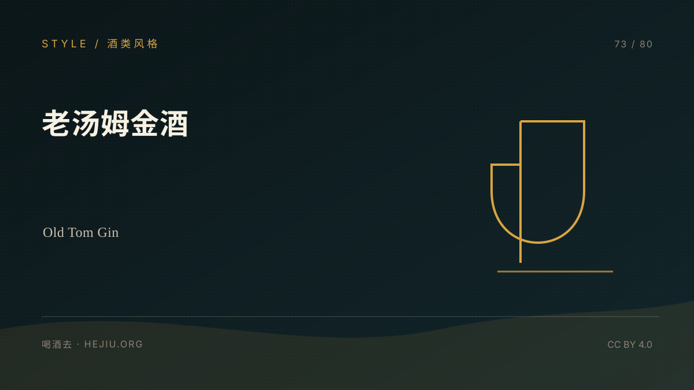

# 老汤姆金酒

老汤姆金酒（Old Tom gin）是 18 至 19 世纪英格兰流行的一种甜型[金酒](ref:gin)风格。它的定义不在法规里，而在历史里：蒸馏金酒后加入糖、糖浆或甘草等甜味植物，让酒体比后来的伦敦干金更圆、更柔、更容易入口。今天的老汤姆不是“复古包装的伦敦干金”，而是对一段甜味金酒传统的重新解释。

图：老汤姆金酒 类型示意图。图片：Doubao Seedream 5.0 AI 辅助绘制（项目自有），不是老汤姆金酒的实拍。

## 一个历史风格，不是法定类别

欧盟烈酒法规没有“Old Tom”这个法定类别。它既不是地理标志，也不是像 London Dry 那样有明确定义的工艺名称；酒厂可以在“金酒”类别下生产它，但“Old Tom”本身更像一个风格标签。这意味着不同品牌的老汤姆甜度、基酒和植物配方可以差得很远，消费者不能只凭名字判断。

这种模糊性既是风险也是空间。风险在于，任何带甜味的金酒都可能自称 Old Tom；空间在于，酒厂可以根据历史配方做不同的复刻。判断一瓶老汤姆，应该看甜度来源、酒精度、杜松子是否清晰，以及它是否保留了 19 世纪金酒那种圆润而非糖浆般甜腻的质地。

## 18 世纪伦敦的甜味金酒

18 世纪的伦敦，金酒消费量激增，价格低廉、质量参差。当时的金酒往往用粗制的谷物酒精加杜松子和甜味剂，喝起来比今天的伦敦干金更甜、更重。老汤姆这个名字的具体来源并不确定，有说法认为它来自酒馆门口猫形招牌，也有说法认为与某位蒸馏师有关；这些故事无法完全证实，但都指向同一个时代背景。

到了 19 世纪，金酒逐渐走向更干、更纯净的风格，老汤姆仍然存在于酒吧和配方书中。20 世纪，它几乎消失，只在少数历史配方里留下名字。21 世纪初的精酿金酒浪潮让生产者重新寻找“消失的风格”，老汤姆因此被复刻出来，并成为连接 genever 与 London Dry 的历史桥梁。

## 糖、甘草与麦芽底

现代老汤姆的甜味通常来自三个方向：蒸馏后加入少量糖或糖浆；在植物配方里加入甘草、杏仁或麦芽；或者使用带麦芽感的谷物基酒。甜度一般低于利口酒，远高于伦敦干金；它应该是圆润的“口感甜”，而不是明显的糖水甜。

[杜松子](ref:juniper)仍然重要，但不必像伦敦干金那样锋利。老汤姆的植物配方常带柑橘、甘草、当归和香料，酒体中等，收口柔和。部分酒厂会把老汤姆放入橡木桶短暂陈年，得到金色和香草气息；这不是风格的必要条件，而是复刻者用来增加复杂度的手段。酒精度通常在 40% 至 45% vol 之间，足以支撑甜味和植物香气。

## 从消失到复刻

老汤姆的复刻不是把历史配方原样搬回来，而是根据有限的文字记录和现代口味重建。19 世纪的配方书常提到“甜金酒”或“老式金酒”，但糖的用量、基酒强度和植物比例都没有统一标准；生产者只能根据上下文推断，再通过现代设备调整。

这也解释了为什么今天的老汤姆风格跨度很大：有的接近 genever，麦芽感和甜味明显；有的接近伦敦干金，只在收口加一点圆润；有的用桶陈增加香草和焦糖。消费者不必寻找“唯一正确”的版本，但应该知道它不是一个有法定边界的类别。

复刻者面对的另一个问题是甜度标准。19 世纪的糖不是今天的精制白砂糖，甘草和麦芽带来的甜感也更复杂；如果只用糖浆，很容易做成“甜味金酒”，而不是老汤姆。甜度不是越高越好，甜苦平衡才是关键，过甜会显得腻。

## 鸡尾酒里的老汤姆

老汤姆在经典鸡尾酒里很有用。汤姆柯林斯类的长饮需要一点甜味来平衡柠檬和气泡，老汤姆比伦敦干金更合适；[金菲士](ref:gin-fizz)也可以用老汤姆，成品更圆润。在[古典鸡尾酒](ref:old-fashioned)的变体中，老汤姆的甜味可以替代部分糖浆，让酒体更柔和。

不过，老汤姆不是“万能甜味剂”。它的甜度仍然低于利口酒，不能像糖浆那样大幅调整配方；如果用它替代伦敦干金，酸度和苦精的比例需要重新平衡。调酒时最好先小批量试配，再决定是否增加柠檬或苦精。

老汤姆也适合与姜汁汽水、苹果汁等风味温和的配料搭配，但不适合与强烈烟熏或重泥煤的烈酒同台。饮用温度建议在 10 至 15 摄氏度，过冷会压住麦芽和甘草香。

## 与 genever、London Dry 的区别

[genever](ref:genever)以麦芽酒为重要组成部分，甜味和麦芽感来自原料与配方，通常带有更明显的谷物和面包气息；老汤姆以金酒为基，甜味主要来自蒸馏后的添加或甜味植物，麦芽感可以有，但不是定义核心。[伦敦干金](ref:london-dry-gin)则要求风味来自重新蒸馏，糖分极低，风格更干、更锐利。

三者可以排成一条历史线：genever 是更早的麦芽酒传统，老汤姆是 18 至 19 世纪的甜型金酒，伦敦干金是 19 世纪后期走向干型的现代标准。但这条线不是进化论，三者今天并存，各有自己的配方与饮用场景。理解它们的差异，比争论“谁更正统”更有意义。

相关条目：[金酒](ref:gin)、[荷兰杜松子酒](ref:genever)。

**来源与边界。** 本页关于「老汤姆金酒」的关键事实，主要由以下来源交叉核对：The Gin Guild（老汤姆金酒的历史时期、甜味来源与风格特征）、European Union（金酒类别与“Old Tom”并非欧盟法定类别的边界）、Beefeater Gin（现代老汤姆的甜味来源与复刻方式）等 4 条来源。价格、批次与状态会变，涉及这些字段时以页面所列来源的最新版本为准。正文为项目自写，来源只作核验，不复制原文。

**并读。** 把「老汤姆金酒」与「金酒」、「荷兰杜松子酒」、「伦敦干金」放在一起读时，先确认它们是同一层级还是上下游关系：先确认定义与工艺，再比较原料、产区与代表品牌。本页负责给出酒类风格的基本坐标，对照条目补上具体案例与差异；读完再回到本页，才能分清哪些差别属于酒类风格本身，哪些只是产地、批次或品牌选择。

**适用边界。** 对「老汤姆金酒」而言，法定定义、原料比例与地域风格会随法规和行业分类更新；品牌案例不等于整个风格。

**更新提示。** 「老汤姆金酒」最近核对于 2026-11-08；价格、状态与公开信息会变，引用前以本页来源的最新版本为准。
