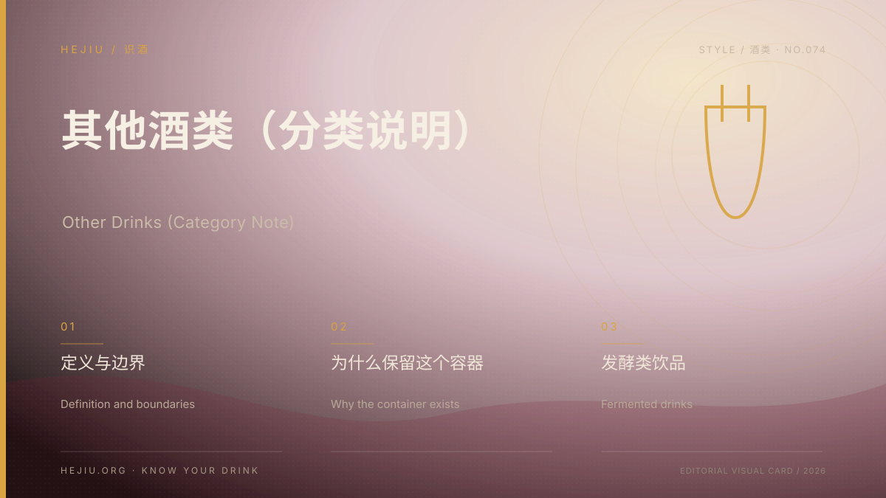

# 其他酒类（分类说明）

“其他酒类”不是一个严格的法定分类，而是旧站为了安置难以归入葡萄酒、啤酒、蒸馏酒与配制酒的条目而保留的映射容器。它既不是一种具体酒饮，也不是质量等级，更不是“无法分类所以不重要”的意思。更合适的理解是：当一种饮品跨越多个工艺家族，或地方称谓与主流分类不一致时，先在这里说明边界，再指向具体的风格条目。

图：其他酒类（分类说明） 双语视觉卡（项目自绘 SVG）。不是实拍。

> **先给结论**
> **一句话：** 这页判断其他酒类（分类说明）的风味位置，以及怎么选、怎么喝。
>
> - **适合谁：** 正在比较其他酒类（分类说明）与其他风格、准备购买或点单的人。
> - **不适合谁：** 只想要“哪个最好”的排名、不接受口味差异的人。
> - **先看这两点：**
>   - 经过蒸馏的饮品应按蒸馏酒或其子类处理，例如以葡萄渣为原料的果渣酒、以谷物为原料的威士忌、以甘蔗糖蜜为原料的朗姆酒。
>   - 分类的第一层是原料与工艺，而不是名称。

## 定义与边界

分类的第一层是原料与工艺，而不是名称。以谷物或水果糖化后发酵、再经蒸馏得到的，通常归入蒸馏酒；以麦芽谷物发酵、加入啤酒花并以啤酒工艺完成的，归入啤酒；以葡萄或其他水果发酵、保留果汁特性的，归入葡萄酒或果酒。还有一类饮品同时使用发酵与浸泡、勾调或添加蜂蜜等步骤，难以塞进单一格子，这时“其他”只表示“需要另作说明”，不表示一个统一的风味或等级。

因此，本页不提供“其他酒类”的统一酒精度、原料表或饮用温度。每一项具体饮品都应按其自身条目核对：它用什么糖源，靠什么微生物发酵，是否蒸馏，是否加糖或加香，最后以什么方式稳定与灌装。

## 为什么保留这个容器

旧站的分类树需要一个兜底节点，否则无法给边缘条目建立父子关系。保留“其他”有利于历史链接与检索迁移，但也带来风险：读者可能误以为这里列出的东西共享同一工艺，或把“其他”当作官方分类。解决办法是把容器写成说明页，而不是清单页；把具体饮品放回各自条目，再用别名与父级关系表达它们的真实归属。

对编辑者而言，这个容器还承担一项技术功能：当某个风格的父级暂时缺失时，关系字段可以指向这里，避免出现悬空引用；一旦更合适的父级建立，就应把子条目迁走，而不是长期堆在兜底分类下。

## 发酵类饮品

发酵类饮品的特点是糖源被微生物转化为酒精，酒精度通常较低，风味来自原料、微生物与发酵条件。清酒以米为糖源，用曲霉菌糖化、酵母发酵，经过磨米、蒸饭、制曲、发酵与压榨；苹果酒以苹果汁发酵，强调果香与酸度；梨酒、樱桃酒等果酒则以相应果汁为主。它们都可能被归入“发酵酒”，但原料与工艺差别很大，不能互相替代。

这类饮品的标签重点通常是原料、发酵方式、甜度、是否含气与产地。把它们统称为“果酒”或“米酒”会掩盖工艺差异；例如清酒的“纯米”与“本酿造”指原料与添加规则，不是甜度等级。阅读具体条目时，应先确认糖源与曲种，再看杀菌、过滤与加水比例。

## 蜂蜜与混合发酵

蜂蜜酒以蜂蜜水为糖源，经酵母发酵而成；加入水果、香料或谷物后，形成不同的蜜酒家族。由于蜂蜜的糖分浓度、花粉来源与发酵终点不同，同一名称的酒可以从极干到很甜，酒精度也有较大范围。把蜂蜜酒简单当作“甜酒”并不准确，因为干型蜂蜜酒同样常见。

混合发酵饮品还可能同时包含谷物与水果，或先发酵再浸泡。此类产品的分类应以主要糖源与关键工艺为准，并在标签上说明添加物。若一种饮品的主要酒精来自浸泡而非发酵，它更接近配制酒；若经过蒸馏，则应归入蒸馏酒。分类的目的不是制造边界，而是让读者知道该看哪一套标准。

## 非葡萄酒的果酒

苹果、梨、樱桃、李子等水果都可以发酵成酒。苹果酒在英语世界里常单独成类，有甜度、酸度、含气与苹果品种的细分；梨酒在某些地区有悠久的传统；樱桃酒则可能同时存在发酵与浸泡两种做法。它们与葡萄酒共享“水果汁发酵”的底层逻辑，但原料化学、单宁结构与法规体系不同。

把果酒统称为“葡萄酒”会造成混淆，尤其是在标签、税则与酒精饮料许可上。更稳妥的写法是：先写清主要水果，再写发酵或浸泡，最后写甜度与含气。对于混合果汁产品，还应核对果汁比例与添加糖，而不是只看包装上的水果图片。

## 非啤酒的谷物饮品

以谷物为原料不等于啤酒。啤酒通常指发芽谷物经糖化、煮沸、加啤酒花与酵母发酵的饮料；而以米、玉米、高粱等谷物为主，使用曲或酶制剂糖化、不经过啤酒花煮沸的饮品，往往属于另一套传统。清酒、米酒、黄酒与某些地方发酵饮品的工艺路径都与啤酒不同。

这类饮品的共同点是谷物淀粉必须先转化为可发酵糖。区别在于糖化剂：麦芽依靠自身酶，曲霉或根霉依靠霉菌酶，部分工艺使用外源酶。糖化方式决定了风味轮廓与生产周期，也决定了标签上该标注什么。把“谷物酿造”直接等同于啤酒，会忽略这些关键差异。

## 蒸馏与配制

经过蒸馏的饮品应按蒸馏酒或其子类处理，例如以葡萄渣为原料的果渣酒、以谷物为原料的威士忌、以甘蔗糖蜜为原料的朗姆酒。蒸馏之后再进行浸泡、加糖、加香或勾调的，可能进入配制酒或利口酒的范畴。分类的关键是“主要酒精来源”与“是否蒸馏”，而不是最后添加了什么。

配制酒的范围很宽，包括以酒精、水、糖与香料调配的产品。它们不一定经过发酵，也不一定经过蒸馏；标签上的酒精度、糖分与添加物是主要信息。把配制酒当作“劣质蒸馏酒”是一种价值判断，不是工艺分类；两者可以共享基酒，却遵循不同的生产与标示规则。

## 分类与检索

在本站的结构里，“其他酒类”只作为说明与兜底节点使用。具体条目应优先挂在更精确的父级下：清酒挂清酒家族，苹果酒挂苹果酒，蜂蜜酒挂蜂蜜酒，果渣酒挂果渣酒。只有当一种饮品确实横跨多个家族，或暂时没有合适父级时，才使用这个容器，并在正文说明理由。

检索时，读者可以用原料、工艺、产地与别名四个维度切入。原料决定大类，工艺决定子类，产地决定风格变体，别名帮助处理地方称谓。四个维度都写清楚，比争论一个词该放进哪个格子更有用。分类是阅读工具，不是给饮品排名。

## 常见误区

第一，把“其他”当作一种酒或一个法定等级。它只是站内的说明性容器。
第二，把谷物发酵等同于啤酒。啤酒有麦芽、啤酒花与特定工艺，清酒与米酒的路径不同。
第三，把蜂蜜酒等同于甜酒。蜂蜜酒可以从干型到甜型，酒精度范围也很宽。
第四，把果酒等同于葡萄酒。苹果、梨与樱桃的原料化学与法规体系都不同。
第五，把配制酒当作低质量蒸馏酒。两者可以共享基酒，但工艺与标签规则不同。
第六，用单一名称判断工艺。先看原料、糖化、发酵、蒸馏与添加，再看名称。

相关条目：[清酒](ref:sake)、[冰苹果酒](ref:cider)、[果蜜酒](ref:mead)、[果啤](ref:fruit-beer)、[马奶酒](ref:airag)。

相关条目：[浊酒](ref:sake)、[冰苹果酒](ref:cider)、[果蜜酒](ref:mead)。

其他酒类是检索容器，不是法定类别；把蜂蜜酒、果酒或配制酒归入这里，是为了说明边界，不是给它们一个新的质量等级，也不代表它们没有自己的法规。

