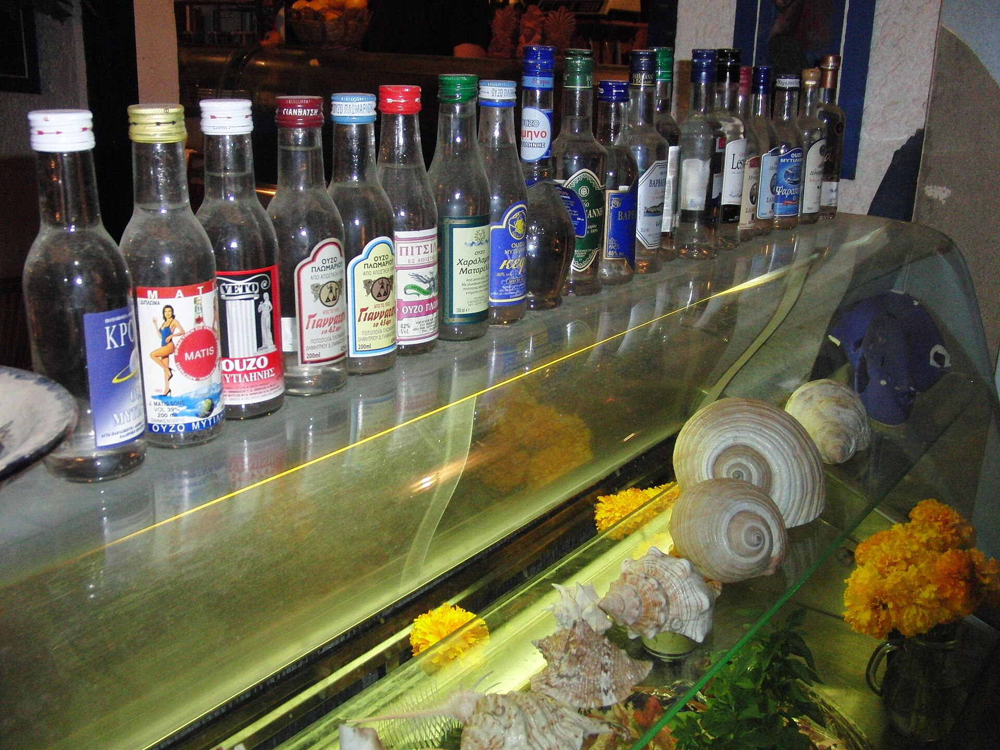

# 乌佐

乌佐（ouzo）是希腊最具辨识度的茴香烈酒：无色透明，加入水或冰块后迅速变成乳白色，入口是茴香、甘草与轻微甜感，尾段带一点植物苦味。它通常以铜壶蒸馏、以茴香籽为核心香料，酒精度不低于 37.5% vol。对希腊人来说，它不是一个“旅游纪念酒”，而是与meze小盘菜、海鲜和漫长午后绑在一起日常饮品。

图：乌佐相关实景照片。图片：Ioannis Protonotarios，CC BY-SA 4.0，via Wikimedia Commons（[原图页面](https://commons.wikimedia.org/wiki/File:Very_rare_ouzo_brands.jpg)）。

## 水一加就变白的茴香酒

乌佐的核心香气来自茴香中的反式茴香脑。这种物质在高度酒精中溶解得很好，酒液因此清澈；一旦加水降低酒精度，茴香脑的溶解度下降，便会析出微小油滴，形成乳白色的浑浊。这种现象叫“louche”，与苦艾酒加水变白是同一类物理变化，不是变质，也不是兑了牛奶。

因此，乌佐的饮用方式本身就是风味设计的一部分。纯饮时香气集中、酒精感强；加水后香气打开、口感变柔，甜味与茴香的甘草感更明显。冰会进一步降低温度与酒精度，让浑浊更厚，也让酒精的刺感后退。

## 地理标志与 37.5% 的底线

在欧盟烈酒法规中，乌佐以地理标志（GI）身份受到保护，而不是普通的 TSG 传统特产保护。这意味着“Ouzo”这个名字只能在希腊境内、按照规定的原料与工艺生产；其他国家可以制作茴香烈酒，但不能把它叫作乌佐。法规同时规定，乌佐的最低酒精度为 37.5% vol，成品必须无色，含糖量或干浸出物不得超过 50 克/升。

“100% 蒸馏”是乌佐中的一个特殊类别：它的酒精全部来自蒸馏，而不是在蒸馏后加入中性酒精。传统铜壶的容量通常不超过 1000 升，蒸馏液酒精度落在 55% 到 80% 之间，再用水稀释到装瓶强度。1989 年欧盟烈酒法规体系建立后，乌佐的名称保护逐渐制度化；今天在欧盟地理标志登记册里可以查到它的产品规格。

## 莱斯沃斯与普洛马里

爱琴海东北部的莱斯沃斯岛常被称为乌佐的心脏，岛上的普洛马里镇则是商业化生产的起点。19 世纪，普洛马里拥有港口、茴香种植与蒸馏传统；巴尔巴亚尼斯家族从敖德萨带回蒸馏技术，以铜壶制作茴香酒。1894 年，伊西多罗斯·阿尔瓦尼蒂斯在普洛马里建立大规模蒸馏厂，后来以“Ouzo of Plomari”之名广为人知。

莱斯沃斯的利夫里村以茴香闻名，希俄斯岛则提供乳香。乳香是黄连木属植物分泌的树脂，带松脂、柑橘与香料气息，加入乌佐后会形成更复杂的树脂感。普洛马里的风格通常茴香饱满、口感偏柔；希俄斯版本则更强调乳香的清亮与微苦。

## 铜壶、茴香与乳香

传统乌佐以铜制壶式蒸馏器生产。生产者先把茴香籽、茴香、乳香、芫荽籽、丁香、肉桂等香料与酒精、水混合，浸泡一段时间，再加热蒸馏。铜会与部分硫化物结合，让酒体更干净；壶式蒸馏则保留更多香料细节。蒸馏时按[头、心、尾](ref:cuts)分段，只取香气最平衡的中段，头段的溶剂感与尾段的浑浊感被弃去。

[蒸馏](ref:distillation)完成后，生产者用软水把酒精度降到目标值，必要时加入极少量糖，让口感更圆润，但成品必须保持无色，干浸出物不得超过 50 克/升。多数乌佐不经过橡木桶，也不追求陈年；它的风格来自香料配比与[壶式蒸馏](ref:pot-still)的切割，而不是时间。

## 浑浊从哪里来

加水后的浑浊程度，取决于茴香脑含量、酒精度、温度与水质。酒精度越低、温度越低，析出越明显；硬水中的矿物质会让浑浊更粗，软水则更细腻。希腊人常把乌佐倒进小杯，再加少量水，观察白色云雾从杯底升起，这个过程本身就是饮用仪式的一部分。

浑浊不是质量指标，但能提示茴香强度。浑浊很淡的乌佐可能茴香用量较低，或经过过滤；浑浊浓密的版本通常香气更足，也更容易在加水后变得柔顺。若酒液在未加水时就浑浊，可能是低温导致的暂时析出，也可能是保存不当，需要结合气味判断。

## 希腊各地的风味差异

莱斯沃斯与普洛马里的乌佐通常茴香主导、酒体较圆，适合搭配海鲜与橄榄；希俄斯的版本因乳香而多一层松脂与柑橘感，尾段更干；色萨利的蒂尔纳沃斯以更强烈、更干燥的风格著称，常被当作“硬派乌佐”；雅典与塞萨洛尼基的大厂则生产更统一、更易饮的商业版本。

酒精度常见 40% 到 50% 之间，少数“100% 蒸馏”产品会更高。品牌方面，Barbayannis、Plomari、Ouzo 12、Metaxa Ouzo 是最容易找到的名字。它们之间的差异不只在香料，也在甜度、稀释用水与蒸馏切割；同一品牌的不同装瓶也可能有风格变化。

## 餐桌上的乌佐

乌佐的标准场景是meze：章鱼、沙丁鱼、炸小鱼、羊奶酪、橄榄、番茄与黄瓜。茴香的甘草感能压住海鲜的腥味，也能切开油炸食物的腻。饮用时用小杯，先倒乌佐，再加水，慢慢喝；不要像喝烈酒那样一口闷，也不要用吸管。

它也可以加冰、加苏打水，或作为鸡尾酒的基酒，但茴香风味很强，配方里通常只需要少量。餐后纯饮时，室温或轻微冷藏即可；加冰会稀释香气，适合更热的天气。与甜点搭配时，选择柠檬、坚果或蜂蜜方向，避免与巧克力争夺风味。

## 与茴香酒家族的边界

乌佐常被拿来和[苦艾](ref:absinthe)比较，但两者不同：苦艾以苦艾草为核心，酒精度通常更高，风味更草本、更苦；乌佐以茴香籽为主，甜感更明显，酒精度下限更低。法国 Pastis 同样加水变白，但通常更甜、更柔和；意大利 Sambuca 更甜，常加糖与香料，分类上更接近[利口酒](ref:liqueur)；黎凡特 Arak 与土耳其 Rakı 也以茴香为核心，但原料、酒精度与饮用习惯各有差异。

希腊的 Tsipouro 是葡萄渣蒸馏酒，通常不加茴香，因此不是乌佐。把 Tsipouro 与乌佐混为一谈，会低估乌佐的香料复杂度，也会误判它的饮用方式。

## 选购与保存

购买时先看名称与产地：真正的乌佐会标注“Ouzo”与希腊产地，酒精度不低于 37.5% vol。再看是否写“100% distillation”，这类产品的香气通常更集中。配料表越简单，越容易判断风格；乳香、芫荽、丁香等香料的出现顺序也能提示风味方向。

乌佐不需要陈年，开瓶后拧紧瓶盖、避光常温保存即可。长时间暴露在空气中会让茴香脑氧化，香气变钝；若出现明显沉淀或异味，就不要再用。它也不适合长期冷藏，低温会让茴香脑提前析出。

相关条目：[利口酒](ref:liqueur)、[蒸馏](ref:distillation)、[壶式蒸馏器（pot still）](ref:pot-still)。
