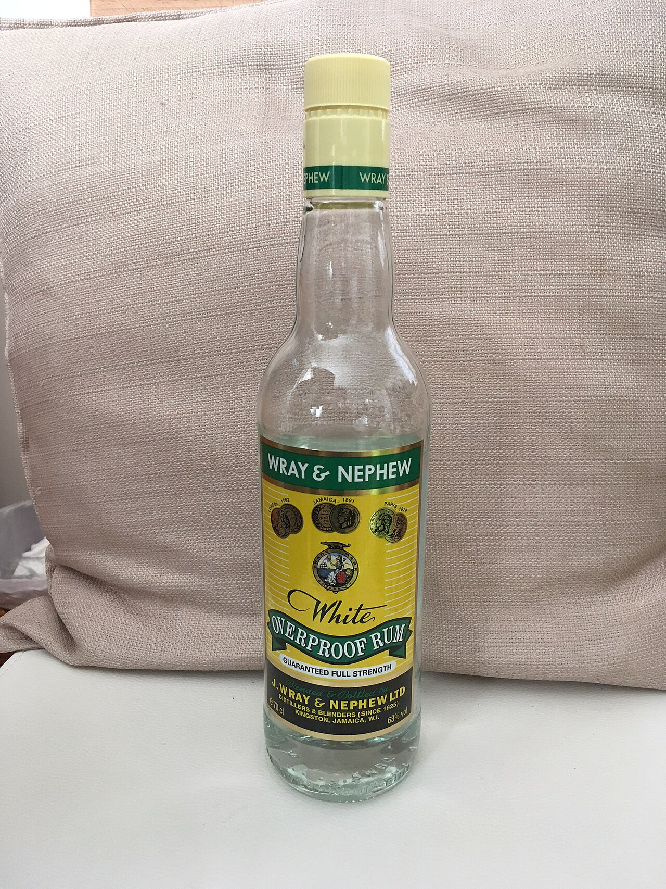

# 高度朗姆

酒精度显著高于常规朗姆的类别，常见 57.15% ABV 或 75.5% ABV（151 US proof）；风味强烈、易燃，多用于调酒与烹饪。

高度朗姆的关键数字是 ABV，而不是“151”：151 US proof 约等于 75.5% ABV，常见高度朗姆还有 57.15%、63% 与 69% ABV，标签上的 151 不是统一酒精度。它风味强烈、易燃，主要用作调酒工具，每杯 5–15 mL 提供香气与酒精度，也可以用于火焰菜、浸泡与烘焙；纯饮要非常谨慎，用小杯少量并准备清水。高度朗姆在 20 世纪的 tiki 调酒与加勒比饮食中占重要位置，151 类产品常用来做 float 或火焰效果，但现代调酒更强调少量使用与安全。Wray & Nephew Overproof 是牙买加最常见的调酒基准，Lemon Hart 151 以德梅拉拉糖蜜风格著称，Plantation OFTD 与 Rum Fire、Rum-Bar 也常见；Bacardi 151 已停产。购买时看 ABV、产地与酯类说明，存放要远离火源、儿童与宠物，开瓶后两三年内用完。高度朗姆的运输受危险品规则约束，个人携带上飞机通常有限制；家中存放要远离热源与阳光。调酒时先用少量试味，再决定是否增加；不要用吸管直接喝，也不要在火焰未熄时加酒。

图：Overproof Rum：Wray & Nephew White Overproof Rum（Wikimedia Commons）。图片：ZeugeDerNacht .，CC BY-SA 4.0，via Wikimedia Commons（[原图页面](https://commons.wikimedia.org/wiki/File:Wray_%26_Nephew_White_Overproof_Rum.jpg)）。

## 定义与边界

高度朗姆（overproof rum）指酒精度显著高于常规朗姆的类别，通常超过 50% ABV；常见的是 57.15% ABV（114.3 US proof）与 75.5% ABV（151 US proof），也有 63%、69% 甚至更高的版本。它不是法定类别，而是市场与调酒术语。

“151”来自美国 proof 体系：151 US proof 约等于 75.5% ABV，而 57.15% ABV 对应 114.3 proof，不是 151。为避免混淆，标签上的 ABV 比“151”更可靠；常见“151 rum”多为 75.5% ABV。

它与普通朗姆的区别在酒精度与用途，不在原料或产地；高度朗姆可以是白朗姆、金朗姆或陈年朗姆，也可以是高酯牙买加风格。

## 历史与命名

加勒比朗姆的早期贸易中，高酒精度能减少体积、便于海运，也降低按体积征收的税负；海军配给与殖民地贸易推动了高酒精度产品。

牙买加的高酯朗姆与圭亚那的德梅拉拉朗姆都有高度版本；20 世纪，Wray & Nephew Overproof 与 Lemon Hart 151 成为调酒师的常用基酒，Bacardi 151 则因营销与流行文化广为人知，后来停产。

17–18 世纪，加勒比糖蜜廉价、蒸馏技术简单，高酒精度朗姆成为船员与种植园的日常；英国海军配给朗姆从 18 世纪起按每日半品脱发放，后来改为加水与柠檬，高度版本仍留在贸易与调酒里。

## 原料与工艺

原料仍是甘蔗糖蜜或甘蔗汁，发酵、蒸馏后得到高酒精度原酒；高度版本可以在蒸馏后直接装瓶，也可以短暂陈年。高酯牙买加朗姆用长时间发酵与壶式蒸馏保留酯类，香气更浓。

高酒精度会放大香气与辛辣感，也增加易燃风险；装瓶前通常加水降到目标酒度，不添加糖或香料的高度朗姆更常见。陈年高度朗姆会在桶中降度，颜色与风味更圆润。

与普通朗姆相比，高度版本不是“更烈就更香”：酒精会压制细腻香气，调酒时通常少量使用，或先稀释再品尝。

高酯朗姆的发酵时间可长达数周，加入丁酸菌与野生酵母产生酯类；壶式蒸馏保留更多同系物，柱式蒸馏更干净。高度版本在蒸馏后直接加水降度，不经过长期桶陈，因此颜色浅、香气冲。

## 风格与味觉

香气强烈，带香蕉、菠萝、芒果、甘蔗糖蜜、胡椒与酒精感；入口灼热，甜感与苦味被酒精放大，回味长。高酯版本带熟水果、油漆与香料，干净版本更偏甘蔗与柑橘。

它不适合像普通朗姆那样大杯纯饮；在鸡尾酒里，少量高度朗姆能提供香气穿透力与“火力”，例如 Ti’ Punch、Zombie、151 Swizzle。判断典型性，先看 ABV、酯类风格与是否加糖。

高酯版本的香气像熟香蕉、菠萝、油漆与香料，入口比闻起来更甜；干净版本以甘蔗、柑橘与胡椒为主。57% ABV 的 Wray & Nephew 常被用来做 Ti' Punch，75.5% 的 151 更适合漂浮与火焰。

## 代表产区与品牌

Wray & Nephew Overproof（牙买加，63% ABV）是最常见的调酒基准；Lemon Hart 151（圭亚那，75.5% ABV）以德梅拉拉糖蜜风格著称；Bacardi 151 已停产，但仍是流行文化里的“151”符号。

Plantation OFTD（69% ABV）与 Rum Fire、Rum-Bar 等牙买加高酯版本也常见。找酒时看 ABV、产地与酯类说明，不要只看“151”字样。

## 怎么喝与配餐

纯饮要非常谨慎：用小杯、少量，先加一两滴水稀释，再闻香；不要直接大口喝。更常见的用法是调酒，每杯 5–15 mL，提供香气与酒精度；也可以用于火焰菜、浸泡与烘焙。

配餐不适合清淡食物，适合重口味烧烤、烟熏肉与甜点；火焰表演时远离易燃物，不要在室内随意点火。开瓶后塞紧、避光、远离热源，高度酒精挥发快，香气会逐渐变淡。

高度朗姆也可以用来做浸泡酒，例如香草、肉桂或水果；高酒精提取快，几天即可，但要注意防火。纯饮时每口不超过 10 mL，并准备清水。

开瓶时先闻瓶口，不要直接凑近鼻子；高酒精会刺激鼻腔。

## 选购、储存与误区

先看 ABV 与产地，再看是否为高酯风格；价格高可能来自陈年或小批量，不代表更烈。标签上的“151”不是统一酒精度，购买时以 ABV 为准；运输与储存要远离火源与高温。

常见误读：把“151”当成 151% ABV；以为高度朗姆越烈越好；把 Bacardi 151 的停产当成所有 151 停产。高度朗姆是调酒工具，不是纯饮挑战。

高度朗姆的运输受危险品规则约束，个人携带上飞机通常有限制；家中存放要远离火源、儿童与宠物。开瓶后酒精挥发快，长期存放会损失香气，建议 2–3 年内用完。

## 延伸阅读与另见

- [朗姆酒](ref:rum)：甘蔗蒸馏酒的大类。
- [蒸馏](ref:distillation)：酒精度与切割。
- [牙买加](ref:jamaica)：高酯朗姆产区。
- [利口酒](ref:liqueur)：与甜味烈酒的边界。
- [酒度与 proof](ref:proof)：ABV 与 proof 的换算。

对照阅读：[朗姆酒](ref:rum)、[牙买加](ref:jamaica)、[蒸馏](ref:distillation)。

**关键事实。**

| 项目 | 内容 |
| --- | --- |
| 一句话定位 | 酒精度显著高于常规朗姆的类别，常见 57.15% ABV 或 75.5% ABV（151 US proof）；风味强烈、易燃，多用于调酒与烹饪 |
| 上位风格 | 朗姆酒 |

**来源与边界。** 本页关于「高度朗姆」的关键事实，主要由以下来源交叉核对：European Union（烈酒类别、定义与标签规则）、US TTB（美国威士忌、朗姆与烈酒分类）、West Indies Rum and Spirits Producers' Association（加勒比朗姆酒的生产、地理标志与行业标准）等 4 条来源。价格、批次与状态会变，涉及这些字段时以页面所列来源的最新版本为准。正文为项目自写，来源只作核验，不复制原文。

**并读。** 把「高度朗姆」与「朗姆酒」、「蒸馏」、「牙买加」放在一起读时，先确认它们是同一层级还是上下游关系：先确认定义与工艺，再比较原料、产区与代表品牌。本页负责给出酒类风格的基本坐标，对照条目补上具体案例与差异；读完再回到本页，才能分清哪些差别属于酒类风格本身，哪些只是产地、批次或品牌选择。

## 相关图像

图：牙买加类别配图。图片：Acampbell3000，CC BY 3.0，via Wikimedia Commons（[原图页面](https://commons.wikimedia.org/wiki/File:Appleton_Estate_Jamaica_November_2012.jpg)）。关联图像：高度朗姆。
