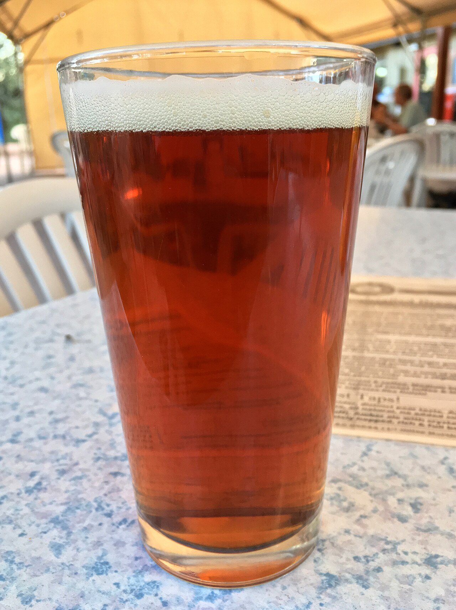
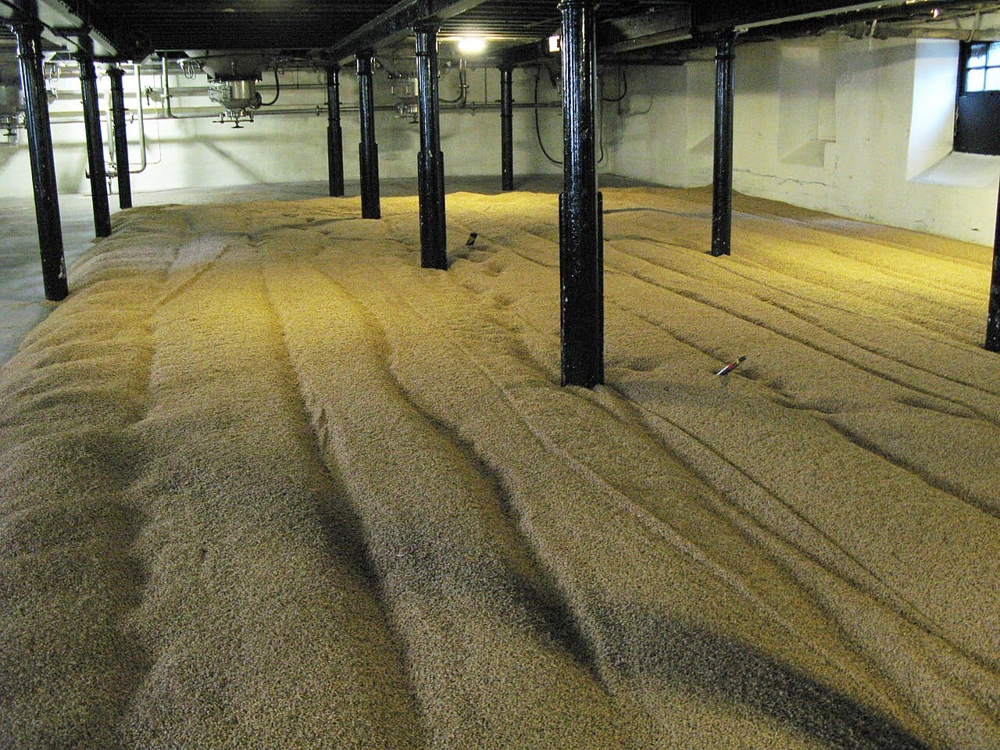

# 淡色艾尔

淡色艾尔（pale ale）是[啤酒](ref:beer)中以浅色麦芽为主体、采用上面发酵、酒花香气清楚可辨的家族。它的一端是[英式艾尔](ref:english-ale)里的苦啤与桶装艾尔，另一端是 1980 年代美国精酿用 Cascade 等酒花重建的 American Pale Ale。判断一款酒是否属于这个家族，关键不是色卡，而是麦芽骨架能否托住酒花，以及收口是否保持干净。

图：淡色艾尔。图片：https://www.flickr.com/photos/cogdog/，CC BY 2.0，via Wikimedia Commons（[原图页面](https://commons.wikimedia.org/wiki/File:THAT_Brewery_Bearfoot_Pale_Ale.jpg)）。

## 浅色麦芽如何改变英国酿酒

18 世纪的英国酿酒者用焦炭代替木柴烘烤麦芽，减少烟熏味，得到颜色更浅、风味更干净的麦芽。这项制麦变化让“pale ale”从棕色艾尔中分离出来。伯顿（Burton-upon-Trent）的硬水富含硫酸盐，会把酒花的苦味推得更干、更利落，当地酿酒业因此成为英式淡色艾尔的代名词。

19 世纪，英国把重酒花的淡色艾尔运往印度，逐渐形成 IPA 这一更烈、更苦的出口分支。留在本土的版本则向较低酒精度、较高饮用量的方向演化，成为酒馆里的 bitter。1980 年，美国加州的 Sierra Nevada 推出以 Cascade 酒花为核心的 Pale Ale，柑橘、松脂与葡萄柚般的香气让淡色艾尔进入新的坐标系。此后美式淡艾成为精酿运动最常用的入门风格之一。英美两地的命名并不统一：英国的 bitter 在酒标上常直接写成 pale ale，而美国的 pale ale 又可能比英式版本更苦、更香。这种重叠让风格边界更像一条带子，而不是一条线。

## 糖化、发酵与酒花投放

[大麦](ref:barley)经过[制麦](ref:malting)后成为浅色基础麦芽，提供酶与可发酵糖；少量结晶麦芽带来饼干、焦糖与琥珀色调。糖化温度偏高时残糖更多、酒体更圆，偏低时收口更干。英式配方常以 Fuggles、Goldings 等品种做苦味与香气，美式配方则偏向 Cascade、Centennial、Citra 一类带柑橘与松脂气息的品种。

[发酵](ref:fermentation)为上面发酵，常见温度 18–20°C。干投（dry hopping）在发酵后期或后储阶段加入酒花，主要提取香气而不是苦味。英式淡艾通常 4.0%–5.5% 酒精度、25–40 IBU；美式淡艾常见 4.5%–6.2%、30–50 IBU。这些数字随来源与酒厂而异，不是法定标准，酒花品种、投放量与发酵度同样会改变最终感受。水质同样关键：硫酸盐偏高的水会放大苦味的干爽感，氯化物偏高的水则让麦芽显得更圆润。英式酒厂常利用当地水质形成固定性格，美式酒厂则更常通过调整水质来配合酒花。

## 杯中的香气与口感边界

英式淡艾的香气以麦芽的饼干、烤面包与轻焦糖为底，酒花多是花香、泥土与柑橘皮的柔和组合，苦味清楚但不喧宾夺主。美式淡艾则把酒花推到前台，葡萄柚、橙皮、松针与热带水果的香气更直接，苦味更干，收口常带一点树脂感。

两者的共同边界是“可饮性”：酒精度不应高到压住香气，酒体不应厚到让苦味失去轮廓。若酒花香气充足但麦芽完全缺席，酒会显得空；若麦芽甜感过重，酒花又会变得含糊。氧化会带来纸板与蜂蜜般的陈旧味，这是保存问题，不是风格特征。碳酸化程度也影响判断：英式桶装艾尔的气泡较柔，香气释放慢，入口更平；瓶装或罐装的美式淡艾气泡更活跃，酒花香气冲得更快。品尝时先闻后喝，等温度略升再判断苦味与麦芽是否平衡。

## 产区与代表酒厂

英国的代表性产区包括伯顿、约克郡与伦敦。伯顿的硫酸盐型水质适合把酒花苦味拉得干爽，伦敦与南部的酒厂则更强调麦芽的柔和。美国太平洋西北地区是柑橘型酒花的重要产地，华盛顿与俄勒冈的种植者提供了 Cascade、Citra 等品种；加州、科罗拉多与佛蒙特则形成了不同强度的美式淡艾版本。

今天，“pale ale”在酒标上既可能是英式苦啤的同义词，也可能是美式淡艾的缩写。读到这个词时，最好同时看酒精度、酒花品种与产地，而不是只看颜色。如果标签只写“pale ale”而不标产地，最稳妥的做法是把它当作一个待确认的家族名：看酒精度可以大致区分日常型与烈性型，看酒花描述可以判断英式还是美式取向。

## 与 IPA、苦啤和拉格的分界

与 IPA 相比，淡色艾尔的酒精度与苦度通常更低，酒花表达更克制；IPA 可以把酒花推到极致，淡艾仍要求麦芽与酒花互相支撑。与英式苦啤相比，两者共享同一套上面发酵与麦芽基础，差别更多在命名习惯与强度：苦啤是酒馆语境下的日常艾尔，淡色艾尔是更宽泛的家族名。

与[拉格](ref:lager)的分界来自酵母与温度：拉格用低温下层发酵，风味更干净、酒花表现更线性；淡色艾尔用上面发酵，酯香与麦芽层次更明显。把淡色艾尔简单理解为“颜色浅的啤酒”，会遗漏发酵方式这个核心变量。

## 侍酒与配餐

淡色艾尔适饮温度约 8–12°C。温度过低会压住酒花香气，过高则让酒精与甜感变得突出。英式版本适合用品脱杯或收口杯，美式版本可以用郁金香杯聚拢香气；倒酒时保留适量泡沫，有助于香气释放。

配餐上，英式淡艾适合炸鱼薯条、烤肉派与切达奶酪，美式淡艾适合汉堡、披萨、墨西哥卷饼与带柑橘的沙拉。避免用极辣或极甜的菜肴同时压制酒花，否则苦味会显得突兀。购买时注意生产日期，酒花香气会随存放时间下降，越新鲜的版本越能体现风格。

对照阅读：[英式艾尔](ref:english-ale)、[拉格啤酒](ref:lager)。

**关键事实。**

| 项目 | 内容 |
| --- | --- |
| 一句话定位 | 以浅色麦芽为主体、上面发酵、酒花表达清晰的啤酒家族；英式版本偏麦芽与花香，美式版本以柑橘松脂型酒花为标志，与苦啤、IPA 构成连续谱而非三个孤立的盒子 |
| 上位风格 | 英式艾尔 |
| 香气家族 | 酒花与麦芽 |

**来源与边界。** 本页关于「淡色艾尔」的关键事实，主要由以下来源交叉核对：Beer Judge Certification Program（英式与美式淡色艾尔的强度、苦度与风味描述框架）、Brewers Association（美国精酿行业对 American Pale Ale 的公开表述与风格分类）、Campaign for Real Ale（英国苦啤、淡色艾尔与桶装真艾尔的传统关系）等 4 条来源。价格、批次与状态会变，涉及这些字段时以页面所列来源的最新版本为准。正文为项目自写，来源只作核验，不复制原文。

## 相关图像

图：制麦。图片：Lakeworther，CC BY-SA 3.0，via Wikimedia Commons（[原图页面](https://commons.wikimedia.org/wiki/File:Highland_park_malting_floor.jpg)）。关联图像：淡色艾尔。
