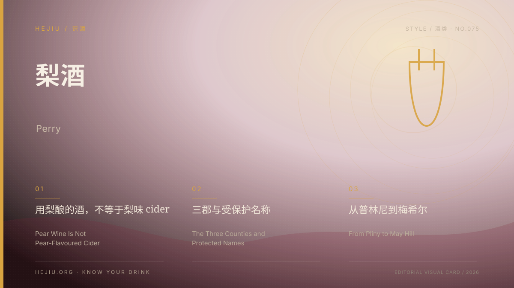
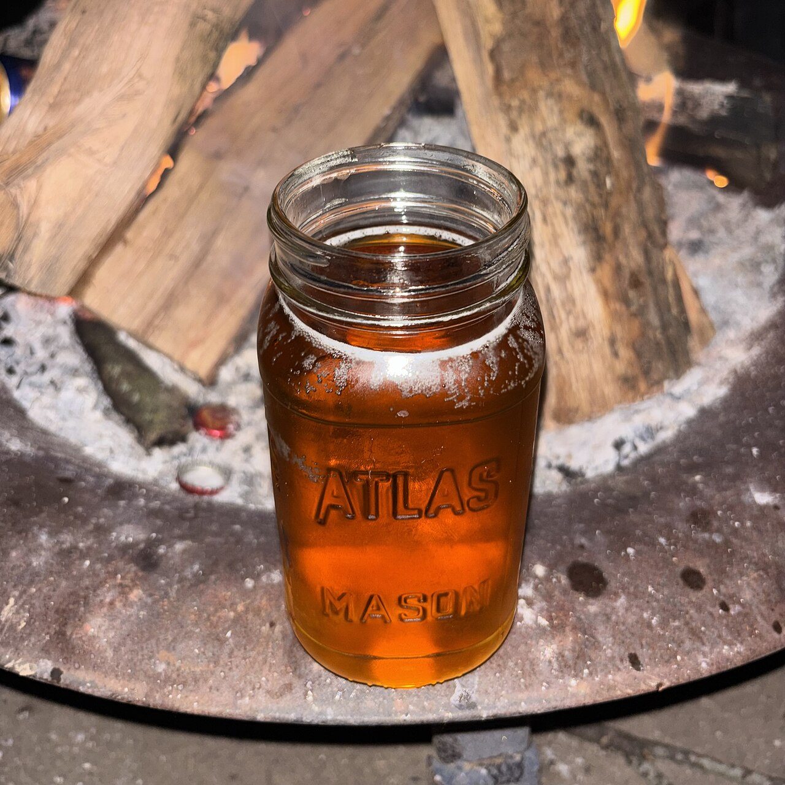

# 梨酒

梨酒（perry）是梨汁经过发酵得到的低度酒，最典型的版本来自英国西米德兰兹的赫里福德郡、格洛斯特郡与伍斯特郡。它使用专门栽培的高单宁梨品种，成品从干型到半甜型都有，酒精度通常在 4% 到 8% 之间。它与“梨味苹果酒”最大的区别在原料：真正的 perry 以梨汁为主体，苹果酒则以[苹果](ref:apple)汁为主体，二者在香气、单宁与收尾上走的是不同路线。

图：梨酒 双语视觉卡（项目自绘 SVG）。不是实拍。

## 用梨酿的酒，不等于梨味 cider

在超市货架上，“pear cider”常指以苹果酒为基底、加入梨汁或梨味香精的饮料；它可以是甜的、清澈的、带明显糖果香。Perry 则是传统的梨发酵酒，强调梨本身的品种差异与果皮单宁。英国与欧盟的标签讨论长期围绕这两个词展开：一派认为 perry 应保留传统工艺与梨品种，另一派把 pear cider 当作更容易被消费者理解的市场名称。

对饮者来说，最实用的区分方法是看配料与酒标：标“perry”的产品通常会更强调梨品种、年份与干型风格；标“pear cider”的产品则可能更甜、更工业化。两者都可以好喝，但它们不是同一类风味。

## 三郡与受保护名称

英国三郡——赫里福德郡、格洛斯特郡、伍斯特郡——是 perry 的传统核心。这里的果园土壤与气候适合高单宁梨生长，梅希尔一带尤其集中了早期梨品种。当地的梨酒生产至少有四百年的文字与农业记录，17 至 18 世纪进入兴盛期，后来因农业转型与果园消失而衰退。

“Herefordshire Perry”曾以地理标识申请进入欧盟保护体系，强调产地、梨品种与传统工艺。无论最终标签如何，三郡的 perry 已经形成一个清晰的风味共同体：干、带苦、有单宁骨架，而不是单纯的甜梨汁。购买时看到“Three Counties”或具体郡名，通常比只看“pear”更有信息量。

## 从普林尼到梅希尔

梨酒的历史可以追溯到古罗马。普林尼在公元 1 世纪的著作中提到过用梨酿造的发酵饮料；中世纪欧洲的修道院与农庄也有类似记录。英国的 perry 在 17 世纪以后逐渐形成规模，赫里福德郡与格洛斯特郡的农场把梨酒当作苹果酒的姊妹饮品，既供自家饮用，也卖给邻近市镇。

19 世纪的农业变革让许多老梨园被砍伐，20 世纪的工业化进一步压缩了传统 perry 的空间。到 2000 年，三郡仍有名字的 perry 梨品种虽多，真正商业种植的却已不到三十种。近二十年，小型生产商、果园保护组织与酒吧重新推动 perry 的复兴，老品种才逐渐回到市场。

## 梨品种决定一切

Perry 梨与鲜食梨不同：果实小、硬、涩，单宁高，直接吃并不美味，却非常适合酿酒。常见品种包括 Blakeney Red、Butt、Gin、Moorcroft、Thorn 等，每个品种带来不同的香气与结构。有的偏花香，有的偏柑橘，有的带明显苦味；混酿可以把它们组合成更完整的酒体。

三郡曾经有超过一百个有名字的 perry 梨品种，如今许多只保存在国家收集园与老果园里。单品种 perry 能表现某一棵树的个性，混酿则更稳定、更像生产者的“ house style”。这也是 perry 与大规模苹果酒最不一样的地方：它仍然是一门关于品种与果园的学问。

## 发酵、澄清与瓶内二次发酵

梨子成熟后采收、破碎、压榨，果汁进入发酵罐。传统做法依赖野生酵母，发酵启动慢、温度低，风味更复杂；现代生产商也会接种培养酵母，追求稳定。发酵完成后，酒液可能经过换桶、澄清或自然沉降，部分产品会保留少量[残糖](ref:residual-sugar)，让口感更圆。

[发酵](ref:fermentation)结束后，许多优质 perry 会进行瓶内二次发酵：装瓶时加入少量糖与酵母，让酒在瓶中产生气泡与更细腻的泡沫。这个过程与香槟法相似，却不需要复杂的转瓶设备。最终酒精度通常在 4% 到 8% 之间，酸度与单宁决定它喝起来是清爽还是厚重。

## 香气：花香、梨与苦单宁

倒入杯中，perry 通常呈浅金到淡琥珀色，清澈或轻微浑浊。闻香以梨、白花、柑橘皮与干草为主，有时带一点蜂蜜与酵母感。入口先从果香开始，中段出现单宁的干涩与轻微苦味，尾段回到梨与矿物感。与[苹果酒](ref:cider)相比，perry 的香气更轻、更花香，单宁更细，酸度通常也更柔和。

甜度跨度很大：干型 perry 适合配餐，半甜型更适合单饮。评价时看三点：梨香是否真实、单宁是否有骨架、收尾是否干净。只甜不苦的版本容易显得单薄；苦味过重的版本则需要食物来平衡。

## 赫里福德、格洛斯特与伍斯特

三郡的 perry 生产商各有侧重。Westons 以大规模苹果酒与 perry 闻名，产品线从干型到甜型都有；Sheppy's 在萨默塞特延续家族果园传统，perry 常带更明显的果香；Dunkertons、Oliver's、Hogan's 等小型生产商则强调有机、老品种与瓶内发酵。它们共同把 perry 从“乡村土酒”推回城市酒吧与餐厅。

法国诺曼底与安茹也有梨发酵酒，通常叫 poiré，风格更干、更矿物；瑞典的 päroncider 则多为甜型、果味更重。把它们放在一起比较，可以看出 perry 的核心不是“梨”这个原料，而是高单宁梨品种与干型发酵的组合。

## 佐餐与温度

Perry 适合轻微冰镇，温度大约在 8 到 10 摄氏度；过冷会压住花香与单宁，过热则让酒精感突出。干型 perry 可以搭配猪肉、烤鸡、鱼、硬奶酪与油炸食物；半甜型适合咖喱、辛辣菜与水果甜点。它的单宁比苹果酒更细，因此配白肉与海鲜也不突兀。

在酒吧里，perry 常与苹果酒一起从木桶或酒柱打出，温度比冰箱略高，气泡更柔。瓶装版本则要注意年份与保存条件：瓶内二次发酵的产品可能继续变化，开瓶前最好先冷藏，开瓶后尽快喝完。

## 选购与保存

购买时先看名称与配料：标“perry”的产品更可能是传统梨发酵酒，标“pear cider”的则可能混有苹果汁或香精。再看甜度与酒精度，4% 到 8% 是常见区间；瓶内二次发酵的产品通常会有“bottle conditioned”字样。若酒标写明年份与梨品种，说明生产者愿意让你追踪它的来源。

Perry 不适合长期陈放，尤其是低酒精度、低单宁的版本。买回家后放在阴凉避光处，开瓶后冷藏并在两三天内喝完。若出现明显氧化、醋味或浑浊异常，说明酒已经过了最佳状态。

补充阅读：[修道院啤酒](ref:c-extra-1)。

对照阅读：[苹果酒](ref:cider)、[残糖（residual sugar）](ref:residual-sugar)。

相关条目：[发酵](ref:fermentation)。

## 相关图像

图：苹果酒。图片：ChuckDabs，CC BY 3.0，via Wikimedia Commons（[原图页面](https://commons.wikimedia.org/wiki/File:Midwest_hard_cider.jpg)）。关联图像：梨酒。
