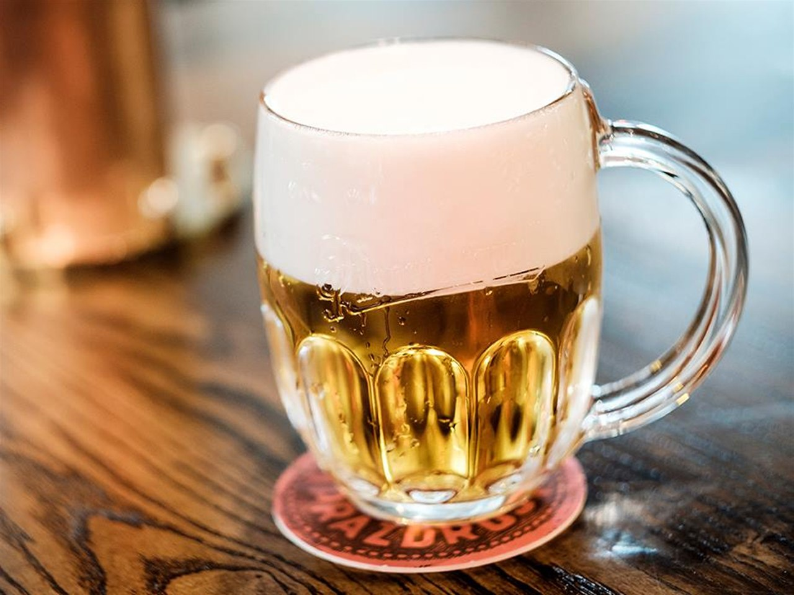

# 皮尔森啤酒

皮尔森啤酒（Pilsner）是起源于捷克波希米亚城市比尔森（Plzeň）的淡色拉格，以极软的水质、萨兹酒花、浅色麦芽与低温下层发酵为特征。它既是一段具体的历史风格，也在许多国家被用作淡色拉格的代称，这两种用法应当分开理解。在[啤酒](ref:beer)的家族里，它属于拉格一支。

图：皮尔森啤酒。图片：Steven Walling，CC BY-SA 4.0，via Wikimedia Commons（[原图页面](https://commons.wikimedia.org/wiki/File:Pilsner_urquell_mug.jpg)）。

## 定义与标准

在风格指南的框架中，皮尔森大致对应“捷克优质淡色拉格”：颜色从淡黄到金黄，清澈明亮，[苦度](ref:ibu)常见约 30–40 IBU，[原麦汁浓度](ref:original-gravity)多在 11–12 °P，酒精度常见 4.2–5.0%。这些数字描述的是典型区间，不是评分表。不同酒厂会按市场调整强度与苦度，因此单看参数无法判断质量。

需要区分的是名称与风格。严格意义上的皮尔森指向比尔森的酿造传统；而在德国、荷兰、巴西等地，“Pils”“Pilsen”已成为一类淡色拉格的通称，酒花、水质与发酵细节早已本地化。把两者混为一谈，会掩盖配方上的真实差异。

## 产地与风格/历史

比尔森位于[捷克](ref:czechia)波希米亚西部。19 世纪初，当地啤酒的质量受到质疑，市民于 1839 年集资建立市民酿酒厂，并请来巴伐利亚酿酒师约瑟夫·格罗尔（Josef Groll）。1842 年，第一批淡色下层发酵啤酒问世，很快获得成功。这款酒即今日的[皮尔森欧克](ref:pilsner-urquell)，也是理解该风格的直接样本。

19 世纪下半叶，铁路与冷藏运输让皮尔森式啤酒迅速扩散到欧洲其他地区。各地沿用名称，却按本地水质、麦芽与酒花条件重新设计，最终形成捷克皮尔森与德国皮尔森等分支。风格传播的过程，也是配方被重新解释的过程。

## 原料与工艺

[水](ref:water)是皮尔森最容易被忽视的条件。比尔森的地下水矿化度很低，硫酸盐与碳酸盐含量都低，不会放大酒花苦味，也不会压迫浅色麦芽的细腻香气，因此成酒显得干净、利落。

[大麦](ref:barley)方面，传统上使用摩拉维亚二棱大麦制成的浅色麦芽，烘烤程度很浅，色泽与风味都保持轻柔。酒花以萨兹（Žatec，德语称 Saaz）为代表，α酸含量偏低，香气偏草本、辛香与花香，苦味细腻而不刺。若改用高α酸酒花，会得到更直接、更硬朗的苦味，风格随之改变。

糖化环节，传统做法是三次煮出糖化：取出部分醪液煮沸后再混回，分步提升温度，使酶的作用与麦芽风味充分展开。现代酒厂则多用阶梯升温或单温度糖化以节约能源。煮出法不是唯一正确答案，但它与浅色、未高度改造的麦芽配合得更好。

[发酵](ref:fermentation)为低温下层发酵，主发酵通常控制在 7–12°C，随后在接近 0°C 的环境中长时间贮酒。低温与时间让酵母沉降、异味减少、泡沫与酒体稳定。发酵温度偏高会带来酯香，那就不再是皮尔森想要的中性表达。

## 风味特征

典型酒液呈淡稻草色至金黄色，透明度高，泡沫细密持久。香气以面包、饼干般的麦芽香为底，叠加萨兹酒花的草本、辛香与轻微花香；酯香与双乙酰应保持很低。

入口先是短暂而柔和的麦芽甜味，随后是清晰但不粗糙的苦味，收口干净偏干。酒体轻到中等，碳酸化中等到偏高，整体追求爽利而非浓烈。平衡是这类风格的核心：苦味要有支撑，麦芽不能缺席。

## 品鉴与饮用

皮尔森适合充分冷却后饮用，常见适饮温度约 4–8°C；温度过低会压制香气，过高则显得松散。细长杯或郁金香杯有助于聚拢泡沫与香气。捷克酒吧还有分层注酒的习惯，通过泡沫比例调整口感与碳酸感。

新鲜度对皮尔森尤其重要。酒花香与细腻的麦芽香会随氧化和光照迅速衰减，透明玻璃瓶在日光下尤其脆弱。购买时留意生产日期与储存条件，比包装设计更能说明问题。佐餐时，清爽的苦味适合油炸食物、香肠与带酸度的菜肴。

## 常见误区

第一，把皮尔森等同于所有淡色拉格。真正的皮尔森依赖特定的水质、酒花与发酵传统。
第二，认为颜色浅就代表寡淡。风味强弱取决于原料与工艺，不取决于色度。
第三，把皮尔森当成艾尔。它是下层发酵的拉格。
第四，认为苦度越高越正宗。皮尔森追求的是细腻、有支撑的苦味。
第五，以为“Pils”在任何国家都是同一款酒。名称相同，配方与法规并不相同。

对照阅读：[啤酒](ref:beer)、[水](ref:water)。

## 延伸阅读

- [啤酒](ref:beer)：拉格与艾尔的整体分类框架。
- [捷克](ref:czechia)：比尔森所在的产地与酿造传统。
- [水](ref:water)：软水质对淡色拉格风味的塑造。
- [大麦](ref:barley)：浅色麦芽与酒体的基础。
- [发酵](ref:fermentation)：下层发酵与低温贮酒的作用。
- [苦度](ref:ibu)：理解 IBU 数值的含义与局限。
- [原麦汁浓度](ref:original-gravity)：判断啤酒强度与酒体的另一指标。
- [皮尔森欧克](ref:pilsner-urquell)：该风格的代表性产品。

**关键事实。**

| 项目 | 内容 |
| --- | --- |
| 一句话定位 | 起源于捷克比尔森的淡色拉格，以极软水质、萨兹酒花、浅色麦芽与低温下层发酵为特征，是理解现代淡色拉格的关键风格 |
| 上位风格 | 啤酒 |
| 香气家族 | 麦芽与酒花 |

**来源与边界。** 本页关于「皮尔森啤酒」的关键事实，主要由以下来源交叉核对：Beer Judge Certification Program（捷克优质淡色拉格的强度、苦度与色度区间）、Brewers Association（精酿啤酒行业对淡色拉格与风格命名的公开表述；未复制其文案）、Plzeňský Prazdroj（1842 年起源、比尔森水源与酒花等公开信息）等 4 条来源。价格、批次与状态会变，涉及这些字段时以页面所列来源的最新版本为准。正文为项目自写，来源只作核验，不复制原文。

**并读。** 把「皮尔森啤酒」与「啤酒」、「捷克共和国」、「水」放在一起读时，先确认它们是同一层级还是上下游关系：先确认定义与工艺，再比较原料、产区与代表品牌。本页负责给出酒类风格的基本坐标，对照条目补上具体案例与差异；读完再回到本页，才能分清哪些差别属于酒类风格本身，哪些只是产地、批次或品牌选择。

**适用边界。** 对「皮尔森啤酒」而言，法定定义、原料比例与地域风格会随法规和行业分类更新；品牌案例不等于整个风格。

**更新提示。** 「皮尔森啤酒」最近核对于 2026-11-05；价格、状态与公开信息会变，引用前以本页来源的最新版本为准。
