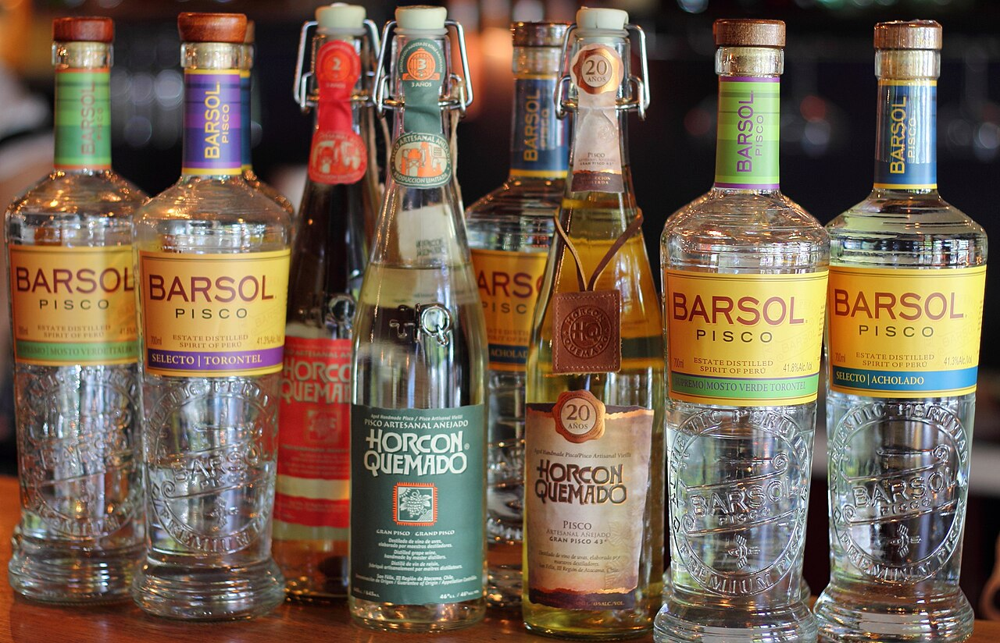

# 皮斯科

皮斯科（Pisco）是以新鲜葡萄汁发酵后直接蒸馏得到的葡萄烈酒，在分类上属于[白兰地](ref:brandy)大类中的葡萄蒸馏酒，但它的工艺逻辑与干邑、雅文邑不同：多数皮斯科不经过橡木桶陈年，也不在装瓶前加水稀释。它更像“把某一季葡萄的香气固定下来”的蒸馏酒，而不是以桶陈和调配塑造复杂度的陈年烈酒。秘鲁与智利都生产皮斯科，也都为本国产品建立了法定产区与工艺规范，两国关于名称与风格的争论延续至今。

图：皮斯科。图片：Cocktailmarler，CC BY-SA 4.0，via Wikimedia Commons（[原图页面](https://commons.wikimedia.org/wiki/File:Range_of_Pisco.jpg)）。

## 定义与法规

皮斯科的核心定义可以拆成三点。第一，原料是葡萄，而且必须是新鲜葡萄汁或葡萄醪，不是葡萄皮渣，因此它不属于果渣白兰地。第二，工艺是发酵后[蒸馏](ref:distillation)，不是浸泡或配制。第三，产地受[原产地命名](ref:appellation)保护，只有在规定产区、按规范生产的酒才能使用“Pisco”名称。

秘鲁的皮斯科受产地命名保护，法规规定使用铜制壶式蒸馏器、单次蒸馏，取酒心，成品酒精度在 38%–48% vol 之间；不得加水、加糖、加色素或香料，也不得用橡木桶陈年，只能在玻璃、不锈钢等惰性容器中静置。智利的皮斯科同样受产地命名保护，法定产区在阿塔卡马与科金博，法规按酒精度划分等级，并允许部分产品在橡木桶中陈年。两套规范都叫“皮斯科”，但门槛并不相同。

欧盟烈酒法规为葡萄蒸馏酒与白兰地提供了比较框架，但皮斯科的具体规则由秘鲁与智利的国内法及双边协议界定；阅读标签时，应先确认产地国，再看酒精度与陈年声明。

## 历史

皮斯科的起源与南美洲殖民时期的葡萄种植有关。16 世纪，西班牙人把葡萄带入秘鲁与智利，沿海河谷的灌溉农业逐渐形成规模。由于葡萄酒运输困难、容易变质，当地开始把葡萄酒或葡萄醪蒸馏成烈酒，既便于保存，也便于征税。秘鲁的伊卡、皮斯科港一带在殖民贸易中占据重要位置，“Pisco”一名与港口、产区的联系也由此加深。

19 世纪，葡萄根瘤蚜与战争冲击了南美葡萄酒业，皮斯科的产量与产区几经起伏。20 世纪，秘鲁在 1991 年正式确立皮斯科的产地命名，智利也在同一时期完善本国的产区法规。两国都把自己的产品视为正宗，名称争议进入国际谈判；对消费者而言，更实际的做法是理解两国规范差异，而不是把其中一个当作“唯一版本”。

## 原料与工艺

皮斯科的原料是葡萄。秘鲁允许的品种分为两类：一类是芳香型，如[麝香葡萄](ref:muscat)、Italia、Albilla、Torontel，带来花香、柑橘与蜜瓜；另一类是非芳香型，如 Quebranta、Negra Criolla、Mollar、Uvina，风格更偏青草、香蕉、面包与矿物感。智利常用 Moscatel de Alejandría、Moscatel Rosada、Pedro Jiménez 与 Torontel，香气更直接。

采收后的葡萄压榨取汁，带皮或不带皮发酵，得到干型葡萄醪。发酵完成后尽快蒸馏，以避免氧化与变质。秘鲁强调单次蒸馏：酒液在壶式蒸馏器中一次完成，掐头去尾，只取酒心；因此酒精度较高，风味也更集中。智利允许多种蒸馏方式，部分产品会进行二次蒸馏或以柱式蒸馏器生产，风格更轻。

蒸馏后，秘鲁皮斯科不加水降度，装瓶酒精度就是蒸馏时的酒心强度；智利则允许按等级调整。这个差异直接影响口感：秘鲁皮斯科入口更烈、更干，香气更紧；智利皮斯科通常更柔和，果香更外放。

## 秘鲁与智利：两套法定风格

秘鲁的法定产区包括利马、伊卡、阿雷基帕、莫克瓜与塔克纳五个大区，核心在伊卡。法规要求单次蒸馏、不加水、不加糖、不用橡木桶，静置时间不少于三个月。成品按香气分为芳香型与不芳香型，按品种可以标注单一品种或混合品种。

智利的法定产区在阿塔卡马与科金博，行政上覆盖多个河谷。智利法规按酒精度设等级：Corriente 或 Tradicional 最低 30% vol，Especial 最低 35% vol，Reservado 最低 40% vol，Gran Pisco 最低 43% vol。橡木桶陈年也有专门标注：在橡木桶中至少 180 天可标“guarda”，至少 360 天可标“envejecido”。因此，智利皮斯科并不完全等于“无桶”。

## 分级与分类

秘鲁的分类更强调原料与香气：按品种分为单一品种皮斯科与混合皮斯科；按香气分为芳香型与不芳香型；按工艺分为普通皮斯科与“mosto verde”（用未完全发酵的葡萄醪蒸馏，酒液仍为干型，但香气更浓、口感更饱满）。mosto verde 不是加糖，而是改变发酵终点。

智利的分类更强调酒精度与陈年：四个酒精度等级，加上 guarda 与 envejecido 两个陈年标注。消费者可以把“等级”理解为合规区间，而不是质量排名；43% vol 的 Gran Pisco 不一定比 35% vol 的 Especial 更好，关键仍是香气是否干净、品种特征是否清晰。

## 感官风格

年轻皮斯科的香气以葡萄、柑橘、白花、蜜瓜与青草为主，入口干、酒体中等偏轻，酒精感明显但不应有刺鼻的溶剂味。芳香型品种常有玫瑰、橙花、荔枝与麝香；不芳香型品种更偏香蕉、面包、矿物与轻微咸感。mosto verde 因发酵终点更早，口感更圆润，香气更浓。

智利皮斯科因品种与蒸馏方式不同，常见更成熟的热带水果、葡萄干与花香；经过橡木桶的产品会多出香草、奶油与轻微香料感。无论哪一国，皮斯科都不应出现明显的橡木单宁或焦糖甜味——出现这些特征时，要么是智利陈年型，要么是调味产品。

## 产区

秘鲁的核心产区是伊卡，气候干热、日照强，葡萄成熟度高，香气集中；皮斯科港与利马周边也有历史产区。阿雷基帕、莫克瓜与塔克纳位于南部，产量较小，风格更清爽。秘鲁的产区名称与品种、工艺绑定，酒标上的“Ica”或“Quebranta”能提供具体线索。

[智利](ref:chile)的皮斯科产区集中在北部的阿塔卡马与科金博，包括 Elqui、Limarí、Choapa 等河谷。这里昼夜温差大、空气干燥，葡萄酸度较好，适合酿造清爽型皮斯科。产区名称不是质量保证，但能提示气候与品种选择。

## 代表产品

秘鲁的代表性类型是 Quebranta 单一品种皮斯科：香气偏香蕉、面包与青草，口感干爽，适合纯饮或调制 Pisco Sour。芳香型 Italia 与 Torontel 常作为单一品种装瓶，花香更明显；mosto verde 则是秘鲁特有的浓郁风格。

智利的代表类型包括 Moscatel 单一品种皮斯科、Reservado 与 Gran Pisco，以及标注 guarda 或 envejecido 的橡木桶版本。白皮斯科适合调酒，陈年型可以纯饮。皮斯科酸（Pisco Sour）在两国都被视为国民鸡尾酒，但配方比例与甜度各有习惯。

## 品鉴与饮用

品鉴时用郁金香形杯或白葡萄酒杯，先闻静止香气，判断果香、花香与酒精的融合度；再加少量水（如果产品允许）观察香气是否展开。入口注意酒体、甜感与收口，皮斯科通常不应有明显的甜味；咽下后看回味是否干净。智利陈年型可以对比无桶版本，感受橡木带来的香草与香料。

纯饮适合判断风格；皮斯科酸、Chilcano 与 Piscola 是常见调法。高酒精度产品应小杯慢饮，避免空腹；本页关于皮斯科的内容涉及酒精饮料；过量饮酒有害健康，未成年人不应饮酒。

## 常见误区

第一，把皮斯科当成“葡萄渣白兰地”。它用的是新鲜葡萄汁，不是皮渣。第二，认为所有皮斯科都不进橡木桶。秘鲁确实禁止，智利允许并设有 guarda、envejecido 标注。第三，把智利的酒精度等级当成质量排名。等级是合规区间，不是评分。第四，认为皮斯科越甜越好。多数皮斯科是干的，甜感来自品种与发酵终点，不是加糖。第五，把“Pisco Sour”当成皮斯科的唯一喝法。纯饮更能体现品种差异。第六，忽视产地国差异。秘鲁与智利的法规、品种与风格并不相同。

## 延伸阅读

- [白兰地](ref:brandy)：葡萄蒸馏酒的总体类别与工艺。
- [蒸馏](ref:distillation)：单次蒸馏与酒心切割对风格的影响。
- [麝香葡萄](ref:muscat)：芳香型皮斯科的重要品种基础。
- [智利](ref:chile)：智利皮斯科的产区与气候背景。
- [原产地命名](ref:appellation)：理解皮斯科名称保护的基础概念。
