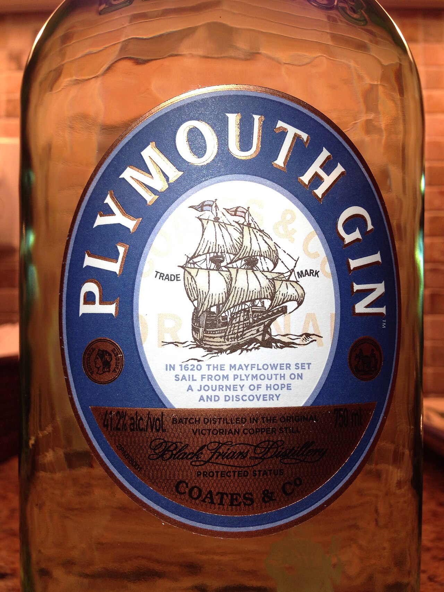

# 普利茅斯金酒

普利茅斯金酒（Plymouth Gin）是一种以英国城市普利茅斯为地理标识的[金酒](ref:gin)。它的特殊之处不在植物配方，而在产地规则：名称与普利茅斯的 Black Friars 酒厂绑定，生产地点离开这座城市，就不能再叫 Plymouth Gin。它比伦敦干金更柔和、更泥土感，历史上与英国皇家海军和经典鸡尾酒关系密切。

图：普利茅斯金酒。图片：WestportWiki，CC BY-SA 3.0，via Wikimedia Commons（[原图页面](https://commons.wikimedia.org/wiki/File:Plymouth_Gin_1793_Black_Friars_Distillery_2.jpg)）。

## 一个地名，一种风格

普利茅斯金酒既是一个品牌名，也是一种风格名。作为品牌，它由 Black Friars 酒厂生产；作为风格，它代表一种比伦敦干金更圆润、更少柑橘锐度、更多根茎与香料的杜松子酒。两者容易混淆，因为今天市场上几乎只有一家酒厂在生产这个名称。

理解这一点很重要：普利茅斯金酒不是“所有在普利茅斯生产的金酒”，也不是“伦敦干金的一个产区版本”。它是一套由地名、酒厂、配方和法规共同维系的身份，离开其中任何一个条件，名称就失去意义。

这也解释了为什么普利茅斯金酒常被推荐给第一次喝金酒的人：它的杜松子不像伦敦干金那样尖锐，柑橘也不抢戏，入口更接近谷物的圆润。但对老练的饮者来说，柔和并不意味着简单，植物之间的比例和收口长度仍然需要细看。这也是它适合作为日常金酒、而不是只供偶尔品尝的原因。

## Black Friars 与 1793 年

Black Friars 酒厂的建筑可追溯到 15 世纪，曾经是多明我会修道院的建筑；酒厂自 1793 年起在同一地点生产金酒，是英格兰持续运营时间最长的金酒蒸馏厂之一。酒厂的蒸馏室、餐厅和访客空间保留了大量历史结构，也让“产地”不只是标签上的一个词。

1793 年这个时间点常被用来强调连续性：同一地点、同一套建筑、同一套基本配方。连续性本身不保证质量，但它解释了为什么普利茅斯金酒能把“地方”写进风味叙事：水质、建筑、设备和人员传统都在同一处积累。

## 七种植物与达特穆尔水

普利茅斯金酒的配方通常公开为七种植物：杜松子、芫荽籽、小豆蔻、当归、鸢尾根、橙皮和柠檬皮。不同来源的名单可能略有差异，但核心结构清楚：杜松子提供骨架，芫荽籽提供柑橘辛香，小豆蔻增加温暖感，当归与鸢尾根带来泥土和花香，柑橘皮负责提亮。

[杜松子](ref:juniper)在这里不是越锋利越好。普利茅斯金酒的风格更接近“柔和而有根茎感”，杜松子清晰但不刺鼻，柑橘不过分突出，收口带一点甜润。生产使用达特穆尔的水，水质对稀释和口感有影响，但它不是风味的全部；植物比例和蒸馏切割才是决定性的。

## 地理标识的边界

“Plymouth Gin”曾在欧盟作为地理标志受到保护，英国脱欧后，地理标识转由英国国内体系管理；名称的具体登记状态应以现行官方登记为准。无论登记细节如何，生产范围一直很清楚：金酒必须在普利茅斯城内生产，核心酒厂是 Black Friars。

地理标识保护的是一组条件，而不是一个神秘配方。它约束产地、生产地点和基本风格，防止外地酒厂用“Plymouth”这个名字搭便车；它不保证每一瓶都好喝，也不阻止酒厂在配方上做微调。如果酒厂搬迁或在城外装瓶，名称就失去依据；这也是地理标识比普通商标更严格的地方。购买时，产地、酒厂和酒精度比“海军”“传统”这类词更可靠。

## 海军、Pink Gin 与鸡尾酒

普利茅斯金酒与英国皇家海军的关系是它最著名的故事之一。海军强度（Navy Strength）版本通常为 57% vol，传说与船上火药的安全测试有关：高酒精度的金酒洒在火药上仍能点燃，说明没有过度稀释。故事的真实细节难以完全证实，但海军强度确实成了高酒精度金酒的通用说法。

Pink Gin 是普利茅斯金酒的经典喝法：金酒加几滴苦精，有时加一点水，颜色呈淡粉。它简单、直接，考验金酒本身的质地。普利茅斯金酒也适合干马天尼、[金菲士](ref:gin-fizz)和[内格罗尼](ref:negroni)；标准瓶 41.2% vol 的酒精度让它在搅拌酒中既有体积又不过分刺激。

纯饮时，普利茅斯金酒适合稍微冰镇后倒入小杯，让根茎和柑橘慢慢展开；做金汤力时，它不需要太多装饰，一片柠檬皮或迷迭香就够。它的柔和不等于寡淡，酒精度仍然足以支撑气泡和冰块，关键是不要用过量汤力水盖住杜松子。

## 与伦敦干金的区别

[伦敦干金](ref:london-dry-gin)是一个工艺名称，不限定产地；普利茅斯金酒是一个地理名称，限定在普利茅斯生产。风格上，伦敦干金通常更干、更柑橘、更锐利；普利茅斯金酒更柔和、更根茎感、更圆润，杜松子与柑橘的边界没有那么锋利。

它与[genever](ref:genever)也不同：genever 以麦芽酒为重要成分，普利茅斯金酒仍以中性谷物酒精和植物重新蒸馏为基础，没有麦芽酒的厚度。把三者放在一起看，普利茅斯金酒的位置很清楚：比伦敦干金柔和，比 genever 干爽，是一个以产地为核心的中间风格。

对照阅读：[金酒](ref:gin)、[荷兰杜松子酒](ref:genever)。

**来源与边界。** 本页关于「普利茅斯金酒」的关键事实，主要由以下来源交叉核对：Plymouth Gin（Black Friars 酒厂的历史、建筑与生产地点）、UK Government（英国烈酒地理标识体系的现行框架）、European Union（金酒类别与地理标志烈酒的边界）等 4 条来源。价格、批次与状态会变，涉及这些字段时以页面所列来源的最新版本为准。正文为项目自写，来源只作核验，不复制原文。

**并读。** 把「普利茅斯金酒」与「金酒」、「伦敦干金」、「荷兰杜松子酒」放在一起读时，先确认它们是同一层级还是上下游关系：先确认定义与工艺，再比较原料、产区与代表品牌。本页负责给出酒类风格的基本坐标，对照条目补上具体案例与差异；读完再回到本页，才能分清哪些差别属于酒类风格本身，哪些只是产地、批次或品牌选择。

**适用边界。** 对「普利茅斯金酒」而言，法定定义、原料比例与地域风格会随法规和行业分类更新；品牌案例不等于整个风格。

**更新提示。** 「普利茅斯金酒」最近核对于 2026-11-08；价格、状态与公开信息会变，引用前以本页来源的最新版本为准。
