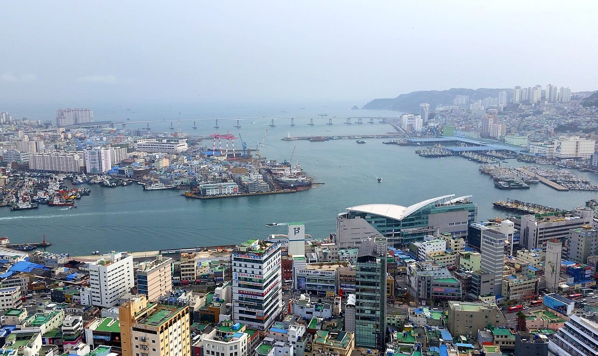

# 波特

波特（Port）是葡萄牙杜罗河谷出产的甜型加强葡萄酒。它在葡萄发酵尚未结束时加入葡萄蒸馏酒，酒精杀死酵母、终止发酵，把葡萄中的糖分留在酒里，同时把酒精度推到约 19%–20% vol。甜、厚、耐存，是波特最直观的印象；但真正决定风格的，是加强之后走“还原”还是“氧化”两条陈年路线。

图：波特。图片：cezzie901，CC BY 2.0，via Wikimedia Commons（[原图页面](https://commons.wikimedia.org/wiki/File:View_of_Nam_Harbor_from_Busan_Tower.jpg)）。

> **先给结论**
> **一句话：** 这页判断波特的风味位置，以及怎么选、怎么喝。
>
> - **适合谁：** 正在比较波特与其他风格、准备购买或点单的人。
> - **不适合谁：** 只想要“哪个最好”的排名、不接受口味差异的人。
> - **先看这两点：**
>   - Ruby 与 LBV 适合 16–18°C；Tawny 适合 12–16°C；White Port 适合 8–10°C；Vintage 适合 16–18°C。
>   - 波特是受原产地命名保护的加强葡萄酒，法定产区在葡萄牙北部的杜罗河谷，名称“Porto”或“Vinho do Porto”由葡萄牙葡萄酒与葡萄园研究所（IVDP）监管。

## 定义与法规

波特是受原产地命名保护的加强葡萄酒，法定产区在葡萄牙北部的杜罗河谷，名称“Porto”或“Vinho do Porto”由葡萄牙葡萄酒与葡萄园研究所（IVDP）监管。葡萄种植、酿造与加强必须在杜罗产区完成；陈年可以在杜罗河谷的酒窖，也可以在加亚新城（Vila Nova de Gaia）的传统酒窖进行。

波特必须以杜罗产区允许的葡萄品种酿造，发酵中途加入葡萄蒸馏酒，成品酒精度通常在 19%–20% vol，残留糖分因类别而异。欧盟葡萄酒法规为地理标志与加强葡萄酒提供框架，具体品种、产量、陈年与标签规则由 IVDP 的产品规范规定。

“Port”不是所有甜型加强酒的统称。只有在杜罗产区按规范生产、并在规定地点陈年的酒，才能使用这个名称；其他地区的类似产品只能叫“加强葡萄酒”或“甜型加强酒”。

## 历史

波特的名字来自港口城市波尔图。17 世纪，英国商人在葡萄牙北部采购葡萄酒，却发现普通葡萄酒在长途海运中容易变质；加入葡萄蒸馏酒提高酒精度，成为延长保存期的手段。1703 年《梅休因条约》降低英国对葡萄牙葡萄酒的关税，波特贸易迅速扩大。

18 世纪，杜罗河谷的葡萄园扩张，1756 年庞巴尔侯爵划定杜罗产区边界，这被广泛视为世界上最早的葡萄酒法定产区之一。19 世纪，葡萄根瘤蚜与病害冲击产区，随后通过嫁接与重新种植恢复。20 世纪，IVDP 逐步统一分级、陈年与标签规则；1986 年葡萄牙加入欧洲共同体后，波特的地理标志体系进一步制度化。

## 杜罗河产区与梯田

杜罗河谷从西向东分为下科尔戈（Baixo Corgo）、上科尔戈（Cima Corgo）与杜罗上级（Douro Superior）。下科尔戈气候较湿润、成熟较早，适合生产较轻的酒；上科尔戈是波特的核心，片岩坡地、昼夜温差大，葡萄成熟度高、酸度保留好；杜罗上级更热、更干燥，产量较低。

杜罗河谷的梯田是产区最著名的景观。传统石墙梯田（socalcos）用片岩垒成窄台，保水、防侵蚀，但机械化困难；现代梯田（patamares）用土坡平台替代石墙，便于机械作业；还有顺着坡面垂直种植的“vinha ao alto”。梯田形式影响光照、水分与成熟度，也影响酒的结构。

## 品种

波特以红葡萄品种为主。Touriga Nacional 提供花香、黑色水果与单宁；Touriga Franca 提供香气与柔顺度；Tinta Roriz（即 Tempranillo）提供红色水果与酸度；Tinta Barroca 提供糖分与体积；Tinto Cão 提供酸度与陈年潜力；Sousão 提供颜色与酸度。白波特使用 Malvasia Fina、Viosinho、Gouveio、Rabigato 等白葡萄。

这些品种常被混种、混酿。老藤地块可能包含多个品种，单一品种波特相对少见；混酿的目标是平衡颜色、单宁、酸度与香气，而不是追求某个品种的纯粹表达。

## 加强工艺

波特与普通葡萄酒的分界在发酵中途。葡萄压榨后发酵，当糖分尚未完全转化为酒精时，加入约 77% vol 的葡萄蒸馏酒，用量通常约为发酵醪体积的五分之一。酒精把酒精度推到 19%–20% vol，酵母失去活性，发酵停止，残糖保留下来。

加强时机决定甜度：较早加强保留更多糖分，酒更甜、果味更重；较晚加强则更干、更像普通葡萄酒。加强后的酒液进入陈年，按类别选择大桶、小桶、不锈钢罐或酒瓶。加强用的蒸馏酒本身不应带有强烈风味，以免掩盖葡萄香气。

## 分类

波特的类别可以按“陈年容器”与“年份”两条轴理解：

- **Ruby**：以还原陈年为主，颜色深红，果味鲜明，酒体饱满，适合年轻饮用。
- **Tawny**：以氧化陈年为主，颜色从琥珀到茶色，带干果、坚果、焦糖与咖啡；标注 10、20、30、40 年表示调配酒的平均年龄，不是单一年份。
- **Vintage**：单一年份、优质年份装瓶，先在桶中陈年约两年，再在瓶中长期陈年；装瓶时间通常在采收后第二年至第三年之间。
- **LBV（Late Bottled Vintage）**：单一年份，通常在桶中陈年四至六年，再装瓶；有过滤型与未过滤型，后者更适合继续瓶陈。
- **Colheita**：单一年份的茶色波特，至少在木桶中陈年七年。
- **Crusted**：多个年份的混酿，瓶陈后形成沉淀“crust”，风格接近年份波特但更早适饮。
- **White Port**：白葡萄酿造，风格从干型到甜型，常作为开胃酒。
- **Rosé Port**：短时间浸皮，颜色浅粉，果味轻，适合冷藏饮用。

这些类别不是质量顺序，而是工艺与陈年方式的不同组合。Vintage 强调年份与瓶陈潜力，Tawny 强调氧化与调配，LBV 强调单一年份的可及性，Colheita 强调单一年份的长期木桶陈年。

## 感官风格

Ruby 的香气以黑莓、樱桃、李子、巧克力为主，酒体饱满，单宁明显，收口甜。Tawny 的香气转向葡萄干、无花果、核桃、焦糖、咖啡与橙皮，口感更柔、酸度更突出。Vintage 年轻时果味集中、单宁强，陈年后发展出皮革、烟草、香料与松露。LBV 通常果味更成熟、单宁更柔，适合较早饮用。White Port 有柑橘、杏、蜂蜜与杏仁，甜度从干到甜不等。

波特的甜度来自残糖，不是后期加糖；但部分廉价产品可能加甜或调味，标签与类别是判断依据。高酒精度与高残糖让波特适合小杯慢饮，而不是大口解渴。

## 代表产品

代表性类型包括：年轻果味的 Ruby、标注 10 年或 20 年的 Tawny、单一年份的 Vintage 与 LBV、长期木桶陈年的 Colheita，以及白波特与桃红波特。经典酒庄包括 Taylor's、Graham's、Symington 家族旗下品牌、Quinta do Noval 等；这些名字只是风格坐标，不是质量排名。

年份波特的“declared”年份由酒商根据当年品质决定，不是每年都生产。购买年份波特时，应看酒庄、年份与陈年状态，而不是只看“Vintage”这个词。

## 品鉴与饮用

Ruby 与 LBV 适合 16–18°C；Tawny 适合 12–16°C；White Port 适合 8–10°C；Vintage 适合 16–18°C，饮用前需要醒酒，年轻年份可能需要一小时以上。使用郁金香形杯或波特杯，小杯慢饮，先闻果香、坚果与香料，再判断甜度、酸度、单宁与回味。

佐餐方面，Ruby 与 Vintage 适合巧克力、蓝纹奶酪、红肉与野味；Tawny 适合坚果、干果、焦糖甜点与陈年奶酪；White Port 适合作为开胃酒，搭配橄榄、杏仁与海鲜。本页关于波特的内容涉及酒精饮料；过量饮酒有害健康，未成年人不应饮酒。

## 常见误区

第一，认为波特都是深红色。Tawny 是琥珀色，White Port 是白色，Rosé Port 是粉色。第二，把 Tawny 标注的 10 年当成单一年份。那是调配酒的平均年龄。第三，把 LBV 等同于 Vintage。LBV 更早装瓶、更早适饮，陈年潜力通常低于年份波特。第四，认为波特越甜越好。甜度是风格，不是质量。第五，认为波特可以随意存放。开瓶后应冷藏并在数周内喝完。第六，把“Port”当成葡萄品种或所有加强酒的通用名。它是受保护的地理标志。

## 延伸阅读

- [加强葡萄酒](ref:fortified-wine)：波特的总体类别与工艺背景。
- [加强](ref:fortification)：发酵中途加酒精如何保留糖分。
- [波特](ref:porto)：波特产区的整体介绍。
- [杜罗](ref:douro)：杜罗河谷的风土与梯田。
- [原产地命名](ref:appellation)：理解波特名称保护的基础概念。

相关条目：[加强葡萄酒](ref:fortified-wine)、[加强（加度）](ref:fortification)、[波特](ref:porto)。

**关键事实。**

| 项目 | 内容 |
| --- | --- |
| 一句话定位 | 葡萄牙杜罗河谷出产、在发酵中途加入葡萄蒸馏酒的甜型加强酒，酒精度约 19%–20% vol，残糖与单宁共同支撑其陈年潜力；按陈年方式分为宝石红、茶色、年份、LBV、Colheita 与 Crusted 等类别 |
| 上位风格 | 加强葡萄酒 |
| 香气家族 | 果香/甜香 |

**来源与边界。** 本页关于「波特」的关键事实，主要由以下来源交叉核对：Instituto dos Vinhos do Douro e Porto（波特的法定产区、品种、加强工艺、类别与陈年要求）、European Union（加强葡萄酒、地理标志与标签框架）、Oxford University Press（提供关于波特、杜罗河谷、加强工艺与陈年风格的条目）等 4 条来源。价格、批次与状态会变，涉及这些字段时以页面所列来源的最新版本为准。正文为项目自写，来源只作核验，不复制原文。

## 相关图像

图：加强（加度）。图片：John Scofield，CC BY-SA 4.0，via Wikimedia Commons（[原图页面](https://commons.wikimedia.org/wiki/File:Castillo_San_Felipe_del_Morro_(10_of_1).jpg)）。关联图像：波特。
