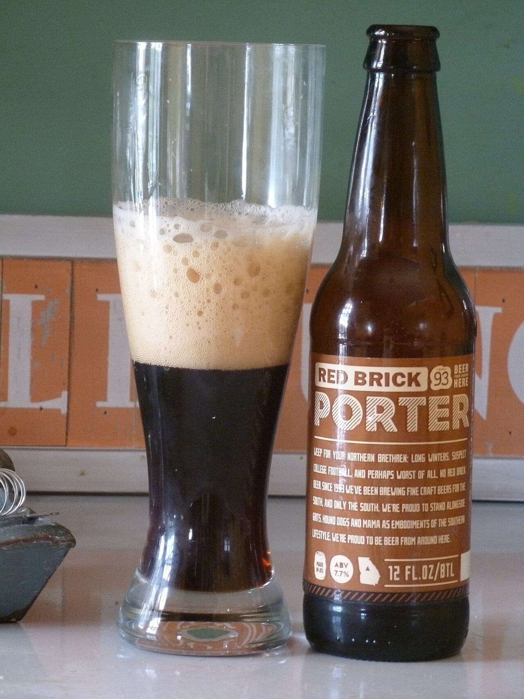

# 波特啤酒

波特（porter）是 18 世纪伦敦兴起的一类深色上面发酵啤酒，以棕色麦芽和后来的烘焙麦芽带来烘烤、咖啡与可可风味。名称据称来自伦敦街头与市场的搬运工（porter），他们曾是这类酒的主要消费者。波特与世涛共享历史渊源，但二者在强度、甜度与配方上并不等同。

图：一瓶 Red Brick Porter 与一杯深色酒液，杯口有米色泡沫。图片：Erik Cleves Kristensen，CC BY 2.0，via [原图页面](https://www.flickr.com/photo.gne?id=6175146624)。

## 定义与标准

在现代风格体系中，波特通常分为棕色波特、烈性波特（robust porter）与波罗的海波特。棕色波特酒精度常见 4.0–5.4%，苦度约 18–35 IBU；烈性波特常见 4.8–6.5%，苦度略高；波罗的海波特常见 6.5–9.5%，酒体更厚。这些区间描述典型范围，不是评分标准。波特属于[啤酒](ref:beer)中的上层发酵家族，与[英式艾尔](ref:english-ale)共享技术与市场背景。

需要区分的是名称与强度。历史上的“stout porter”指更烈的波特，后来“stout”独立为[世涛](ref:stout)风格；今天一款波特不一定比世涛淡，一款世涛也不一定比波特甜。把两者当作同一风格，或简单按颜色排序，都会误读配方。

## 历史与产地

波特在 1720 年代的伦敦流行起来。当地水质偏硬、富含碳酸盐，适合深色麦芽的糖化；大型酒厂把不同批次的酒合并，再经较长时间陈放后供应市场。18 世纪后期，波特成为伦敦重要的啤酒类型之一，并出口到爱尔兰与欧洲大陆。

19 世纪，随着玻璃器皿、铁路运输与消费习惯变化，波特在英国本土的相对地位下降，世涛与淡色艾尔获得更多关注。波罗的海地区在 18 至 19 世纪引入英式波特，后以本地原料与工艺演化出波罗的海波特。20 世纪后期，[精酿啤酒](ref:craft-beer)运动让波特在英美重新流行；今日以[英国](ref:uk)与美国最具代表性。

## 原料与工艺

[大麦](ref:barley)是波特的主体。18 世纪的波特大量使用棕色麦芽（brown malt），这种麦芽经直接火烘烤，带来较深的颜色与烘烤味；19 世纪以后，配方逐渐转为淡色基础麦芽搭配少量黑色麦芽或烘焙麦芽，以获得更干净的深色与焦香。现代配方还会加入水晶麦芽、巧克力麦芽或少量黑麦芽。

[发酵](ref:fermentation)为上层发酵，温度通常 18–22°C。历史上波特常经数月木桶陈放，使酒体圆润并产生轻微氧化风味；现代酒厂多用不锈钢罐，追求更干净的成品。伦敦水质、麦芽烘焙与较长的陈放，共同构成了传统波特的工艺背景。

## 风味特征

酒液呈深棕至黑色，逆光常见红宝石色边缘。香气以巧克力、咖啡、焦糖、烤面包为主，可能带坚果与果干；酒花提供中等苦味，英式版本偏草本，美式版本可能更重。棕色波特酒体中等，收口偏干；烈性波特更浓、更甜；波罗的海波特酒体厚，酒精温暖明显，风味接近深色拉格。

优质波特的烘焙味应当干净，不应出现焦糊、烟熏刺鼻或纸板味。温度升高后，焦糖与酒精感更明显，品鉴时可分温度段比较。

## 品鉴与饮用

波特适饮温度约 8–12°C，波罗的海波特可稍高至 12–14°C。郁金香杯、收口杯或品脱杯都能使用，杯型主要影响香气聚集与泡沫呈现。佐餐适合烤肉、炖菜、硬质奶酪与黑巧克力甜点；波罗的海波特也常与东欧风味菜肴搭配。

保存应避光、阴凉。低酒精度的棕色波特宜趁新鲜饮用；高酒精度的烈性波特与波罗的海波特在合适条件下可适度陈放，但不宜无限期存放。桶装波特的侍酒温度通常比瓶装略高。

## 常见误区

第一，认为波特就是世涛，或二者只是颜色深浅不同。它们共享历史，却在强度、甜度与配方上分化。
第二，认为颜色越黑越烈。色度来自烘焙，酒精度由配方与发酵决定。
第三，认为波特只属于英国。波罗的海与美国都形成了稳定传统。
第四，把波罗的海波特当成英式波特的简单复制。它经历了本地原料与工艺的改造。
第五，认为所有波特都适合长期陈放。只有结构完整的高酒精度版本才具备陈放价值。

波特啤酒是十八世纪伦敦兴起的深色上面发酵啤酒，棕色麦芽与后来的烘焙麦芽带来烘烤、咖啡与可可气息；名称源于搬运工的市场语境。它与世涛有历史渊源，但强度、配方与现代分化不同；烈性波特、波罗的海波特是分支，不能把所有深色啤酒都叫波特。

对照阅读：[啤酒](ref:beer)、[英式艾尔](ref:english-ale)。

## 延伸阅读

- [啤酒](ref:beer)：理解波特在啤酒风格体系中的位置。
- [世涛](ref:stout)：与波特共享渊源的另一支深色啤酒。
- [英式艾尔](ref:english-ale)：波特所属的上层发酵传统。
- [英国](ref:uk)：伦敦波特的历史产地与酒吧文化。
- [大麦](ref:barley)：棕色麦芽与烘焙麦芽的来源。
- [发酵](ref:fermentation)：上层发酵与陈放对酒体的影响。
- [精酿啤酒](ref:craft-beer)：现代波特复兴与变体的背景。

**关键事实。**

| 项目 | 内容 |
| --- | --- |
| 一句话定位 | 18 世纪伦敦兴起的深色上面发酵啤酒，以棕色麦芽与后来的烘焙麦芽带来烘烤、咖啡与可可风味；名称源于搬运工，与世涛有渊源但强度与配方不同，现代分化出烈性波特与波罗的海波特 |
| 上位风格 | 啤酒 |
| 香气家族 | 烘焙麦芽 |

**来源与边界。** 本页关于「波特啤酒」的关键事实，主要由以下来源交叉核对：Beer Judge Certification Program（棕色波特、烈性波特与波罗的海波特的强度、苦度与风味边界）、Campaign for Real Ale（英国深色啤酒与酒吧侍酒传统的公开表述）、Brewers Association（美国精酿行业对波特及其变体的风格讨论；未复制其文案）等 4 条来源。价格、批次与状态会变，涉及这些字段时以页面所列来源的最新版本为准。正文为项目自写，来源只作核验，不复制原文。

**并读。** 把「波特啤酒」与「啤酒」、「世涛」、「英式艾尔」放在一起读时，先确认它们是同一层级还是上下游关系：先确认定义与工艺，再比较原料、产区与代表品牌。本页负责给出酒类风格的基本坐标，对照条目补上具体案例与差异；读完再回到本页，才能分清哪些差别属于酒类风格本身，哪些只是产地、批次或品牌选择。

**适用边界。** 对「波特啤酒」而言，法定定义、原料比例与地域风格会随法规和行业分类更新；品牌案例不等于整个风格。

**更新提示。** 「波特啤酒」最近核对于 2026-11-05；价格、状态与公开信息会变，引用前以本页来源的最新版本为准。

## 相关图像

图：世涛。图片：55belgianbeerfan，CC0，via Wikimedia Commons（[原图页面](https://commons.wikimedia.org/wiki/File:A_Pint_of_English_Imperial_Stout.png)）。关联图像：波特啤酒。
