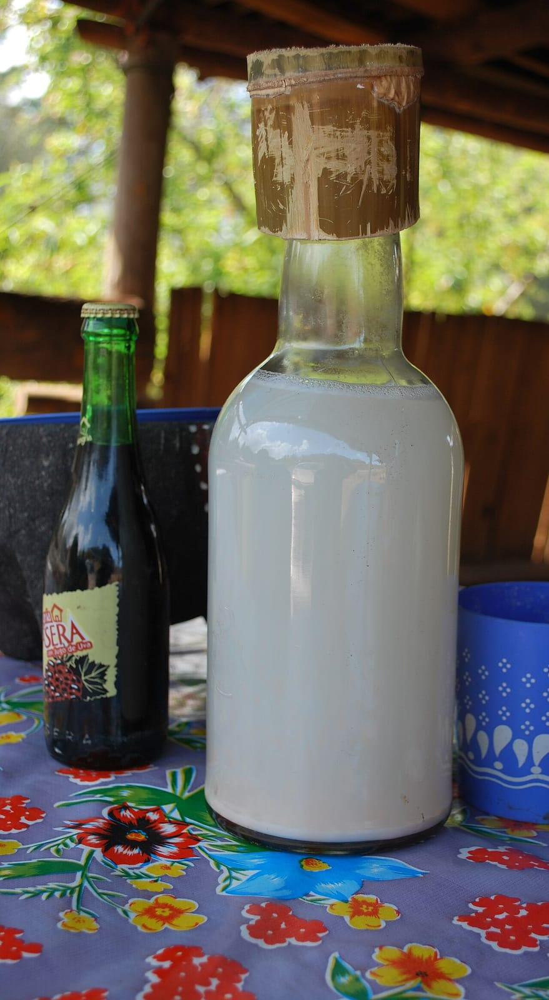
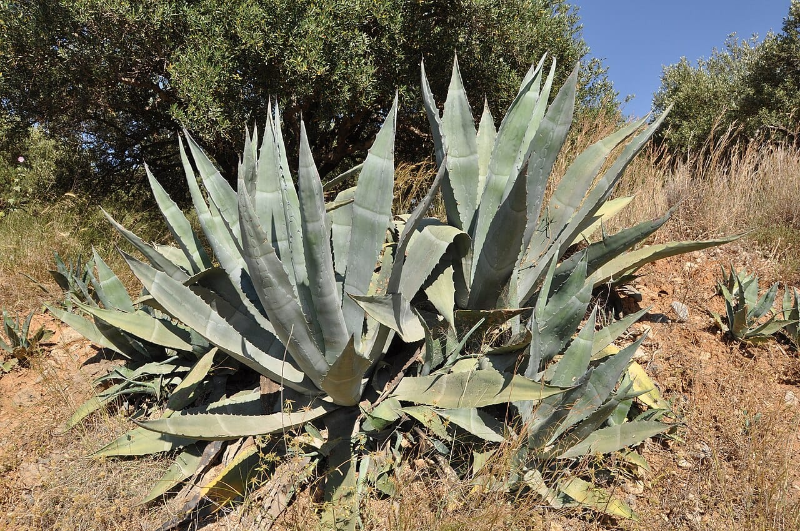

# 普尔克

普尔克（pulque）是墨西哥中部以龙舌兰汁自然发酵得到的低度酒。它的关键事实可以用一句话说清：不蒸馏。龙舌兰被切开、刮出汁液，汁液在容器里靠天然酵母和细菌发酵，几天内就得到一种酸、黏、带酵母气息的白色饮料。它和[龙舌兰酒](ref:tequila)、[梅斯卡尔](ref:mezcal)共享植物起点，却属于完全不同的技术传统。

图：普尔克。图片：AlejandroLinaresGarcia，CC BY-SA 3.0，via Wikimedia Commons（[原图页面](https://commons.wikimedia.org/wiki/File:Pulquebottle.JPG)）。

## 一种发酵汁，不是蒸馏酒

普尔克的原料是 aguamiel，字面意思是“蜜水”，即龙舌兰心部渗出的甜汁。采收者被称为 tlachiquero，他们会刮开龙舌兰的心部，让汁液积聚，再用葫芦或吸管吸出。汁液不能久放，必须尽快送到 tinacal（发酵房），否则会自然发酵过度或变质。

发酵完成后，普尔克通常只有 4% 至 6% vol 的酒精度，比葡萄酒还低，更接近[苹果酒](ref:cider)这类发酵饮料。它不经过蒸馏，也不经过长时间陈年；这决定了它必须新鲜饮用，不能像烈酒那样在瓶中放上几年。

## 从圣饮到 pulquería

在前西班牙时期的墨西哥中部，普尔克带有宗教和仪式色彩。龙舌兰被视为神圣植物，普尔克与丰产、祭祀和特定节庆联系在一起；殖民时期，西班牙当局一度试图限制它的消费，因为它被认为与醉酒和“异教”习俗有关。禁令并没有消灭它，反而让它在城市与乡村的日常饮用中继续存在。

19 世纪至 20 世纪初， pulquería（普尔克酒馆）成为墨西哥城市生活的一部分。它们像今天的咖啡馆或啤酒馆，提供大杯的白色普尔克、调味普尔克和小食。20 世纪后期，啤酒工业、城市化、卫生偏见和对普尔克的负面刻板印象让它迅速衰落，许多老店关门；近十几年，年轻生产者和小型酒馆又开始把它带回城市。

## 龙舌兰汁怎样变成酒

普尔克的[发酵](ref:fermentation)是自然接种，不添加商业酵母。tinacal 里的木桶或石槽保留着上一批的微生物群落，新汁液加入后，酵母、乳酸菌和醋酸菌共同工作，产生酒精、乳酸、醋酸和少量酯类。发酵时间通常只有几天，温度高时更快；时间过长会过度酸化，时间不足则甜味太重、酒体单薄。

[龙舌兰](ref:agave)的品种与成熟度影响汁液的糖分和风味。用于普尔克的主要是 maguey manso 等品种，植株要生长多年才能取汁；取汁会伤害植株，因此生产者必须管理采收节奏。与梅斯卡尔把龙舌兰心烤熟、糖化后再发酵不同，普尔克直接使用生汁，香气更青、更植物性。

发酵房里的“种子”很关键：生产者会保留一部分上一批的发酵液，作为下一批的启动菌群，这与酸面团或康普茶的做法相似。发酵结束的标志不是固定的天数，而是酸度、气泡和气味；有经验的生产者靠闻和尝判断。这种判断依赖经验，而不是仪器。

## 酸、黏、微醺：感官

白色普尔克（pulque blanco）通常浑浊、乳白，带细密气泡和轻微黏稠感。香气是酵母、面团、青草、龙舌兰和一点酸味；入口酸度明显，酒体薄到中等，收口带乳酸和矿物感。它不适合用烈酒的品鉴语言来描述，更像一种发酵乳或酸面团饮料。

普尔克的黏稠感来自龙舌兰汁中的多糖和微生物代谢物，不是增稠剂；这也是它入口与啤酒、葡萄酒最不同的地方。它最好在发酵后一两天内喝完，放久会继续变酸，甚至变成醋。

curado 是加入水果、坚果、谷物或蔬菜的调味普尔克，常见的有仙人掌果、燕麦、草莓、芒果和咖啡味。调味可以遮盖酸度，让第一次喝的人更容易接受，但也可能盖住龙舌兰本身的气息。传统喝法是大杯、低温、尽快喝完，不追求复杂陈年。

## 法规与产业的困境

普尔克在墨西哥有官方标准与卫生规范，但不像[龙舌兰酒](ref:tequila)那样拥有严格的原产地命名和全球化的分级体系。它的生产分散、保鲜期短、运输成本高，很多小生产者没有能力装瓶和冷链配送；这使普尔克长期停留在本地市场。

另一个困境是形象。殖民时期以来的“不卫生”“低档”叙事，让部分消费者对普尔克抱有偏见；实际上，正规生产者对发酵容器、用水和卫生有明确要求。近年的精酿发酵潮流让普尔克重新受到关注，但它的未来仍取决于原料供应、价格和消费者是否愿意把它当作一种日常发酵酒，而不是猎奇饮品。

## 与龙舌兰酒、梅斯卡尔的区别

[龙舌兰酒](ref:tequila)以蓝色龙舌兰为原料，经过蒸煮、糖化、发酵和蒸馏，酒精度通常在 35% vol 以上；[梅斯卡尔](ref:mezcal)同样蒸馏，但用地下坑烤和壶式蒸馏，烟熏与品种差异更大。普尔克不蒸馏、不烤制，酒精度只有个位数，风味也不依赖橡木桶或蒸馏切割。

因此，普尔克不是“龙舌兰酒的原始版本”，也不是“没蒸馏的梅斯卡尔”。它是一条独立的发酵传统：以龙舌兰汁为原料，以自然微生物为动力，以新鲜、酸、低酒精为特征。理解这一点，才能把它放在墨西哥饮料史的正确位置。

**来源与边界。** 本页关于「普尔克」的关键事实，主要由以下来源交叉核对：Secretaría de Cultura — CDI（普尔克的前西班牙时期传统、maguey 原料与饮用文化）、Frontiers in Microbiology（aguamiel 发酵、微生物过程、酒精度与 pulque 类型）、Universidad Nacional Autónoma de México（pulque 的词源、maguey manso 与历史背景）等 4 条来源。价格、批次与状态会变，涉及这些字段时以页面所列来源的最新版本为准。正文为项目自写，来源只作核验，不复制原文。

**并读。** 把「普尔克」与「龙舌兰酒」、「梅斯卡尔」、「龙舌兰（龙舌兰属）」放在一起读时，先确认它们是同一层级还是上下游关系：先确认定义与工艺，再比较原料、产区与代表品牌。本页负责给出酒类风格的基本坐标，对照条目补上具体案例与差异；读完再回到本页，才能分清哪些差别属于酒类风格本身，哪些只是产地、批次或品牌选择。

**适用边界。** 对「普尔克」而言，法定定义、原料比例与地域风格会随法规和行业分类更新；品牌案例不等于整个风格。

**更新提示。** 「普尔克」最近核对于 2026-11-08；价格、状态与公开信息会变，引用前以本页来源的最新版本为准。

**编者注。** 本页把「普尔克」作为酒类风格条目处理：定义、流程与关键数字以正文表格为准，与「龙舌兰酒」、「梅斯卡尔」的差异用对照阅读验证；遇到价格、批次或地址，回到页面所列来源核对。

## 相关图像

图：龙舌兰（龙舌兰属）。图片：Marc Ryckaert ( MJJR )，CC BY-SA 3.0，via Wikimedia Commons（[原图页面](https://commons.wikimedia.org/wiki/File:Agave_americana_R01.jpg)）。关联图像：普尔克。
