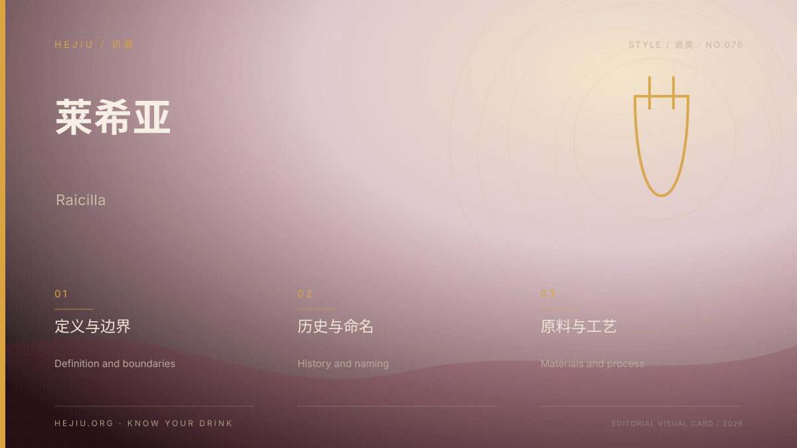

# 莱希亚

莱希亚是墨西哥哈利斯科州西部山区与太平洋沿岸村落出产的龙舌兰蒸馏酒，与梅斯卡尔同属龙舌兰烈酒家族，但所用野生龙舌兰种类、村落工艺和风味谱系都更分散；2019 年获得墨西哥原产地名称保护，2020 年列入欧盟与墨西哥烈酒互认清单。

图：Raicilla主题示意图。图片：Doubao Seedream 5.0 AI 辅助绘制（项目自有）；不是莱希亚的实拍，仅作主题示意。

## 定义与边界

莱希亚是一种以烘焙熟成的龙舌兰心为原料、发酵后蒸馏得到的烈酒，产区集中在哈利斯科州西部的西马德雷山脉、阿穆拉山脉以及南北沿岸地带，并延伸到纳亚里特州的巴伊亚·班德拉斯市。根据 2019 年 6 月 28 日墨西哥联邦官方公报公布的原产地名称保护声明，获准使用该名称的区域包括哈利斯科州 16 个市镇和纳亚里特州 1 个市镇，名录中有 Mascota、Mixtlán、Talpa de Allende、San Sebastián del Oeste、Puerto Vallarta、Cabo Corrientes、Tomatlán 等山区与港口村落。

分类上，莱希亚靠近梅斯卡尔(ref:mezcal)这一支，而不是龙舌兰酒：它不使用蓝龙舌兰，而是采摘山地与半野生的多种龙舌兰。它也不是统一配方的商品名，而是一批以村落为单位的小型蒸馏产品的统称。在双边保护层面，根据欧盟与墨西哥烈酒名称互认换文，该名称列入协定附件二，自 2020 年 1 月 31 日起在欧盟受保护；英国也在 2021 年 9 月 1 日的本土清单中将其登记为受保护烈酒名称。

## 历史与命名

莱希亚在哈利斯科山区大约有 300 年酿造历史，早期出产于靠近西马德雷山脉的矿区村落。矿区缺水缺粮、运输不便，山民把当地野生龙舌兰在石灶里烘熟，取汁发酵，再用小型壶式设备蒸出烈酒。很长一段时间里，它属于乡村自酿与私酿范畴，不在官方烈酒贸易体系之内，也较少进入出口市场。

名称一种通行解释来自西班牙语 raíz（根）：酒液与包装外观让人联想到从龙舌兰根部取得的烈酒，村落沿用了这个口语称呼。这属于词源推测，并不等于有书面文献把命名者归于某个人；和许多乡村烈酒一样，莱希亚是原料可得性、矿区生活方式与长途运输条件共同作用的结果。2019 年，墨西哥政府通过原产地名称声明保护该名称，随后按里斯本体系在世界知识产权组织完成登记，生产者组织 Consejo Mexicano Promotor de la Raicilla 长期推动村落产品进入正式市场。

## 原料与工艺

法定允许使用的龙舌兰包括 Agave maximiliana Baker、A. inaequidens Koch、A. valenciana、A. angustifolia Haw.、A. rhodacantha 等山地品种，明确排除 Agave tequilana F.A.C. Weber。这些龙舌兰多在山坡与灌丛中野生或半野生生长，成熟年限长、产量分散，原料成本高于连片种植的蓝龙舌兰；龙舌兰(ref:agave)的品种、海拔、土壤与采收年份，直接决定酒液的香气方向。

传统流程先把龙舌兰心放在石砌土窑中慢烤，让淀粉转化并带出烘烤香；取出后粉碎压汁，果汁在木桶或容器中发酵，酵母可以是当地野生菌群，也可以是人工培养的墨西哥酵母。发酵酒醪再进入小型黏土或铜质壶式蒸馏器蒸馏(ref:distillation)，多数村落产品只做一次或两次小批次蒸馏，保留较多原料与发酵层次。成品按陈年方式分两类：玻璃中陈放或未陈年的版本接近无色，木桶陈年后呈淡黄色；市场上最常见的是透明或浅金色的未陈年款。

## 风格与味觉

与梅斯卡尔相比，莱希亚的风味更随村落和品种变化：常见描述包括草本、青椒、柑橘皮、矿物、烘烤龙舌兰与轻微烟熏，部分批次出现可可、木瓜、红薯与焦糖龙舌兰的甜感。烟熏并不是每条产品线都突出，它更多来自石灶烘烤和个别品种，而不是统一工艺要求；判断一瓶莱希亚，先分清是山地草本路线还是烘烤浓重路线。

酒精度按批次和品牌装瓶，常见区间在 40–48% 之间，同一品牌的不同产品线可以从 41.8% 到 48% 不等，瓶标度数通常随批次调整。酒液口感偏干爽、酸度清晰，余味以草本与矿物为主。未陈年款以新鲜草本和柑橘为主，木陈款更圆润，出现蜂蜜、干果和木质香料；跨品牌比较时，最好先固定品种与蒸馏方式，再比较市镇、陈年和批次。

## 代表产区与品牌

产区内的生产单元多为村落小作坊（tabernas），由蒸馏师带领家庭或小型团队操作，产量有限、批次差异明显。进入国际市场较早、知名度较高的品牌是 La Venenosa，产品线按山地与村落划分，包括 Sierra Occidental、Sierra del Tigre、Tabernas 与 Etílica 等系列，分别使用 maximiliana 等不同龙舌兰，并标注各自的蒸馏师与酒精度。

除 La Venenosa 外，哈利斯科与纳亚里特还有许多未形成大规模出口的村落生产者，产品通过本地节庆、产区协会与小批量进口渠道流通。市场品牌不是官方分级，也不代表品质排名；同一品牌内的未陈年款、陈年金酒款与不同品种批次，价格和风味都可能相差很大。购买时留意瓶标上的市镇、龙舌兰学名、批次号与蒸馏方式，比只看品牌大小更可靠。

## 怎么喝与配餐

纯饮时常用小份品鉴杯（copita）在室温下入口，先闻草本与柑橘，再小口体会酒精强度；喜欢柔和一些的可以加几块冰或滴几滴清水，让烘烤与矿物香气展开。调酒方向上，草本、矿物与柑橘骨架的莱希亚可以替代龙舌兰酒用于玛格丽特，也适合兑汤力水或苏打水做高杯长饮，搭配柠檬、橙子等柑橘配料。

配餐方面，浓郁的奶油奶酪可以承接酒液的酸度与质地，烤肉、烤蔬菜和柑橘调味的菜肴能与草本、烟熏气息呼应；辣味过重的菜式会放大酒精刺激，选择酒体更柔和的批次更稳妥。

## 选购、储存与误区

读标签先确认名称是否受原产地规则约束：标注 raicilla 的产品应能看到产区市镇、龙舌兰原料与生产方式；只写 agave spirit 而不标莱希亚名称的产品，并不一定符合这套地理标志规则。未陈年烈酒性质稳定，避光、避高温、避开震动即可长期存放；莱希亚含糖量低，不像甜利口酒那样依赖高糖保鲜，开瓶后建议在数月内喝完。

常见误区有三类：一是把莱希亚等同于梅斯卡尔或龙舌兰酒，实际上法定原料品种和产区都不同；二是认为所有莱希亚都带重烟熏，烟熏程度随烘烤方式和品种变化；三是把单一品牌的厚重甜感当成风格标准，忽略山区村落之间的工艺差异。名称保护只保证产地与原料规则，并不替某一瓶酒的品质背书。

## 延伸阅读与另见

想建立对莱希亚的认识，可以先从一款未陈年、标注市镇的基础款入手，再比较不同龙舌兰品种的批次，最后尝试一款木陈或小批次山地产品；三轮对照之后，品种、烘烤与陈化带来的差别会比读定义更清楚。

- 相关条目：[mezcal](ref:mezcal)、[agave](ref:agave)、[distillation](ref:distillation)、[peat](ref:smoke)、[liqueur](ref:liqueur)。

## 相关图像

图：龙舌兰（龙舌兰属）。图片：Marc Ryckaert ( MJJR )，CC BY-SA 3.0，via Wikimedia Commons（[原图页面](https://commons.wikimedia.org/wiki/File:Agave_americana_R01.jpg)）。关联图像：莱希亚。
