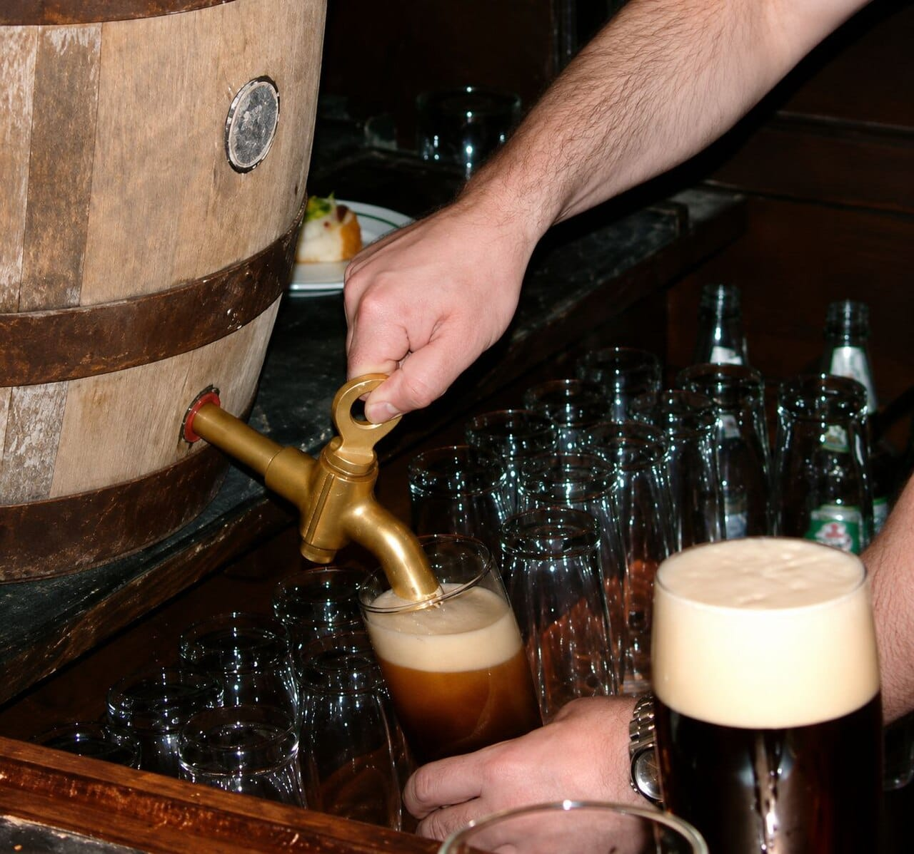
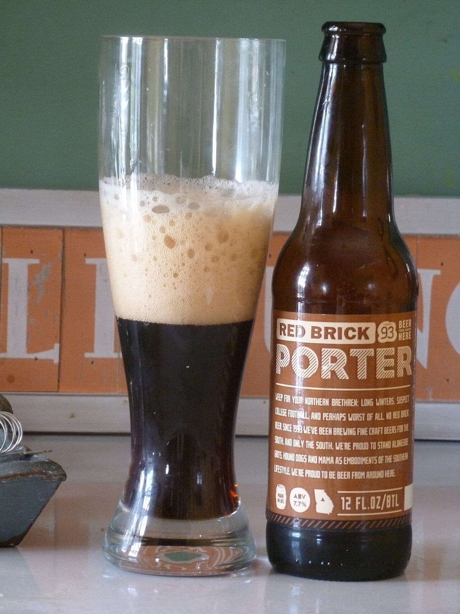

# 烟熏啤酒

烟熏啤酒（Rauchbier）是以烟熏麦芽为主要风味来源的[拉格](ref:lager)，最著名的产地是德国巴伐利亚的班贝格。它的烟味来自麦芽干燥时接触的榉木明火，而不是往酒里添加烟熏香精；这一点决定了它与“带烟味的深色啤酒”之间的界限。传统产品多为深色拉格，但烟熏强度、颜色与酒精度都随酒厂而异。

图：烟熏啤酒。图片：The original uploader was SilkTork at English Wikipedia .，CC BY-SA 2.5，via Wikimedia Commons（[原图页面](https://commons.wikimedia.org/wiki/File:GravityTap.jpg)）。

## 烟从麦芽来，不从酒来

酿造烟熏啤酒的关键步骤在[制麦](ref:malting)：把发芽的[大麦](ref:barley)放在窑中，用榉木火直接烘烤干燥。燃烧产生的酚类化合物附着在麦芽上，随后进入糖化与[发酵](ref:fermentation)，最终留在酒里。用榉木而非松木或泥炭，是因为榉木燃烧稳定、烟味干净，带辛香与木质调，不会引入树脂或药味。

这也解释了一个常见误解：烟熏啤酒不是把烟熏液滴进啤酒。真正的烟熏风味与麦芽的烘烤香结合，层次更复杂；液体烟熏剂往往只有单一烟味，缺少麦芽底味。另一个边界是烟熏烈性啤酒，它们使用烟熏麦芽，但以烘焙麦芽的咖啡苦为主，烟只是配角。

## 班贝格的榉木火

班贝格位于弗兰肯地区，传统上拥有密集的小型酒厂。烟熏麦芽的工艺在这里保存下来，与当地的山毛榉林、窑炉结构和家庭作坊式生产有关。20 世纪下半叶，烟熏啤酒在其他地区一度稀少，班贝格却把它当作地方身份的一部分，酒馆里常把烟熏啤酒与普通拉格并排供应。

弗兰肯的小酒厂常把烟熏啤酒与未烟熏的拉格放在同一条生产线上，共用糖化与发酵设备，只在制麦环节分线。这种安排解释了为什么当地烟熏啤酒的麦芽骨架与普通拉格相近，差异集中在酚类香气。对酒厂来说，烟熏不是一种猎奇口味，而是制麦传统留下的默认选项。

[巴伐利亚](ref:bavaria)的啤酒文化强调地方性，班贝格尤其如此。这里的烟熏啤酒不是猎奇产品，而是日常饮品；这种日常性反过来保护了工艺，让烟熏麦芽仍有稳定的需求。每年秋冬的啤酒节与酒馆菜单，也让游客有机会按强度逐级尝试。

## 1405 年的蓝狮之家

班贝格最常被引用的样本是 Schlenkerla。酒厂建筑“蓝狮之家”（Haus zum blauen Löwen）在 1405 年的文献中首次出现，如今由 Trum 家族经营至第六代。它仍用橡木桶盛酒、从木桶直接引出，招牌产品是烟熏三月啤酒，此外还有烟熏双博克与烟熏小麦啤。

另一家传统酒厂是 Brauerei Spezial，烟熏强度通常更轻，适合初次尝试。两家风格不同，正好说明班贝格烟熏不是一个固定参数，而是一段从轻柔到浓烈的光谱。参观时留意酒厂是否自己制麦：外购烟熏麦芽可以做出合格产品，但风味层次往往较单一。若时间允许，把两家同一年份的产品并排比较，最容易看出制麦与发酵选择的差异。

## 烟熏的浓淡梯度

典型班贝格烟熏啤酒呈铜色至深棕色，清澈，泡沫细腻；香气以烟熏、面包皮、坚果与轻微焦糖为主，酒花很低。入口麦芽甜先行，中段烟熏铺开，收口干爽，苦味中等偏低。常见酒精度约 4.8%–6%，[苦度](ref:ibu)约 20–30 IBU；这些数字随来源与酒厂而异，不能当作法定标准。

烟熏强度可以用“像培根”“像篝火”“像烟熏奶酪”来描述，但描述词不如对照品尝可靠。初次饮用建议从轻烟版本开始，再过渡到浓烟版本。温度过低会让烟味显得刺鼻，过高则酒精感突出，8–10°C 较为合适。若同一酒厂同时生产轻烟与浓烟产品，对比品尝最能说明制麦比例的作用。

## 与波特、世涛的分界

[波特](ref:porter)与[世涛](ref:stout)的深色来自烘焙麦芽，风味核心是咖啡、巧克力与焦苦；烟熏啤酒的深色可以来自烟熏麦芽本身，风味核心是木质烟熏，烘焙苦只是背景。若一款酒同时具备明显咖啡苦与浓烟，它更接近烟熏波特，而不是班贝格传统烟熏拉格。

与苏格兰泥炭烟熏啤酒相比，榉木烟熏更干、更辛香，泥炭则带药味与海藻感。与德国普通深色拉格相比，烟熏啤酒多了一层酚类香气，但麦芽甜与酒体结构相近。区分这些边界，靠的是烟从哪来与烟占多大比例，而不是颜色深浅。

## 配餐：把烟熏当调味料

烟熏啤酒适合搭配烟熏猪肉、烤香肠、烤鸡、洋葱塔与硬质奶酪；烟熏味与菜肴的焦香互相呼应，麦芽甜则缓冲咸味。它也能配烤肉与蘑菇，但不适合清淡的海鲜或甜品，烟味会压过食材。若用作出餐酒，建议小杯、低温、慢饮，把它当作液体调味料而不是解渴饮料。在班贝格，酒馆常把烟熏啤酒倒进直身杯或传统陶杯，杯型不追求聚香，而是让烟味不过分集中。

购买时留意生产日期与储存条件。烟熏酚类相对稳定，但酒花香与新鲜麦芽香仍会衰减；长期存放后烟味可能更突出，平衡感下降。开瓶后尽量一次喝完，避免氧化带来的纸板味。

对照阅读：[拉格啤酒](ref:lager)、[世涛](ref:stout)。

**关键事实。**

| 项目 | 内容 |
| --- | --- |
| 一句话定位 | 以榉木明火烘烤的烟熏麦芽为核心风味的德国啤酒，班贝格是其保存最完整的产地，烟熏强度从轻柔到浓烈形成光谱 |
| 上位风格 | 拉格啤酒 |
| 香气家族 | 烟熏与麦芽 |

**来源与边界。** 本页关于「烟熏啤酒」的关键事实，主要由以下来源交叉核对：Beer Judge Certification Program（烟熏啤酒的强度、苦度、色度与烟熏麦芽描述）、Brauerei Heller-Trum / Schlenkerla（1405 年文献记载、蓝狮之家、家族经营与橡木桶侍酒等信息）、Bamberg Tourismus & Kongress Service（班贝格啤酒文化与酒馆传统的公开介绍）等 4 条来源。价格、批次与状态会变，涉及这些字段时以页面所列来源的最新版本为准。正文为项目自写，来源只作核验，不复制原文。

**并读。** 把「烟熏啤酒」与「拉格啤酒」、「波特啤酒」、「世涛」放在一起读时，先确认它们是同一层级还是上下游关系：先确认定义与工艺，再比较原料、产区与代表品牌。本页负责给出酒类风格的基本坐标，对照条目补上具体案例与差异；读完再回到本页，才能分清哪些差别属于酒类风格本身，哪些只是产地、批次或品牌选择。

## 相关图像

图：一瓶 Red Brick Porter 与一杯深色酒液，杯口有米色泡沫。。图片：Erik Cleves Kristensen，CC BY 2.0，via Wikimedia Commons（[原图页面](https://www.flickr.com/photo.gne?id=6175146624)）。关联图像：烟熏啤酒。
