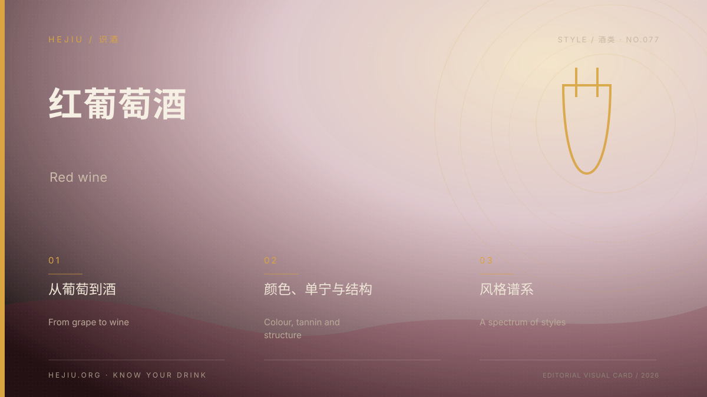
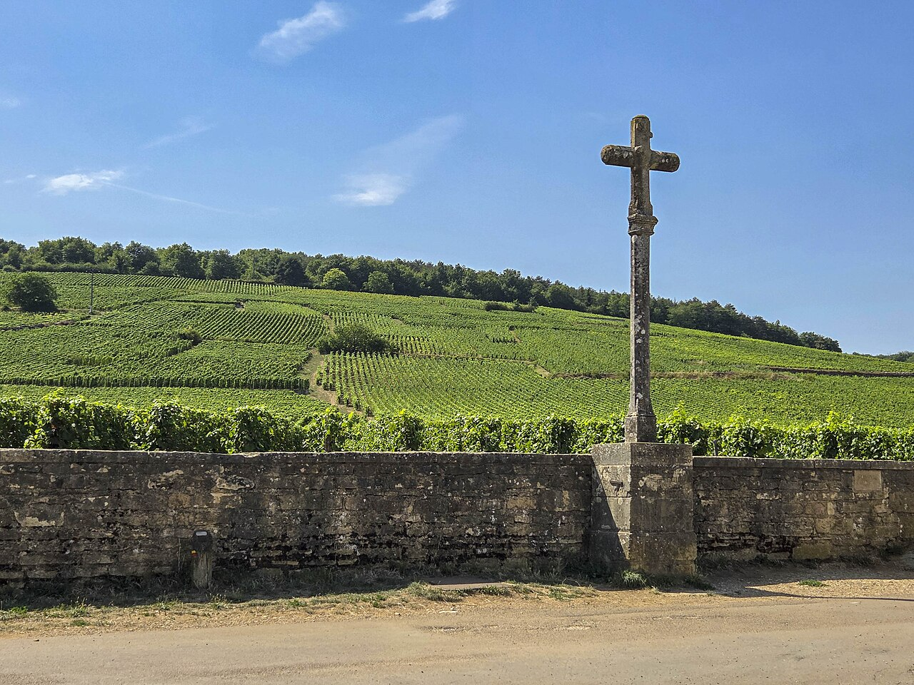

# 红葡萄酒

红葡萄酒是用深色葡萄品种酿造的葡萄酒。它的颜色来自葡萄皮中的花青素，单宁来自果皮、种子和果梗。与白葡萄酒最大的区别，不是原料颜色本身，而是发酵时是否让酒液与果皮充分接触：红葡萄酒通常带皮发酵，在浸渍过程中同时提取颜色、单宁和香气。

图：红葡萄酒 双语视觉卡（项目自绘 SVG）。不是实拍。

## 从葡萄到酒

红葡萄酒的基本流程包括除梗破碎、带皮发酵、压榨、苹果酸-乳酸发酵（可选）、陈年和装瓶。破碎后，葡萄汁与果皮、种子一起进入发酵容器，酵母把糖转化为乙醇和二氧化碳。发酵期间，生产者会通过“压帽”或“淋皮”让酒液反复接触漂浮的果皮，以控制提取强度。浸渍时间可以从几天到数周，温度、氧气和压榨力度也会改变最终风格。

发酵结束后，自流酒与压榨酒分开处理。自流酒通常更柔和，压榨酒颜色更深、单宁更多；是否合并、合并多少，是风格选择。苹果酸-乳酸发酵可以把尖锐的苹果酸转化为更柔和的乳酸，并带来黄油、奶油类香气，但是否进行取决于目标风格。

## 颜色、单宁与结构

年轻红葡萄酒的颜色从紫红到宝石红不等，随着陈年逐渐转向石榴红、砖红。颜色深浅受品种、浸渍时间、温度和 pH 影响，不能单独用来判断质量。单宁则决定口感的“骨架”：适量的单宁让酒有结构、能配餐、耐陈年；过量或未成熟的小单宁会让酒显得干硬。

酸度同样重要。高酸度的红葡萄酒更清爽、更适合配餐，也可能需要更长时间才能柔化；低酸度的红葡萄酒口感更圆润，但陈年潜力通常较弱。酒精度、酸度、单宁和香气共同构成“酒体”，单看某一项容易误判。

## 风格谱系

红葡萄酒的风格可以从轻到重排成一条连续谱。轻酒体红葡萄酒通常颜色较浅、单宁较少、果香直接，适合稍低温度饮用；中等酒体红葡萄酒在果味、酸度和单宁之间更平衡；重酒体红葡萄酒颜色深、单宁多、酒精度较高，常来自温暖气候和较长的浸渍。

品种和气候会塑造风格。黑皮诺通常颜色较浅、酸度高、单宁细腻；赤霞珠颜色深、单宁结构明显；梅洛更圆润、果味更柔；西拉常带胡椒和黑色水果气息。同一品种在冷凉产区与温暖产区也可能呈现完全不同的成熟度和酸度。具体酒款可以看[拉菲古堡](ref:lafite)这样的波尔多混酿，或[罗曼尼·康帝](ref:romanee-conti)这样的勃艮第黑皮诺特级园。

## 产区与标签

“波尔多”“勃艮第”“托斯卡纳”等产区名称，首先说明地理来源和适用规则，而不是质量排名。欧盟的 PDO/PGI 体系、法国的 AOC、意大利的 DOCG 等，都把品种、产量、酿造方法和标签用语写进法规。同一产区内部仍有大量差异，村庄、地块、年份和生产者都会影响结果。

年份指葡萄采收年，不是装瓶年。天气会影响成熟度、产量和病害压力，但酿造调整能力强的生产者可以在不同年份之间保持相对稳定的风格。把“好年份”当成绝对结论，容易忽略具体酒款和生产者。

## 怎么喝

红葡萄酒的饮用温度通常比白葡萄酒稍高，轻酒体红葡萄酒可以稍凉，重酒体红葡萄酒可以接近室温。温度过高会让酒精感突出，过低则会让香气闭塞。醒酒主要适用于年轻、单宁较强的酒，或需要分离沉淀的老酒；并非所有红葡萄酒都需要醒酒。

配餐时，高单宁的红葡萄酒适合与蛋白质和脂肪含量较高的食物搭配，单宁与食物蛋白结合后涩感会减弱。辛辣、过酸或甜度较高的食物可能放大单宁的干涩感。比起机械套用“红酒配红肉”，更可靠的做法是看酒的结构与菜肴的调味。

## 浸渍与提取：风格的真正杠杆

同样一批葡萄，浸渍方式可以把酒带向完全不同的方向。浸渍时间短，颜色浅、单宁少，果香更直接；浸渍时间长，颜色深、单宁多，但也更容易提取出粗糙的成分。温度高有利于颜色和单宁进入酒液，温度低则更保留新鲜果香。压帽、淋皮、旋转罐等操作，决定了酒液与果皮接触的效率。

压榨酒的处理同样关键。压榨酒颜色更深、单宁更多，适量加入可以增加结构，加入过多则会让酒显得干硬。生产者每年都要根据果实成熟度、单宁质地和目标风格重新判断，而不是套用固定配方。

## 常见误区

第一，颜色深不等于质量高。颜色受品种、浸渍和 pH 影响，深色酒也可能单宁粗糙、果味不足。

第二，单宁多不等于耐陈年。耐陈年取决于酸度、单宁质地、酒体结构和保存条件，单看单宁数量容易误判。

第三，红葡萄酒不一定要醒酒。年轻、单宁强的酒可能受益于醒酒，老酒和轻酒体红葡萄酒过度醒酒反而会损失香气。

## 参考边界

本页描述红葡萄酒的类别与基本方法，不评价具体酒庄、年份或价格。具体酒款的葡萄比例、残糖、酒精度、陈年潜力和适饮期，应以酒标、生产者资料和专业评审为准。

对照阅读：[葡萄酒](ref:wine)、[罗曼尼·康帝](ref:romanee-conti)。

## 延伸阅读

- [葡萄酒](ref:wine)：葡萄酒的总览，包括静止酒、起泡酒、加强酒与甜酒。
- [拉菲古堡红葡萄酒](ref:lafite)：以赤霞珠为主的波尔多混酿实例。
- [罗曼尼·康帝](ref:romanee-conti)：勃艮第黑皮诺特级园实例。

相关条目：[葡萄酒](ref:wine)。

**来源与边界。** 本页关于「红葡萄酒」的关键事实，主要由以下来源交叉核对：International Organisation of Vine and Wine (OIV)（葡萄酒与特种葡萄酒的定义、最低酒精度与类别）、European Union（欧盟葡萄酒类别、地理标志与标签规则）、Oxford University Press（提供关于红葡萄酒酿造、单宁与产区的条目）等 4 条来源。价格、批次与状态会变，涉及这些字段时以页面所列来源的最新版本为准。正文为项目自写，来源只作核验，不复制原文。

**并读。** 把「红葡萄酒」与「葡萄酒」、「拉菲古堡红葡萄酒」、「罗曼尼·康帝」放在一起读时，先确认它们是同一层级还是上下游关系：先确认定义与工艺，再比较原料、产区与代表品牌。本页负责给出酒类风格的基本坐标，对照条目补上具体案例与差异；读完再回到本页，才能分清哪些差别属于酒类风格本身，哪些只是产地、批次或品牌选择。

## 相关图像

图：罗曼尼·康帝。图片：Wikipedro，CC BY-SA 4.0，via Wikimedia Commons（[原图页面](https://commons.wikimedia.org/wiki/File:Vosne-Roman%C3%A9e,_le_Domaine_de_la_Roman%C3%A9e-Conti.jpg)）。关联图像：红葡萄酒。
