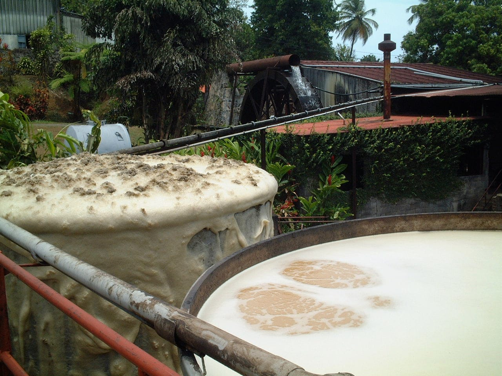
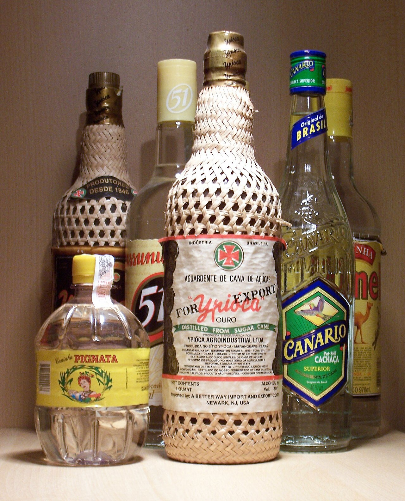

# 农业朗姆

农业朗姆（rhum agricole）是以新鲜甘蔗汁为原料、直接发酵并蒸馏的[朗姆酒](ref:rum)。它与常见的糖蜜朗姆共享“甘蔗”这个起点，却在第一个环节就分道扬镳：糖厂先结晶取糖，剩下的糖蜜再发酵蒸馏，那是工业朗姆的路线；农业朗姆则把刚压出的甘蔗汁直接送进发酵罐，尽量保留甘蔗的田园气息。这个差别不是营销话术，而是原料、法规与风味同时改变的工艺选择。

图：农业朗姆。图片：Stefan Ivanovich，CC BY-SA 3.0，via Wikimedia Commons（[原图页面](https://commons.wikimedia.org/wiki/File:Guadeloupe_rhum_fermentation_tanks.jpg)）。

## 甘蔗汁，而不是糖蜜

[甘蔗](ref:sugarcane)被压榨后得到浑浊的汁液，含糖、矿物质和大量植物组织。汁液如果不马上处理，会迅速氧化、发酵甚至变质，所以农业朗姆的产地必须把压榨厂和蒸馏厂放在很近的位置。甘蔗品种、土壤、降雨和采收时间都会进入酒里，这也是农业朗姆可以谈论“风土”的原因。

[糖蜜](ref:molasses)路线则不同：糖蜜是制糖的副产品，便于运输和储存，发酵规模可以做得很大，风味更集中、更甜、更重。农业朗姆的汁液发酵更轻、更草本，酒体更干，青草和橄榄的气息更明显。两条路线没有绝对高下，但它们对原料新鲜度的要求完全不同。

## 法属安的列斯与糖业危机

农业朗姆的历史与法属加勒比的糖业紧密相连。17 至 18 世纪，马提尼克和瓜德罗普以甘蔗种植和蔗糖出口为主；19 世纪的糖业危机、甜菜糖竞争和奴隶制废除改变了当地经济，部分庄园把过剩的甘蔗转向蒸馏，逐渐形成以甘蔗汁为基础的朗姆传统。

马提尼克的农业朗姆在 1996 年获得原产地命名控制（AOC），这是它区别于普通朗姆的关键节点。AOC 把产区、甘蔗品种、压榨时限、发酵、蒸馏和至少 3 年的橡木桶陈年写进规则，让“农业朗姆”从地方习惯变成可核查的法律身份。瓜德罗普、留尼汪和法属圭亚那也有农业朗姆生产，但马提尼克的 AOC 最为严格、辨识度最高。

## 从田间到蒸馏器

甘蔗通常在成熟后手工或机械收割，尽快运到压榨厂。压榨出的汁液经过简单过滤，进入发酵罐；发酵时间通常较短，以保留甘蔗的清香，避免过度产生酯类和酸味。发酵完成后，酒液进入[蒸馏](ref:distillation)环节，常用柱式蒸馏器连续蒸馏，得到 65% 至 75% vol 的原酒；部分酒厂也用壶式蒸馏器生产更厚重的版本。

[发酵](ref:fermentation)在这里不是“越慢越好”。农业朗姆要的是干净的甘蔗香，而不是糖蜜朗姆那种浓重的酯香；温度过高、杂菌过多或发酵过久，都会让青草变成蔬菜味。蒸馏时的切割同样关键：头段过于尖锐，尾段带有泥土和酸味，酒心必须干净而有体积。

## AOC Martinique 的规则

马提尼克农业朗姆的 AOC 规则覆盖从甘蔗到装瓶的全过程：甘蔗必须来自规定产区，品种要符合名单；压榨后必须尽快发酵；蒸馏必须在当地完成；白色朗姆的酒精度、陈年朗姆的桶陈时间都有下限。标有 “rhum vieux” 的酒款必须在橡木桶中至少陈年 3 年，而 “rhum ambré” 可能只经过较短时间的木桶接触。

这些规则的目的不是制造稀缺，而是固定风格。AOC 让消费者知道，一瓶标着 Martinique 的农业朗姆不是随便某个热带岛屿的甘蔗蒸馏酒；它必须通过产地、原料和工艺的连续检查。购买时，AOC 字样、酒精度和“vieux”或“ambré”的标示，比品牌故事更值得先看。

## 青草、橄榄与香蕉

白色农业朗姆的香气很有辨识度：新鲜甘蔗、青草、橄榄、青香蕉、柑橘皮和白花，入口干爽，酒精感清晰，收口带一点咸鲜和苦。它不像糖蜜朗姆那样甜厚，也不追求伏特加式的中性；它的目标是把甘蔗田的气息尽量完整地保存下来。

陈年农业朗姆则转向蜂蜜、香草、椰子、干果和香料，青草感减弱，酒体变圆。木桶的使用很讲究：新桶会带来明显的香草和单宁，旧桶则让甘蔗与花香保持更久。过重的木味会掩盖农业朗姆最珍贵的草本线条，因此不少生产者选择大桶或旧桶，而不是一味追求“桶味”。

## Ti' Punch 的语法

在马提尼克，农业朗姆最常见的喝法是 Ti' Punch：甘蔗糖浆、青柠和白色农业朗姆，比例按个人口味调整，通常以朗姆为主体。它的语法很简单——甜味圆润酒精，酸味提亮香气，青柠皮油提供芳香——但顺序和比例会明显改变成品。当地人常说“自己调”，因为每个人对甜酸和酒精的容忍度不同。

农业朗姆也适合做 Daiquiri 的变体、Rum Sour 和高球；陈年酒款可以纯饮或加冰。与[卡莎萨](ref:cachaca)相比，农业朗姆的草本和橄榄气息更突出，卡莎萨则更偏向甘蔗的甜香和青涩。两者都以甘蔗为原料，但产区、法规和发酵传统不同，不能简单互换。

## 与糖蜜朗姆、卡莎萨的边界

[糖蜜朗姆](ref:rum)以制糖副产品为原料，农业朗姆以新鲜甘蔗汁为原料；前者更容易做出浓重的焦糖、香草和酯香，后者更轻、更草本、更干。巴巴多斯、牙买加和古巴的经典朗姆多属糖蜜路线，马提尼克和瓜德罗普则以农业朗姆著称。

卡莎萨是巴西的甘蔗蒸馏酒，通常以甘蔗汁发酵后蒸馏，但它的法规、产区和风味目标与农业朗姆不同；卡莎萨更强调甘蔗的甜香和青草感，农业朗姆则有更明确的 AOC 体系和橄榄、咸鲜的个性。理解这三者的原料与法规差异，比记住“都来自甘蔗”更有用。

相关条目：[卡莎萨](ref:cachaca)。

**关键事实。**

| 项目 | 内容 |
| --- | --- |
| 一句话定位 | 法属马提尼克、瓜德罗普等地以新鲜甘蔗汁直接发酵蒸馏的朗姆酒，1996 年马提尼克农业朗姆获得 AOC；不经过糖蜜环节，风格青草、橄榄、香蕉与柑橘，白色酒款常用于 Ti' Punch，陈年酒款需在橡木桶中至少 3 年 |
| 上位风格 | 朗姆酒 |
| 香气家族 | 草本/果香/花香 |

**来源与边界。** 本页关于「农业朗姆」的关键事实，主要由以下来源交叉核对：Rhums AOC Martinique（马提尼克农业朗姆的 AOC 规则、原料、蒸馏与陈年要求）、Martinique Tourism Authority（马提尼克朗姆的农业传统与 1996 年 AOC 的时间）、European Union（朗姆酒类别、农业朗姆的甘蔗汁要求与地理标志框架）等 4 条来源。价格、批次与状态会变，涉及这些字段时以页面所列来源的最新版本为准。正文为项目自写，来源只作核验，不复制原文。

## 相关图像

图：卡莎萨。图片：Tom Tom at German Wikipedia，CC BY-SA 3.0，via Wikimedia Commons（[原图页面](https://commons.wikimedia.org/wiki/File:Cachaca.JPG)）。关联图像：农业朗姆。
