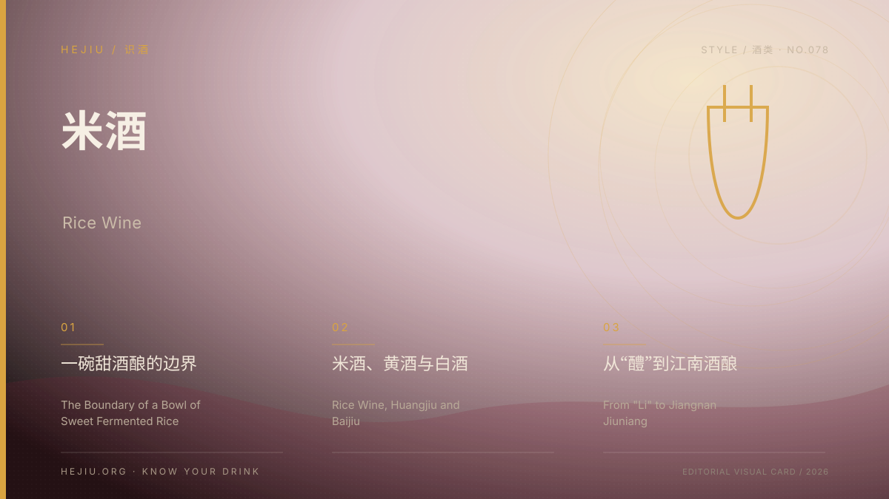

# 米酒

米酒是[中国](ref:china)以[糯米](ref:rice)为主料、加入酒药或甜酒曲、经糖化与发酵得到的低度酒。它最常见的形态是酒酿、醪糟：白色或微黄的浊液，米粒半浮半沉，入口甜、带酸、有轻微气泡，酒精度通常只有 1% 到 15%。它不蒸馏，也不像黄酒那样陈放，价值在新鲜、甜润与米香。

图：米酒 双语视觉卡（项目自绘 SVG）。不是实拍。

## 一碗甜酒酿的边界

米酒的定义可以从原料与工艺两头看。原料以糯米为主，也有用粳米或普通大米的版本；工艺是把米蒸熟、摊凉、拌入酒药，让霉菌把淀粉分解成糖，再由酵母把部分糖转化成酒精。糖化与发酵同时进行，几天后就能得到甜中带酒味的酒酿。过滤后得到的清液可以叫米酒，未过滤的带米粒版本则叫酒酿或醪糟。

“米做的酒”不等于米酒：清酒、烧酒、黄酒、白酒都可以用米，但工艺与成品差异很大。米酒的关键是低度、甜、浊、未经蒸馏，通常还保留米粒与活性微生物。

## 米酒、黄酒与白酒

米酒与黄酒最易混淆。黄酒以糯米、粳米为主，用麦曲或酒药，发酵更长、酒精度更高，通常 14% 到 20%，经压榨、澄清与陈放，颜色从浅黄到琥珀；米酒发酵短、度数低、甜度高、颜色浅，很多不过滤、不陈放。

米酒与白酒的差别在蒸馏：米香型白酒虽以米为原料，却已是蒸馏酒；米酒不蒸馏，度数低、保存期短。它与清酒的区别在曲种：清酒用米曲与酵母，口感更干；米酒用酒药，更甜、乳酸感更明显。

## 从“醴”到江南酒酿

中国古代把用谷物发芽或发霉糖化、发酵得到的甜酒称为“醴”。《诗经》里有“为酒为醴”，说明这种低度甜酒很早就进入祭祀与日常。后来的黄酒、白酒占据主流，但米酒式的甜酒没有消失，它以酒酿、醪糟的名字在江南、华中与西南延续下来。

湖北孝感是米酒最著名的地方之一。当地以糯米、酒药与地下水制作，成品甜润、米香明显，既是早餐与宵夜，也是产妇坐月子时的传统食物。江南的酒酿圆子、四川的醪糟粉子、湖南的甜酒冲蛋，都是同一类米酒的不同吃法。

## 糯米、酒药与温度

做米酒的第一步是选米。糯米支链淀粉含量高，蒸熟后黏性强、不易回生，糖化后甜味更饱满；粳米做出的酒酿更清爽，但口感偏散。米先浸泡、蒸熟，要求“熟而不烂”，再摊开降温到 25 到 30 摄氏度，避免把酒药中的微生物烫死。

酒药是米酒的灵魂。南方常用的酒药含根霉、毛霉与酵母：根霉把淀粉切成糖，酵母把糖变成酒精，不同配方还会带入乳酸菌。拌好曲的米饭装入陶罐或玻璃容器，中间挖一个“窝”，便于观察出液与透气。温度保持 25 到 30 摄氏度，通常 2 到 4 天就能看到窝里积满甜液。

## 糖化与发酵同时发生

米酒的发酵是“边糖化、边发酵”。霉菌的淀粉酶把淀粉分解成葡萄糖，酵母再把糖变成酒精与二氧化碳；乳酸菌产生乳酸，让酒酿带一点酸与奶香。三者在同一容器里竞争，温度、湿度与曲种决定最终的甜酸比。

[发酵](ref:fermentation)初期以糖化为主，酒酿很甜、酒精很低；随着时间推移，酵母把糖转成酒精，甜度下降、酒味上升。若继续发酵，乳酸与醋酸菌会把酒酿推向酸败。因此家庭制作常在最甜时冷藏，商业生产则用巴氏杀菌或过滤稳定风味。

## 甜、酸、米香与微气泡

好的酒酿呈乳白或微黄色，米粒饱满、悬浮在浑浊酒液中，表面可能有细小的气泡。闻香是熟糯米、甜酒、乳酸与轻微花香；入口甜而不腻，酸度随后出现，酒精感很轻，质地像稀粥。不同曲种会带来蜂蜜、花香或酸奶、米糠的方向。

米酒的“鲜”很重要：刚做好的酒酿最甜、香气最活；放久了甜味变薄、酸味变重。评价时看米粒是否完整、甜酸是否平衡；过甜可能是糖化过度，过酸则说明发酵失控。

## 孝感、江南与地方吃法

孝感米酒以“糊汤米酒”最出名：米酒加糯米圆子、桂花与糖，煮成浓稠甜汤，冬天热饮、夏天冰镇。江南的酒酿圆子把酒酿与小汤圆、桂花组合，是家常甜点；四川的醪糟粉子加入红糖与糯米粉，湖南的甜酒冲蛋则把酒酿与鸡蛋、红糖同煮。

云南、贵州、江西也有各自的米酒传统，有的用红曲或草药，风味从甜到酸。商业化瓶装米酒杀菌后活性酵母与新鲜米香会减弱；想体验真实状态，最好找冷藏、保质期短的产品。

## 酒酿圆子与蛋酒

米酒最常见的吃法是煮，而不是纯饮。酒酿圆子把酒酿、小汤圆、冰糖与桂花一起煮，甜香温暖；蛋酒把酒酿与鸡蛋、红糖同煮，口感更厚。夏天可以加冰、柠檬或苏打水，冬天则加姜丝、红枣与枸杞煮成热饮。

它也可以入菜：酒酿蒸鱼、酒酿烧肉、酒酿圆子羹，利用甜味与乳酸软化肉质、增加香气。纯饮时用小碗或小杯，冷藏后更清爽；但米酒酒精度低，开瓶后容易继续发酵，不适合像烈酒那样长期保存。

## 为什么它不适合长期陈放

米酒的酒精度通常只有 1% 到 15%，不足以抑制所有微生物；酒液中还可能残留活性酵母与酶，装瓶后继续发酵，产生气体、酸味甚至爆瓶。家庭自制的酒酿即使放冰箱，也只能减缓而不能完全停止发酵，通常建议在一周内吃完。

商业米酒通过巴氏杀菌、过滤或添加防腐剂延长保质期，但杀菌会损失一部分新鲜米香。它的[残糖](ref:residual-sugar)较高，开瓶后容易成为微生物的温床；一旦出现异味、霉斑、胀气或酒液变红，就应丢弃。米酒不是越陈越香，而是越新鲜越接近本来面目。

## 选购与保存

购买时先看配料：只有糯米、水、酒药或甜酒曲的产品更接近传统；若配料表很长，可能加了糖、酸度调节剂或防腐剂。再看保存条件与保质期，冷藏柜里、保质期短的产品通常更鲜活；常温长保产品则更方便，但风味更平。酒精度与甜度也要看，1% 到 15% 的跨度很大，适合的吃法不同。

自制要注意容器消毒与工具清洁，温度不超过 30 摄氏度；若出现彩色霉斑，整罐都不要吃。开封后冷藏并尽快加热食用。

补充阅读：[修道院啤酒](ref:c-extra-1)。

相关条目：[大米](ref:rice)、[发酵](ref:fermentation)、[残糖（residual sugar）](ref:residual-sugar)。

## 相关图像

图：大米。图片：China News Service，CC BY 3.0，via Wikimedia Commons（[原图页面](https://commons.wikimedia.org/wiki/File:20201102.Hengnan.Hybrid_rice_Sanyou-1.6.jpg)）。关联图像：米酒。
