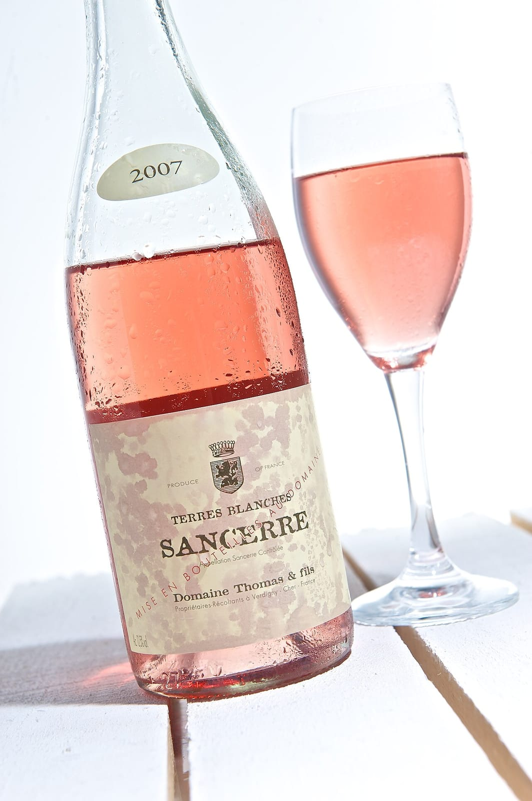
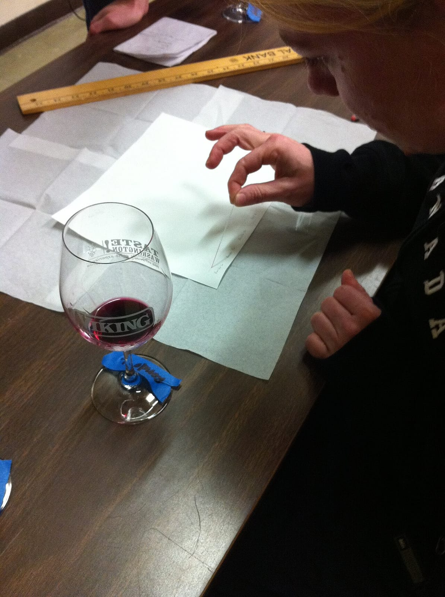

# 桃红葡萄酒

桃红葡萄酒是[葡萄酒](ref:wine)的一种，用红葡萄品种酿成，但果汁与果皮的接触时间很短，只提取少量颜色与单宁。它既不是“红葡萄酒兑白葡萄酒”的简单产物，也不是一个甜度等级；颜色深浅、香气和口感取决于品种、[浸渍](ref:maceration)方式、发酵温度与是否保留[残糖](ref:residual-sugar)。

图：桃红葡萄酒。图片：THOR，CC BY 2.0，via Wikimedia Commons（[原图页面](https://commons.wikimedia.org/wiki/File:Sancerre_rose_Wine.jpg)）。

## 定义边界：什么算桃红

桃红的核心是“用红葡萄、短时间取色”。葡萄汁本身大多无色，颜色来自果皮中的花青素；当果汁与果皮短暂接触后分离，得到的酒液呈粉红、洋葱皮或浅宝石红。它与[红葡萄酒](ref:red-wine)的差别在浸渍时间，与[白葡萄酒](ref:white-wine)的差别在原料与少量单宁。

不算桃红的产品包括：用红白葡萄酒混合而成的静态酒（欧盟规则对静态酒的这种混合有严格限制）、加色或加香精的调配饮料，以及颜色浅但经过长时间带皮发酵的轻酒体红葡萄酒。颜色浅不等于桃红，颜色深也不等于红葡萄酒。

## 颜色从哪里来

葡萄的颜色主要来自果皮中的花青素。花青素的提取受温度、酒精、二氧化硫、pH 与接触时间影响：温度越高、酒精越高、接触越久，颜色越深；pH 偏低时颜色更偏红，pH 偏高时更偏紫。桃红的颜色因此可以从极浅的洋葱皮到明亮的草莓粉。

颜色不是质量指标。普罗旺斯追求极浅的颜色与清爽感，塔维尔则追求更深的颜色与结构；两者都可以是高质量的桃红。把“越浅越高级”当作规则，是把一种产区审美误当成通用标准。

## 三种取色工艺

直接压榨法把红葡萄轻微压榨后立即分离果汁，颜色较浅、单宁很少，适合清爽风格。放血法（saignée）在酿造红葡萄酒时提前放出一部分果汁，这部分果汁单独发酵成桃红；它能带来更深的颜色与更多结构，但也会改变原红葡萄酒的浓缩程度。

混合法把红葡萄酒与白葡萄酒混合，在欧盟静态葡萄酒规则下受到严格限制，只有特定产品与传统才被允许；[起泡酒](ref:sparkling)的桃红则常通过混合少量红葡萄酒获得颜色。无论哪种方法，工艺选择都会影响颜色、单宁与香气，而不只是“好看”。

## 发酵与质地

桃红通常在较低温度下发酵，以保留新鲜果香。是否进行[苹果酸-乳酸发酵](ref:mlf)、是否使用橡木桶、是否带酒泥陈酿，都会改变质地。多数桃红适合年轻时饮用，强调果香与酸度，而不是长期陈年；少数结构型桃红可以陈年数年。

单宁含量低是桃红的典型特征，但并非没有。带皮时间稍长、使用放血法的酒款会有更明显的[单宁](ref:tannin)与结构感，适合搭配烤肉；直接压榨、早分离的酒款则更轻盈，适合海鲜与沙拉。

## 法规与甜度

欧盟葡萄酒法规对桃红的类别、酿造限制与标签有框架性规定，具体产区还会叠加 AOC 规则。中国 GB/T 17204-2021 则从饮料酒分类的角度给出术语基础。酒标上的“dry”“sec”“demi-sec”等词描述甜度，不描述颜色。

OIV 对静止葡萄酒的糖分等级给出可核查的阈值：干型最高为 4 g/L 糖，或在总酸度比糖分低不超过 2 g/L 时可到 9 g/L；半干型可到 12 g/L，或在特定酸度条件下到 18 g/L；半甜型可到 45 g/L；甜型高于 45 g/L。桃红可以是干型、半干型、半甜型或甜型，颜色与甜度没有对应关系。

## 风格谱系

普罗旺斯桃红通常颜色很浅，带柑橘、白桃、红醋栗与草本香气，酒体轻，酸度高；主要品种包括歌海娜、神索、西拉与慕合怀特。法国塔维尔的桃红颜色更深，结构更接近轻酒体红葡萄酒，常带草莓、香料与矿物感。

西班牙的 rosado 常带草莓与香料感，里奥哈与纳瓦拉是代表产区；意大利的 chiaretto 与 cerasuolo 颜色深浅不一，酸度清爽；美国的 white Zinfandel 式桃红可能保留明显残糖，口感偏甜。桃红香槟通过短暂浸渍或加入少量红葡萄酒获得颜色，气泡与红果香气结合。

## 关键参数

桃红的酒精度通常在 11% 至 14% 之间，具体取决于产区气候与成熟度。浸渍时间可以从数小时到一两天；发酵温度通常低于红葡萄酒；多数产品不使用新橡木桶。适饮温度通常低于红葡萄酒、高于白葡萄酒，约 8 至 12 摄氏度。

这些参数是风格变量，不是法规数字。同一产区、同一品种的桃红，因浸渍与发酵选择不同，可以从清淡爽脆到饱满辛香。购买时应看酒标上的品种、产区、酒精度与甜度词，而不是只看颜色。

## 与相邻风格的区别

浅色红葡萄酒（如某些黑皮诺或佳美）与桃红的区别在发酵方式：前者带皮发酵完成，后者在取色后分离果汁。Blush 在美国市场常指半甜或甜型桃红，但并非法规类别。Vin gris 指极浅色的直接压榨桃红，颜色可以接近白葡萄酒。

桃红也不是“粉红起泡酒”的同义词：静止桃红与桃红起泡酒在工艺、气压与饮用场景上都不同。把这些名称混用，会让消费者难以判断甜度、气泡与酒体。

## 常见误解与争议

第一，认为桃红一定是甜的。第二，认为桃红是红白葡萄酒简单混合。第三，认为颜色越浅质量越高。第四，认为桃红只能夏天喝。第五，把 white Zinfandel 当作所有桃红的代表。第六，认为桃红不适合配餐。

争议主要集中在欧盟对静态桃红混合法的限制、产区对颜色的审美偏好，以及“桃红”是否应被视为一个独立风格类别而非颜色描述。这些问题涉及法规与市场，不影响“短浸渍取色”这一核心工艺。

## 怎么喝

桃红适合在比白葡萄酒稍高、比红葡萄酒稍低的温度下饮用，过冷会让香气闭塞，过热会突出酒精。干型桃红适合沙拉、海鲜、地中海蔬菜与清淡禽肉；带甜味的桃红可以搭配水果甜点或辛辣食物。它也是夏季开胃酒的常见选择，但不必把饮用场景限定在夏天。

开瓶后应冷藏并尽快饮用，尤其是低酒精度、低单宁的风格；接触空气后香气会迅速衰减。

对照阅读：[葡萄酒](ref:wine)、[白葡萄酒](ref:white-wine)。

## 相关图像

图：苹果酸-乳酸发酵。图片：Agne27，CC BY-SA 3.0，via Wikimedia Commons（[原图页面](https://commons.wikimedia.org/wiki/File:Malolactic_spotting.JPG)）。关联图像：桃红葡萄酒。
