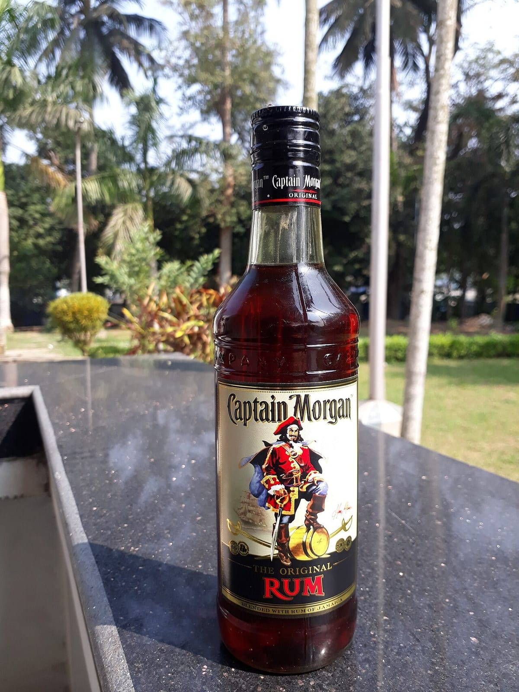

# 朗姆酒

朗姆酒（rum）是以甘蔗汁、糖蜜或甘蔗糖浆为原料，经发酵、[蒸馏](ref:distillation)得到的烈酒。它的风味跨度很大：同样叫朗姆，可以是几乎中性的白色调酒基酒，也可以是带焦糖、香草与木质感的深色陈年酒。理解原料、蒸馏器与陈年这三条线索，比记住某个品牌更能判断风格。

图：一瓶 Captain Morgan 原味朗姆酒，深色酒液与品牌标签。图片：Pinakpani，CC BY-SA 4.0，via [原图页面](https://commons.wikimedia.org/wiki/File:Bottle_of_Captain_Morgan_Rum_01.jpg)。

## 定义与法规

欧盟法规要求朗姆酒以甘蔗产品为原料，最低酒精度为 37.5% vol，并允许以“农业朗姆”（rhum agricole）标注直接以甘蔗汁发酵蒸馏的产品。法规同时区分“朗姆酒”与“甘蔗烈酒”等类别，标签上的类别词因此具有实际约束力。各国还有本国的标准与地理标志，例如马提尼克农业朗姆享有法国的原产地命名保护。

需要区分朗姆酒与巴西的卡夏莎（cachaça）。两者都以甘蔗为原料、工艺相近，但卡夏莎在法规与分类上是独立类别，不能简单等同。类似地，“spiced rum”通常是在朗姆酒基础上加入香料与糖，属于调味产品，原料与添加物应以标签为准。

## 原料与产区

原料主要有两类：糖蜜是制糖的副产物，产量大、成本低，风味偏厚；甘蔗汁直接发酵则保留更多植物与草本气息，常见于农业朗姆。部分产区也使用甘蔗糖浆。原料的新鲜度、发酵时间与菌种会直接影响香气基底。

朗姆酒主要产于加勒比地区，也在中南美洲、印度洋与亚洲生产。牙买加、巴巴多斯、马提尼克、古巴、特立尼达等产区形成了不同的风格传统：有的强调酯香与厚重酒体，有的追求轻盈干净，有的以农业朗姆的鲜切甘蔗感为标志。产区名称本身不是质量保证，但能提示工艺传统。

## 「朗姆酒」的时间线
朗姆酒的起源与加勒比甘蔗种植园经济紧密相关。17 世纪，糖蜜发酵蒸馏的技术在加勒比岛屿上普及，朗姆成为船员、种植园与殖民贸易中的常见酒。18 世纪，朗姆酒的贸易与海军配给把它推向更广的市场，也带来了税收、走私与奴隶制相关的沉重历史。

19 世纪，连续蒸馏器与更稳定的发酵控制提升了产量与一致性，轻盈的白朗姆逐渐成为调酒基酒。20 世纪，朗姆酒在热带风格鸡尾酒与旅游消费中扩张；21 世纪的精酿浪潮让农业朗姆、单一产区与长陈年产品重新受到关注，也让“加糖”与“年份”的透明度成为讨论焦点。

## 蒸馏与陈年

蒸馏器主要分壶式与柱式。壶式蒸馏通常保留更多酯类与厚重香气，适合深色、风味复杂的风格；柱式蒸馏可以得到更高纯度与更轻盈的酒体，适合白朗姆。部分产品会混合不同蒸馏批次的酒液，以平衡香气与口感。

陈年通常在橡木桶中进行，参见[橡木桶陈年](ref:oak-ageing)。热带陈年温度高、蒸发快，数年即可带来明显颜色与风味；温带陈年速度较慢，风格更收敛。陈年朗姆的颜色也可能来自焦糖着色，因此颜色深浅不能直接等同于陈年长度。购买时应看标签上的陈年声明与是否标注添加物。

## 主要类别

- **白朗姆**：通常经过过滤，颜色浅、风味轻，适合莫吉托、代基里等鸡尾酒。
- **金朗姆**：可能短暂陈年或加焦糖色，风味比白朗姆圆润，常见于调酒与加冰饮用。
- **深色朗姆**：陈年更久或加入糖蜜、焦糖，带香草、焦糖与木质风味，适合纯饮或深色鸡尾酒。
- **农业朗姆**：直接以甘蔗汁发酵蒸馏，常见于马提尼克等地，风格更草本、鲜明。
- **调味朗姆**：在朗姆酒基础上加入香料、水果或糖，属于调味产品，甜度与添加物需看标签。
- **高度朗姆**：酒精度明显高于常规产品，常用于调酒或特定饮用传统，需注意安全与稀释。

## 「朗姆酒」的闻与喝
白朗姆的典型香气是甘蔗甜感、轻微酯香与干净酒精；金朗姆多一层香草与焦糖；深色朗姆常见焦糖、巧克力、咖啡、烟草与木质。农业朗姆则有鲜甘蔗、青草、花香与胡椒感。酯香高的牙买加风格会有明显的香蕉、熟果与溶剂感，这是风格特征，不是缺陷。

品鉴时先小杯纯饮，必要时加几滴水打开香气，再判断甜度、酒体与余味。若标签未说明加糖，甜感可能来自原料、桶陈或添加物，不能仅凭甜度推断年份。对比[哈瓦那俱乐部 7 年](ref:havana)这类陈年朗姆与[百加得白朗姆](ref:bacardi)这类轻盈基酒，可以更清楚地看到陈年与过滤对风格的影响。

## 「朗姆酒」的饮用与搭配
白朗姆适合调酒，金朗姆与农业朗姆可以加冰纯饮，深色朗姆适合纯饮或用于热带风格鸡尾酒。莫吉托与代基里看似简单，但青柠、糖与冰的比例会显著改变平衡；朗姆酒的酒精度越高，酸甜比例越需要重新调整。

餐食搭配上，白朗姆适合海鲜、沙拉与清淡小食；陈年朗姆适合黑巧克力、坚果、雪茄与餐后甜点。高酯香的朗姆与重口味烤肉也能相配，但甜味较高的调味朗姆更适合甜点而非正餐。

## 「朗姆酒」容易被读错的地方
第一，把朗姆酒等同于“甜酒”。白朗姆可以很干，甜感更多出现在陈年或调味产品。
第二，认为颜色越深年份越长。焦糖着色会加深颜色，标签声明才是依据。
第三，把卡夏莎当作朗姆的一种。两者法规与分类不同。
第四，认为所有朗姆都适合可乐。轻盈白朗姆与厚重深色朗姆在混合后的表现差异很大。
第五，忽视“农业朗姆”的产地与法规含义。它不只是营销词，通常对应特定的原料与产区规则。

**来源与边界。** 本页关于「朗姆酒」的关键事实，主要由以下来源交叉核对：European Union（朗姆酒的原料类别、最低酒精度与农业朗姆的标注要求）、West Indies Rum and Spirits Producers' Association（加勒比朗姆酒的生产背景与地理标志讨论）、Oxford University Press（提供关于甘蔗烈酒、加勒比产区与朗姆酒风格的条目）等 4 条来源。价格、批次与状态会变，涉及这些字段时以页面所列来源的最新版本为准。正文为项目自写，来源只作核验，不复制原文。

## 进阶判断

图：四方朗姆酒厂的橡木桶仓库，热带陈年与桶型共同塑造朗姆风格。图片：Unknown author Unknown author，CC BY 2.5，via Wikimedia Commons（[原图页面](https://commons.wikimedia.org/wiki/File:Foursquare_Rum_Distillery_Barrel_Warehouse.jpg)）。

| 变量 | 路线 | 风味与购买线索 |
| --- | --- | --- |
| 原料 | 糖蜜 / 甘蔗汁 | 糖蜜厚、甘蔗汁清 |
| 蒸馏 | 壶式 / 柱式 | 壶式重、柱式轻 |
| 陈年 | 热带 / 欧洲 | 热带快、欧洲慢 |
| 添加 | 加糖 / 香料 | 口感圆润但需看标签 |

**Agricole 和工业朗姆有什么区别？** Agricole 用甘蔗汁发酵，风味更青绿、花香；工业朗姆多用糖蜜，风格更厚、更甜。两者都可能优质，差别在原料与产区传统。

**香料朗姆是“假朗姆”吗？** 不是。香料朗姆是合法类别，但添加糖与香料会改变风味和标签真实性。买的时候看配料、产地与酒精度，不只看“Spiced”。

**朗姆酒的年份可信吗？** 要看标签写的是最低年份、单一桶还是调和。热带陈年与欧洲陈年速度不同，年份数字不能直接跨产区比较。

延伸阅读：[蒸馏](ref:distillation)、[橡木桶陈年](ref:oak-ageing)。

## 参考资料
- [蒸馏](ref:distillation)：壶式与柱式蒸馏决定朗姆酒体的基础。
- [橡木桶陈年](ref:oak-ageing)：陈年朗姆颜色与风味的重要来源。
- [哈瓦那俱乐部 7 年](ref:havana)：古巴陈年朗姆的代表性产品页。
- [百加得白朗姆](ref:bacardi)：轻盈白朗姆作为调酒基酒的例子。
