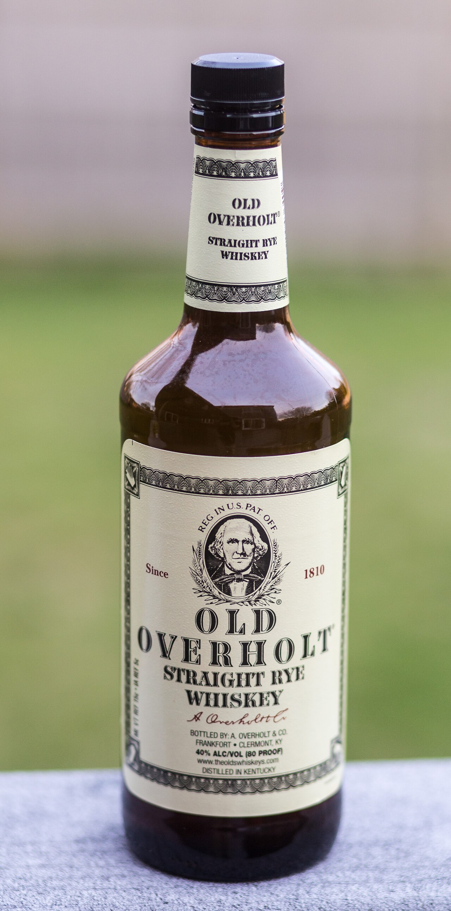
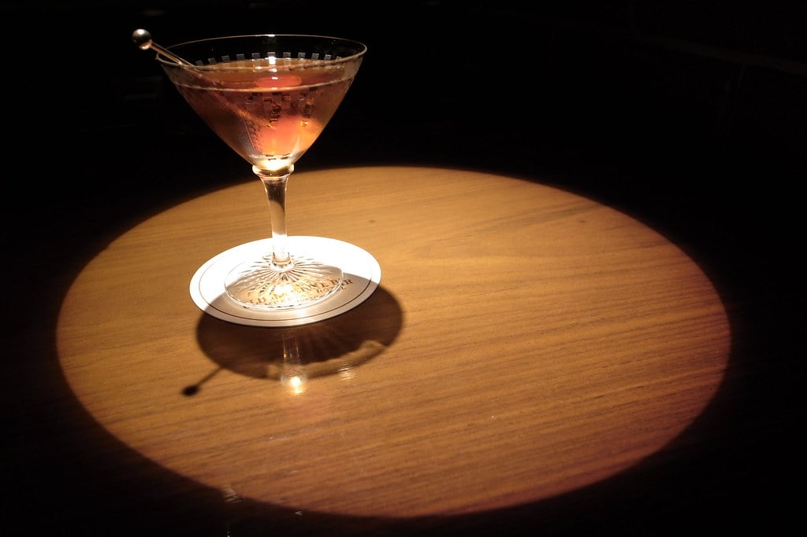

# 黑麦威士忌

黑麦威士忌（rye whiskey）是以黑麦为主要谷物的威士忌。在美国，它有一套可核查的联邦门槛：发酵醪中黑麦不少于 51%，蒸馏酒精度不高于 160 proof（80% ABV），入桶不高于 125 proof（62.5% ABV），使用新烧焦橡木桶，装瓶不低于 80 proof（40% ABV）。在加拿大，“rye”又是另一套故事：它常常只是 Canadian Whisky 的同义词，并不保证瓶中有多少黑麦。

图：黑麦威士忌。图片：User:kzirkel，CC0，via Wikimedia Commons（[原图页面](https://commons.wikimedia.org/wiki/File:A_bottle_of_Old_Overholt_Straight_Rye_Whiskey.jpg)）。

## 51% 是法律底线

美国现行[威士忌](ref:whisky)标准把 rye whisky 列入“以谷物命名”的类型：只要发酵醪中黑麦占比达到 51%，就可以这样标注。蒸馏上限、入桶上限、桶型与装瓶下限与[波本](ref:bourbon)相同，区别只在主要谷物。换句话说，黑麦威士忌不是“波本加了黑麦”，而是把玉米换成黑麦的平行类别。

51% 是底线，不是典型配方。许多产品把黑麦做到 60% 以上，甚至接近全黑麦；也有“barely legal rye”把黑麦刚好压在 51%，其余用玉米与发芽大麦补足。比例越高，辛香与干爽感通常越明显，但酵母、蒸馏与桶型仍能改写这条经验。

## 新烧焦桶与 straight 的两年

所有美国 rye whisky 都必须使用新的、经过烧焦的橡木桶。桶壁炭化把木质素与木糖转化为香草醛、焦糖与愈创木酚类化合物，为酒液提供香草、椰子与甜香料底色。与苏格兰的旧桶传统相比，新桶萃取更强，陈年时间过长容易让木质压过谷物。

标为 straight rye 的产品还必须在新烧焦桶中陈年至少两年，不得添加色素、香料或其他烈酒。若瓶中酒液不足四年，标签通常要写明酒龄。straight 是一层附加约束，不是“黑麦威士忌”的同义词；一款酒可以只是 rye whisky，而没有 straight 标注。

## 黑麦从田里到醪液

[黑麦](ref:rye)的淀粉结构与大麦不同，糖化时黏度高，容易结成胶状醪液，因此酒厂常配合发芽大麦提供的酶，或使用外源酶帮助转化。黑麦表皮还带有较强的谷物香气与辛香前体，发酵过程中会生成胡椒、薄荷与莳萝类的风味物质。

[发酵](ref:fermentation)时间与酵母菌株决定这些前体的走向。较短发酵保留更多谷物直白感，较长发酵增加酯类与果香，也可能带来酸味。黑麦醪液容易起泡，发酵温度控制比玉米配方更敏感；这些工艺细节，往往比“黑麦比例”更能解释两家酒厂风格的差异。

## 蒸馏与切酒

美国黑麦威士忌多用柱式蒸馏器连续蒸馏，小型酒厂也可能使用壶式或混合流程。无论设备如何，蒸馏都必须把酒精度控制在 160 proof 以下，入桶前再稀释到 125 proof 以下。蒸馏过高会削掉黑麦的辛香与油脂感，留下干净的甜味。

[酒头、酒心与酒尾](ref:heads-hearts-tails)的切分同样关键。酒头带溶剂感，酒尾带浑浊与苦味，酒心才是装瓶主体。偏早切酒得到更轻盈、更干净的新酒；偏晚切酒保留更多油脂与谷物重量。黑麦的胡椒感在晚切时更突出，但也更容易带上粗糙的边缘。

## 胡椒、薄荷与干爽收口

典型黑麦威士忌的香气从黑麦面包、胡椒、薄荷与莳萝开始，中段可能出现焦糖、香草与柑橘皮，收口比波本更干，单宁感更明显。高黑麦配方会更辛辣、更草本；高玉米配方则更甜、更圆润；小麦参与配方时会增加柔软度。

这些描述只是倾向，不是产区或品牌保证。新桶的炭化等级、仓库温湿度、陈年长度与装瓶强度都会改变结果。同一酒厂的黑麦与波本，差异有时小于两个品牌之间的差异；把“黑麦一定更烈”当成定律，容易错过那些柔和、油脂感强的版本。

## 加拿大分岔：rye 不必是 51%

加拿大法规把 Canadian Whisky、Canadian Rye Whisky 与 Rye Whisky 视为同一套标准：以谷物醪液蒸馏，在小木桶中陈年至少三年，在加拿大糖化、蒸馏与陈年，装瓶酒精度不低于 40% vol，并允许添加香料。它没有“黑麦必须达到 51%”的要求，也不要求使用新烧焦桶。

因此，加拿大酒标上的“rye”更多是历史与风味传统，而不是配方声明。它可以指黑麦比例很高的酒，也可以指以玉米为主、只带少量黑麦的调和酒。把美国 rye 与 Canadian rye 当成同一种产品，是跨市场比较时最常见的错误。

## 在 Manhattan 与 Sazerac 里

[曼哈顿](ref:manhattan)传统上以黑麦威士忌为基酒，黑麦的辛香能切开味美思的甜味，让收口保持干爽；用波本替代会更圆、更甜。[萨泽拉克](ref:sazerac)同样依赖黑麦的骨架，苦艾酒 rinse 与柠檬皮提供香气对比，黑麦的胡椒感则撑住整体。

调酒时不必追求最贵的桶强版本。高黑麦的基础款往往比高玉米配方更适合搅拌类鸡尾酒；桶强产品需要相应减少用量或增加稀释。纯饮时，加几滴水可以打开薄荷与黑麦面包的香气。

## 黑麦威士忌的六个误读

第一，认为黑麦威士忌必须是 100% 黑麦。美国法只要求 51%。第二，把加拿大 rye 与美国 rye 当成同一标准。第三，认为黑麦一定比波本更烈、更粗糙。第四，把 straight 当成陈年越久越好的标志；它只保证至少两年。第五，认为黑麦威士忌只能调酒，实际上许多高年份产品适合纯饮。第六，认为“rye”一定意味着辛辣，忽略了桶型与酵母的作用。

选购时先看产地与类别名称，再看黑麦比例（如果酒厂披露）、酒龄与酒精度。黑麦威士忌的陈年同样遵循[橡木桶陈年](ref:oak-ageing)的基本机制：桶型与新桶强度决定萃取方向，时间只是变量之一。适量饮用，未成年人不应饮酒。

加拿大的 Canadian Rye Whisky 没有 51% 黑麦下限，和美国 rye whiskey 不是同一套规则；跨境比较时先看酒标与法规，而不是只看 rye 这个词，先核对酒标与当地法规，再谈风格。

**关键事实。**

| 项目 | 内容 |
| --- | --- |
| 一句话定位 | 以黑麦为主要谷物、在新烧焦橡木桶中熟成的威士忌；美国法要求黑麦不少于 51%，straight 需陈年至少两年，加拿大则把 Canadian Rye Whisky 当作与 Canadian Whisky 同一套标准，并不设黑麦比例下限 |
| 上位风格 | 威士忌 |

**来源与边界。** 本页关于「黑麦威士忌」的关键事实，主要由以下来源交叉核对：U.S. Government Publishing Office（rye whisky、straight rye whisky 的谷物比例、蒸馏与入桶上限、桶型与陈年规则）、Alcohol and Tobacco Tax and Trade Bureau（美国烈酒类别名称与标签管理的官方框架）、Canadian Food Inspection Agency（Canadian Whisky、Canadian Rye Whisky 与 Rye Whisky 的共同标准、陈年与酒精度要求）等 4 条来源。价格、批次与状态会变，涉及这些字段时以页面所列来源的最新版本为准。正文为项目自写，来源只作核验，不复制原文。

## 相关图像

图：一杯曼哈顿，深琥珀色酒液盛于碟形杯，杯口横放酒签与一颗酒渍樱桃。图片：naotakem，CC BY 2.0，via Wikimedia Commons（[原图页面](https://www.flickr.com/photo.gne?id=6992048786)）。关联图像：黑麦威士忌。
