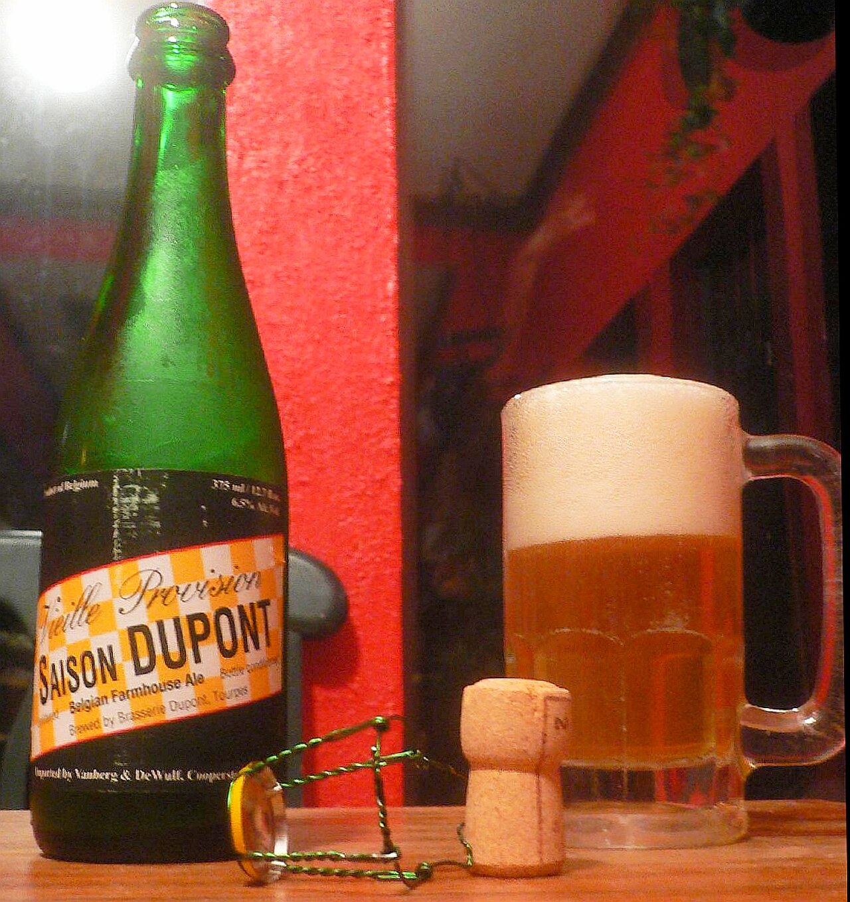
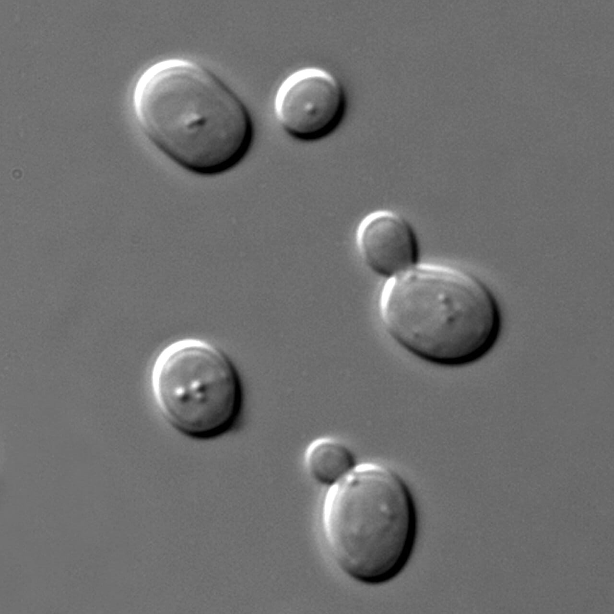

# 赛松

赛松（saison）是[比利时](ref:belgium)瓦隆地区农庄在凉爽季节酿造、留到夏季农忙时饮用的[啤酒](ref:beer)。它的定义不靠颜色，而靠发酵方式与口感走向：高发酵度带来干爽收口，酵母产生胡椒、柑橘与干草般的香气，气泡通常活跃。历史上它是低酒精的农忙饮料，今天则从日常型延伸到 8% 以上的烈性版本。

图：赛松。图片：Jmcstrav，Public domain，via Wikimedia Commons（[原图页面](https://commons.wikimedia.org/wiki/File:Saison_Dupont.jpg)）。

## 瓦隆农庄的夏季储备

19 世纪，瓦隆的农庄在冬季与早春酿造啤酒，利用较低的气温控制发酵，等夏季农忙时再拿出来给雇工解渴。这类酒通常酒精度不高，原料以当地大麦、小麦与糖为主，酿造者未必受过正式训练，配方随农庄而异。Hainaut 省的乡镇被认为是赛松的核心地带。当时的农庄往往同时种植谷物、养牛与酿酒，啤酒既是工资的一部分，也是夏季劳作时的水分与能量来源；这种“农庄—季节—劳工”的关系，构成了赛松名称的日常背景。

20 世纪，瓶装工业啤酒与战争改变了农村经济，许多农庄停止酿造。1980 年代以后，比利时与美国的精酿酿酒者重新关注这一传统，把赛松从地方农舍饮品变成国际风格。今天的赛松既有坚持旧配方的家族酒厂，也有以美式酒花、水果或桶陈做增味的现代版本。

## 高发酵度与酵母驱动

[酵母](ref:yeast)是赛松的核心。发酵温度通常较高，常见 20–25°C，酵母在温暖环境中产生丰富的酯香与酚香，带来胡椒、丁香、柑橘与熟果的气息。糖化配方常用浅色基础麦芽、少量小麦与可发酵糖，目的是让酒体轻盈、收口干净，而不是靠高残糖撑起厚度。水质偏硬或偏软会改变苦味的轮廓，糖化温度偏低则有利于产生更多可发酵糖，让成品更干。部分酒厂会使用陈年酒花，只取苦味而不追求香气。

[发酵](ref:fermentation)往往分阶段升温，让酵母在后期继续消耗糖分，达到很高的发酵度。装瓶时可能加入少量糖与酵母进行二次发酵，形成细密气泡。赛松常见 5%–8% 酒精度、20–35 IBU，但这些数字随来源与酒厂而异，不是法定标准；有些农舍版本只有 3%–5%，有些现代版本则超过 8%。

## 胡椒、柑橘与干爽收口

年轻赛松的香气以柠檬皮、橙皮、青苹果、胡椒与干草为主，部分版本带一点布雷特酵母的谷仓气息。入口酒体轻到中等，气泡活跃，酸度不高但足够提神，收口干爽，苦味通常中等且干净。它不是酸啤，酸度只是结构的一部分。高发酵度让酒体显得轻盈，但酒精与香料感会把余味拉长；这种“轻而不薄”的平衡，是判断赛松质量的关键。

陈年赛松会发展出蜂蜜、坚果与更明显的香料感，但香气也会逐渐衰退。若出现明显的醋味、纸板味或过度氧化，通常说明保存不当。品尝时可以先让酒液在杯中回温几分钟，香气会比刚从冰箱取出时更开放。

## 埃诺与东佛兰德的产区图景

赛松的传统产区集中在比利时瓦隆的 Hainaut，尤其是与法国接壤的乡镇。布鲁塞尔以南与东佛兰德也有一些酒厂生产农舍风格啤酒，但各自的酵母与配方差异很大。代表性酒厂包括以 Saison Dupont 为标杆的 Brasserie Dupont、以野生酵母与实验风格著称的 Fantôme，以及 Blaugies 等小型农舍酒厂。

美国精酿在 1980 年代以后发展出自己的赛松传统，常以更明显的酒花香气、更高的酒精度或桶陈做变化。这些版本可以很好喝，但与比利时农舍原型的距离需要用配方与酵母来判断，而不能只看“saison”这个词。比利时农舍版本常带更明显的谷仓与胡椒气息，美式版本则可能更干净、更偏向柑橘酒花；两者都合法，但参照系不同。

## 赛松、小麦啤酒与比利时金色艾尔

与[小麦啤酒](ref:wheat-beer)相比，赛松的小麦比例通常更低，重点在酵母香料与干爽收口，而不是香蕉、丁香与浑浊酒体。与比利时金色艾尔相比，赛松的酒体更轻、发酵度更高、苦味更干，酵母香气也更偏向胡椒与干草。与酸啤相比，赛松的酸度通常温和，不是以乳酸或醋酸为主导。

[苦度](ref:ibu)在赛松里主要起平衡作用，而不是主角。过高的苦味会压住酵母香气，过低则让收口显得软。判断一款赛松是否典型，最好看它是否干爽、是否有清晰的酵母香料感，以及气泡是否支撑起轻盈的酒体。

## 年份差异、侍酒与配餐

赛松适饮温度约 6–10°C。温度过低会压住胡椒与柑橘香气，过高则让酒精感变得突出。郁金香杯或白葡萄酒杯有助于聚拢香气；倒酒时保留适量泡沫，但不必追求厚厚一层。瓶内二次发酵的版本可能有沉淀，饮用前可以静置。

配餐上，赛松适合沙拉、烤鸡、海鲜、带香草的猪肉与山羊奶酪，也能搭配略带辛辣的亚洲菜肴。它的干爽与气泡可以清理口腔，但不宜与极甜的甜点同饮。购买时留意装瓶日期与酒精度，农舍版本的年份差异往往比工业啤酒更明显。

对照阅读：[啤酒](ref:beer)、[比利时](ref:belgium)。

**关键事实。**

| 项目 | 内容 |
| --- | --- |
| 一句话定位 | 比利时瓦隆农庄在凉爽季节酿造、留待夏季饮用的农舍艾尔；以高发酵度、干爽收口、胡椒与柑橘般的酵母香为标志，现代版本从低酒精日常型扩展到 8% 以上的烈性赛松 |
| 上位风格 | 啤酒 |
| 香气家族 | 酵母酯香与香料 |

**来源与边界。** 本页关于「赛松」的关键事实，主要由以下来源交叉核对：Beer Judge Certification Program（赛松的强度、苦度、酵母香气与季节酿造描述框架）、Brewers Association（美国精酿行业对赛松与农舍艾尔的公开分类）、Oxford University Press（提供关于瓦隆农舍酿造、赛松历史与比利时酵母的条目）等 4 条来源。价格、批次与状态会变，涉及这些字段时以页面所列来源的最新版本为准。正文为项目自写，来源只作核验，不复制原文。

**并读。** 把「赛松」与「啤酒」、「小麦啤酒」、「比利时」放在一起读时，先确认它们是同一层级还是上下游关系：先确认定义与工艺，再比较原料、产区与代表品牌。本页负责给出酒类风格的基本坐标，对照条目补上具体案例与差异；读完再回到本页，才能分清哪些差别属于酒类风格本身，哪些只是产地、批次或品牌选择。

## 相关图像

图：酵母。图片：Masur，Public domain，via Wikimedia Commons（[原图页面](https://commons.wikimedia.org/wiki/File:S_cerevisiae_under_DIC_microscopy.jpg)）。关联图像：赛松。
