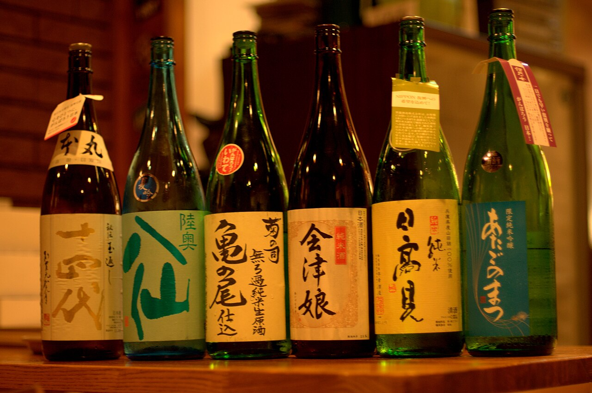

# 清酒

清酒（sake，日本酒）是以米、水、米曲（koji）和酵母为基本原料酿成的日本传统酒类。它与葡萄酒一样属于发酵酒，而不是蒸馏酒；酒精度通常在 15% 左右，部分原酒或生酒会更高。

图：清酒。图片：Intforce，CC BY-SA 4.0，via Wikimedia Commons（[原图页面](https://commons.wikimedia.org/wiki/File:Overflowing_sake_glass_in_masu.jpg)）。

## 定义与分类

日本酒税法把清酒定义为以米、米曲和水为原料、经发酵得到的酿造酒，酒精度低于 22 度。清酒与[烧酒](ref:soju)不同：烧酒是蒸馏酒，清酒没有蒸馏环节。清酒也不同于中国的米酒与黄酒，虽然同样以米为原料，但曲种、酵母与工艺路线各有传统。

清酒的类别由三个维度交叉决定：精米步合（米磨到什么程度）、是否添加酿造酒精、以及是否经过吟酿式低温发酵。标签上的类别词是法定概念，不是营销形容词，因此读懂类别词比记住品牌更有用。

## 「清酒」的时间线
清酒的酿造传统可追溯到稻作与发酵技术传入日本之后。早期由寺院与神社掌管酿酒，室町时代出现商品化的酒屋。江户时代，三段仕込み、火入与冬季酿造等工艺逐渐定型，并形成了以杜氏为核心的酿造组织。

明治以后，清酒进入现代化阶段：酵母被分离与选育，温控与检测技术引入，酒税法也开始规范类别与标示。20 世纪后期，吟酿技术普及，低温长期发酵带来花果香；21 世纪，精米设备与冷链让纯米大吟酿的品质稳定性明显提升，清酒也从国内消费转向出口市场。

## 原料与精米

清酒的原料是米、水、米曲与酵母。酿酒米与食用米不同，粒大、心白明显、蛋白质与脂肪较少，常见品种包括山田锦、五百万石与美山锦。米粒外层含有蛋白质与脂肪，会带来杂味，因此需要研磨。

精米步合指研磨后剩余米粒的比例。50% 意味着磨去一半，数值越低，杂味来源越少，成本也越高。精米后还要洗米、浸渍与蒸米，蒸到“外硬内软”的状态，才能让曲菌顺利生长。水在日本清酒中被视为风格要素，硬度会影响发酵速度与香气走向。

## 类别体系

- **纯米酒**：只使用米、水、米曲和酵母，不添加酿造酒精，通常风味更饱满。
- **本酿造**：添加少量酿造酒精以调整香气和口感，精米步合法定上限为 70%。
- **吟酿**：在更低温度下长时间发酵，常带花果香，精米步合上限为 60%；**大吟酿**的上限为 50%。
- **纯米吟酿 / 纯米大吟酿**：同时满足纯米与吟酿类别的条件，既有纯米的厚度，也有吟酿的香气。

此外还有生酒、生贮藏酒、原酒与古酒等按处理方式区分的类别。类别之间没有绝对高下，差别在原料约束与风格目标。选购时应同时看类别词与精米步合，而不是只看“大吟酿”三个字。

## 「清酒」怎么做出来
流程包括：精米、洗米、浸渍、蒸米、制曲、造酒母、三段仕込み、发酵、压榨、澄清、火入、储藏、装瓶。制曲是把蒸米接种曲菌，让淀粉分解为可发酵糖；酒母是培养酵母的酸性环境；三段仕込み分三次加入蒸米、曲与水，让发酵逐步扩大。

[制曲](ref:qu-making)与酒母管理决定发酵起点。传统山废酒母依靠乳酸菌自然酸化，周期长、风味复杂；速酿酒母通过添加乳酸缩短周期、提高稳定性。醪的发酵通常持续约 20 至 30 天，温度控制在 5 至 15°C 之间，具体随类别调整。

## 「清酒」的闻与喝
清酒的香气包括米香、曲香、乳酸感与花果香。纯米酒偏谷物与乳香，吟酿类偏苹果、梨、香蕉般的酯香，熟成酒则出现坚果与干果气息。口感以“甘、辛、酸、苦、涩”来描述，日本常用“日本酒度”表示甜辛倾向，但数值不能代替实际品尝。

品鉴时先看清澈度与色泽，再闻香：香气是偏向米与曲，还是偏向果香。入口注意水感与酒体的关系，清酒通常比葡萄酒更柔和，酸度也更低。温度会显著改变香气：同一款酒在 10°C 与 45°C 下几乎是两种体验。

## 「清酒」的饮用与搭配
清酒可以冷藏、室温或温热饮用。吟酿类通常适合 5–10°C 以保留香气；纯米酒和较厚重的酒款可以温热到 40–55°C，温度过高会突出酒精与苦味。传统的枡杯和猪口杯各有使用场景，杯型会影响香气聚集，但不必把规则绝对化。

佐餐时，清酒适合寿司、刺身、烧物、豆腐与清淡海鲜；吟酿的果香与贝类、白身鱼相合，纯米酒的米香与炖物、酱味更协调。浓烈香料与重辣会压住清酒的细腻香气。开瓶后应冷藏，并在数周内喝完，生酒尤其需要低温。

## 「清酒」容易被读错的地方
第一，把清酒与烧酒混为一谈。清酒是发酵酒，烧酒是蒸馏酒。
第二，认为精米步合越低越好。低步合带来香气潜力，也带来成本，风格是否合适才是关键。
第三，认为温饮是低端喝法。温饮是清酒的传统饮用方式，温度选择取决于酒款。
第四，认为“大吟酿”必须纯米。大吟酿可以添加少量酿造酒精，纯米大吟酿才是无添加的对应类别。
第五，忽视保存条件。清酒怕光、怕热，生酒与未杀菌产品更需要冷链。

对照阅读：[制曲](ref:qu-making)、[烧酒](ref:soju)。

**来源与边界。** 本页关于「清酒」的关键事实，主要由以下来源交叉核对：Japan Sake and Shochu Makers Association（清酒分类与标示）、National Tax Agency of Japan（清酒的法定标示、原料与酒精度范围；日本酒类分类与清酒制造状况的公开资料）、Oxford University Press（提供关于清酒酿造、侍酒与历史的条目；由原条目末尾参考资料迁移，未逐条复核访问日期）。价格、批次与状态会变，涉及这些字段时以页面所列来源的最新版本为准。正文为项目自写，来源只作核验，不复制原文。

**并读。** 把「清酒」与「制曲」、「蒸馏」、「烧酒」放在一起读时，先确认它们是同一层级还是上下游关系：先确认定义与工艺，再比较原料、产区与代表品牌。本页负责给出酒类风格的基本坐标，对照条目补上具体案例与差异；读完再回到本页，才能分清哪些差别属于酒类风格本身，哪些只是产地、批次或品牌选择。

## 进阶判断

图：清酒瓶装，精米步合、酒度与日本酒度常决定选购判断。图片：koutalou，CC BY 2.0，via Wikimedia Commons（[原图页面](https://commons.wikimedia.org/wiki/File:Sake_bottles.jpg)）。

| 指标 | 含义 | 选购影响 |
| --- | --- | --- |
| 精米步合 | 米磨去的比例 | 越低越轻盈、香气更集中 |
| 纯米 / 本酿造 | 原料与添加酒精 | 决定风格与法规类别 |
| 日本酒度 | 干甜倾向 | 配餐与温度选择 |
| 生酒 / 杀菌 | 是否加热杀菌 | 保存条件与新鲜度 |

**生酒一定比熟酒好吗？** 不一定。生酒新鲜、香气活，但必须冷藏并且尽快喝；熟酒稳定、适合运输与常温短存。买生酒要看冷链，不是只看“生”字。

**纯米酒和吟酿酒怎么选？** 纯米酒强调米香与醇厚，吟酿强调低温发酵的果香与轻盈。先看精米步合与酵母，再看口味；不要用“纯米”当质量等级。

**清酒为什么要试不同温度？** 温度会改变香气释放、甜感与酒精感。同一瓶酒冰镇时更紧、更清爽，升温后米香与醇厚感更明显；先小杯试，再决定。

延伸阅读：[制曲](ref:qu-making)、[烧酒](ref:soju)。

## 参考资料
- [制曲](ref:qu-making)：理解米曲在清酒糖化中的作用。
- [蒸馏](ref:distillation)：清酒与烧酒分属不同工艺路线的关键。
- [烧酒](ref:soju)：同为东亚米与谷物传统，但走蒸馏路线。
- [酒精度](ref:abv)：比较清酒与其他发酵酒强度时的基础指标。
