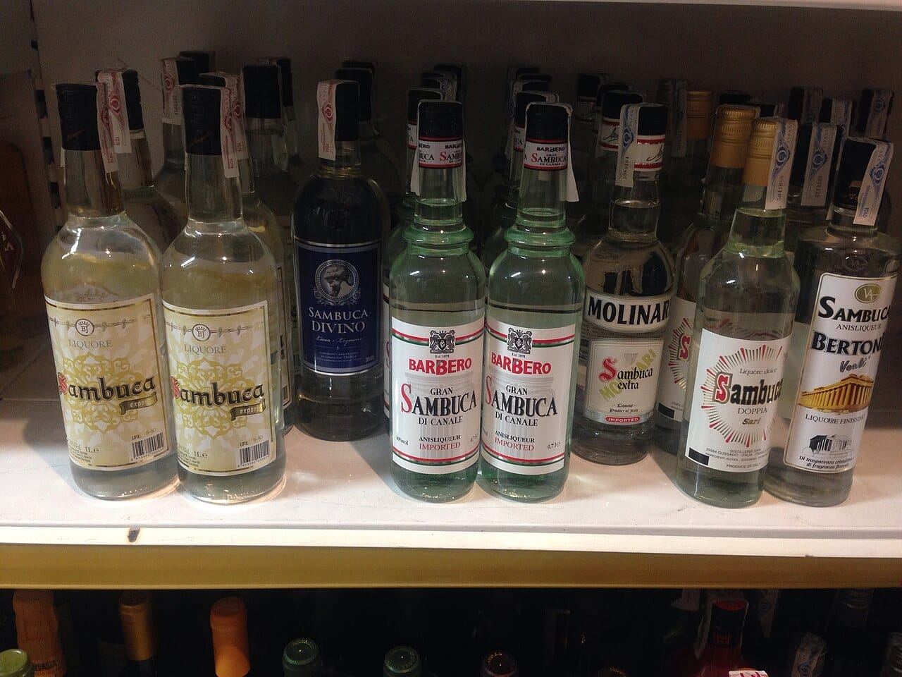
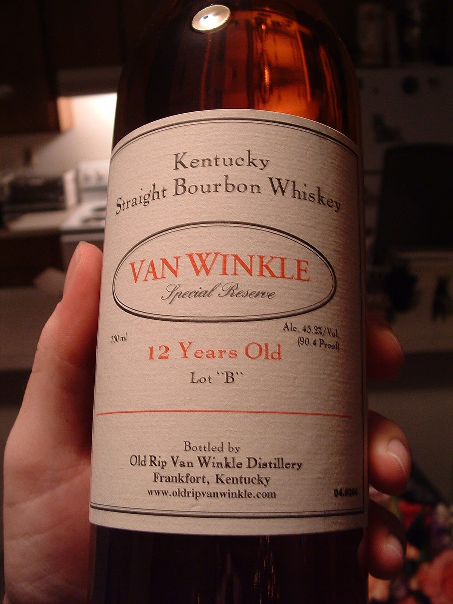

# 桑布卡

桑布卡是意大利茴香风味甜利口酒，以八角茴香为主香，配合糖与中性烈酒，法定最低酒精度 38%；经典款透明清亮，传统喝法配咖啡豆或加水变浑浊，餐后饮用居多。

图：Sambuca：Bottles of sambuca（Wikimedia Commons）。图片：No Swan So Fine，CC BY-SA 4.0，via Wikimedia Commons（[原图页面](https://commons.wikimedia.org/wiki/File:Bottles_of_sambuca.jpg)）。

## 定义与边界

桑布卡在欧盟烈酒法规中属于利口酒(ref:liqueur)类别，是以茴香为主香的无色利口酒：原料中含有茴香（Pimpinella anisum L.）、八角茴香（Illicium verum L.）或其他芳香草本的蒸馏物。法规对成分有明确下限：以转化糖计的甜味物含量不低于 350 克/升，天然茴香脑含量在 1 到 2 克/升之间，最低酒精度为 38%；按法规定义，桑布卡本身不得调色。

市场上除经典透明款（white sambuca）外，还能见到深蓝近黑的 nero 款与红色款，这些属于商品化的配色变体，与严格法规定义下的无色桑布卡不是一回事。接骨木花、甘草等配料可以加入，但不是法定要求；读标签时，主香是否为茴香、糖度与酒精度是否达到法定门槛，比颜色更能判断产品归属。它产自意大利(ref:italy)，品牌与配方多集中在中部与北部的利口酒传统产区。

## 历史与命名

名称一般追溯到拉丁语 sambucus，即接骨木；另有说法认为它来自阿拉伯语 zammut，指一种茴香饮品，这两种都属于词源推测。1850 年前后，Luigi Manzi 在奇维塔韦基亚（Civitavecchia）创制了一种以接骨木为原料的利口酒，并用 sambuca 命名；那款早期产品与今天以茴香为主的桑布卡并不完全相同。

现代桑布卡的商业起点在 1945 年：调香师与调配专家 Angelo Molinari 在奇维塔韦基亚开始实验，以八角茴香为基础做出 Sambuca Extra，配方至今保密。20 世纪 50 年代，罗马咖啡馆开始把这种利口酒与三颗烘焙咖啡豆一同上桌，成为后来最有辨识度的喝法。1974 年，公司在科尔费利切（弗罗西诺内）建成第二座工厂 Molinari Sud，自动化生产线日产能达到 60,000 瓶；1975 年 Angelo Molinari 去世后，由其子辈延续经营。

## 原料与工艺

基酒通常是谷物或葡萄来源的中性烈酒，茴香与芳香草本通过浸渍(ref:maceration)或蒸馏(ref:distillation)取得精油，再加入中性酒精、浓缩糖液与其他风味物调配。八角茴香提供主导的甜茴香气息，绿茴香（欧洲茴香）较少使用；接骨木花、甘草等草本只作辅助层次。糖液带来明显的糖浆质感与甜度，酒精则把芳香成分稳定地溶解在溶液中。

工艺上先处理芳香原料：蒸馏或浸泡提取精油与风味物质，再与酒精、糖浆混合，经过滤、稳定后装瓶。桑布卡不经过橡木陈化，货架上的产品以新酒状态为主；调配比例决定茴香脑浓度、甜度与酒精平衡。茴香脑在高酒精度下溶于酒精，加水稀释到约 30% ABV 以下时会形成乳白浑浊，也就是通常说的乌佐效应（louche），这是茴香类烈酒的共同物理现象。

## 风格与味觉

经典桑布卡入口甜润黏稠，茴香与甘草、花香交织，余味带清凉草本感，酒精感被高糖包裹但并不淡薄。香气以八角茴香甜香为主，辅以草本与轻微花香；酒液透明，反光清亮。不同品牌在糖度、茴香强度与辅助草本上有差别，有的更甜厚，有的茴香更冲。

法定最低酒精度 38%，市场常见装瓶在 38–42% 之间：Luxardo Sambuca dei Cesari 为 38%，Ramazzotti 为 38%，Molinari Sambuca Extra 约 42%。酒精度(ref:proof)与糖度共同决定口感：高糖让甜感突出，酒精提供温热骨架；陈化不是这类利口酒的环节，新调配酒的香气直接反映原料与配方。

## 代表产区与品牌

进入国际市场最常见的品牌是 Molinari Sambuca Extra，1945 年创立于奇维塔韦基亚，以八角茴香配方和三颗咖啡豆的喝法推广闻名；公司家族经营至今，第二代与第三代接手后继续向意大利以外市场扩张。Luxardo 的 Sambuca dei Cesari 使用星茴、草本香料与自家火山泉水，沿用家族配方生产，酒精度 38%。

其他常见品牌还包括 Ramazzotti Sambuca（38%，隶属保乐力加）与美国市场流通的 Romana Sambuca。这些品牌不是法定分级，只是市场参照；配料表上标注的茴香种类、糖度与酒精度，比品牌名次更能说明一瓶酒的风格。桑布卡的生产以意大利利口酒厂为主，也有其他国家仿制茴香甜利口酒，但名称使用受法规与商标约定约束。

## 怎么喝与配餐

最经典的喝法是 con la mosca（“带苍蝇”）：杯中放三颗烘焙咖啡豆，纯饮桑布卡；咖啡豆在饮用时提供轻微焦香与口感对比。另一种常见方式是加冰，或兑少量清水，让酒液变浑浊、释放茴香香气；也有上桌时点燃表面酒精的饮用方式，多用于社交场合。餐后利口酒是它最传统的场景，也可以加入咖啡中调味。

配餐上，甜茴香利口酒通常不佐正餐，而与甜点、干果、坚果搭配，或作为餐后消化酒单独饮用。咖啡、巧克力、杏仁饼干与茴香蜜饯能呼应它的甜香；搭配清淡芝士或咸味冷盘并不常见，甜感与酒精会压住食物味道。酒吧中它也用于调制茴香风味鸡尾酒，但高糖高香决定了用量需要克制。

## 选购、储存与误区

读标签先确认主香与参数：茴香蒸馏物、糖度、茴香脑含量与酒精度是法规关心的项目；只标注“茴香利口酒”而不标产地与配方的产品，风格可比性有限。名称上要分清意大利传统桑布卡与其他国家的茴香利口酒，后者不一定符合欧盟对 sambuca 的定义。

储存上，利口酒高糖高酒精度，性质稳定，避光、避高温即可长期存放；开瓶后糖与酒精仍能抑菌，但香气会随氧化缓慢变淡，建议在一两年内喝完。常见误区有三类：一是把深色或红色版本当成传统桑布卡的标准色，实际上法定经典款为无色；二是以为桑布卡需要橡木陈化，它以新调配酒上市；三是把三颗咖啡豆当成必须的配料，它只是一种传统饮用装饰。

## 延伸阅读与另见

认识桑布卡可以先从一款 38% 左右的经典透明款纯饮入门，再比较加水浑浊与咖啡豆两种喝法，最后试一款糖度或茴香强度不同的品牌；对照之后，配方、甜度与饮用方式的差别会比较清楚。

- 相关条目：[liqueur](ref:liqueur)、[italy](ref:italy)、[distillation](ref:distillation)、[proof-and-abv](ref:proof)、[maceration](ref:maceration)。

对照阅读：[利口酒](ref:liqueur)、[蒸馏](ref:distillation)。

## 相关图像

图：Old Rip Van Winkle 波本酒瓶与标签；标签是酒精度/Proof 标示的实际载体，不是比重计或测量仪器。图片：Joe Hall from Oakland, USA，CC BY 2.0，via Wikimedia Commons（[原图页面](https://commons.wikimedia.org/wiki/File:Old_Rip_Van_Winkle_Whiskey_301243232.jpg)）。关联图像：桑布卡。
