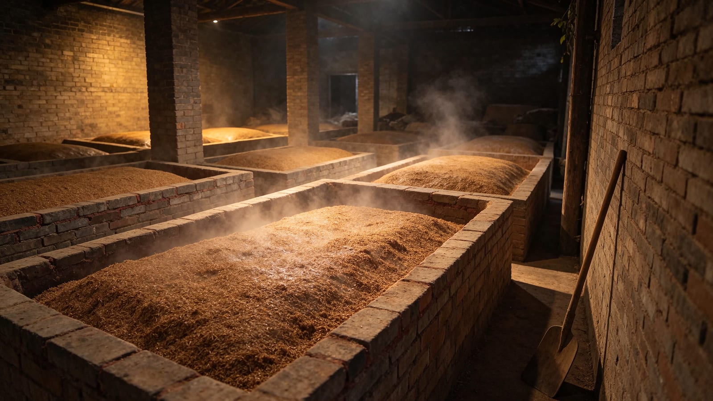

# 酱香型白酒

酱香型白酒是[白酒](ref:baijiu)的一个香型类别，以高温制曲、高温堆积、石窖泥底、多轮次发酵与长期贮存为主要工艺特征。它的香气描述通常集中在“酱香突出、幽雅细腻、酒体醇厚、回味悠长”，但香型名称本身不是质量等级。

图：酱香型白酒。图片：Xiaomage de，CC BY-SA 4.0，via Wikimedia Commons（[原图页面](https://commons.wikimedia.org/wiki/File:Vertreter_der_vier_Baijiu_Kategorien.jpg)）。

## 定义与标准

酱香型是按香气与工艺特征划分的风格类别。现行产品标准是 GB/T 10781.4-2024《白酒质量要求 第4部分：酱香型白酒》，2024-05-28 发布，2025-06-01 实施，全部代替 GB/T 26760-2011《酱香型白酒》。

GB/T 26760-2011 于 2011 年发布、2011-12-01 实施，曾长期作为酱香型产品的检验依据。今天讨论在 2025-06-01 之后生产的产品，应优先引用新版；讨论旧标签与历史产品时，才适合引用旧版并注明其时间背景。

在术语层面，GB/T 15109-2021《白酒工业术语》提供“下沙”“轮次”“堆积”等概念的定义，GB/T 17204-2021《饮料酒术语和分类》提供饮料酒层级的分类框架。产品标准负责质量要求，术语标准负责概念边界，两者不能互相替代。

## 工艺特征

酱香型白酒的工艺常被概括为“高温制曲、高温堆积、多轮次发酵、长期贮存、勾调成型”。高温制曲带来耐热菌群与丰富的酶系；高温堆积在入窖前完成扩培与升温；石窖泥底提供密闭的窖内发酵环境；多轮次取酒让不同轮次的酒体形成层次；长期贮存与勾调则负责稳定与统一。

这套工艺对季节与节奏依赖明显。行业常说“端午制曲、重阳下沙”，描述的是传统生产围绕气温与原料供应形成的节律。不同企业、不同产区会按自身条件调整，节律不是法定要求。

## 两次投料与轮次

酱香型白酒传统上分两次投料。第一次投料称为“下沙”，第二次称为“糙沙”。此后进入多轮次的蒸煮、发酵与取酒。

行业常用“12987”概括传统工艺：一年一个生产周期、两次投料、九次蒸煮、八次发酵、七次取酒。这是对传统流程的通俗总结，不是法定等级，也不是所有产品的统一参数。GB/T 10781.4-2024 的描述是：一个制酒生产周期不少于六个轮次堆积发酵，传统为八个轮次窖内发酵，窖内发酵时间不少于 30 天。

轮次之间的酒体差异明显。前几轮酒通常酸感与生涩感更突出，中段轮次的酒体更饱满，后段轮次可能带更重的焦香与苦感。生产企业通过分轮次贮存与[勾调](ref:blending)来平衡这些差异。

## 制曲与堆积

酱香型使用高温大曲。GB/T 10781.4-2024 对制曲的描述是最高品温大于 60 °C。高温条件让耐热细菌参与发酵，也为酱香与焦香类气味提供基础。[制曲](ref:qu-making)是这条工艺路线的第一道关口，曲的质量不稳定，后续环节很难完全补救。

[堆积发酵](ref:stacked-fermentation)是酱香工艺中最具识别性的开放环节。拌曲后的酒醅在入窖前堆放，顶温最高可达 50 °C 或以上。堆积承担扩大培养、升温与物质转化的任务，结束后才入窖。

## 窖池与窖内发酵

酱香型的窖池宜为石窖泥底。石壁提供结构强度与清洁便利，窖底的泥层承载微生物并参与风味形成。入窖后要密闭，形成厌氧环境，让酵母完成酒精发酵，让酯化等反应继续进行。

[窖池](ref:fermentation-pit)的状态与维护会直接影响结果。与浓香型强调泥窖和窖泥不同，酱香型的工艺重点更多落在石窖结构、窖底泥层、轮次节奏与堆积控制上。说“酱香也重视老窖”并不算错，但不能把浓香的窖池逻辑直接套过来。

## 风味结构

酱香型白酒的感官描述通常包括酱香突出、幽雅细腻、酒体醇厚、回味悠长与空杯留香。主体香气成分复杂，学界与行业尚未把某一种化合物认定为唯一“酱香”来源，这也是它与己酸乙酯主导的浓香型在解释方式上的差异。

酒精度方面，53% vol 是酱香型最常见的规格之一，也有 43% vol、38% vol 等低度产品。酒精度影响香气集中度与入口刺激，但不构成质量等级。比较产品时，应结合执行标准、原料、轮次结构、贮存时间与价格带一起看。

## 产区与代表产品

酱香型白酒最集中的产区是赤水河流域，包括贵州的茅台镇、习水、金沙一带（见[贵州省](ref:guizhou)），以及四川古蔺等地。[茅台酒](ref:moutai)与[郎酒](ref:langjiu)是这一风格的代表性产品页。

产区叙事常强调河谷气候、水质与微生物环境，但这些因素要通过具体企业、原料与工艺来验证。酱香型并非只产自贵州，山东、湖南等地也有酱香型或兼香型产品；把产区名称直接等同于品质，是常见的简化。

## 标签与常见误区

第一，把香型当成质量等级。酱香型只是类别，质量还要看执行标准、等级标注与感官表现。
第二，把“坤沙”“碎沙”“翻沙”“窜香”当成法定等级。这些是行业对原料处理与工艺路线的俗称，标准文本并不以此划分产品等级。
第三，只认 53% vol。53% vol 常见，但不是唯一规格，低度产品同样有工艺要求。
第四，把“年份”当成标准等级。年份表达在不同企业与产品中含义不一，应看标签与生产者说明。
第五，把酱香型等同于贵州产区。产区是重要线索，但不是唯一解释。

## 延伸阅读

- [白酒](ref:baijiu)：酒种层面的定义与分类框架。
- [浓香型白酒](ref:strong-aroma)：与酱香型对照阅读的另一香型。
- [制曲](ref:qu-making)：高温大曲的微生物与酶系基础。
- [堆积发酵](ref:stacked-fermentation)：酱香工艺中最具识别性的开放环节。
- [窖池](ref:fermentation-pit)：石窖泥底与窖内发酵的容器背景。
- [蒸馏](ref:distillation)：多轮次取酒的技术背景。
- [勾调](ref:blending)：轮次酒组合与风味统一的关键工序。
- [高粱](ref:sorghum)：酱香型白酒的主要原料。
- [贵州省](ref:guizhou)：赤水河流域酱香型白酒的核心产区。
- [茅台酒](ref:moutai)：酱香型的代表性产品页。
- [郎酒](ref:langjiu)：四川赤水河沿岸的酱香型产品页。
- [GB/T 26760-2011《酱香型白酒》](ref:gbt-26760-2011)：已被 GB/T 10781.4-2024 全部代替的旧版标准。

**关键事实。**

| 项目 | 内容 |
| --- | --- |
| 一句话定位 | 以高温制曲、高温堆积、石窖泥底和多轮次发酵为特征的酱香型白酒，是白酒风格分类中的一类；香型名称不构成质量等级 |
| 上位风格 | 白酒 |
| 香气家族 | 酱香 |

## 相关图像

图：堆积发酵的编辑插图：砖砌发酵房中的粮堆与蒸汽；AI 辅助绘制，不是车间实拍。。图片：Hejiu 编辑团队，使用豆包 Seedream 5.5 AI 辅助生成；项目自制，不是现场照片（[项目说明](https://hejiu.org/about/)）。关联图像：酱香型白酒。
