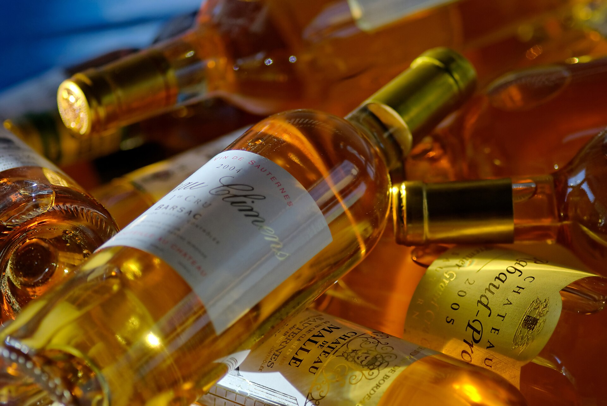
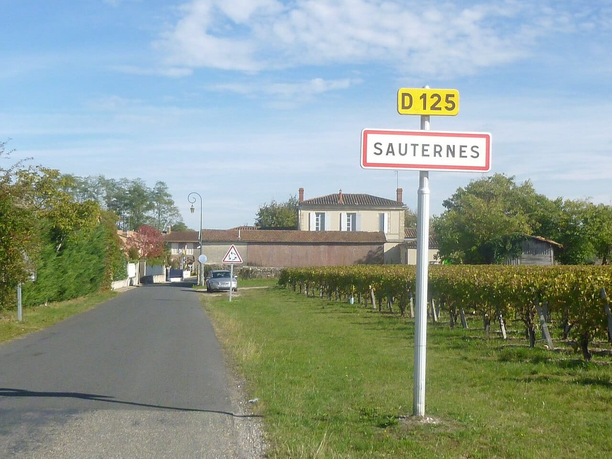

# 苏玳

苏玳（Sauternes）是法国[波尔多](ref:bordeaux)南部[苏玳产区](ref:sauternes)的[贵腐甜白](ref:noble-rot)，也是世界上最容易被记住名字的甜酒之一。它的核心不是某个品牌，而是一条小河、一种真菌与一套分级制度共同作用的结果。Ciron 河在秋季带来的晨雾让贵腐菌在葡萄园中生长，Sémillon 提供酒体与蜂蜜质地，Sauvignon Blanc 提供酸度与柑橘香，橡木桶与新酒年份决定它最终是清爽还是浓郁。

图：苏玳相关实景照片。图片：Pascal MOULIN，CC BY-SA 4.0，via Wikimedia Commons（[原图页面](https://commons.wikimedia.org/wiki/File:Sauternes_2.jpg)）。

## 雾是这里的第一原料

苏玳位于加龙河左岸，Ciron 河从南向北汇入加龙河。秋季，Ciron 的冷水与加龙河的暖水相遇，清晨形成浓雾，午后阳光驱散雾气，葡萄园在潮湿与干燥之间反复。这种交替正是贵腐菌（Botrytis cinerea）生长的理想条件：雾气让真菌侵入果皮，干燥的午后抑制有害霉菌，果实在藤上缓慢失水，糖、酸与香气被浓缩。

没有雾，苏玳只能酿出普通甜白；雾太多或雨水太多，贵腐菌会转成灰腐，整串葡萄报废。这也是苏玳年份差异极大的原因。

## 三个品种，两种角色

[赛美蓉](ref:semillon)是主体，通常占一半以上。它皮薄、易感染贵腐菌，酿出的酒酒体饱满，带蜂蜜、杏与蜡质感。[长相思](ref:sauvignon-blanc)提供酸度、柑橘与青草香气，让酒不至于厚重；Muscadelle 用量较少，贡献花香与葡萄香。混酿比例因酒庄与年份而异，有的酒庄几乎全用 Sémillon，有的则提高 Sauvignon 的比例以保持清新。

三者的分工可以这样理解：Sémillon 是身体，Sauvignon 是骨架，Muscadelle 是香气点缀。理解这一点，就能理解为什么苏玳既可以是浓郁的蜜饯，也可以是轻盈的柑橘与矿石感。

## 1855 年：一张榜单的寿命

1855 年巴黎世界博览会期间，波尔多商会按当时的价格与声誉对酒庄进行分级。苏玳与巴萨克共有 26 家酒庄入选，分为超一级、一级与二级。这份名单原本是为博览会临时编制，却在之后的一个多世纪里成为市场与收藏的参照。它没有随价格、所有权与质量变化而全面重排，因此今天看到的等级更多是历史坐标，而不是绝对质量排名。

对苏玳来说，1855 年分级还有一个特殊之处：它是唯一一份把甜白与干红分开排列的波尔多分级。理解这一点，就能明白为什么苏玳的名声与波尔多左岸的红酒体系紧密相连，却又独立成章。

## d'Yquem 为什么是例外

在 1855 年的苏玳分级中，[滴金酒庄](ref:dyquem)（Château d'Yquem）被列为唯一的超一级（Premier Cru Supérieur），高于其他所有苏玳与巴萨克酒庄。这不是因为它的产量大，恰恰相反，它的筛选极严：葡萄要逐粒挑选，达不到标准的年份甚至不出正牌酒。酒庄的历史可以追溯到数百年前，长期的所有权更迭与酿造哲学让它成为苏玳的象征。

d'Yquem 的风格通常比同产区更浓郁、更耐久，年轻时就有蜂蜜、杏、香草与烤坚果，陈年后转向焦糖、橙皮与香料。它的价格与稀缺性使它成为收藏品，但也容易让人误以为苏玳只有这一种表达。事实上，苏玳的多样性远大于一个酒庄。

## 采收是一场分次进行的手术

苏玳的采收不是一次完成，而是分多次进行。工人逐行检查葡萄，只采下已经感染贵腐菌、达到理想状态的果粒，其他果实留到下一轮。一个葡萄园可能采三到六次，甚至更多。每次采收的果粒含糖量与香气都不同，压榨后分别发酵，最后再决定如何调配。

这种做法的成本极高：人工、时间、产量都受限。苏玳 AOC 允许的最高产量本来就不高，遇到天气不好的年份，产量还会进一步下降。这也是苏玳价格高于普通波尔多白葡萄酒的原因之一。

## 年轻与年老：两种酒

年轻的苏玳呈浅金色，香气以柑橘、白花、蜂蜜与杏为主，口感甜而不腻，酸度清晰。随着陈年，颜色转向琥珀与铜色，香气出现烤坚果、焦糖、橙皮酱、姜与香料，口感更厚，酸度成为支撑。

并非所有苏玳都适合长期陈年。入门级酒款通常在五到十年内饮用最佳，而顶级酒庄的年份酒可以陈放数十年。判断陈年潜力，可以看酸度、残糖与酒体是否平衡，而不是只看酒庄名字。

## 侍酒、配餐与价格

苏玳适合 8–10°C，年份较老的酒可以到 12°C。小号郁金香杯或白葡萄酒杯即可，不必过度冰镇，否则香气会被压住。配餐上，鹅肝是最经典的选择，蓝纹奶酪、烤鸡、龙虾与带杏子的甜点也很合适。它也可以搭配微辣的亚洲菜，甜味能缓和辣度。

价格跨度很大。普通苏玳可能只需几十欧元，顶级年份的 d'Yquem 则可能达到数百甚至上千欧元。购买时应先确定用途：日常饮用可以选择风格清新、价格合理的酒款；收藏则要关注年份、酒庄与储存条件。

## 购买时看什么

第一，看产区名。标着 Sauternes 或 Barsac 的酒才属于这一体系，标着 "Bordeaux Supérieur" 的甜白则不是。第二，看年份。苏玳的年份差异很大，潮湿的秋季可能让贵腐菌过度发展。第三，看酒庄与分级。1855 年分级可以作为参考，但不是唯一标准。第四，看容量。苏玳常以半瓶装出售，因为甜酒每次饮用量不大。第五，看储存。甜酒怕热、怕光，购买时要确认来源与保存条件。

对照阅读：[赛美蓉](ref:semillon)、[贵腐（noble rot）](ref:noble-rot)。

**关键事实。**

| 项目 | 内容 |
| --- | --- |
| 一句话定位 | 法国波尔多南部的贵腐甜白，以 Sémillon 为主、Sauvignon Blanc 与 Muscadelle 为辅；Ciron 河的秋雾催生贵腐菌，1855 年分级与 d'Yquem 的独尊地位塑造了它的名声 |
| 上位风格 | 甜酒 |
| 香气家族 | 蜂蜜/杏/柑橘皮 |

**来源与边界。** 本页关于「苏玳」的关键事实，主要由以下来源交叉核对：Conseil Interprofessionnel du Vin de Bordeaux（波尔多产区、品种与甜白的基本框架）、INAO（法国原产地命名制度与苏玳 AOC 的管理框架）、Conseil des Grands Crus Classés en 1855（苏玳与巴萨克的风土、AOC 数据与 1855 年分级）等 4 条来源。价格、批次与状态会变，涉及这些字段时以页面所列来源的最新版本为准。正文为项目自写，来源只作核验，不复制原文。

**并读。** 把「苏玳」与「赛美蓉」、「长相思」、「贵腐（noble rot）」放在一起读时，先确认它们是同一层级还是上下游关系：先确认定义与工艺，再比较原料、产区与代表品牌。本页负责给出酒类风格的基本坐标，对照条目补上具体案例与差异；读完再回到本页，才能分清哪些差别属于酒类风格本身，哪些只是产地、批次或品牌选择。

## 相关图像

图：File:Vineyard in Sauternes.jpg。摄影：davitydave，CC BY 2.0，来自 Wikimedia Commons。。图片：davitydave，CC BY 2.0，via Wikimedia Commons（[原图页面](https://commons.wikimedia.org/w/index.php?curid=25673556)）。关联图像：苏玳。
