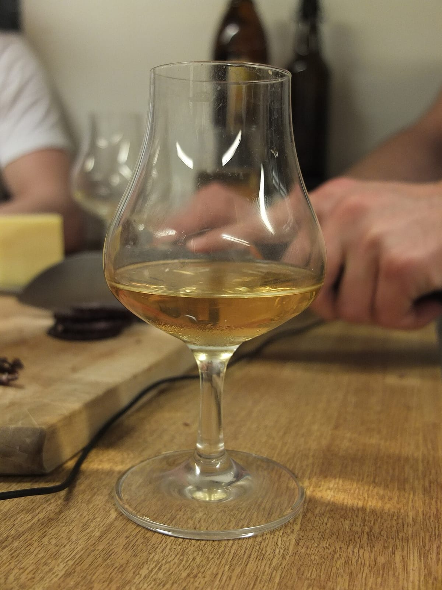

# 苏格兰威士忌

苏格兰威士忌是少数把“在哪里、用什么、怎么做、陈多久、装多烈”全部写进法律的烈酒。它的身份不靠营销形容词，而靠一串可核查的门槛：苏格兰境内生产、水与发芽大麦、橡木桶至少三年、装瓶不低于 40% vol、蒸馏酒精度低于 94.8% vol。理解这些门槛，才能理解它为什么既是一个产区概念，也是一个工艺标准。

图：苏格兰威士忌。图片：Sansvase，CC BY-SA 3.0，via Wikimedia Commons（[原图页面](https://commons.wikimedia.org/wiki/File:Bowmore_whisky_12_years.JPG)）。

## 法定定义的五道门槛

第一，产地。糖化、发酵、蒸馏与陈年都必须在苏格兰完成。第二，原料。以水与发芽大麦为基础，允许加入其他谷物的整粒。第三，蒸馏。蒸馏得到的酒液酒精度必须低于 94.8% vol，以保留原料带来的香气与风味。第四，陈年。必须在苏格兰的保税仓或经批准的仓库中，用容量不超过 700 升的橡木桶陈年至少三年。第五，装瓶。酒精度不得低于 40% vol，除水与焦糖色外不得添加其他物质。

这套规则把“苏格兰威士忌”与“在苏格兰装瓶的威士忌”区分开来。后者可能在其他地方蒸馏、陈年，只是最后在苏格兰装瓶，不能使用这个名称。产地、工艺与陈年地点是捆绑的。

## 五个类别怎么分

单一麦芽苏格兰威士忌来自同一家蒸馏厂，原料只有水与发芽大麦，使用壶式蒸馏器。单一谷物苏格兰威士忌同样来自一家蒸馏厂，但原料包含发芽大麦与其他谷物，通常使用连续式蒸馏器。调和麦芽由多家蒸馏厂的单一麦芽调配；调和谷物由多家蒸馏厂的单一谷物调配；调和苏格兰威士忌则把麦芽威士忌与谷物威士忌混合。

这五类是法律类别，不是质量顺序。调和苏格兰威士忌占据市场多数，靠的是稳定与平衡；单一麦芽强调酒厂个性；单一谷物常作为调和骨架，也能单独装瓶，展现谷物与蒸馏器的特征。把“单一麦芽”当成最高等级，是把类别误读成排名。

## 产区：地理名称与风格想象

法规保护五个产区名称：斯佩塞、高地、低地、艾雷岛与坎贝尔镇。斯佩塞集中了大量蒸馏厂，常被描述为花果香、柔和酒体；艾雷岛以泥煤烟熏、海风与碘感著称；高地跨度极大，从清爽到厚重都有；低地偏清淡、草本；坎贝尔镇兼具果香与轻微烟熏。

产区名称描述的是传统与风格倾向，不是每瓶酒的质量保证。同一产区内，蒸馏器形状、泥煤使用、酵母、桶型与陈年条件差异明显。把“艾雷岛”当成“重泥煤”的同义词，会忽略岛上也有轻泥煤甚至无泥煤的产品；把“斯佩塞”当成“甜美”的同义词，也会漏掉风格跨度。

## 从发芽到蒸馏

原料是[大麦](ref:barley)与[水](ref:water)。大麦先浸水发芽，产生分解淀粉的酶；部分酒厂在干燥阶段用泥煤烟熏麦芽，把酚类物质带入麦芽。糖化后得到含糖麦汁，加入酵母[发酵](ref:fermentation)，再进入[蒸馏](ref:distillation)。

壶式蒸馏器通常蒸馏两次，少数酒厂蒸馏三次。蒸馏器的形状影响回流：高颈、长莱恩臂增加回流，酒体更轻；矮颈、短莱恩臂减少回流，酒体更厚。切酒决定酒头、酒心与酒尾的比例，酒心是装瓶主体。连续式蒸馏器效率高、酒精度高，适合谷物威士忌，风味更中性。

## 橡木桶与时间

陈年必须使用橡木桶，参见[橡木桶陈年](ref:oak-ageing)。桶的容量上限为 700 升，常见的是波本桶与雪莉桶。波本桶带来香草、椰子与奶油感；雪莉桶带来干果、巧克力与香料。桶的先前内容、烘烤程度与使用次数都会改变风味。

“年份”标注的是瓶中所有威士忌中陈年时间最短的那一款，不是平均年龄。一瓶标 12 年的调和威士忌，可以含有更老的酒，但不得含有不足 12 年的酒。陈年时间受桶型、仓储位置与气候影响，时间长不等于质量高；原酒结构不足，长时间陈年只会让木味压过酒体。

## 调和的艺术

调和不是“把剩下的酒混在一起”。调和师要从不同酒厂、不同年份、不同桶型的原酒中取样，按香气、酒体、甜度与烟熏感搭配，目标是让每一批产品的风格稳定。麦芽威士忌提供个性与骨架，谷物威士忌提供柔和与体积，比例决定成品走向。

单一麦芽也会做桶内调配：同一酒厂不同桶、不同年份的原酒在装瓶前混合，以求平衡。单桶装瓶则强调某一桶的独特性，批次差异更大。这些选择属于产品策略，不改变法定类别。

## 关键参数

- 陈年：橡木桶至少三年，且必须在苏格兰境内完成。
- 桶容量：不超过 700 升。
- 装瓶酒精度：不低于 40% vol。
- 蒸馏酒精度：低于 94.8% vol。
- 类别：单一麦芽、单一谷物、调和麦芽、调和谷物、调和苏格兰威士忌。
- 产区名称：斯佩塞、高地、低地、艾雷岛、坎贝尔镇。

这些数字来自法规与行业协会公开说明，属于合规边界。酒精度、年份与产区都不能单独代表质量；它们只是阅读一瓶酒的坐标。

## 品鉴与饮用

用郁金香形杯，先闻静止香气，判断花果、麦芽、泥煤与桶味的比例，再加少量水，观察香气是否展开。入口注意酒体、甜度、烟熏感与酒精整合度，咽下后看回味长度与收口。加水会改变表面张力与香气释放，也会稀释酒体，少量多次比一次加满更容易控制。

纯饮适合判断风格；加冰适合高酒精度产品，但低温会压住香气；苏打水与 Highball 适合清爽饮用。本页关于苏格兰威士忌的内容涉及酒精饮料；过量饮酒有害健康，未成年人不应饮酒。

## 常见误解

第一，把苏格兰威士忌等同于单一麦芽。调和威士忌占市场多数，也是法定类别。第二，认为年份越长越好。陈年受桶型、仓储与气候影响，原酒结构同样关键。第三，认为泥煤味越重越好。泥煤是风格，不是等级。第四，把产区当成质量保证。产区描述风格倾向，不保证每瓶水平。第五，认为所有苏格兰威士忌都产自高地。苏格兰有五个受保护的产区名称。第六，把“单一谷物”当成“劣质谷物”。它是独立类别，可以展现谷物与连续蒸馏的干净风格。

## 延伸阅读

- [威士忌](ref:whisky)：威士忌的总体分类与工艺。
- [橡木桶陈年](ref:oak-ageing)：桶型与陈年对风味的影响。
- [蒸馏](ref:distillation)：壶式蒸馏与切酒的作用。
- [大麦](ref:barley)与[水](ref:water)：苏格兰威士忌的基础原料。
- [酒精度](ref:abv)：理解标签标注的基础概念。

## 相关图像

图：水注入玻璃杯。酿造用水还需检测硬度、碱度、矿物离子与微生物指标。图片：Jorge Barrios，Public domain，via Wikimedia Commons（[原图页面](https://commons.wikimedia.org/wiki/File:Glass_of_Water.JPG)）。关联图像：苏格兰威士忌。
