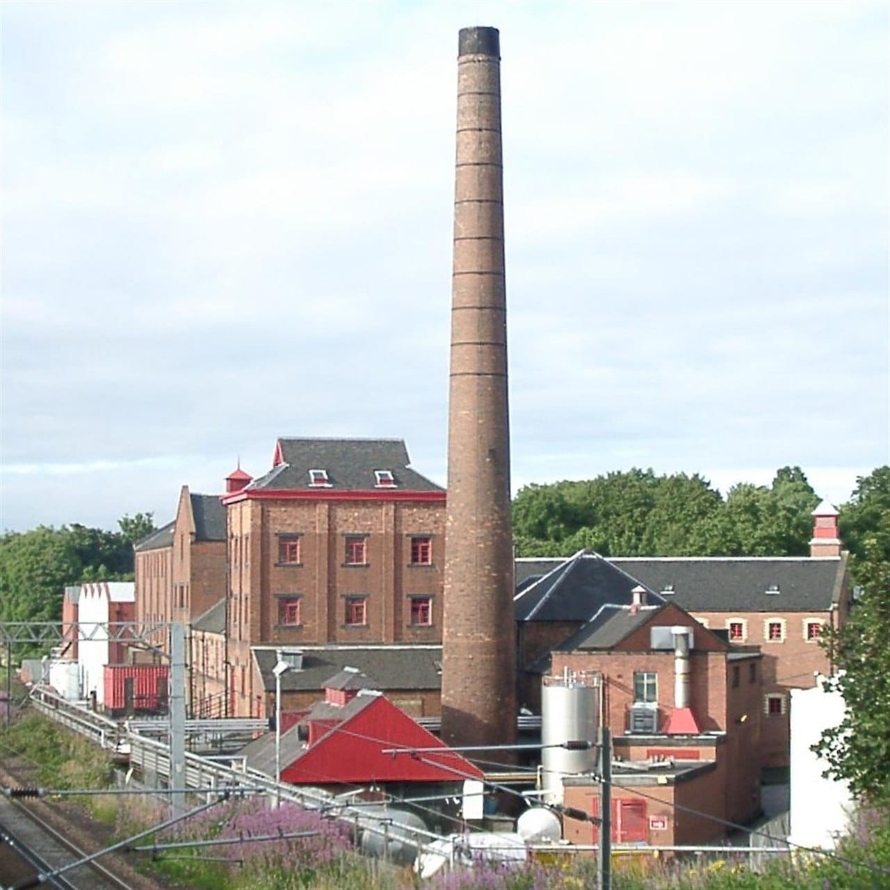

# 苏格兰艾尔

苏格兰艾尔是苏格兰传统顶层发酵啤酒的统称，麦芽主导、酒花苦度偏低，带焦糖、烤面包、太妃糖与干果气息；强度从轻度的 60/- 到厚重的 Wee Heavy 形成完整梯度，与英国艾尔(ref:english-ale)同属不列颠群岛艾尔谱系。

图：Scottish Ale：Caledonian Brewery（Wikimedia Commons）。图片：Wikimedia Commons contributor，CC BY-SA 3.0，via Wikimedia Commons（[原图页面](https://commons.wikimedia.org/wiki/File:Caledonian_Brewery.jpg)）。

## 定义与边界

苏格兰艾尔是一组以麦芽为骨架的苏格兰啤酒(ref:beer)，传统上按强度分成几档：60/- Scottish Light 接近深色淡艾尔，70/- Scottish Heavy 对应普通苦啤，80/- Scottish Export 对应优质或强苦啤，最强的一档是 Wee Heavy（Strong Scotch Ale）。它们不是法定产区名称，也没有统一的酿造规程；“/-”后面的数字今天只表示同一酒厂内酒液的轻重档位，数字越大通常酒体越重、酒精度越高。

与英式苦啤相比，苏格兰艾尔发酵衰减度更低、收尾甜度更高、酒花用量更少，颜色普遍偏深。苏格兰(ref:scotland)本地水质偏软，大麦(ref:barley)麦芽提供主要风味；酒花并非苏格兰本土作物，历史上进口成本高，因此传统配方把酒花控制在只用来平衡甜感的水平。需要区分的是：苏格兰艾尔是顶层发酵的艾尔，与后来普及的底层发酵拉格不属于同一工艺体系。苏格兰各地酒厂按本地水质、麦芽习惯与传统酒花调整配方，因此同名档位在不同酒厂之间仍有可感知的深浅差异。

## 历史与命名

“先令”（/-）标签最初指啤酒以 hogshead 桶装出售时的价格，价格随年代波动，如今苏格兰已不再使用先令货币，但这个称呼保留为啤酒档位的简写。同名啤酒在一战前就作为淡熟啤酒存在，但今天见到的 Light、Heavy、Export 各档，现代形态都是在二战以后才定型的。

从酿造谱系看，Wee Heavy 源自 Edinburgh Ale，一款麦芽浓厚的强啤酒，类似 Burton Ale 但酒花投放约为一半。历史上酒花在苏格兰昂贵而稀缺，酿酒师依赖焦糖化麦芽、烘烤糖与高麦芽浓度建立风味，发酵温度也比英格兰同类啤酒略低。60/-、70/-、80/- 三档常通过分段取汁工艺（parti-gyling，同一麦汁按比重分段熬煮）生产，比重越高的段落酒体越厚、风味越浓。

## 原料与工艺

传统原料以糊精性强的淡色艾尔麦芽为主，辅以玉米、深色酿造糖与酿造焦糖色调色；二战后的现代配方常加入少量深色麦芽、较低比例的结晶麦芽，以及琥珀麦芽与小麦。糖化传统上用单式糖化，配合下醪与多次洗糟；酵母为干净的艾尔酵母，水质偏软。酒花多用英国品种，用量克制，苦味只起到压住甜腻的作用。

发酵温度略低于英格兰艾尔，发酵衰减度不高，残糖与糊精保留较多，这是酒体圆润、入口甜润的工艺来源。传统配方不使用泥炭(ref:peat)烟熏麦芽；酿造文献明确指出，泥炭麦芽不仅不正宗，还会带来不洁的酚类异味。所谓烟熏或泥土气息，更多来自酵母表现、本地水质与烘烤麦芽，而不是泥炭烘烤。现代少数烟熏版本属于专门的烟熏啤酒类别，不应算作传统苏格兰艾尔。

## 风格与味觉

典型香气以中等麦芽甜感开场，焦糖、太妃糖、烤面包屑、手指饼干与黄油糖气息为主，带少量仁果类果香和淡淡的英式酒花泥土、花香或柑橘辛香。入口是烤面包麦芽味，收尾带轻微烘烤干感，平衡残甜；酯类与酒花风味都较轻，发酵轮廓干净。酒体从中轻到中等，碳酸化低到中等，口感可以偏奶油感。

各档参数大致如下：60/- Light 酒精度 2.5–3.3%，IBU 10–20，色度 SRM 17–25；70/- Heavy 酒精度 3.3–3.9%，IBU 10–20，SRM 12–20；80/- Export 酒精度 3.9–6%，IBU 15–30，SRM 12–20；Wee Heavy 酒精度 6.5–10%，IBU 17–35，SRM 14–25，初始比重 OG 1.070–1.130。强款麦芽集中度高，像冷夜中的慢饮啤酒，碳酸化偏低以突出酒体重量；轻款则更接近日常佐餐的木桶鲜啤。

## 代表产区与品牌

苏格兰本土酒厂构成主要参照：Light 档有 Belhaven Best、McEwan's 60；Heavy 档有 McEwan's 70、Orkney Raven Ale；Export 档有 Belhaven Scottish Ale、Broughton Wee Jock 80 Shilling、Caledonian Edinburgh Castle、McEwan's 80/-、Orkney Dark Island、Traquair Bear Ale。这些名字是市场与比赛中的参照，不是官方分级。

Wee Heavy 一档的代表包括 Belhaven Wee Heavy、Broughton Old Jock、Gordon Highland Scotch Ale、Inveralmond Blackfriar、McEwan's Scotch Ale、Orkney Skull Splitter 与 Traquair House Ale。北美也有按苏格兰艾尔风格酿造的产品，部分美式版本强度比传统苏格兰款更高；比较时先看档位与酒精度，再谈品牌风格，避免把美式强艾尔当成苏格兰传统基准。

## 怎么喝与配餐

饮用温度按强度调整：轻档与 Heavy 接近英式苦啤，在冰镇但不冰透的温度（约 10–12 摄氏度）饮用，突出麦芽甜与清爽度；Export 与 Wee Heavy 稍凉即可，让焦糖与干果香气展开。杯型用普通品脱杯或中等肚径艾尔杯即可；木桶鲜啤优先在酒场直饮，瓶装年轻款不必久醒。

配餐围绕麦芽甜与烘烤骨架：烤羊肉、炖肉、香肠、烟熏肉制品与燕麦饼能承接焦糖与面包麦芽味；切达、烟熏奶酪等硬质奶酪搭配 Wee Heavy 也很常见。清淡海鲜或酸度很高的沙拉不太对路，麦芽甜会压住食材；辛辣菜式会放大酒花与酒精感，选酒花更柔的轻档更稳妥。

## 选购、储存与误区

读标签先确认档位与强度：60/-、70/-、80/- 与 Wee Heavy 的酒精度、酒体差别很大，同一名厂不同档位不能互换比较。再看原料表：传统款以麦芽、糖与少量酒花为主，额外烟熏、水果或香料配料属于现代变体。产地标注苏格兰还是北美仿制，也会影响配方强度与酒花平衡。

啤酒不是可以无限陈年的酒：苏格兰艾尔以年轻鲜饮为主，高残糖与碳酸化的瓶装款应避光、避高温存放，开瓶后尽快喝完；Wee Heavy 一类强款在合适条件下可以放更久，但并非越陈越好。常见误区有三类：一是认为苏格兰艾尔必带泥炭烟熏，传统配方并不使用泥炭麦芽；二是把所有深色甜啤都称作 Scotch Ale，强度与工艺档位需要分开；三是用美式强款的浓甜标准衡量传统轻档苏格兰艾尔。

## 延伸阅读与另见

认识苏格兰艾尔，可以先从一款 70/- 或 80/- 的标准强度入手理解麦芽骨架，再比较 Light 与 Wee Heavy 两端；三档对照之后，比重、残糖与酒花用量带来的差别会比较清楚。

- 相关条目：[english-ale](ref:english-ale)、[beer](ref:beer)、[barley](ref:barley)、[peat](ref:peat)、[scotland](ref:scotland)。

对照阅读：[英式艾尔](ref:english-ale)、[大麦](ref:barley)。

**关键事实。**

| 项目 | 内容 |
| --- | --- |
| 一句话定位 | 苏格兰传统艾尔，麦芽甜、酒体饱满、酒花苦度低，带焦糖、烤面包与干果；从轻度的 60/- 到厚重的 Wee Heavy 都有 |
| 上位风格 | 英式艾尔 |

## 相关图像

图：泥煤（peat）。图片：David Stanley from Nanaimo, Canada，CC BY 2.0，via Wikimedia Commons（[原图页面](https://commons.wikimedia.org/wiki/File:Peat_(49302157252).jpg)）。关联图像：苏格兰艾尔。
